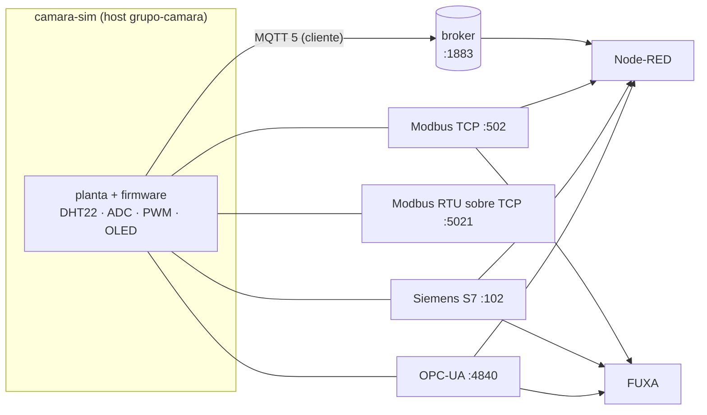

O **camara-sim** simula uma câmara climática com ESP32: DHT22, OLED, potenciômetro (ADC),
aquecedor e ventilador por PWM. Ele é **isolado**: não traz broker, Node-RED nem MQTT Explorer.
Ele **se conecta** ao que já existe — o LAB IoT, o kit do grupo (`gen_iot_scada_portal.py`) ou
qualquer broker MQTT.

A mesma planta é exposta, ao mesmo tempo, por cinco interfaces. Um comando enviado por qualquer
uma delas (o setpoint, por exemplo) aparece em todas as outras.



| Interface                                                 | Porta       | Biblioteca Python |
| --------------------------------------------------------- | ----------- | ----------------- |
| MQTT 5 (cliente, como o ESP32 real)                       | broker:1883 | `paho-mqtt`       |
| Modbus TCP                                                | 502         | `pymodbus`        |
| Modbus RTU sobre TCP (quadro RTU + CRC, sem porta serial) | 5021        | `pymodbus`        |
| Siemens S7 (ISO-on-TCP)                                   | 102         | `python-snap7`    |
| OPC-UA                                                    | 4840        | `asyncua`         |

:::note[Versões]
O `requirements.txt` do simulador fixa as versões das bibliotecas de propósito: a API do
`pymodbus` muda bastante entre versões. Instale sempre por ele.
:::

## Compatibilidade com o LAB IoT {/* #lab-iot */}

| Convenção do LAB IoT (`gen_iot_scada_portal.py`)                        | No simulador                                                                |
| ----------------------------------------------------------------------- | --------------------------------------------------------------------------- |
| Tópicos do grupo `<grupo>/...` (a ponte do kit só repassa `<grupo>/#`)  | `<grupo>/camara/telemetria`, `/cmd`, `/cmd/<campo>`, `/status`, `/oled`      |
| Serviços na rede `labnet`, nomes `<grupo>-nodered`, `<grupo>-fuxa`      | host **`<grupo>-camara`** (ex.: `lab05-a-camara`)                            |
| Broker `mosquitto:1883`, anônimo                                        | `MQTT_HOST=mosquitto` ao entrar na rede do lab ou do kit                    |
| Node-RED em `/<grupo>/` (`httpNodeRoot`)                                | dashboard em `/<grupo>/dashboard/camara`                                    |
| Volume `/data` do grupo                                                 | SQLite em `/data/camara.sqlite`                                             |
| ntfy: `NTFY_URL`, `NTFY_TOPIC`, `NTFY_TOKEN` no Node-RED                | os alarmes da câmara viram notificação no celular                           |
| Nós do Dockerfile do lab (modbus, s7, opcua, sqlite, dashboard 2)       | os fluxos usam só esses (nada de serial nem `ui-led`)                        |

O endereço OPC-UA se adapta ao cliente: o servidor devolve o mesmo host que o cliente usou
(`localhost`, o IP do PC ou `lab05-a-camara`). UaExpert, Node-RED e FUXA conectam sem
configurar nada.

:::tip[Tópicos da disciplina]
Nos laboratórios, o tópico base segue o padrão da disciplina, e não `<grupo>/camara`. Ajuste
`MQTT_BASE` no `.env` (ou `--mqtt-base` no Python), por exemplo
`MQTT_BASE=elt85b/lab08/grupo-a/camara`.
:::

## 1. Rodar {/* #rodar */}

Escolha **uma** das três formas. Os comandos são para o **Prompt de Comando (cmd)** do VS Code,
dentro da pasta `camara-sim`.

<Tabs groupId="camara-rodar">
<TabItem value="python" label="A) Python" default>

```shell title="Terminal (cmd), na pasta camara-sim"
py -m pip install -r requirements.txt
py camara_sim.py --grupo lab05-a
```

Sem outras opções, o simulador usa o broker em `localhost:1883` (o kit no próprio PC). Outras
situações:

| Situação                              | Comando                                                        |
| ------------------------------------- | -------------------------------------------------------------- |
| Broker do laboratório                 | `py camara_sim.py --grupo lab05-a --mqtt-host 192.168.0.10`    |
| Sem MQTT (só Modbus, S7 e OPC-UA)     | `py camara_sim.py --grupo lab05-a --sem-mqtt`                  |
| Dinâmica 5× mais rápida               | `py camara_sim.py --grupo lab05-a --speed 5`                   |
| Todas as opções                       | `py camara_sim.py --help`                                      |

:::info[Linux e macOS]
As portas 102 e 502 exigem administrador. Use outras, por exemplo
`--s7-port 1102 --modbus-tcp-port 5020`.
:::

</TabItem>
<TabItem value="docker" label="B) Docker, sozinho">

```shell title="Terminal (cmd), na pasta camara-sim"
copy .env.example .env
docker compose up -d --build
docker compose logs -f
```

Antes do `up`, ajuste no `.env` o `GRUPO` e, se precisar, as portas (`PORTA_S7=1102`, por
exemplo). Se o kit do grupo estiver rodando no mesmo PC, o simulador publica no mosquitto dele
(`host.docker.internal:1883`). **Ctrl+C** sai do `logs -f` sem parar a câmara.

</TabItem>
<TabItem value="rede" label="C) Docker, na rede do kit ou do lab">

Assim o Node-RED e o FUXA do grupo enxergam `lab05-a-camara` (Modbus, S7 e OPC-UA) pelo nome.

```shell title="Terminal (cmd), na pasta camara-sim"
docker network ls
docker compose -f docker-compose.yml -f docker-compose.lab.yml up -d --build
```

No `docker network ls`, procure `<pasta-do-kit>_labnet` (ex.: `lab05-a_labnet`) e ponha esse
nome em `LAB_REDE` no `.env` **antes** do `up`.

</TabItem>
</Tabs>

### Uma câmara por grupo no servidor do laboratório (professor) {/* #professor */}

```shell title="Terminal, na pasta camara-sim"
py gerar_compose_lab.py --lab lab05 --grupos 10
docker compose -f docker-compose.camaras.yml up -d --build
```

Use os mesmos `--lab` e `--grupos` do portal. Isso cria `lab05-a-camara` … `lab05-j-camara` na
rede `lab05_labnet`, sem abrir portas no servidor.

### Testar {/* #testar */}

```shell title="Terminal (cmd), na pasta camara-sim"
py testar_clientes.py --grupo lab05-a
```

O teste escreve o setpoint por um protocolo e confere a leitura por todos os outros.

## 2. Node-RED do grupo {/* #node-red */}

```shell title="Terminal (cmd), na pasta camara-sim"
py gerar_flows.py --grupo lab05-a
```

O comando gera `flows/camara-lab05-a.json`. No Node-RED do grupo: **Menu ☰ → Import** →
selecione o arquivo → **Import** → **Deploy**. O arquivo cria quatro abas:

| Aba                             | O que faz                                                                                          |
| ------------------------------- | -------------------------------------------------------------------------------------------------- |
| Câmara - Dashboard              | `/<grupo>/dashboard/camara`: medidores, gráficos, LEDs, réplica do OLED, comandos e simulação       |
| Câmara - Banco SQLite           | `/data/camara.sqlite`, uma amostra a cada 10 s, consultas prontas e histórico no dashboard           |
| Câmara - Controle Node-RED      | controlador externo (ON/OFF + ventilador P) e **alarmes → ntfy** do grupo                           |
| Câmara - Modbus / S7 / OPC-UA   | lê a câmara por cada protocolo e republica em `<grupo>/camara/via/<protocolo>`                      |

:::warning[Já existe um Dashboard 2.0 no Node-RED do grupo?]
O Dashboard 2.0 aceita um só `ui-base`. Ao importar, aponte a página "Câmara Climática" para o
`ui-base` que já existe e apague o importado.
:::

## 3. FUXA do grupo {/* #fuxa */}

No FUXA 1.3.x, os drivers Modbus, OPC-UA e S7 são **plugins**: instale-os em **Editor >
Configurações > Plugins** (`modbus-serial`, `node-opcua`, `node-snap7`). Eles ficam em
`server/_pkg`, que precisa de um volume para sobreviver à recriação do contêiner. O guia foi
testado com o FUXA 1.3.4.

| Conexão no FUXA | Configuração |
| --------------- | ------------ |
| MQTT client     | `mqtt://mosquitto:1883`. Tag do tipo **json**: tópico `lab05-a/camara/telemetria`, chave `temp` (ou outra) |
| Modbus TCP      | endereço `lab05-a-camara:502`, slave 1. Os endereços do FUXA são **base 1**: IR0 = Input Register `1`, HR3 = Holding `4`. Temperatura ×10: `Int16` com divisor 10; em float: `Float32` no endereço `13` |
| Siemens S7      | **IP** do contêiner (o snap7 não resolve nomes: `docker exec <fuxa> getent hosts lab05-a-camara`), rack 0, slot 1. Sintaxe Step 7: `DB1.DBD20` (REAL), `DB1.DBW2` (INT), `DB1.DBX0.0` (BOOL), `DB1.DBD48` (DINT) |
| OPC-UA          | `opc.tcp://lab05-a-camara:4840/`, segurança None, anônimo. Endereço da tag = NodeId (`ns=2;s=Camara.temp`), tipo igual ao do nó (`Double`, `Int32`, `Boolean`) |

## 4. A câmara {/* #camara */}

### Objetivos de projeto atendidos

| Objetivo                        | Implementação                                                                              |
| ------------------------------- | ------------------------------------------------------------------------------------------ |
| Medir temperatura e umidade     | DHT22: leitura a cada 2 s, ruído de ±0,1 °C e ±0,5 %UR, 1 % de erros de leitura             |
| Setpoint configurável           | `setpoint` remoto (20–55 °C) ou pelo potenciômetro (`fonte_sp = 1`)                        |
| Aquecedor e ventilador por PWM  | 0–100 % e duty LEDC de 8 bits (0–255)                                                      |
| Tela OLED                       | 6 linhas × 21 caracteres (SSD1306 128×64)                                                  |
| Potenciômetro                   | ADC de 12 bits (0–4095)                                                                    |
| Estratégia de controle          | MANUAL (controle externo), ON/OFF com histerese e PI com anti-windup                       |
| Estado da planta                | DESLIGADO, AQUECENDO, RESFRIANDO, ESTÁVEL e ALARME; LEDs verde, amarelo e vermelho          |

### Pinagem sugerida para a câmara real

| Componente                      | ESP32                                   |
| ------------------------------- | --------------------------------------- |
| DHT22                           | GPIO4 (pull-up de 10 kΩ)                |
| Potenciômetro de 10 kΩ          | GPIO34 (ADC1_CH6)                       |
| Aquecedor (~25 W)               | GPIO25 → MOSFET, LEDC de 8 bits         |
| Ventilador de 12 V              | GPIO26 → MOSFET, LEDC de 8 bits, 25 kHz |
| OLED SSD1306                    | SDA GPIO21 / SCL GPIO22 (0x3C)          |
| LEDs verde, amarelo e vermelho  | GPIO16, GPIO17 e GPIO5                  |

### Modelo e firmware

- **Térmico:** dois estados (resistência e câmara) e perdas para o ambiente (25 °C). O
  ventilador aumenta a troca de calor.
- **Umidade:** umidade absoluta mais uma carga úmida interna. A UR sai pela fórmula de Magnus,
  por isso **aquecer derruba a UR**.
- **Tempo:** em tempo real, a câmara vai de 25 °C a 35 °C em cerca de 1,5 min. `SIM_SPEED=5`
  (ou `10`) acelera.
- **Modos:**
  - `0` MANUAL: usa `aquecedor_cmd` e `ventilador_cmd`;
  - `1` ON/OFF: histerese de ±0,5 °C; o ventilador vai a 100 % se T > SP + 2;
  - `2` PI: Kp = 15 e Ki = 0,15, com anti-windup.
- **Proteções:** com T ≥ 60 °C ou falha do DHT22, o estado vai para ALARME: aquecedor a 0 % e
  ventilador a 100 %. O alarme é liberado com T < 55 °C e o sensor OK.

| `estado` | Nome       | Condição (e = SP − T) |
| -------- | ---------- | --------------------- |
| 0        | DESLIGADO  | `habilitado = 0`      |
| 1        | AQUECENDO  | e > 1                 |
| 2        | RESFRIANDO | e < −1                |
| 3        | ESTAVEL    | \|e\| ≤ 1             |
| 4        | ALARME     | proteção ativa        |

Bits de `alarme`: **1** = sobretemperatura, **2** = sensor.

## 5. Mapa de variáveis {/* #mapa */}

<Tabs groupId="camara-protocolo">
<TabItem value="mqtt" label="MQTT" default>

Base: `<grupo>/camara` (ou o `MQTT_BASE`).

| Tópico          | Sentido | Conteúdo                                         |
| --------------- | ------- | ------------------------------------------------ |
| `…/status`      | ESP32 → | `online`/`offline` (retido, _Last Will_)         |
| `…/telemetria`  | ESP32 → | JSON a cada 2 s                                  |
| `…/oled`        | ESP32 → | texto da tela                                    |
| `…/cmd`         | → ESP32 | JSON parcial, ex.: `{"setpoint": 40, "modo": 2}` |
| `…/cmd/<campo>` | → ESP32 | valor simples                                    |

Campos de comando: `habilitado`, `modo`, `fonte_sp`, `setpoint`, `aquecedor_cmd`,
`ventilador_cmd`, `pot_raw` (simulação) e `falha_dht` (simulação). Valores fora da faixa são
saturados.

</TabItem>
<TabItem value="modbus" label="Modbus">

TCP e RTU sobre TCP: unit 1, endereços **base 0**.

| Tabela          | End.         | Variável                                                       |
| --------------- | ------------ | -------------------------------------------------------------- |
| Coil            | 0 / 1        | habilitado / falha_dht                                         |
| Discrete input  | 0–4          | led_verde, led_amarelo, led_vermelho, dht_ok, alarme ativo     |
| Holding         | 0 / 1 / 2    | habilitado / modo / fonte_sp                                   |
| Holding         | 3            | setpoint × 10 (350 = 35,0 °C)                                  |
| Holding         | 4 / 5        | aquecedor_cmd / ventilador_cmd (%)                             |
| Holding         | 6 / 7        | pot_raw / falha_dht (simulação)                                |
| Input           | 0 / 1 / 2    | temp × 10 / umid × 10 / sp_efetivo × 10                        |
| Input           | 3 / 4 / 5    | aquecedor_pwm / ventilador_pwm / pot_raw                       |
| Input           | 6 / 7 / 8    | estado / alarme / leds (bit0 verde, bit1 amarelo, bit2 vermelho) |
| Input           | 9 / 10 / 11  | dht_erros / heartbeat / uptime                                 |
| Input           | 12–13 / 14–15| temp / umid em float32 ABCD                                    |
| Input           | 16 / 17      | aquecedor_duty / ventilador_duty (0–255)                       |

:::tip[Node-RED]
No `node-red-contrib-modbus`, o RTU sobre TCP usa o tipo **TELNET**. O tipo "RTU-BUFFERED"
envia, na verdade, Modbus TCP.
:::

</TabItem>
<TabItem value="s7" label="S7">

DB1 (sem acesso otimizado), rack 0, slot 1.

| Endereço                     | nodes7                          | Variável                                                    |
| ---------------------------- | ------------------------------- | ----------------------------------------------------------- |
| DBX0.0 / 0.1 / 0.2           | `DB1,X0.0` …                    | habilitado / fonte_sp / falha_dht (graváveis)               |
| DBW2                         | `DB1,INT2`                      | modo (gravável)                                             |
| DBD4 / 8 / 12                | `DB1,REAL4` …                   | setpoint / aquecedor_cmd / ventilador_cmd (graváveis)       |
| DBW16                        | `DB1,INT16`                     | pot_raw de simulação (gravável)                             |
| DBD20 / 24 / 28 / 32 / 36    | `DB1,REAL20` …                  | temp / umid / sp_efetivo / aquecedor_pwm / ventilador_pwm   |
| DBW40 / 42                   | `DB1,INT40` / `INT42`           | estado / alarme                                             |
| DBX44.0–44.3                 | `DB1,X44.0` …                   | led_verde, led_amarelo, led_vermelho, dht_ok                |
| DBW46, DBD48, DBD52          | `DB1,INT46`, `DINT48`, `DINT52` | pot_raw (ADC), heartbeat, uptime                            |

Imagem de processo: `IW0` = potenciômetro; `Q0.0–Q0.2` = LEDs; `QB2`/`QB3` = duty do aquecedor
e do ventilador.

</TabItem>
<TabItem value="opcua" label="OPC-UA">

NodeId `ns=2;s=Camara.<variável>`, URI do namespace `urn:utfpr:camara-climatica`.

```text title="Espaço de endereços"
Objects/Camara/
  Medicoes/   temp, umid, sp_efetivo (Double) · pot_raw (Int32)
  Atuadores/  aquecedor_pwm, ventilador_pwm (Double) · aquecedor_duty, ventilador_duty (Int32)
  Estado/     estado, alarme, dht_erros, heartbeat, uptime (Int32) · estado_txt, oled (String)
              led_verde, led_amarelo, led_vermelho, dht_ok (Boolean)
  Comandos/   habilitado (Boolean) · modo, fonte_sp (Int32) · setpoint, aquecedor_cmd,
              ventilador_cmd (Double)                                         [graváveis]
  Simulacao/  pot_raw_sim (Int32) · falha_dht (Boolean)                       [graváveis]
```

As pastas organizam a navegação; o NodeId não leva a pasta: `ns=2;s=Camara.temp`,
`ns=2;s=Camara.setpoint`.

</TabItem>
</Tabs>

## 6. Atividades sugeridas {/* #atividades */}

1. Comparar ON/OFF, PI e o controlador do Node-RED pela consulta "Erro médio |SP − T| por modo"
   no SQLite.
2. Escrever o próprio controlador na aba _Controle Node-RED_ (P, PI, PID, fuzzy).
3. Observar o acoplamento térmico e de umidade: ventilar e aquecer, e ver o que acontece com a
   UR.
4. Provocar o alarme (MANUAL, aquecedor a 100 %, ventilador a 0 %) e receber o aviso no celular
   pelo ntfy.
5. Ler a mesma variável por MQTT, Modbus, S7 e OPC-UA e comparar formatos (int × 10, float32,
   REAL) e latência.
6. Parar o simulador (`docker compose stop`) e ver o _Last Will_ `offline` no dashboard.

## Arquivos {/* #arquivos */}

<FileTree
  root="camara-sim"
  files={[
    "camara_model.py r",
    "camara_sim.py r",
    "proto_mqtt.py r",
    "proto_modbus.py r",
    "proto_s7.py r",
    "proto_opcua.py r",
    "testar_clientes.py r",
    "gerar_flows.py r",
    "gerar_compose_lab.py r",
    "docker-compose.yml r",
    "docker-compose.lab.yml r",
    ".env.example r",
    "wokwi/camara_esp32/camara_esp32.ino r",
  ]}
/>

| Arquivo                                                              | Função                                                                 |
| -------------------------------------------------------------------- | ---------------------------------------------------------------------- |
| `camara_model.py`                                                    | planta, DHT22, ADC, PWM, controle, estados e OLED                      |
| `camara_sim.py`                                                      | programa principal (opções por argumento ou variável de ambiente)      |
| `proto_mqtt.py`, `proto_modbus.py`, `proto_s7.py`, `proto_opcua.py`  | um adaptador por protocolo                                             |
| `testar_clientes.py`                                                 | teste de ponta a ponta em todos os protocolos                          |
| `gerar_flows.py`                                                     | fluxos do Node-RED para um grupo                                       |
| `gerar_compose_lab.py`                                               | uma câmara por grupo no servidor do laboratório                        |
| `docker-compose.yml`, `docker-compose.lab.yml`, `.env.example`       | Docker sozinho / na rede do lab ou do kit                              |
| `wokwi/camara_esp32/`                                                | **firmware ESP32 + circuito Wokwi** com o mesmo contrato MQTT e a planta virtual (veja o README da pasta) |
