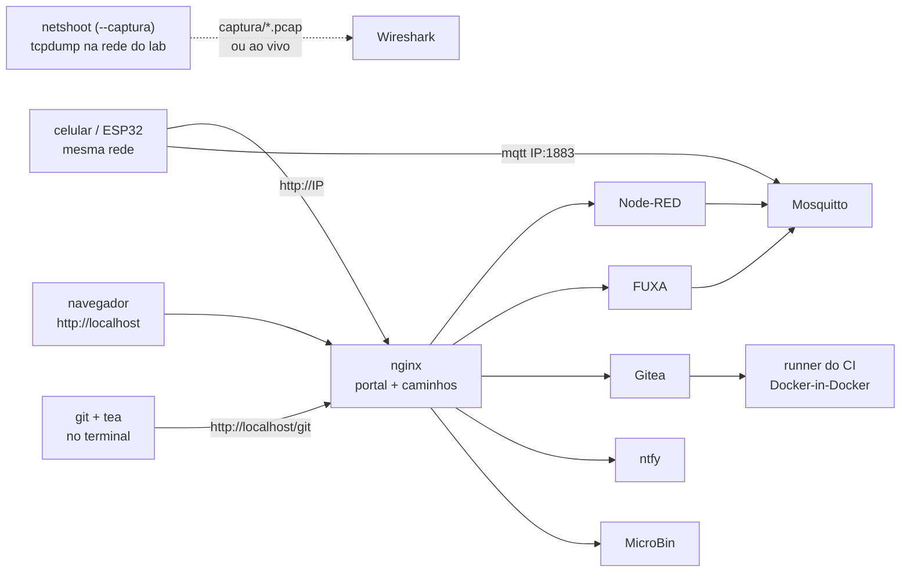

O **`gen_iot_aluno.py`** monta no seu computador o mesmo LAB IoT do laboratório: Node-RED,
FUXA (SCADA/HMI), broker MQTT, Gitea com CI (Gitea Actions), notificações (ntfy), MicroBin
e MQTT Explorer. Os **caminhos e nomes são os mesmos** do laboratório (`/lab05-a/`,
`/fuxa/lab05-a/`, `mosquitto:1883`, tópicos `lab05-a/...`): um fluxo ou uma tela feitos em
casa funcionam no laboratório sem mudança, e vice-versa.

Tudo roda em containers Docker e fica **só na sua máquina e na sua rede local** (Wi-Fi). Nada
fica exposto na internet. Com `--captura`, um container extra (netshoot) grava os pacotes que
passam entre os serviços para você analisar no **Wireshark** ([seção 10](#captura)).



## 1. Instalar (uma vez) {/* #instalar */}

<Tabs groupId="so">
<TabItem value="win" label="Windows 11" default>

No **PowerShell**:

```powershell
winget install --id Docker.DockerDesktop -e
winget install --id Python.Python.3.12 -e
winget install --id Git.Git -e
winget install --id Gitea.tea -e
winget install --id WiresharkFoundation.Wireshark -e   # opcional: só para a captura de pacotes
```

O Wireshark aqui só **lê** os pacotes que o netshoot captura. Se o instalador oferecer o
**Npcap**, ele é dispensável para o LAB IoT (serve para capturar as placas de rede do próprio
Windows).

Depois:

1. Reinicie o computador e abra o **Docker Desktop**. Aceite o WSL 2 se ele pedir. Em
   _Settings → Resources_, deixe pelo menos **4 GB** de memória, ou **6 GB** se for usar o CI.
2. Instale a biblioteca que o gerador usa para as senhas:

   ```powershell
   py -m pip install bcrypt
   ```

3. Confira: `docker version`, `git --version` e `tea --version` respondem sem erro.

</TabItem>
<TabItem value="nix" label="Linux / macOS">

- Docker Engine com o plugin Compose (Linux) ou Docker Desktop (macOS).
- `python3 -m pip install bcrypt` (no Linux, pode ser preciso `--user` ou um venv).
- `git` do sistema; `tea` pelo `brew install tea` (macOS) ou pelo binário em
  [dl.gitea.com/tea](https://dl.gitea.com/tea/) (Linux).
- Opcional, para a captura de pacotes: Wireshark (`sudo apt install wireshark` ou
  `brew install --cask wireshark`).
- Troque `py` por `python3` nos comandos deste guia.

</TabItem>
</Tabs>

## 2. Gerar o LAB IoT {/* #gerar */}

Baixe o `gen_iot_aluno.py` (o professor indica onde) para uma pasta **sem espaços nem
acentos**, por exemplo `C:\iot`, e rode lá:

```powershell
cd C:\iot
py gen_iot_aluno.py --lab lab05 --grupo a
```

O gerador cria a pasta `lab05-a` com tudo: `docker-compose.yml`, configurações, senhas
(`credenciais.txt`) e um `LEIA-ME.md` com os **seus** endereços e senhas.

| Opção                                                                                              | Para quê                                                                                |
| -------------------------------------------------------------------------------------------------- | --------------------------------------------------------------------------------------- |
| `--lab lab05`                                                                                      | o lab da disciplina (prefixo de tudo, como no laboratório)                              |
| `--grupo a`                                                                                        | a letra do seu grupo: a conta vira `lab05-a`                                            |
| `--segredos CAMINHO`                                                                               | usa a **mesma senha** do grupo no laboratório (`.segredos.json` que o professor passar) |
| `--porta-http 8080`                                                                                | portal em `http://localhost:8080` (quando a porta 80 já está ocupada)                   |
| `--ip 192.168.0.20`                                                                                | IP da máquina na rede (padrão: descobre sozinho)                                        |
| `--wokwi-token TOKEN`                                                                              | o seu token do Wokwi CI, já cadastrado como secret do Gitea                             |
| `--ponte-mqtt IP-DO-LAB`                                                                           | liga o seu broker ao do laboratório, só nos tópicos do grupo                            |
| `--proteger-http`                                                                                  | exige login também nos dashboards do Node-RED e para ver o FUXA                         |
| `--captura`                                                                                        | grava os pacotes da rede do lab para o Wireshark ([seção 10](#captura))                 |
| `--captura-filtro "port 1883"`                                                                     | captura só o que passa no filtro (BPF do tcpdump); padrão: tudo                         |
| `--captura-minutos 10`, `--captura-arquivos 36`                                                    | um `.pcap` novo a cada N minutos; quantos guardar (os mais antigos são apagados)        |
| `--sem-gitea`, `--sem-runner`, `--sem-fuxa`, `--sem-ntfy`, `--sem-microbin`, `--sem-mqtt-explorer` | deixa o serviço de fora (máquina mais leve)                                             |
| `--gitea-db postgres`                                                                              | Gitea com PostgreSQL (padrão: SQLite, mais leve)                                        |
| `--novas-senhas`                                                                                   | sorteia senhas novas                                                                    |

:::tip[Rodar de novo é seguro]
Mudou uma opção? Rode o gerador outra vez **na mesma pasta** e depois
`docker compose up -d --build`. As senhas ficam em `.segredos.json` e são reaproveitadas, e os
seus dados (`data/`, `fuxa/` e os volumes do Docker) não são tocados.
:::

## 3. Subir {/* #subir */}

```powershell
cd C:\iot\lab05-a
docker compose up -d --build
docker compose ps
```

A primeira vez demora alguns minutos: o Docker monta a imagem do Node-RED e baixa as outras.
No `docker compose ps`, tudo fica `running`, exceto o `gitea-init`, que roda uma vez (cria a
sua conta, a organização e os secrets do CI) e sai. Depois disso, o Docker Desktop sobe tudo
sozinho quando o computador liga.

## 4. Endereços e login {/* #enderecos */}

Uma conta só, **`lab05-a`**, com **a mesma senha** em todos os serviços (está em
`credenciais.txt`). Há também a `lab05-a-view`, só leitura no Node-RED, para mostrar o fluxo
num projetor sem risco.

| Serviço       | Nesta máquina                        | No celular / outro PC da mesma rede |
| ------------- | ------------------------------------ | ----------------------------------- |
| Portal        | `http://localhost/`                  | `http://IP/`                        |
| Node-RED      | `http://localhost/lab05-a/`          | `http://IP/lab05-a/`                |
| Dashboard     | `http://localhost/lab05-a/dashboard` | `http://IP/lab05-a/dashboard`       |
| FUXA          | `http://localhost/fuxa/lab05-a/`     | `http://IP/fuxa/lab05-a/`           |
| Gitea         | `http://localhost/git/`              | `http://IP/git/`                    |
| Avisos (ntfy) | `http://localhost/avisos/`           | `http://IP/avisos/`                 |
| MicroBin      | `http://localhost/bin/`              | `http://IP/bin/`                    |
| MQTT Explorer | `http://localhost:3001/`             | `http://IP:3001/`                   |
| Broker MQTT   | `mosquitto:1883` (Node-RED, FUXA)    | `IP:1883` (ESP32)                   |

`IP` é o endereço da sua máquina na rede (o gerador mostra no fim; `ipconfig` também). Ele
muda quando você troca de rede (casa, laboratório). Para o celular e o ESP32 alcançarem a
máquina, o **firewall do Windows** precisa permitir as portas 80 e 1883: na primeira vez que
o Docker abrir as portas, marque **Redes privadas**.

## 5. Os serviços {/* #servicos */}

**Node-RED.** Já vem com Dashboard 2, SQLite, Modbus, S7 e OPC-UA. Nos nós `mqtt`, use o
servidor `mosquitto`, porta `1883`, e os tópicos `lab05-a/...`. As variáveis de ambiente
`NTFY_URL`, `NTFY_TOPIC`, `NTFY_TOKEN`, `MICROBIN_URL`, `MICROBIN_AUTH` e `MICROBIN_LINK` já
estão prontas (`env.get("NTFY_URL")`). Para um exemplo pronto, importe
`http://localhost/avisos/exemplo-node-red.json`: um aviso no ntfy e um relatório longo no
MicroBin com o link no aviso.

**FUXA.** Em _Conexões → +_, escolha _MQTT client_ com endereço `mqtt://mosquitto:1883` e tags
nos tópicos `lab05-a/...`. Ver as telas não pede login, mas editar pede. Os drivers (Modbus,
OPC-UA, S7) instalados pelo editor ficam salvos na pasta `fuxa/`.

**ESP32.** Broker `IP:1883` (o da sua máquina), sem usuário. No Wokwi do VS Code com
gateway, `host.wokwi.internal:1883` também chega ao broker do seu computador.

**ntfy.** No app do celular (Android/iOS): ⚙ → _Usuários_ → servidor `http://IP/ntfy` com o
seu login; depois **+**, para assinar `lab05-a` e `lab05-a-ci` (é lá que o CI avisa). No
navegador, use `/avisos/`.

**MicroBin.** Para colar código, logs e JSON com realce de sintaxe e trocar arquivos (até
50 MB). O login é o mesmo dos outros serviços.

**MQTT Explorer.** Já conectado ao broker, assinando `#`. O login é o mesmo dos outros
serviços.

## 6. Gitea pelo terminal com o tea {/* #tea */}

O **tea** é o cliente oficial do Gitea na linha de comando: cria repositórios, clona, abre
PRs, publica releases e acompanha o CI. Ele trabalha **junto** com o `git`: o `git` envia e
recebe código, e o tea fala com a API do Gitea.

### 6.1 Login (uma vez)

```powershell
tea login add --name lab --url http://localhost/git --user lab05-a --password SUA_SENHA --git-credentials
tea login default lab
tea whoami
```

- Com `--user` e `--password`, o tea **cria um token de acesso** no Gitea e guarda só o
  token, não a senha. O token aparece no Gitea, em _Configurações → Aplicações_, e pode ser
  revogado lá.
- `--git-credentials` registra o tea como **ajudante de credenciais** do `git` para esse
  endereço. Assim, o `git` não pede senha. Veja a [seção 8.3](#git-credenciais) se o
  Git Credential Manager ainda aparecer.
- Gerou com `--porta-http 8080`? Use `--url http://localhost:8080/git`.

### 6.2 Repositórios: criar, clonar, enviar

```powershell
tea repos create --owner lab05-grupo-a --name camara --private
tea clone lab05-grupo-a/camara
cd camara
# ... crie ou copie os arquivos ...
git add .
git commit -m "primeiro commit"
git push
```

A organização **`lab05-grupo-a`** já existe e você é o dono. Repositórios na organização
recebem os secrets do CI prontos (seção 7). `tea repos list` lista os seus repositórios.

**Repositório que já existe** (por exemplo, o do GitHub): crie-o **vazio** no Gitea e
acrescente o Gitea como segundo remoto:

```powershell
tea repos create --owner lab05-grupo-a --name camara --private
git remote add lab http://localhost/git/lab05-grupo-a/camara.git
git push lab main
```

Para um `git push` enviar aos dois de uma vez (GitHub e Gitea), dê ao `origin` duas URLs de
envio. A do GitHub entra de novo porque, ao receber a primeira URL de envio, o `git` deixa de
usar a normal:

```powershell
git remote set-url --add --push origin https://github.com/ORG/REPO.git
git remote set-url --add --push origin http://localhost/git/lab05-grupo-a/camara.git
git remote -v
```

### 6.3 PRs, issues e releases

Rode os comandos **dentro da pasta do repositório**: o tea descobre o repositório pelo remoto.
De outra pasta, acrescente `--repo lab05-grupo-a/camara`.

```powershell
git switch -c ajuste-pwm
git commit -am "ajusta o PWM"
git push -u origin ajuste-pwm             # ou: git push -u lab ajuste-pwm

tea pulls create --base main --head ajuste-pwm --title "Ajusta o PWM"
tea pulls                                   # PRs abertos
tea pulls checkout 3                        # traz o PR 3 para um ramo local
tea pulls merge 3 --style merge

tea issues create --title "LED não acende no modo auto"
tea issues

tea releases create --tag v1.0.0 --title "v1.0.0" --asset firmware.bin
tea open                                    # abre o repositório no navegador
```

## 7. CI na sua máquina (Gitea Actions) {/* #ci */}

O Gitea roda os workflows de `.gitea/workflows/`. Se essa pasta não existir, ele usa os de
`.github/workflows/`, no mesmo formato do GitHub Actions (`runs-on: ubuntu-latest`,
`uses: actions/checkout@v4`...). Quem executa é o **runner da sua máquina** (`lab05-a-runner`),
um container com Docker próprio: cada job ganha um container novo, que é apagado no fim.

| Já pronto na organização `lab05-grupo-a` | Valor                                               |
| ---------------------------------------- | --------------------------------------------------- |
| variable `NTFY_URL`                      | `http://localhost/ntfy`                             |
| secret `NTFY_TOPIC`                      | `lab05-a-ci`                                        |
| secret `NTFY_TOKEN`                      | token do CI no ntfy                                 |
| secret `WOKWI_CLI_TOKEN`                 | o seu token do Wokwi (se gerou com `--wokwi-token`) |

Dentro de um job, `http://localhost/` é o **seu** portal: o `actions/checkout` baixa o código
do seu Gitea e a notificação chega ao seu ntfy. O job também alcança `mosquitto:1883`, então
um teste de integração pode publicar no broker local.

```powershell
tea actions runs list                       # execuções do repositório
tea actions runs view 12 --jobs             # jobs de uma execução
tea actions runs logs 12                    # log (--job ID para um job só)
tea actions workflows list
tea actions workflows dispatch diagnostico.yml --ref main   # roda um workflow manual
tea actions secrets create MEU_TOKEN        # secret do repositório (pede o valor)
tea actions variables set MODO teste        # variable do repositório
```

:::note[O primeiro job demora]
O primeiro job baixa a imagem dos jobs (`runner-images:ubuntu-latest`, cerca de 1,5 GB) e,
num projeto PlatformIO, o toolchain do ESP32. Os seguintes usam o cache do runner e ficam bem
mais rápidos. Por padrão, o runner faz **1 job por vez**; em máquinas com bastante memória,
gere com `--runner-capacidade 2`.
:::

:::caution[Se o CI não alcançar o Gitea]
O CI usa um truque: o runner divide a rede do nginx, e por isso `localhost` dentro do job é o
seu portal. Se o `actions/checkout` falhar com erro de conexão, gere de novo com
`--ci-rede ip`: o Gitea passa a usar o IP da máquina, como no laboratório. Nesse modo, gere
de novo sempre que a máquina mudar de rede.
:::

## 8. Git no Windows {/* #git-windows */}

### 8.1 Configuração inicial (uma vez)

```powershell
git config --global user.name "Seu Nome"
git config --global user.email "seu.email@alunos.utfpr.edu.br"
git config --global init.defaultBranch main
git config --global core.longpaths true
```

- `user.name` e `user.email` assinam os seus commits. Use o mesmo e-mail do GitHub para os
  commits aparecerem no seu perfil.
- `init.defaultBranch main`: repositórios novos nascem com `main`, como no Gitea e no GitHub.
- `core.longpaths true`: evita erros com caminhos longos (comuns em projetos PlatformIO).

### 8.2 Quebras de linha: o `^M` que quebra o CI

O Windows termina as linhas com CRLF, e o Linux com LF. Um script `.sh` com CRLF falha no CI
(que roda em Linux) com erros como `bash\r: No such file or directory` ou
`$'\r': command not found`. Ponha um **`.gitattributes`** na raiz de **todo** repositório:

```text title=".gitattributes"
* text=auto
*.sh   text eol=lf
*.py   text eol=lf
*.yml  text eol=lf
*.yaml text eol=lf
*.bat  text eol=crlf
*.ps1  text eol=crlf
*.bin  binary
*.elf  binary
```

Com ele, o repositório guarda LF e cada sistema recebe o que precisa. Para normalizar um
repositório que já tem arquivos com CRLF:

```powershell
git add --renormalize .
git commit -m "normaliza quebras de linha"
```

O Windows também não guarda o bit de **execução**. Se o workflow chama `./ci/script.sh` (e
não `bash ci/script.sh`), marque o arquivo:
`git update-index --chmod=+x ci/script.sh`.

### 8.3 Credenciais e os avisos do Git Credential Manager {/* #git-credenciais */}

O Git for Windows usa o **Git Credential Manager** (GCM) para guardar senhas. Com o LAB IoT em
`http://localhost`, ele mostra este aviso:

```text
warning: use of unencrypted HTTP remote URLs is not recommended; see https://aka.ms/gcm/unsaferemotes
```

O aviso é esperado: o portal local não tem HTTPS, e a senha não sai da sua máquina. Há duas
saídas.

**(a) Recomendado: o tea responde pelo `localhost`.** O `--git-credentials` do `tea login add`
já registra o tea. Para o GCM nem ser consultado nesse endereço, deixe o tea como **único**
ajudante dele. A linha vazia zera a lista herdada da configuração do Git for Windows. Rode no
**cmd** ou no **Git Bash**: o Windows PowerShell 5.1 descarta o argumento vazio `""`.

```bat
git config --global --unset-all credential.http://localhost.helper
git config --global --add credential.http://localhost.helper ""
git config --global --add credential.http://localhost.helper "!tea login helper"
git config --global --get-regexp "^credential"
```

Com a porta 8080, use `credential.http://localhost:8080.helper`.

**(b) Continuar com o GCM e só calar o aviso:**

```powershell
git config --global credential.allowUnsafeRemotes true
```

Essa opção vale para **qualquer** remoto HTTP, então use-a só no seu computador.

**Senha errada guardada?** Abra o _Gerenciador de Credenciais_ do Windows → _Credenciais do
Windows_ e remova as entradas `git:http://localhost...`. Depois, refaça o `tea login add`
(ou o primeiro `git push`).

### 8.4 "TLS certificate verification has been disabled!"

Este aviso **não** é do LAB IoT, que nem usa HTTPS. Ele quer dizer que alguma configuração
desligou a verificação de certificados para **todos** os remotos HTTPS, inclusive o GitHub.
Isso é perigoso: qualquer um no meio do caminho pode se passar pelo servidor. Descubra de onde
vem:

```powershell
git config --show-origin --get-all http.sslverify
echo $env:GIT_SSL_NO_VERIFY
```

- Se aparecer `http.sslverify=false` no seu `.gitconfig`, rode
  `git config --global --unset http.sslverify`. Se estiver no arquivo do sistema, rode
  `git config --system --unset http.sslverify` num PowerShell **como administrador**.
- Se o `echo` mostrar `1`, apague a variável `GIT_SSL_NO_VERIFY` em _Configurações → Sistema
  → Sobre → Configurações avançadas → Variáveis de ambiente_.
- Se alguém desligou a verificação por causa do proxy da rede (que troca certificados), use os
  certificados do Windows no lugar:

  ```powershell
  git config --global http.sslBackend schannel
  ```

Confira com `git ls-remote https://github.com/git/git`: deve responder sem o aviso.

### 8.5 PowerShell, cmd e Git Bash

| Situação                 | Atenção                                                                                                  |
| ------------------------ | -------------------------------------------------------------------------------------------------------- |
| `cmd1 && cmd2`           | funciona no PowerShell 7 e no Git Bash; no **Windows PowerShell 5.1** dá erro: rode um comando por linha |
| Variável de ambiente     | PowerShell: `$env:NOME = "valor"` · cmd: `set NOME=valor` · Git Bash: `export NOME=valor`                |
| Caminhos                 | PowerShell e cmd: `C:\iot\lab05-a` · Git Bash: `/c/iot/lab05-a`                                          |
| Scripts `.sh` do projeto | rode no **Git Bash** (`bash ci/script.sh`), não no PowerShell                                            |

## 9. Levar o trabalho para o laboratório {/* #levar */}

- **Pelo Gitea:** no laboratório, o seu grupo tem a mesma organização (`lab05-grupo-a`). Faça
  um `tea login add` também para o Gitea do laboratório, com outro nome (por exemplo,
  `--name labiot --url http://IP-DO-LAB/git`). Acrescente o remoto e envie.
- **Node-RED:** menu → _Export_ → _All flows_ → _Download_; do outro lado, _Import_. Como os
  nomes são os mesmos, as conexões continuam valendo.
- **FUXA:** menu → _Salvar projeto como_ (gera um `.json`); do outro lado, _Abrir projeto_.
- **Mesma senha nos dois lugares:** gere com `--segredos` apontando para o `.segredos.json`
  do grupo que o professor passar. As credenciais salvas nos nós do Node-RED continuam
  legíveis nos dois lugares.

## 10. Captura de pacotes com o Wireshark {/* #captura */}

Gerado com `--captura`, o LAB IoT ganha o container **`lab05-a-netshoot`**
([netshoot](https://github.com/nicolaka/netshoot), uma caixa de ferramentas de rede). Ele roda
o `tcpdump` na **ponte da rede do lab** (`br-lab05-a`), por onde passa todo o tráfego entre os
serviços:

- Node-RED e FUXA ↔ Mosquitto (o MQTT de verdade: CONNECT, SUBSCRIBE, PUBLISH);
- ESP32 e celular → broker `IP:1883` e portal `http://IP/`;
- nginx ↔ Node-RED, FUXA, Gitea, ntfy e MicroBin (HTTP e WebSocket);
- jobs do CI ↔ Gitea e ntfy.

```powershell
cd C:\iot
py gen_iot_aluno.py --lab lab05 --grupo a --captura
cd lab05-a
docker compose down
docker compose up -d --build
docker compose logs netshoot      # "[captura] gravando br-lab05-a em captura/ ..."
```

:::warning[Ligou ou desligou a captura? `down` antes do `up`]
A captura dá um nome fixo à ponte da rede (`br-lab05-a`), e o Docker só aplica isso
recriando a rede. Por isso, ao **ligar ou desligar** o `--captura`, rode `docker compose down`
antes do `docker compose up -d` (os dados ficam). Para desligar, gere de novo **sem** o
`--captura` e use `docker compose up -d --remove-orphans`, que também remove o netshoot.
:::

### 10.1 Abrir os arquivos gravados

O netshoot grava na pasta **`captura/`**, um arquivo a cada 10 minutos
(`lab05-a_2026-10-13_14-30-00.pcap`), e guarda os 36 mais recentes (cerca de 6 horas). No
Wireshark: _File → Open_ → `C:\iot\lab05-a\captura\...`. O arquivo mais novo é o que está
sendo gravado: com ele aberto, _View → Reload_ (**Ctrl+R**) traz os pacotes que chegaram
depois.

Para guardar menos, ou só o que interessa:

```powershell
py gen_iot_aluno.py --lab lab05 --grupo a --captura --captura-filtro "port 1883"
py gen_iot_aluno.py --lab lab05 --grupo a --captura --captura-minutos 5 --captura-arquivos 12
```

O filtro de captura usa a sintaxe **BPF** do tcpdump (`port 1883`, `host 172.18.0.5`,
`tcp port 1883 or tcp port 1880`), que é diferente dos filtros de exibição do Wireshark
([10.4](#captura-filtros)).

### 10.2 Ao vivo

O gerador cria um script que abre o Wireshark já recebendo os pacotes do netshoot, em tempo
real. Fechar o Wireshark encerra a captura ao vivo (a gravação em `captura/` continua).

<Tabs groupId="so">
<TabItem value="win" label="Windows 11" default>

No PowerShell ou no cmd, na pasta `lab05-a`:

```powershell
.\wireshark-ao-vivo.cmd                          # tudo
.\wireshark-ao-vivo.cmd port 1883                # só o MQTT
.\wireshark-ao-vivo.cmd port 1883 or port 1880   # MQTT e o Node-RED
```

O script é um `.cmd` de propósito: o pipe do cmd entrega os bytes do pcap intactos, e o do
Windows PowerShell 5.1 os corrompe.

</TabItem>
<TabItem value="nix" label="Linux / macOS">

```bash
./wireshark-ao-vivo.sh
./wireshark-ao-vivo.sh port 1883
```

</TabItem>
</Tabs>

**Sem Wireshark**, direto no terminal (o netshoot já traz o `termshark`, um Wireshark em modo
texto):

```powershell
docker exec -it lab05-a-netshoot termshark -i br-lab05-a port 1883
docker exec lab05-a-netshoot tcpdump -i br-lab05-a -n -A port 1883   # mostra o conteúdo das mensagens
```

### 10.3 Quem é quem

Nos pacotes aparecem os **IPs dos containers** (`172.x.x.x`), não os nomes. Para saber qual é
qual:

```powershell
docker network inspect lab05-a_labnet --format '{{range .Containers}}{{.IPv4Address}}  {{.Name}}{{println}}{{end}}'
```

Os IPs podem mudar quando um container é recriado: confira de novo se algo parecer estranho.

:::note[ESP32 e celular no Docker Desktop]
No Windows e no macOS, o Docker Desktop repassa as conexões que chegam de fora. Por isso, o
ESP32 e o celular aparecem com o IP do **gateway** da rede do lab (em geral terminado em `.1`),
e não com o IP real do aparelho. No Linux, aparece o IP real.
:::

### 10.4 Filtros e portas no Wireshark {/* #captura-filtros */}

| Filtro de exibição                                  | Mostra                                                |
| --------------------------------------------------- | ----------------------------------------------------- |
| `mqtt`                                              | todo o MQTT                                           |
| `mqtt.msgtype == 3`                                 | só os PUBLISH (as mensagens)                          |
| `mqtt.topic contains "lab05-a/"`                    | mensagens dos tópicos do grupo                        |
| `mqtt.msgtype == 1`                                 | os CONNECT (quem se conecta ao broker e com qual id)  |
| `tcp.port == 1883 && tcp.flags.syn == 1 && !tcp.flags.ack` | tentativas de conexão no broker (útil se o ESP32 não conecta) |
| `http.request`                                      | requisições HTTP (portal, Node-RED, FUXA, Gitea…)     |
| `websocket`                                         | editor e dashboard do Node-RED, telas do FUXA         |

O MQTT na porta 1883 o Wireshark reconhece sozinho. O HTTP **dentro** da rede do lab usa
outras portas: em _Edit → Preferences → Protocols → HTTP → TCP port(s)_, acrescente
`1880,1881,3000,8080` (Node-RED, FUXA, Gitea e MQTT Explorer, MicroBin). Outra saída é
_Analyze → Decode As…_ → _HTTP_ numa conversa específica.

Para ver uma conversa inteira, clique num pacote com o botão direito → _Follow → TCP Stream_.
_Statistics → Conversations_ mostra quem fala com quem e quanto.

:::danger[Os `.pcap` têm senhas]
Nada no LAB IoT é criptografado (é HTTP e MQTT puros, dentro da sua máquina). Por isso, os
arquivos de captura contêm **senhas e tokens**: o login do Node-RED, do FUXA e do MicroBin,
os tokens do ntfy e do CI. Não envie esses arquivos para ninguém nem os coloque em
repositório; apague a pasta `captura/` quando terminar. Para mostrar uma captura, filtre antes
(_File → Export Specified Packets_ só com o `mqtt`, por exemplo) e confira o que ficou.
:::

## 11. Dia a dia {/* #dia-a-dia */}

| Para                                          | Comando (na pasta `lab05-a`)                                                            |
| --------------------------------------------- | --------------------------------------------------------------------------------------- |
| Ver o que está rodando                        | `docker compose ps`                                                                     |
| Erros de um serviço                           | `docker compose logs -f lab05-a-nodered` (ou `gitea`, `gitea-runner`, `ntfy`…)          |
| Reiniciar o Node-RED                          | `docker compose restart lab05-a-nodered`                                                |
| Refazer conta, organização e secrets do Gitea | `docker compose run --rm gitea-init`                                                    |
| Parar (os dados ficam)                        | `docker compose down`                                                                   |
| Atualizar as imagens                          | `docker compose pull`, depois `docker compose build --pull` e `docker compose up -d`    |
| Liberar espaço do CI                          | `docker compose down`, `docker volume rm lab05-a_runner_docker`, `docker compose up -d` |
| Ver a captura de pacotes                      | `docker compose logs -f netshoot`                                                       |
| Apagar as capturas antigas                    | apague os `.pcap` da pasta `captura/` (o mais novo está em uso)                         |

**Backup:** copie a pasta `lab05-a` inteira, principalmente `data/`, `fuxa/` e
`.segredos.json`. O Gitea, o ntfy e o MicroBin guardam os dados em volumes do Docker
(`docker volume ls`). Se o código também está no GitHub, ele já tem uma cópia.

:::danger[`docker compose down -v`]
O `-v` **apaga os volumes**: os repositórios do Gitea, o histórico do ntfy e o MicroBin. Use
só se quiser recomeçar do zero.
:::

## 12. Problemas comuns {/* #problemas */}

| Sintoma                                                    | O que fazer                                                                                            |
| ---------------------------------------------------------- | ------------------------------------------------------------------------------------------------------ |
| `Ports are not available` / porta 80 em uso                | outro programa usa a 80 (IIS, Skype, outro servidor): gere com `--porta-http 8080`                     |
| `ModuleNotFoundError: bcrypt`                              | `py -m pip install bcrypt`                                                                             |
| `docker: command not found` / erro de conexão com o Docker | abra o Docker Desktop e espere ele ficar _running_                                                     |
| Celular ou ESP32 não conectam                              | mesma rede? IP certo (`ipconfig`)? firewall liberado para redes privadas?                              |
| `502 Bad Gateway` num caminho                              | o serviço ainda está subindo ou caiu: `docker compose logs <serviço>`                                  |
| `tea login add` falha                                      | o Gitea está no ar (`http://localhost/git/`)? a URL termina em `/git`, sem barra no fim?               |
| `git push` pede senha toda hora                            | refaça o `tea login add ... --git-credentials` e a configuração da [seção 8.3](#git-credenciais)       |
| Job do CI parado em "Esperando"                            | `docker compose logs gitea-runner`; o runner aparece em `http://localhost/git/-/admin/actions/runners` |
| Job falha no `actions/checkout`                            | veja o quadro da [seção 7](#ci) (`--ci-rede ip`)                                                       |
| Script `.sh` falha no CI com `\r`                          | quebras de linha CRLF: [seção 8.2](#git-windows)                                                       |
| Esqueci a senha                                            | está em `credenciais.txt` na pasta `lab05-a`                                                           |
| `up` reclama que a rede `lab05-a_labnet` precisa ser recriada | ligou ou desligou o `--captura`: `docker compose down` e depois `docker compose up -d`              |
| `captura/` vazia; log do netshoot parado em "aguardando a interface" | a rede foi criada antes do `--captura`: `docker compose down` e `docker compose up -d`      |
| `.pcap` sem nada do que você procura                       | o `--captura-filtro` deixou de fora? veja o filtro em `docker compose logs netshoot`                   |
| `wireshark-ao-vivo.cmd`: "Wireshark.exe não é reconhecido" | instale o Wireshark (seção 1) ou ponha a pasta dele no `PATH`                                          |
| Wireshark ao vivo abre e acusa arquivo corrompido          | rodou o `tcpdump ... -w -` com pipe do PowerShell 5.1: use o `wireshark-ao-vivo.cmd`                   |
| HTTP aparece só como TCP no Wireshark                      | portas 1880, 1881, 3000, 8080 como HTTP: [seção 10.4](#captura-filtros)                                |
