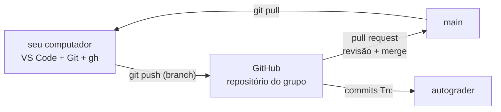
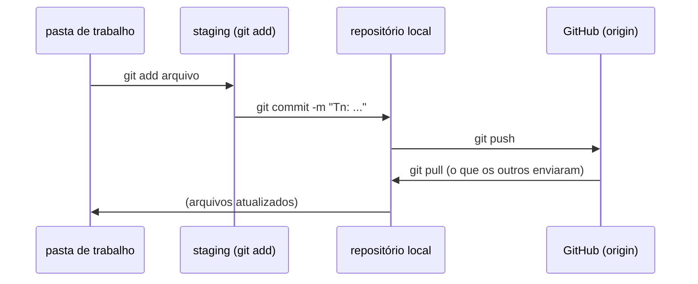
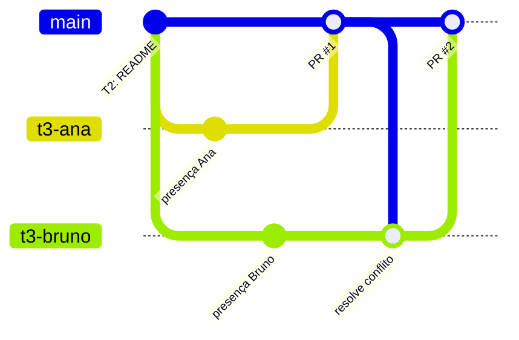

import { GitLogOut } from "@site/src/components/shared/InstructionsSite";

<div style={{ display: "flex", justifyContent: "center" }}>
  <LabTable index={1} internal={false} />
</div>

## Checklist — ambiente de desenvolvimento (parte 1): Git, GitHub e VS Code {/* #checklist */}

- [ ] VS Code, Git, GitHub CLI (`gh`) e Python 3 instalados; extensões PlatformIO IDE e Wokwi Simulator no VS Code (Parte 1)
- [ ] Identidade do Git configurada, `gh` autenticado, repositório do grupo clonado e versões registradas em `evidencias/t1-ambiente.txt` (T1)
- [ ] `README.md` do grupo com os integrantes e o primeiro `push` (T2)
- [ ] Cada integrante com um _pull request_ aprovado, e um conflito de merge resolvido (T3)
- [ ] Primeiro build do PlatformIO, entregue por _issue_ → _branch_ → _pull request_ que fecha a _issue_ (T4)
- [ ] Previsões P1–P3 respondidas no `README.md`
- [ ] Nenhum `push --force`; cada tarefa num commit `Tn:`
- [ ] Logout do Git e do `gh` no computador do laboratório

:::info[Pontuação]
**T1…T4 = 100 pts** (esta aula não tem desafios): T1 15 · T2 20 · T3 30 · T4 35. O autograder
normaliza para 0–10. Vale o commit `Tn:` mais recente de cada tarefa.
:::

<LabSetup />

### Configuração do ambiente de desenvolvimento {/* #setup */}

<DevTools />

---

Os laboratórios desta disciplina têm sempre a mesma forma. O grupo recebe um **repositório no
GitHub**, criado a partir de um _template_. Ali escreve o firmware do ESP32 no **VS Code** com o
**PlatformIO**, simula no **Wokwi** e entrega cada tarefa num **commit** `Tn:`. O autograder lê
esses commits. Mais adiante entram o broker MQTT, o Node-RED, o banco de dados e o CI, todos
rodando sobre as mesmas ferramentas.

Os Labs 01 e 02 preparam esse ambiente. Nesta aula:

1. você instala e confere as ferramentas;
2. o Git passa a saber **quem** você é, e o GitHub passa a aceitar os seus `push`;
3. o grupo pratica o fluxo que vai usar o semestre inteiro: _branch_, _pull request_, revisão e
   _merge_, inclusive quando dois mexem na mesma linha;
4. o PlatformIO faz o primeiro build. Ele baixa o toolchain do ESP32 (~300 MB), e é melhor que
   isso aconteça **hoje**, e não no meio do Lab 02.



## Objetivos

- Instalar e **verificar** o ambiente: VS Code, Git, GitHub CLI, Python e as extensões
  PlatformIO e Wokwi.
- Configurar a **identidade** do Git e autenticar o `gh`, sem guardar senha em lugar nenhum.
- Usar o fluxo de trabalho em grupo: `clone`, `commit`, `push`, `pull`, _branch_, _pull request_,
  revisão e _merge_.
- **Resolver um conflito** de merge sem perder o trabalho de ninguém.
- Fazer o **primeiro build** do PlatformIO e saber o que vai (e o que não vai) para o repositório.

## Material

- Computador com **Windows 11** e ~5 GB livres. Todos os comandos desta página são para o
  **Prompt de Comando** (`cmd`), o terminal padrão do VS Code nesta disciplina.
- Uma conta no **GitHub**, já aceita na organização da disciplina (`ELT85B-N21-2026-2`).
- Nenhuma placa: os Labs 01 e 02 não precisam de ESP32 físico.

:::info[Computador do laboratório × o seu]
Nos computadores do laboratório o ambiente já vem instalado: faça só a **Parte 2 em diante** e,
no fim, o **logout** do Git e do `gh`. No seu computador, faça tudo, desde a Parte 1. O Lab 02
acrescenta o Docker, que só é necessário no seu computador.
:::

<details>
<summary><strong>Mapa de tarefas</strong> — 4 tarefas · 100 pts</summary>

- [T1 — Identidade, autenticacao e clone](#t1) · 15 pts
- [T2 — README e primeiro push](#t2) · 20 pts
- [T3 — Branch, pull request e conflito](#t3) · 30 pts
- [T4 — Primeiro build por issue e pull request](#t4) · 35 pts

</details>

<FileTree
  details={true}
  defaultOpen={false}
  title="Estrutura de Arquivos do Projeto (no fim da aula)"
  root="lab01-grupo-X"
  files={[
    ".gitignore r",
    ".vscode/settings.json c",
    "README.md u",
    "platformio.ini c",
    "src/main.cpp c",
    "include/README c",
    "lib/README c",
    "test/README c",
    "evidencias/t1-ambiente.txt c",
    "evidencias/t3-presenca.md c",
    "evidencias/t3-prs.txt c",
    "evidencias/t4-build.txt c",
  ]}
/>

---

## Parte 1 — Instalar as ferramentas {/* #parte-1 */}

Siga as abas da [configuração do ambiente](#setup), nesta ordem. Cada aba tem o comando de
instalação (`winget`) e um comando para conferir. Depois de cada instalação, **feche e abra** o
terminal, para ele achar os programas novos.

| Aba do ambiente | O que fazer no Lab 01 |
| --- | --- |
| **VS Code** | instalar e criar o `settings.json` do terminal (veja 1.1) |
| **Git SCM** | instalar; a configuração é a Parte 2 |
| **GitHub CLI** | instalar; o login é a Parte 2 |
| **Python** | instalar e conferir com `py --version` |
| **PlatformIO** | instalar a extensão no perfil `ESP32IO` e pôr o `pio` no **Path** |
| **Wokwi** | instalar a extensão no perfil `ESP32IO` (a licença e o `wokwi-cli` ficam para o Lab 02) |
| Drivers, Docker | ficam para o Lab 02 |

As extensões vão para o **perfil `ESP32IO`** do VS Code (`--profile "ESP32IO"`), separado do
seu perfil do dia a dia. O primeiro `code --install-extension ... --profile "ESP32IO"` cria o
perfil. Abra sempre os repositórios da disciplina **nesse perfil**:

```shell title="Prompt de Comando (cmd), na pasta do repositório"
code --profile "ESP32IO" .
```

Na primeira vez que o VS Code abrir com a extensão do PlatformIO, ela instala o **PlatformIO
Core** (barra de status: _Installing PlatformIO Core_). Espere terminar e recarregue a janela
quando ele pedir. É essa instalação que cria a pasta `%USERPROFILE%\.platformio\penv\Scripts\`
que a aba **PlatformIO** manda pôr no **Path**.

### 1.1 O terminal do VS Code é o Prompt de Comando

Os comandos desta disciplina são escritos para o **Prompt de Comando** (`cmd`). O PowerShell,
padrão do VS Code no Windows, trata aspas, `&&`, `>` e `%VARIAVEL%` de outro jeito, e um comando
copiado daqui pode falhar ou fazer outra coisa. Por isso, cada repositório tem o arquivo
`.vscode/settings.json`:

```json title=".vscode/settings.json"
{
  "terminal.integrated.defaultProfile.windows": "Command Prompt"
}
```

Crie o arquivo pelo VS Code (**Explorer** → nova pasta `.vscode` → novo arquivo
`settings.json`) depois de clonar o repositório (2.3), e abra um terminal novo (**Ctrl+Shift+`**).
O nome do terminal, à direita, tem de ser **cmd**, e o prompt fica assim:

```text title="Terminal do VS Code"
Microsoft Windows [versão 10.0.26100.xxxx]
(c) Microsoft Corporation. Todos os direitos reservados.

C:\Users\aluno\lab01-grupo-x>
```

:::note[Comentários no cmd]
No `cmd` não existe comentário com `#`: o texto seria passado ao comando. Nesta página, as
explicações estão fora dos blocos de comando, ou em linhas `rem`.
:::

---

## Parte 2 — Identidade, autenticação e clone {/* #parte-2 */}

### 2.1 Quem você é para o Git

Cada commit leva um **nome** e um **e-mail**. O GitHub usa o e-mail para ligar o commit à sua
conta: é assim que o autograder e o professor sabem **quem** fez o quê no grupo.

```shell title="Terminal (cmd)"
git config --global user.name "Seu Nome Completo"
git config --global user.email "12345678+seu-usuario@users.noreply.github.com"
git config --global init.defaultBranch main
git config --global pull.rebase false
git config --global core.autocrlf true
git config --global --list
```

O e-mail `...@users.noreply.github.com` está em **GitHub → Settings → Emails** ("Keep my email
address private"). Com ele, o seu e-mail pessoal não fica público no histórico do repositório.
O `pull.rebase false` faz o `git pull` juntar por _merge_ (o fluxo desta disciplina), e o
`core.autocrlf true` converte os fins de linha do Windows (CRLF) para LF no repositório, e o
inverso na sua pasta. O comando `git config --list --show-origin` da aba **Git SCM** mostra de
qual arquivo vem cada configuração.

:::tip[Preveja antes de rodar]
**P1:** e se o `user.email` estiver errado (o e-mail do computador do laboratório, por
exemplo)? O commit é aceito pelo GitHub? O que aparece no lugar do seu avatar na lista de
commits, e o que isso significa para a **sua** nota num trabalho em grupo? Confira na T2.
:::

### 2.2 Autenticar o `gh`

O GitHub não aceita a senha da conta no `git push`. Quem autentica é o **GitHub CLI**: ele
abre o navegador, você autoriza, e ele passa a atender o Git como _credential helper_.

```shell title="Terminal (cmd)"
gh auth login --hostname github.com --git-protocol https --web
gh auth setup-git
gh auth status
```

O `gh auth login` mostra um código de 8 caracteres e abre o navegador: cole o código e
autorize. O `gh auth setup-git` faz o `git push` usar esse login.

```text title="Saída esperada (trecho)"
github.com
  ✓ Logged in to github.com account seu-usuario (keyring)
  - Active account: true
  - Git operations protocol: https
  - Token: gho_************************************
```

:::warning[Computador compartilhado]
No laboratório, o login fica guardado no computador até você sair. Antes de ir embora, faça o
**logout** do fim desta página. Quem usar a máquina depois teria acesso de escrita aos **seus**
repositórios.
:::

### 2.3 Clonar o repositório do grupo {/* #clonar */}

Escolha o grupo e rode o comando gerado. Ele cria o repositório do grupo a partir do template
(na primeira vez) e o clona no seu computador:

<LabTeamMembers labName="lab01" />

### 2.4 Enviar o link do repositório no Moodle {/* #moodle-link */}

<LabSubmit labName="lab01" />

Entre na pasta clonada e abra-a no VS Code, no perfil da disciplina:

```shell title="Terminal (cmd)"
cd lab01-grupo-x
code --profile "ESP32IO" .
```

Crie o `.vscode/settings.json` da seção 1.1 e abra um terminal novo (**Ctrl+Shift+`**): ele
tem de ser o **cmd**. Os comandos desta aula rodam nele, na raiz do repositório.

### 2.5 Registrar o ambiente

Gere a evidência com as versões instaladas. O mesmo arquivo ajuda o professor a entender um
erro de ambiente depois.

```shell title="Terminal do VS Code (cmd), na raiz do repositório"
if not exist evidencias mkdir evidencias
(echo == ambiente %DATE% %TIME% & git --version & gh --version & call code --version & py --version & pio --version & call code --list-extensions --profile "ESP32IO" & git config --global user.name & git config --global user.email & gh auth status) > evidencias\t1-ambiente.txt 2>&1
type evidencias\t1-ambiente.txt
```

Os parênteses juntam vários comandos, e o `> arquivo 2>&1` grava a saída **e os erros** de
todos. O `call` é necessário porque o `code` é um arquivo `.cmd`: sem ele, o `cmd` não volta
para os comandos seguintes.

```text title="evidencias/t1-ambiente.txt (trecho; as versões variam)"
== ambiente 22/10/2026 14:05:31,27
git version 2.xx.x.windows.1
gh version 2.xx.x (aaaa-mm-dd)
https://github.com/cli/cli/releases/tag/v2.xx.x
1.1xx.x
(hash do commit do VS Code)
x64
Python 3.14.x
PlatformIO Core, version 6.1.xx
platformio.platformio-ide
wokwi.wokwi-vscode
Seu Nome Completo
12345678+seu-usuario@users.noreply.github.com
github.com
  ✓ Logged in to github.com account seu-usuario (keyring)
```

Confira que **todas** as linhas têm versão, que as duas extensões aparecem e que o `gh` está
logado. O token aparece mascarado (`gho_****`): é seguro registrar. Se aparecer _'pio' não é
reconhecido como um comando interno_, falta o **Path** da aba **PlatformIO**.

```shell title="Terminal (cmd)"
git add .vscode/settings.json evidencias/t1-ambiente.txt
git commit -m "T1: ambiente registrado"
git push
```

<FileTree
  root="lab01-grupo-X"
  files={[".vscode/settings.json c", "evidencias/t1-ambiente.txt c"]}
/>

<CommitPoint
  id="t1"
  task="Identidade, autenticacao e clone"
  pontos={15}
  files=".vscode/settings.json evidencias/t1-ambiente.txt"
/>

---

## Parte 3 — README e primeiro push {/* #parte-3 */}

### 3.1 O ciclo básico



Antes de qualquer coisa: `git status`. Ele diz em que ramo você está, o que mudou e o que está
pronto para o commit. Use-o o tempo todo.

### 3.2 O `README.md` do grupo

Um integrante edita o `README.md`. Ele vai ser a capa de todos os repositórios da disciplina:

```markdown title="README.md"
# Lab 01 — Grupo X

## Integrantes

| Nome | Usuário no GitHub |
| --- | --- |
| Nome 1 | @usuario1 |
| Nome 2 | @usuario2 |

## Como rodar

- Build: `pio run`
- Simulação: Wokwi no VS Code (Lab 02)

## Previsões

- **P1:** ...
- **P2:** ...
- **P3:** ...
```

```shell title="Terminal (cmd)"
git status
git add README.md
git commit -m "T2: README com os integrantes"
git push
git log --oneline -3
```

Os **outros** integrantes trazem o commit para as suas máquinas. O commit `T2:` aparece no
`git log`:

```shell title="Terminal (cmd, cada um dos outros integrantes)"
git pull
git log --oneline -3
```

Abra o repositório no navegador (`gh repo view --web`), clique em **commits** e confira o P1: o
seu avatar aparece ao lado do commit?

:::note[Mensagens de commit nesta disciplina]
Cada tarefa entregue tem **um** commit cuja mensagem começa com `Tn:` (`T1:`, `T2:`…). O
autograder procura essas mensagens; vale o commit `Tn:` mais recente de cada tarefa. Commits
intermediários podem ter qualquer mensagem, desde que descritiva (`corrige pino do LED`, e não
`asdf`).
:::

<FileTree root="lab01-grupo-X" files={["README.md u"]} />

<CommitPoint id="t2" task="README e primeiro push" pontos={20} files="README.md" />

---

## Parte 4 — Branch, pull request e conflito {/* #parte-4 */}

### 4.1 Por que não todo mundo direto na `main`?

Se todos fazem `push` na `main` ao mesmo tempo, um sobrescreve ou atrapalha o outro, e ninguém
revisa nada. O fluxo da disciplina é: **cada mudança num ramo** (_branch_) → **pull request**
(PR) → alguém do grupo **revisa** → **merge** na `main`.



### 4.2 Cada integrante, no seu computador

**Todos ao mesmo tempo**, cada um no seu computador, partindo da `main` atualizada:

O `git switch -c` cria o ramo e muda para ele (troque `ana` pelo seu nome):

```shell title="Terminal (cmd, cada integrante)"
git switch main
git pull
git switch -c t3-ana
```

Crie (ou edite, se já existir no seu ramo) o arquivo `evidencias/t3-presenca.md` com **exatamente**
este conteúdo, trocando só a terceira linha:

```markdown title="evidencias/t3-presenca.md"
# Presença no Lab 01

Quem fez este arquivo: Ana (@usuario-da-ana)
```

O `-u` do primeiro `push` liga o ramo local ao remoto; nos seguintes, basta `git push`:

```shell title="Terminal (cmd)"
git add evidencias/t3-presenca.md
git commit -m "presença da Ana"
git push -u origin t3-ana
gh pr create --base main --title "Presença da Ana" --body "Lab 01, T3"
```

### 4.3 Revisar, juntar e resolver o conflito

1. Outro integrante abre o PR (`gh pr list` e `gh pr view 1 --web`), lê a mudança em **Files
   changed** e aprova (**Review changes → Approve**).
2. Quem abriu o PR faz o merge: `gh pr merge 1 --merge --delete-branch`.
3. O **segundo** PR agora mostra _This branch has conflicts that must be resolved_: os dois ramos
   mudaram a **mesma linha** do mesmo arquivo. O dono do segundo PR resolve:

```shell title="Terminal (cmd, dono do PR com conflito)"
git switch t3-bruno
git pull origin main
git status
```

O `git pull origin main` traz a `main` e avisa `CONFLICT (add/add)`. O `git status` mostra o
arquivo em **both added**: os dois ramos criaram o mesmo arquivo com conteúdos diferentes.

No VS Code, o arquivo aparece com as marcas do conflito:

```text title="evidencias/t3-presenca.md (durante o conflito)"
# Presença no Lab 01

<<<<<<< HEAD
Quem fez este arquivo: Bruno (@usuario-do-bruno)
=======
Quem fez este arquivo: Ana (@usuario-da-ana)
>>>>>>> 52f781f13aa312d984ce2e0dc6056b2a83372c98
```

Entre `<<<<<<< HEAD` e `=======` está a **sua** versão; entre `=======` e `>>>>>>>`, a que
veio da `main` (identificada pelo hash do commit).

Resolver é **editar o arquivo** até ele ficar como deve ser, sem as marcas, mantendo o trabalho
dos dois:

```markdown title="evidencias/t3-presenca.md (resolvido)"
# Presença no Lab 01

Quem fez este arquivo: Ana (@usuario-da-ana)
Quem fez este arquivo: Bruno (@usuario-do-bruno)
```

```shell title="Terminal (cmd)"
git add evidencias/t3-presenca.md
git commit -m "resolve conflito com a presença da Ana"
git push
```

O PR fica verde: revise, aprove e faça o merge como antes. Repita até o PR de **todos** os
integrantes estar na `main`.

:::tip[Preveja antes de rodar]
**P2:** se a Ana tivesse escrito na **linha 3** e o Bruno numa **linha 5** nova, haveria
conflito? Por que o Git consegue juntar sozinho mudanças em linhas diferentes, mas não na mesma
linha? E por que o `git push --force` "resolveria" o conflito do jeito errado?
:::

### 4.4 Evidência

Com todos os PRs juntados, um integrante atualiza a `main` e registra:

```shell title="Terminal (cmd)"
git switch main
git pull
(gh pr list --state merged & echo. & git log --oneline --graph -15) > evidencias\t3-prs.txt 2>&1
type evidencias\t3-prs.txt
git add evidencias/t3-prs.txt
git commit -m "T3: PRs de todos e conflito resolvido"
git push
```

<FileTree
  root="lab01-grupo-X"
  files={["evidencias/t3-presenca.md c", "evidencias/t3-prs.txt c"]}
/>

<CommitPoint
  id="t3"
  task="Branch, pull request e conflito"
  pontos={30}
  files="evidencias/t3-presenca.md evidencias/t3-prs.txt"
/>

---

## Projeto integrador — primeiro build por issue e pull request {/* #integrador */}

Num projeto real, o trabalho começa por uma **issue** (o que precisa ser feito), segue num
**ramo** e termina num **PR que fecha a issue** quando entra na `main`. Aqui, a issue é o
primeiro build do firmware do ESP32.

### Requisitos

1. **Issue.** Um integrante abre a issue:

   ```shell title="Terminal (cmd)"
   gh issue create --title "Primeiro build do PlatformIO" --body "Criar o projeto esp32dev e compilar o pisca-LED."
   gh issue list
   ```

   Anote o número da issue (ex.: `#3`).

2. **Ramo e projeto.** No ramo `t4-build`, crie o projeto PlatformIO na raiz do repositório
   (o `pio` funciona no terminal do VS Code depois do **Path** da aba **PlatformIO**):

   ```shell title="Terminal (cmd)"
   git switch main
   git pull
   git switch -c t4-build
   pio project init -b esp32dev -O "framework=arduino" -O "monitor_speed=115200"
   ```

   O `pio project init` cria `platformio.ini`, `src/`, `include/`, `lib/` e `test/`. Ele não
   apaga o `README.md`, as `evidencias/` nem o `.vscode/settings.json`. (A aba **PlatformIO**
   mostra o mesmo comando com `--ide vscode --sample-code`: o primeiro gera arquivos de
   configuração do VS Code, o segundo um `main.cpp` de exemplo. Aqui você escreve o seu.)

3. **Pisca-LED.** Crie `src/main.cpp`:

   ```cpp title="src/main.cpp"
   #include <Arduino.h>

   #define LED_PIN 2                     // GPIO2 (o LED do circuito do Lab 02)

   // Protótipo: em C/C++ uma função precisa ser declarada antes de ser usada
   void piscar(uint8_t pino, uint16_t meioPeriodoMs);

   void setup() {
     Serial.begin(115200);               // o mesmo valor do monitor_speed do platformio.ini
     pinMode(LED_PIN, OUTPUT);
     Serial.println("ESP32 inicializado! Lab 01, grupo X");
   }

   void loop() {
     piscar(LED_PIN, 500);
   }

   void piscar(uint8_t pino, uint16_t meioPeriodoMs) {
     digitalWrite(pino, HIGH);
     delay(meioPeriodoMs);
     digitalWrite(pino, LOW);
     delay(meioPeriodoMs);
   }
   ```

4. **Build.** O **primeiro** build baixa a plataforma `espressif32`, o toolchain Xtensa e o core
   Arduino (~300 MB). Pode levar de 5 a 15 minutos. Os seguintes levam segundos. Rode o primeiro
   na tela, para acompanhar o download, e o segundo gravando a evidência:

   ```shell title="Terminal (cmd)"
   pio run
   pio run > evidencias\t4-build.txt 2>&1
   type evidencias\t4-build.txt
   ```

   ```text title="evidencias/t4-build.txt (final; os números variam)"
   RAM:   [=         ]   6.5% (used 21360 bytes from 327680 bytes)
   Flash: [==        ]  20.4% (used 267525 bytes from 1310720 bytes)
   Building .pio/build/esp32dev/firmware.bin
   ========================= [SUCCESS] Took 41.27 seconds =========================
   ```

5. **O que vai para o repositório.** `git status` mostra a pasta `.pio/`? Não deveria: o
   `.gitignore` do template a ignora. Confira e faça o commit **só** do que é código e
   configuração:

   ```shell title="Terminal (cmd)"
   git status
   git add platformio.ini src include lib test evidencias/t4-build.txt
   git commit -m "T4: primeiro build do PlatformIO (closes #3)"
   git push -u origin t4-build
   gh pr create --base main --title "Primeiro build do PlatformIO" --body "Closes #3"
   ```

6. **Revisão e merge.** Outro integrante revisa (o `platformio.ini` e o `main.cpp` fazem
   sentido?), aprova e faz o merge. A issue **fecha sozinha** por causa do `Closes #3`. Confira
   com `gh issue list --state closed`.

7. **No `README.md`:** as respostas de P1, P2 e P3 (num PR, como todo o resto).

:::tip[Preveja antes de rodar]
**P3:** quanto espaço a pasta `.pio/` ocupa depois do build (as duas últimas linhas do
`dir /s .pio`)? O que aconteceria com o repositório, e com o `git pull` dos
colegas, se ela fosse para o GitHub a cada build? Por que o `firmware.bin` também não vai, se é
justamente o "produto" do projeto? (No Lab 10 ele vai para outro lugar: uma _release_.)
:::

<FileTree
  root="lab01-grupo-X"
  files={[
    "platformio.ini c",
    "src/main.cpp c",
    "evidencias/t4-build.txt c",
    "README.md u",
  ]}
/>

<CommitPoint
  id="t4"
  task="Primeiro build por issue e pull request"
  pontos={35}
  files="platformio.ini src/main.cpp evidencias/t4-build.txt README.md"
/>

---

## Referência rápida {/* #referencia */}

| Para… | Comando |
| --- | --- |
| Ver em que ramo estou e o que mudou | `git status` |
| Trazer o que os outros enviaram | `git pull` |
| Salvar e enviar | `git add <arquivos>` → `git commit -m "msg"` → `git push` |
| Criar um ramo e mudar para ele | `git switch -c nome` |
| Voltar para a `main` atualizada | `git switch main` → `git pull` |
| Histórico resumido | `git log --oneline --graph -15` |
| Abrir o repositório no navegador | `gh repo view --web` |
| Abrir / listar / juntar PRs | `gh pr create` · `gh pr list` · `gh pr merge N --merge --delete-branch` |
| Issues | `gh issue create` · `gh issue list` |
| Desfazer mudanças **não** commitadas num arquivo | `git restore <arquivo>` |

| Problema | O que fazer |
| --- | --- |
| `Permission denied` / `403` no `push` | `gh auth status`; confira se você está no time do grupo; peça ao professor para conferir o acesso |
| `Repository not found` | nome errado ou você ainda não é membro da organização: `gh repo view ELT85B-N21-2026-2/lab01-grupo-x` |
| `rejected ... (fetch first)` no `push` | alguém enviou antes: `git pull`, resolva o conflito se houver, e `git push` de novo. **Nunca** `--force` |
| Commit sem o seu avatar no GitHub | `user.email` diferente do da conta (P1). Corrija o `git config` para os próximos commits |
| `'pio' não é reconhecido como um comando interno` | ponha `%USERPROFILE%\.platformio\penv\Scripts\` no **Path** (aba **PlatformIO**) e abra um terminal novo. Se a pasta não existir, o PlatformIO Core ainda não terminou de instalar |
| O terminal abre como **PowerShell** | falta o `.vscode/settings.json` (1.1), ou a pasta aberta não é a raiz do repositório. Abra um terminal novo depois de criar o arquivo |
| `code` abre o VS Code sem as extensões | abra no perfil: `code --profile "ESP32IO" .` |
| Comando com `'aspas simples'` falha | no `cmd`, só as **aspas duplas** agrupam um texto |

---

## Logout do seu ambiente dev, git e gh {/* #logout */}

<GitLogOut />

<LabLogout />
