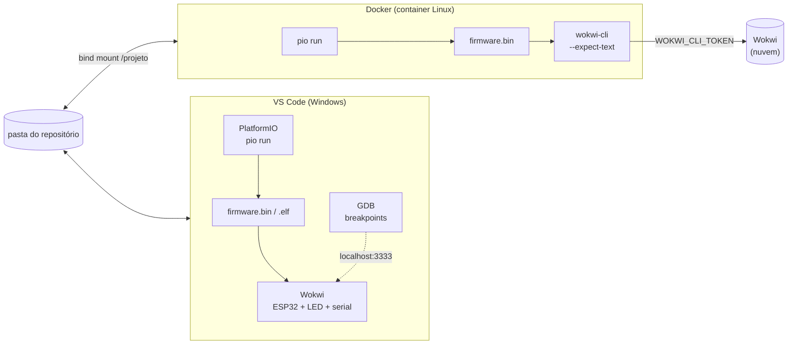
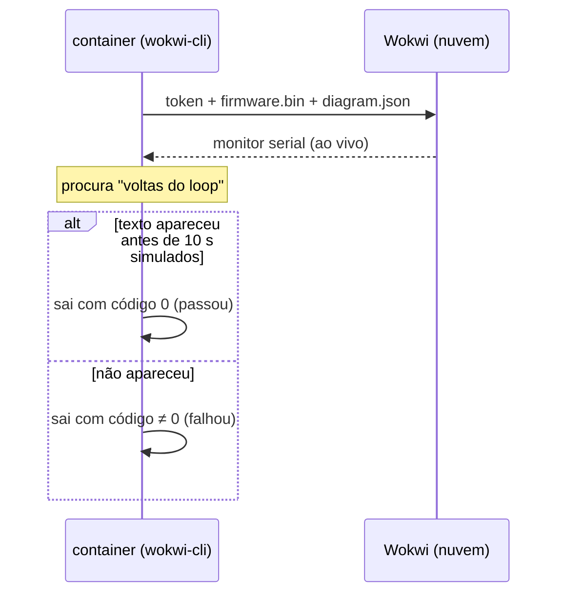

## Checklist — ambiente de desenvolvimento (parte 2): PlatformIO, Wokwi e Docker {/* #checklist */}

- [ ] Extensões PlatformIO IDE e Wokwi Simulator no perfil `ESP32IO`, com o `pio` no **Path** (Parte 1)
- [ ] Projeto PlatformIO com plataforma e bibliotecas em **versões fixas**, compilando, sem a `.pio/` no repositório (T1)
- [ ] Licença do Wokwi ativada, `wokwi.toml` + `diagram.json` e o pisca-LED simulado no VS Code (T2)
- [ ] Pisca sem `delay()` (com `millis()`) e um _breakpoint_ do GDB parando o firmware no Wokwi (T3)
- [ ] Docker funcionando, `Dockerfile` + `compose.yaml` e o firmware compilado **dentro do container** (T4)
- [ ] Firmware simulado pelo `wokwi-cli` no container, com teste automático do serial (T5)
- [ ] Previsões P1–P3 respondidas no `README.md`
- [ ] Nenhum token no repositório; nenhum `push --force`; cada tarefa num commit `Tn:`
- [ ] Logout do Git e do `gh` no computador do laboratório

:::info[Pontuação]
**T1…T5 = 100 pts** (esta aula não tem desafios): T1 15 · T2 20 · T3 15 · T4 20 · T5 30. O
autograder normaliza para 0–10. Vale o commit `Tn:` mais recente de cada tarefa.
:::

<LabSetup />

### Configuração do ambiente de desenvolvimento {/* #setup */}

<DevTools />

---

No Lab 01, o grupo passou a usar o Git e o GitHub. Agora entra o **firmware**: o
**PlatformIO** compila o código do ESP32, e o **Wokwi** o roda num ESP32 simulado dentro do
VS Code, com LED, monitor serial e depurador (GDB). E entra a última ferramenta do ambiente, o
**Docker**: o mesmo build e a mesma simulação passam a rodar num **container Linux**, igual em
qualquer computador, sem depender do que está instalado no Windows. É exatamente o que o CI do
Lab 10 vai fazer a cada `push`. O MQTT fica para o Lab 04.



## Objetivos

- Instalar o **PlatformIO** e o **Wokwi** no VS Code e fazer o primeiro build do ESP32.
- Configurar um projeto PlatformIO **reprodutível**: plataforma e bibliotecas com versão fixa.
- Ativar o **Wokwi** no VS Code e ligar o firmware do PlatformIO ao circuito (`wokwi.toml`,
  `diagram.json`).
- Trocar o `delay()` por **`millis()`**, o padrão que todos os labs seguintes usam, e
  **depurar** o firmware simulado com o **GDB**.
- Instalar o **Docker**, escrever um `Dockerfile` e um `compose.yaml`, e **compilar** e
  **simular** o firmware num container com o `wokwi-cli`.

## Material

- O ambiente do Lab 01: Windows 11, VS Code, Git, `gh`, Python, e o terminal do VS Code no
  **Prompt de Comando** (`cmd`).
- ~6 GB livres: o toolchain do ESP32 (~300 MB no Windows e de novo no container) e a imagem do
  Docker.
- Uma **conta no Wokwi** (gratuita): a licença do simulador no VS Code e o **token de CI** do
  `wokwi-cli`.
- **Docker Desktop** com **WSL 2** (aba **Docker** da [configuração do ambiente](#setup)).
- Nenhuma placa. A Parte 6 mostra como gravar uma placa real, para quem tiver.

:::note[Abas da configuração do ambiente usadas hoje]
**PlatformIO**, **Wokwi** (extensão e licença), **Docker** (WSL 2 e Docker Desktop) e, só para
quem tiver placa, **Drivers**. As demais já foram feitas no Lab 01. O `wokwi-cli` não precisa
ser instalado no Windows: ele roda dentro do container.
:::

:::info[Por que simular?]
O Wokwi simula o ESP32 (incluindo o Wi-Fi), LEDs, potenciômetros, o DHT22, o display SSD1306 e
um analisador lógico. Todo o semestre roda nele: ninguém depende da bancada, do cabo USB ou do
driver da placa, e o mesmo circuito (`diagram.json`) vai para o repositório junto com o código.
No Lab 10, o mesmo simulador roda sem interface, dentro do CI, com a imagem que você monta hoje.
:::

## Clonar o repositório do grupo {/* #clonar */}

<LabTeamMembers labName="lab02" />

## Envie o link do repositório do seu grupo no Moodle: {/* #moodle-link */}

<LabSubmit labName="lab02" />

<details>
<summary><strong>Mapa de tarefas</strong> — 5 tarefas · 100 pts</summary>

- [T1 — Projeto PlatformIO com versoes fixas](#t1) · 15 pts
- [T2 — Wokwi no VS Code](#t2) · 20 pts
- [T3 — Pisca com millis e GDB](#t3) · 15 pts
- [T4 — Docker: build no container](#t4) · 20 pts
- [T5 — Simulação no container com o wokwi-cli](#t5) · 30 pts

</details>

O repositório nasce do `lab02-template`, com o `README.md` e o `.gitignore`:

<FileTree
  details={true}
  defaultOpen={false}
  title="Estrutura de Arquivos do Projeto (no fim da aula)"
  root="lab02-grupo-x"
  files={[
    ".gitignore u",
    ".dockerignore c",
    ".vscode/settings.json r",
    ".vscode/launch.json c",
    "Dockerfile c",
    "compose.yaml c",
    "README.md u",
    "platformio.ini c",
    "src/main.cpp c",
    "include/README c",
    "lib/README c",
    "test/README c",
    "wokwi.toml c",
    "diagram.json c",
    "evidencias/t1-ambiente.txt c",
    "evidencias/t1-build.txt c",
    "evidencias/t2-serial.txt c",
    "evidencias/t2-wokwi.png c",
    "evidencias/t3-serial.txt c",
    "evidencias/t3-gdb.png c",
    "evidencias/t4-docker.txt c",
    "evidencias/t4-build-docker.txt c",
    "evidencias/t5-wokwi.txt c",
    "evidencias/t5-serial.txt c",
  ]}
/>

---

## Parte 1 — PlatformIO: instalação e projeto com versões fixas {/* #parte-1 */}

### 1.1 Instalar as extensões

Siga as abas **PlatformIO** e **Wokwi** da [configuração do ambiente](#setup). As extensões vão
para o **perfil `ESP32IO`** do VS Code (`--profile "ESP32IO"`), o mesmo em que você abriu o
repositório no Lab 01:

```shell title="Terminal (cmd)"
code --install-extension platformio.platformio-ide --profile "ESP32IO"
code --install-extension wokwi.wokwi-vscode --profile "ESP32IO"
```

Abra o repositório do grupo **nesse perfil** e confira que o terminal é o **cmd** (o
`.vscode/settings.json` do Lab 01; se o template não o trouxer, crie-o de novo):

```shell title="Terminal (cmd)"
cd lab02-grupo-x
code --profile "ESP32IO" .
```

Na primeira vez que o VS Code abrir com a extensão do PlatformIO, ela instala o **PlatformIO
Core** (barra de status: _Installing PlatformIO Core_). Espere terminar e recarregue a janela
quando ele pedir. É essa instalação que cria a pasta `%USERPROFILE%\.platformio\penv\Scripts\`,
que a aba **PlatformIO** manda pôr no **Path**. Depois de pôr, **feche e abra** o VS Code e
confira:

```shell title="Terminal do VS Code (cmd)"
pio --version
call code --list-extensions --profile "ESP32IO"
```

Se aparecer _'pio' não é reconhecido como um comando interno_, falta o **Path**; se a pasta não
existir, o PlatformIO Core ainda não terminou de instalar.

### 1.2 Criar o projeto

No terminal do VS Code, na raiz do repositório:

```shell title="Terminal do VS Code (cmd)"
pio project init -b esp32dev -O "framework=arduino" -O "monitor_speed=115200"
```

```text title="Saída esperada"
The following files/directories have been created in C:\...\lab02-grupo-x
include - Put project header files here
lib - Put project specific (private) libraries here
src - Put project source files here
platformio.ini - Project Configuration File
Resolving esp32dev dependencies...
Project has been successfully initialized!
```

O `pio project init` cria `platformio.ini`, `src/`, `include/`, `lib/` e `test/`, e não apaga o
`README.md` nem o `.vscode/settings.json`. (A aba **PlatformIO** mostra o mesmo comando com
`--ide vscode --sample-code`: o primeiro gera arquivos de configuração do VS Code, o segundo um
`main.cpp` de exemplo. Aqui você escreve o seu.)

### 1.3 Fixar as versões

O `pio project init` escreve `platform = espressif32`, sem versão. Sem versão, o mesmo projeto
compila com um core Arduino diferente quando sai uma versão nova, e um código que funcionava
para de compilar "sozinho". Fixe:

```ini title="platformio.ini"
[env:esp32dev]
platform = espressif32@6.9.0       ; versão fixa: core Arduino 2.0.17 (o dos labs seguintes)
board = esp32dev
framework = arduino
monitor_speed = 115200             ; o mesmo valor do Serial.begin()
```

### 1.4 Pisca-LED e primeiro build

Crie `src/main.cpp`:

```cpp title="src/main.cpp"
#include <Arduino.h>

#define LED_PIN 2                     // GPIO2 (o LED do circuito da Parte 2)

// Protótipo: em C/C++ uma função precisa ser declarada antes de ser usada
void piscar(uint8_t pino, uint16_t meioPeriodoMs);

void setup() {
  Serial.begin(115200);               // o mesmo valor do monitor_speed do platformio.ini
  pinMode(LED_PIN, OUTPUT);
  Serial.println("ESP32 inicializado! Lab 02, grupo X");
}

void loop() {
  piscar(LED_PIN, 500);
}

void piscar(uint8_t pino, uint16_t meioPeriodoMs) {
  digitalWrite(pino, HIGH);
  delay(meioPeriodoMs);
  digitalWrite(pino, LOW);
  delay(meioPeriodoMs);
}
```

O **primeiro** build baixa a plataforma `espressif32@6.9.0`, o toolchain Xtensa e o core
Arduino (~300 MB). Pode levar de 5 a 15 minutos; os seguintes levam segundos. Rode o primeiro
na tela, para acompanhar o download, e o segundo gravando a evidência:

```shell title="Terminal do VS Code (cmd)"
pio run
if not exist evidencias mkdir evidencias
(echo == ambiente %DATE% %TIME% & pio --version & call code --list-extensions --profile "ESP32IO") > evidencias\t1-ambiente.txt 2>&1
pio run > evidencias\t1-build.txt 2>&1
type evidencias\t1-build.txt
```

```text title="evidencias/t1-build.txt (final; os números variam)"
RAM:   [=         ]   6.5% (used 21360 bytes from 327680 bytes)
Flash: [==        ]  20.4% (used 267525 bytes from 1310720 bytes)
Building .pio/build/esp32dev/firmware.bin
========================= [SUCCESS] Took 41.27 seconds =========================
```

:::note[Os botões do PlatformIO]
A barra de status do VS Code tem os mesmos comandos: ✓ **Build** (`pio run`), → **Upload**
(`pio run -t upload`), 🔌 **Serial Monitor** (`pio device monitor`) e 🗑 **Clean**. O terminal é
melhor para gerar evidências, porque o `> arquivo 2>&1` grava a saída direto num arquivo. O
segundo `pio run` não recompila nada, mas imprime de novo o uso de RAM e Flash.
:::

### 1.5 O que vai para o repositório

O `git status` mostra a pasta `.pio/`? Não deveria: o `.gitignore` do template a ignora. Ela
guarda o build inteiro (dezenas de MB, confira com `dir /s .pio`), muda a cada compilação e é
refeita por qualquer um com `pio run`. Nem o `firmware.bin` vai: ele é gerado a partir do
código, e no Lab 10 vai para outro lugar, uma _release_. Faça o commit **só** do que é código e
configuração:

```shell title="Terminal do VS Code (cmd)"
git status
git add .vscode/settings.json platformio.ini src include lib test evidencias/t1-ambiente.txt evidencias/t1-build.txt
git commit -m "T1: projeto com versões fixas"
git push
```

<FileTree
  root="lab02-grupo-x"
  files={[
    ".vscode/settings.json c",
    "platformio.ini c",
    "src/main.cpp c",
    "evidencias/t1-ambiente.txt c",
    "evidencias/t1-build.txt c",
  ]}
/>

<CommitPoint
  id="t1"
  task="Projeto PlatformIO com versoes fixas"
  pontos={15}
  files=".vscode/settings.json platformio.ini src/main.cpp evidencias/t1-ambiente.txt evidencias/t1-build.txt"
/>

---

## Parte 2 — Wokwi no VS Code {/* #parte-2 */}

### 2.1 Ativar a licença

Na aba **Wokwi** da [configuração do ambiente](#setup), use o link **Gerar uma licença pessoal
de 30 dias** (ou, no VS Code, **F1** → **Wokwi: Request a New License**). O navegador abre o
site do Wokwi: entre com a sua conta e confirme, e o navegador devolve a licença ao VS Code.
Quando ela vencer, o VS Code avisa, e você repete o passo.

### 2.2 Ligar o firmware ao simulador

O Wokwi precisa de dois arquivos na raiz do projeto:

- `wokwi.toml`: **qual firmware** rodar (o que o PlatformIO acabou de compilar);
- `diagram.json`: **o circuito** (placa, componentes, fios).

```toml title="wokwi.toml"
[wokwi]
version = 1
firmware = '.pio/build/esp32dev/firmware.bin'
elf = '.pio/build/esp32dev/firmware.elf'
```

Use `/` nos caminhos, mesmo no Windows: o arquivo vai para o repositório e precisa funcionar
nos computadores de todos e no container Linux da Parte 4.

```json title="diagram.json"
{
  "version": 1,
  "author": "ELT85B - Lab 02",
  "editor": "wokwi",
  "parts": [
    {
      "type": "board-esp32-devkit-c-v4",
      "id": "esp",
      "top": 0,
      "left": 0,
      "attrs": {}
    },
    {
      "type": "wokwi-resistor",
      "id": "r1",
      "top": 130,
      "left": 120,
      "attrs": { "value": "220" }
    },
    {
      "type": "wokwi-led",
      "id": "led1",
      "top": 80,
      "left": 220,
      "attrs": { "color": "red", "label": "GPIO2" }
    }
  ],
  "connections": [
    ["esp:TX", "$serialMonitor:RX", "", []],
    ["esp:RX", "$serialMonitor:TX", "", []],
    ["esp:2", "r1:1", "green", []],
    ["r1:2", "led1:A", "green", []],
    ["led1:C", "esp:GND.2", "black", []]
  ],
  "dependencies": {}
}
```

| Linha                                        | O que liga                                                                   |
| -------------------------------------------- | ---------------------------------------------------------------------------- |
| `esp:TX` → `$serialMonitor:RX` (e o inverso) | a UART0 do ESP32 ao monitor serial do Wokwi (o `Serial.println`)             |
| `esp:2` → resistor → `led1:A`                | o GPIO2 ao **anodo** do LED, passando por 220 Ω (limita a corrente em ~6 mA) |
| `led1:C` → `esp:GND.2`                       | o **catodo** do LED ao terra                                                 |

Abra o `diagram.json` no VS Code: o editor do Wokwi mostra o circuito ao lado, e você pode
arrastar as peças. Os labs seguintes acrescentam componentes a este mesmo arquivo.

### 2.3 Simular

1. Compile (`pio run`): o Wokwi roda o **último** `firmware.bin` compilado.
2. **F1** → **Wokwi: Start Simulator** (ou clique no `diagram.json` e em ▶).
3. O LED pisca, e o monitor serial (abaixo do circuito) mostra `ESP32 inicializado!`.

Salve o monitor serial em `evidencias/t2-serial.txt` (selecione o texto e copie) e uma captura
do VS Code com o circuito e o serial em `evidencias/t2-wokwi.png`.

:::tip[Preveja antes de rodar]
**P1:** (a) você mudou o `LED_PIN` para `4` e iniciou o simulador **sem** compilar de novo. O que
o Wokwi mostra: o código novo ou o antigo? Por quê? (b) No canto do simulador aparece a
porcentagem de **tempo real** (ex.: `98%`). Se ela cair para 50 %, o LED pisca mais devagar na
tela? E o `millis()` do ESP32: conta o tempo simulado ou o do relógio da parede?
:::

<FileTree
  root="lab02-grupo-x"
  files={[
    "wokwi.toml c",
    "diagram.json c",
    "evidencias/t2-serial.txt c",
    "evidencias/t2-wokwi.png c",
  ]}
/>

<CommitPoint
  id="t2"
  task="Wokwi no VS Code"
  pontos={20}
  files="wokwi.toml diagram.json evidencias/t2-serial.txt evidencias/t2-wokwi.png"
/>

---

## Parte 3 — Pisca com `millis()` e depuração com GDB {/* #parte-3 */}

### 3.1 Sem `delay()`

Com `delay(500)`, o ESP32 fica **parado** meio segundo e não faz mais nada: não lê a serial, não
atende o Wi-Fi, não confere um botão. Os labs seguintes fazem várias coisas "ao mesmo tempo",
então o padrão é outro: o `loop()` gira o tempo todo e cada tarefa confere se **já deu a hora**.

```cpp title="src/main.cpp (T3)"
#include <Arduino.h>

#define LED_PIN       2
#define MEIO_PERIODO  500              // ms aceso, ms apagado
#define RELATORIO_MS  2000             // a cada 2 s, uma linha no serial

unsigned long tLed = 0, tRelatorio = 0;
bool ledAceso = false;
uint32_t voltas = 0;                   // quantas vezes o loop() rodou

void setup() {
  Serial.begin(115200);
  pinMode(LED_PIN, OUTPUT);
  Serial.println("ESP32 inicializado! Lab 02, grupo X");
}

void loop() {
  unsigned long agora = millis();
  voltas++;

  if (agora - tLed >= MEIO_PERIODO) {          // já deu a hora de trocar o LED?
    tLed += MEIO_PERIODO;
    ledAceso = !ledAceso;
    digitalWrite(LED_PIN, ledAceso ? HIGH : LOW);
  }

  if (agora - tRelatorio >= RELATORIO_MS) {    // e a do relatório?
    tRelatorio += RELATORIO_MS;
    Serial.printf("[%7lu ms] LED %s · %lu voltas do loop() em 2 s\r\n",
                  agora, ledAceso ? "aceso " : "apagado", (unsigned long)voltas);
    voltas = 0;
  }
}
```

```text title="Monitor serial (trecho; o número de voltas varia)"
ESP32 inicializado! Lab 02, grupo X
[   2000 ms] LED aceso  · 1032915 voltas do loop() em 2 s
[   4000 ms] LED aceso  · 1035522 voltas do loop() em 2 s
[   6000 ms] LED aceso  · 1035519 voltas do loop() em 2 s
```

O `loop()` roda centenas de milhares de vezes por segundo, e o LED continua piscando no ritmo
certo. Com o pisca de `delay` da T1, seriam **2** voltas a cada 2 s.

:::tip[Preveja antes de rodar]
**P2:** (a) o `millis()` é um `unsigned long` de 32 bits e volta a zero depois de ~49,7 dias.
Por que `agora - tLed >= MEIO_PERIODO` continua certo na virada, mas `agora >= tLed + MEIO_PERIODO`
não? Teste a conta com números de 32 bits: `tLed = 4294967000`, `agora = 200`. (b) Por que
`tLed += MEIO_PERIODO` e não `tLed = agora`? O que acontece com o ritmo do LED em cada caso, se
uma volta do `loop()` atrasar 3 ms?
:::

**Evidência:** pelo menos 5 linhas do monitor serial em `evidencias/t3-serial.txt`.

### 3.2 Depurar com GDB no Wokwi

O `Serial.printf` mostra o que você **mandou** imprimir. O **GDB** para o firmware numa linha
(_breakpoint_) e mostra **todas** as variáveis naquele instante, sem mudar o código. O Wokwi
abre um servidor GDB na porta 3333, e o VS Code se conecta a ele.

1. **Extensão C/C++** (fornece o depurador `cppdbg` do VS Code):

   ```shell title="Terminal (cmd)"
   code --install-extension ms-vscode.cpptools --profile "ESP32IO"
   ```

2. **`wokwi.toml`**: acrescente a porta do servidor GDB.

   ```toml title="wokwi.toml"
   [wokwi]
   version = 1
   firmware = '.pio/build/esp32dev/firmware.bin'
   elf = '.pio/build/esp32dev/firmware.elf'
   gdbServerPort = 3333
   ```

3. **`.vscode/launch.json`**: diz ao VS Code qual GDB usar (o do toolchain do ESP32, baixado
   pelo PlatformIO), qual `.elf` tem os símbolos e onde está o servidor.

   ```json title=".vscode/launch.json"
   {
     "version": "0.2.0",
     "configurations": [
       {
         "name": "Wokwi GDB",
         "type": "cppdbg",
         "request": "launch",
         "program": "${workspaceFolder}/.pio/build/esp32dev/firmware.elf",
         "cwd": "${workspaceFolder}",
         "MIMode": "gdb",
         "miDebuggerPath": "${userHome}/.platformio/packages/toolchain-xtensa-esp32/bin/xtensa-esp32-elf-gdb.exe",
         "miDebuggerServerAddress": "localhost:3333"
       }
     ]
   }
   ```

   Confira que o GDB existe nesse caminho:

   ```shell title="Terminal do VS Code (cmd)"
   dir "%USERPROFILE%\.platformio\packages\toolchain-xtensa-esp32\bin\*gdb*"
   ```

4. **Depurar.** Compile (`pio run`), depois **F1** → **Wokwi: Start Simulator and Wait for
   Debugger**: o simulador abre parado, esperando o GDB. Clique na margem à esquerda da linha
   `ledAceso = !ledAceso;` (aparece um ponto vermelho) e aperte **F5** (configuração
   **Wokwi GDB**).

5. O firmware para no _breakpoint_. No painel **Run and Debug**, a seção **Variables** mostra
   `agora`, e **Watch** aceita expressões (`tLed`, `voltas`, `ledAceso`). **F5** continua até a
   próxima parada, **F10** executa uma linha, **F11** entra na função, **Shift+F5** encerra.

Salve uma captura do VS Code parado no _breakpoint_, com as variáveis à vista, em
`evidencias/t3-gdb.png`.

:::note[Variáveis _optimized out_]
O build padrão do PlatformIO é otimizado (`-Os`): o compilador guarda variáveis em
registradores ou as elimina, e o GDB mostra `<optimized out>`. Para depurar, acrescente
`build_type = debug` ao `[env:esp32dev]` do `platformio.ini` e compile de novo; retire-o depois.
Enquanto o firmware está parado no GDB, o tempo **simulado** também para: o `millis()` não
avança, e o LED não troca (compare com o P1-b).
:::

<FileTree
  root="lab02-grupo-x"
  files={[
    "src/main.cpp u",
    "wokwi.toml u",
    ".vscode/launch.json c",
    "evidencias/t3-serial.txt c",
    "evidencias/t3-gdb.png c",
  ]}
/>

<CommitPoint
  id="t3"
  task="Pisca com millis e GDB"
  pontos={15}
  files="src/main.cpp wokwi.toml .vscode/launch.json evidencias/t3-serial.txt evidencias/t3-gdb.png"
/>

---

## Parte 4 — Docker: o ambiente num container {/* #parte-4 */}

Até aqui, o build depende do **seu** Windows: da versão do PlatformIO, do Path, do perfil do
VS Code. Um **container** é um Linux mínimo, descrito num arquivo de texto (`Dockerfile`), que
roda igual em qualquer computador com Docker. Se o firmware compila no container, compila no
computador do colega, no do professor e no CI.

| Peça           | O que é                                                                                         |
| -------------- | ----------------------------------------------------------------------------------------------- |
| `Dockerfile`   | a **receita** da imagem: sistema base + o que instalar (PlatformIO, `wokwi-cli`)                |
| imagem         | o resultado do `docker compose build`: um "molde" pronto, guardado no Docker                    |
| container      | uma execução da imagem; com `--rm`, é apagado quando o comando termina                          |
| `compose.yaml` | **como** rodar: qual imagem, quais pastas montar, quais variáveis, qual comando de cada serviço |
| _bind mount_   | a pasta do repositório aparece dentro do container em `/projeto`: o que ele grava, você vê      |
| volume nomeado | uma pasta guardada pelo Docker entre execuções: aqui, o cache do PlatformIO (~300 MB)           |

### 4.1 Instalar e conferir o Docker

Siga a aba **Docker** da [configuração do ambiente](#setup): primeiro o **WSL 2** (o
`wsl --install` pede para reiniciar o computador), depois o **Docker Desktop**. Abra o Docker
Desktop, aceite os termos e espere a baleia ficar parada na bandeja. Se ele reclamar de
virtualização, ative-a na BIOS/UEFI (Intel VT-x ou AMD-V).

Confira no terminal do VS Code e grave a evidência:

```shell title="Terminal do VS Code (cmd)"
(wsl --version & docker --version & docker compose version & docker run --rm hello-world) > evidencias\t4-docker.txt 2>&1
type evidencias\t4-docker.txt
```

O `hello-world` baixa uma imagem minúscula, cria um container, imprime _Hello from Docker!_ e
o container é apagado (`--rm`). O `wsl --version` escreve em UTF-16, e por isso pode aparecer
com espaços entre as letras no arquivo: tudo bem.

### 4.2 O `Dockerfile`

Na raiz do repositório, crie o `Dockerfile` (sem extensão):

```dockerfile title="Dockerfile"
# ELT85B - ambiente de build e simulação do ESP32 (o mesmo do CI do Lab 10)
FROM python:3.12-slim

# Versão fixa do PlatformIO Core, como a plataforma no platformio.ini
ARG PIO_VERSION=6.1.18

# curl: baixar o wokwi-cli · git: bibliotecas do PlatformIO vindas de repositórios
RUN apt-get update \
 && apt-get install -y --no-install-recommends curl ca-certificates git \
 && rm -rf /var/lib/apt/lists/*

RUN pip install --no-cache-dir "platformio==${PIO_VERSION}"

# wokwi-cli: um único executável Linux, publicado no GitHub do Wokwi
RUN curl -fsSL -o /usr/local/bin/wokwi-cli \
      https://github.com/wokwi/wokwi-cli/releases/latest/download/wokwi-cli-linuxstatic-x64 \
 && chmod +x /usr/local/bin/wokwi-cli \
 && wokwi-cli --version

WORKDIR /projeto
CMD ["pio", "--version"]
```

Cada `RUN` vira uma **camada** da imagem. O Docker guarda as camadas em cache: se você mudar só
a última linha, ele não instala o PlatformIO de novo. Por isso o que muda menos fica em cima.

O **contexto** do build é a pasta inteira, enviada ao Docker antes de começar. O
`.dockerignore` tira dele o que a imagem não usa (e o `.env` da T5, que nunca deve entrar numa
imagem):

```text title=".dockerignore"
.git
.pio
.vscode
evidencias
.env
```

### 4.3 O `compose.yaml`

O `docker compose` guarda num arquivo os parâmetros que, com o `docker run`, você teria de
digitar a cada vez. Os três serviços usam a mesma imagem; muda só o comando:

```yaml title="compose.yaml"
# Configuração comum aos serviços (âncora YAML: &esp32 define, <<: *esp32 reutiliza)
x-esp32: &esp32
  build: .
  image: elt85b/esp32-dev:lab02
  working_dir: /projeto
  volumes:
    - .:/projeto # o repositório, dentro do container
    - platformio:/root/.platformio # cache do toolchain entre execuções
  environment:
    WOKWI_CLI_TOKEN: ${WOKWI_CLI_TOKEN:-} # vem do arquivo .env (T5), nunca do Git

services:
  pio: # compilar
    <<: *esp32
    command: pio run

  wokwi: # simular e testar o serial
    <<: *esp32
    command: >
      wokwi-cli --timeout 10000 --expect-text "voltas do loop"
      --serial-log-file evidencias/t5-serial.txt .

  ci: # compilar e simular, como o CI do Lab 10
    <<: *esp32
    command: sh -c "pio run && wokwi-cli --timeout 10000 --expect-text 'voltas do loop' ."

volumes:
  platformio:
```

### 4.4 Construir a imagem e compilar no container

```shell title="Terminal do VS Code (cmd)"
docker compose build
docker compose run --rm pio
docker compose run --rm -T pio > evidencias\t4-build-docker.txt 2>&1
type evidencias\t4-build-docker.txt
```

1. `docker compose build` monta a imagem a partir do `Dockerfile` (alguns minutos, na primeira
   vez).
2. O primeiro `docker compose run --rm pio` baixa a plataforma `espressif32@6.9.0` e o
   toolchain **para Linux** (~300 MB, de novo: o do Windows não serve no container) e guarda
   tudo no volume `platformio`.
3. O segundo grava a evidência. O `-T` desliga o terminal interativo, que atrapalha quando a
   saída vai para um arquivo.

O `firmware.bin` aparece na **sua** pasta `.pio/build/esp32dev/`, porque o container escreve
no _bind mount_. O build do Windows e o do container usam a mesma `.pio/`, mas caminhos
diferentes (`C:\...` × `/projeto`): na primeira vez que você alternar entre os dois, cada lado
recompila tudo. Um build dentro do container, numa pasta do Windows, também é mais lento que o
do VS Code: é o preço do WSL 2 cruzar os dois sistemas de arquivos.

```shell title="Terminal do VS Code (cmd)"
git add Dockerfile .dockerignore compose.yaml evidencias/t4-docker.txt evidencias/t4-build-docker.txt
git commit -m "T4: build do firmware no Docker"
git push
```

<FileTree
  root="lab02-grupo-x"
  files={[
    "Dockerfile c",
    ".dockerignore c",
    "compose.yaml c",
    "evidencias/t4-docker.txt c",
    "evidencias/t4-build-docker.txt c",
  ]}
/>

<CommitPoint
  id="t4"
  task="Docker: build no container"
  pontos={20}
  files="Dockerfile .dockerignore compose.yaml evidencias/t4-docker.txt evidencias/t4-build-docker.txt"
/>

---

## Projeto integrador — simular no container com o `wokwi-cli` {/* #integrador */}

O Wokwi do VS Code precisa de alguém olhando a tela. O **`wokwi-cli`** roda a mesma simulação
sem interface: envia o `firmware.bin` e o `diagram.json` para o simulador do Wokwi (na nuvem),
recebe o monitor serial e termina com um **código de saída**: `0` se o texto esperado apareceu
no serial a tempo, diferente de `0` se não. É um **teste automático** do firmware, e é o que o
CI do Lab 10 roda a cada `push`.



### Requisitos

1. **Token de CI.** Em [wokwi.com/dashboard/ci](https://wokwi.com/dashboard/ci), entre com a sua
   conta e gere um token. Ele é **pessoal**: quem tem o token usa a sua cota de simulação.

2. **`.env`, fora do Git.** Primeiro, garanta que o Git ignora o `.env`; depois, crie-o pelo
   VS Code (**Explorer** → novo arquivo `.env`):

   ```shell title="Terminal do VS Code (cmd)"
   echo .env>> .gitignore
   git check-ignore -v .env
   ```

   ```text title=".env (NÃO vai para o repositório)"
   WOKWI_CLI_TOKEN=cole_aqui_o_seu_token
   ```

   O `git check-ignore` tem de responder `.gitignore:N:.env .env`. O `docker compose` lê o
   `.env` sozinho e passa o token ao container pelo `${WOKWI_CLI_TOKEN:-}` do `compose.yaml`.
   Confira com `git status`: o `.env` **não** pode aparecer.

3. **Simular.** Com o firmware da T3 já compilado (T4):

   ```shell title="Terminal do VS Code (cmd)"
   docker compose run --rm wokwi
   echo %ERRORLEVEL%
   ```

   ```text title="Saída (trecho; as mensagens do wokwi-cli variam com a versão)"
   Wokwi CLI v0.x.x
   Starting simulation...
   ESP32 inicializado! Lab 02, grupo X
   [   2000 ms] LED aceso  · 1032915 voltas do loop() em 2 s
   Expected text found: "voltas do loop"
   TEST PASSED.
   0
   ```

   O `--expect-text` encerra a simulação assim que o texto aparece; o `--timeout 10000` é o
   limite, em milissegundos **simulados**; o `--serial-log-file` grava o serial em
   `evidencias/t5-serial.txt`.

4. **Ver o teste falhar.** Rode com um texto que o firmware nunca imprime (o comando depois do
   nome do serviço substitui o do `compose.yaml`):

   ```shell title="Terminal do VS Code (cmd)"
   docker compose run --rm wokwi wokwi-cli --timeout 5000 --expect-text "texto que nunca aparece" .
   echo %ERRORLEVEL%
   ```

   O código de saída não é `0`. É isso que faz o CI marcar o `push` em vermelho.

5. **Tudo de uma vez.** O serviço `ci` compila e simula na sequência, como o Lab 10 fará:

   ```shell title="Terminal do VS Code (cmd)"
   docker compose run --rm -T ci > evidencias\t5-wokwi.txt 2>&1
   echo exit=%ERRORLEVEL%>> evidencias\t5-wokwi.txt
   type evidencias\t5-wokwi.txt
   ```

   O `echo` fica numa linha separada de propósito: dentro de parênteses, o `cmd` trocaria o
   `%ERRORLEVEL%` pelo valor de **antes** do comando.

6. **Evidências:** `evidencias/t5-wokwi.txt` (saída do serviço `ci`, terminando em `exit=0`) e
   `evidencias/t5-serial.txt` (gravado pelo serviço `wokwi` no passo 3).

7. **No `README.md`:** as respostas de P1, P2 e P3.

```shell title="Terminal do VS Code (cmd)"
git status
git add .gitignore evidencias/t5-wokwi.txt evidencias/t5-serial.txt README.md
git commit -m "T5: firmware simulado no Docker com o wokwi-cli"
git push
```

:::warning[O token não vai para o Git]
Nem no `compose.yaml`, nem no `README.md`, nem numa evidência. Se ele for parar num commit,
apagar o arquivo depois **não** resolve: o token continua no histórico. Revogue-o em
**wokwi.com/dashboard/ci** e gere outro. No Lab 10, ele vai para os **secrets** do GitHub.
:::

:::tip[Preveja antes de rodar]
**P3:** (a) o primeiro `docker compose run --rm pio` levou minutos, e o segundo, segundos. Se o
container é apagado a cada execução (`--rm`), onde ficou guardado o toolchain? O que aconteceria
depois de um `docker compose down -v`? (b) O `firmware.bin` compilado **no container** pode ser
simulado pelo Wokwi **do VS Code**, no Windows? Por quê (pense no _bind mount_ e no que o
`firmware.bin` contém)? (c) Por que um teste com `--expect-text` e código de saída serve para o
CI, e um print do monitor serial não serve?
:::

<FileTree
  root="lab02-grupo-x"
  files={[
    ".gitignore u",
    "evidencias/t5-wokwi.txt c",
    "evidencias/t5-serial.txt c",
    "README.md u",
  ]}
/>

<CommitPoint
  id="t5"
  task="Simulação no container com o wokwi-cli"
  pontos={30}
  files=".gitignore evidencias/t5-wokwi.txt evidencias/t5-serial.txt README.md"
/>

---

## Parte 6 — Placa real (opcional) {/* #placa */}

Quem tiver um ESP32 DevKit pode gravar o mesmo firmware: o código não muda.

Antes, siga a aba **Drivers** da [configuração do ambiente](#setup): a placa tem de aparecer
como uma porta **COM** no Gerenciador de Dispositivos, e o `esptool chip-id` tem de responder.
Depois, no terminal do VS Code (a gravação é feita pelo Windows, não pelo container, que não
enxerga as portas COM):

```shell title="Terminal do VS Code (cmd)"
pio device list
pio run -t upload
pio device monitor
```

O `pio device list` mostra as portas (`COM3`, `COM4`...). O `upload` compila e grava, e o
`monitor` abre o serial a 115200 (**Ctrl+C** sai). Feche o monitor antes de gravar de novo: a
porta COM só atende um programa por vez.

| Problema                                      | O que tentar                                                                        |
| --------------------------------------------- | ----------------------------------------------------------------------------------- |
| A porta não aparece                           | outro cabo (muitos só carregam), outra USB, driver CP210x ou CH340                  |
| `Failed to connect to ESP32`                  | segure **BOOT** quando aparecer `Connecting....`                                    |
| Caracteres estranhos no serial                | `monitor_speed` diferente do `Serial.begin()`                                       |
| `could not open port 'COM4': PermissionError` | outro programa está com a porta (um monitor serial aberto, outro terminal): feche-o |

---

## Referência rápida {/* #referencia */}

| Para…                             | Comando                                                                        |
| --------------------------------- | ------------------------------------------------------------------------------ |
| Compilar                          | `pio run`                                                                      |
| Limpar o build                    | `pio run -t clean`                                                             |
| Simular                           | F1 → **Wokwi: Start Simulator** (compile antes)                                |
| Depurar                           | F1 → **Wokwi: Start Simulator and Wait for Debugger** → **F5** (**Wokwi GDB**) |
| Construir a imagem                | `docker compose build`                                                         |
| Compilar no container             | `docker compose run --rm pio`                                                  |
| Simular no container              | `docker compose run --rm wokwi`                                                |
| Compilar e simular (CI)           | `docker compose run --rm ci`                                                   |
| Outro comando na mesma imagem     | `docker compose run --rm pio <comando>` (ex.: `pio run -t clean`)              |
| Gravar a saída num arquivo        | `docker compose run --rm -T <serviço> > arquivo.txt 2>&1`                      |
| Código de saída do último comando | `echo %ERRORLEVEL%`                                                            |
| Ver imagens / volumes             | `docker images` · `docker volume ls`                                           |
| Apagar o cache do PlatformIO      | `docker compose down -v`                                                       |
| Fluxo de entrega                  | ramo → commit `Tn:` → `push` → PR → revisão → merge (Lab 01)                   |

| Atalho do depurador | Ação                                 |
| ------------------- | ------------------------------------ |
| **F9**              | liga/desliga o _breakpoint_ na linha |
| **F5**              | inicia / continua                    |
| **F10** · **F11**   | próxima linha · entra na função      |
| **Shift+F5**        | encerra a depuração                  |

| Problema                                             | O que fazer                                                                                                                                                                        |
| ---------------------------------------------------- | ---------------------------------------------------------------------------------------------------------------------------------------------------------------------------------- |
| `'pio' não é reconhecido como um comando interno`    | ponha `%USERPROFILE%\.platformio\penv\Scripts\` no **Path** (aba **PlatformIO**) e abra um terminal novo. Se a pasta não existir, o PlatformIO Core ainda não terminou de instalar |
| `code` abre o VS Code sem as extensões               | abra no perfil: `code --profile "ESP32IO" .`                                                                                                                                       |
| O primeiro `pio run` demora muito                    | é o download do toolchain (~300 MB): deixe terminar. Os builds seguintes levam segundos                                                                                            |
| O Wokwi pede licença                                 | link da aba **Wokwi**, ou F1 → **Wokwi: Request a New License** (vence a cada 30 dias)                                                                                             |
| `firmware.bin not found` no Wokwi                    | compile antes (`pio run`) e confira os caminhos do `wokwi.toml`                                                                                                                    |
| O Wokwi roda o código antigo                         | ele roda o último build: compile de novo                                                                                                                                           |
| `Configured debug type 'cppdbg' is not supported`    | falta a extensão **C/C++** (`ms-vscode.cpptools`) no perfil `ESP32IO`                                                                                                              |
| GDB: `Unable to start debugging` / `localhost:3333`  | inicie antes o **Wokwi: Start Simulator and Wait for Debugger**, e confira o `gdbServerPort = 3333` no `wokwi.toml`                                                                |
| GDB: `miDebuggerPath` inválido                       | o caminho do `launch.json` tem de bater com o `dir ...\toolchain-xtensa-esp32\bin\*gdb*` (3.2)                                                                                     |
| _Breakpoint_ cinza ou variável `<optimized out>`     | `build_type = debug` no `platformio.ini` e compile de novo                                                                                                                         |
| `docker: error during connect`                       | o Docker Desktop está fechado ou iniciando: abra-o e espere                                                                                                                        |
| `'docker' não é reconhecido como um comando interno` | o Docker Desktop terminou de instalar depois que o VS Code abriu: feche e abra o VS Code                                                                                           |
| `docker compose build` falha no `curl` do wokwi-cli  | sem acesso ao GitHub (proxy ou rede): tente de novo em outra rede                                                                                                                  |
| `no configuration file provided: not found`          | rode o `docker compose` na raiz do repositório, onde está o `compose.yaml`                                                                                                         |
| `wokwi-cli`: token ausente ou inválido               | falta o `.env` na raiz, com `WOKWI_CLI_TOKEN=...` sem espaços nem aspas; ou o token foi revogado                                                                                   |
| `wokwi-cli`: `firmware.bin` não encontrado           | compile antes: `docker compose run --rm pio` (ou use o serviço `ci`)                                                                                                               |
| `wokwi-cli` termina por _timeout_                    | o texto do `--expect-text` não apareceu no serial: confira o firmware gravado (é o da T3?) e as maiúsculas                                                                         |
| Build no container muito lento                       | é a pasta do Windows vista pelo WSL 2; o segundo build, com o cache, é bem mais rápido                                                                                             |
| O terminal abre como **PowerShell**                  | falta o `.vscode/settings.json` (Lab 01, 1.1): crie-o e abra um terminal novo                                                                                                      |

---

## Logout do seu ambiente dev, git e gh {/* #logout */}

<GitLogOut />

<LabLogout />
