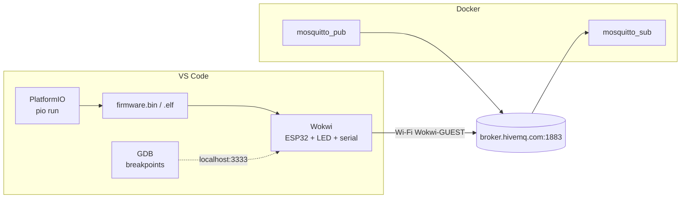
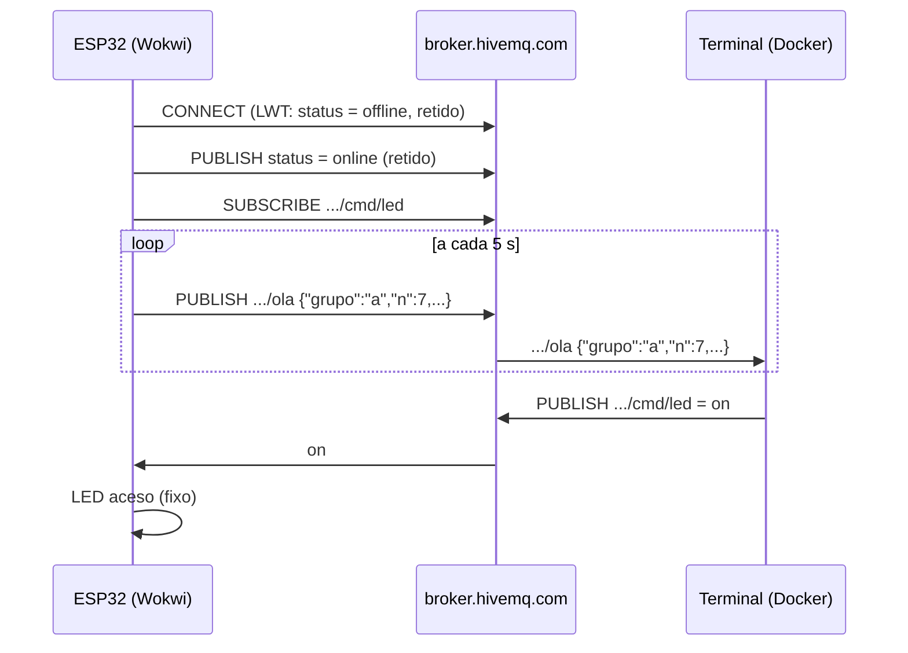

## Checklist — ambiente de desenvolvimento (parte 2): PlatformIO, Wokwi e Docker {/* #checklist */}

- [ ] Extensões PlatformIO IDE e Wokwi Simulator no perfil `ESP32IO`, com o `pio` no **Path** (Parte 1)
- [ ] Projeto PlatformIO com plataforma e bibliotecas em **versões fixas**, compilando, sem a `.pio/` no repositório (T1)
- [ ] Licença do Wokwi ativada, `wokwi.toml` + `diagram.json` e o pisca-LED simulado no VS Code (T2)
- [ ] Pisca sem `delay()` (com `millis()`) e um _breakpoint_ do GDB parando o firmware no Wokwi (T3)
- [ ] Docker funcionando e mensagens MQTT trocadas com o `mosquitto_sub`/`mosquitto_pub` (T4)
- [ ] ESP32 simulado publicando no broker MQTT e obedecendo a um comando enviado do terminal (T5)
- [ ] Previsões P1–P3 respondidas no `README.md`
- [ ] Nenhum `push --force`; cada tarefa num commit `Tn:`
- [ ] Logout do Git e do `gh` no computador do laboratório

:::info[Pontuação]
**T1…T5 = 100 pts** (esta aula não tem desafios): T1 15 · T2 20 · T3 15 · T4 20 · T5 30. O
autograder normaliza para 0–10. Vale o commit `Tn:` mais recente de cada tarefa.
:::

<LabSetup />

### Configuração do ambiente de desenvolvimento {/* #setup */}

<DevTools />

---

No Lab 01, o grupo passou a usar o Git e o GitHub. Agora entra o **firmware**: o
**PlatformIO** compila o código do ESP32, e o **Wokwi** o roda num ESP32 simulado dentro do
VS Code, com LED, monitor serial, Wi-Fi e depurador (GDB). E entra a última ferramenta do
ambiente, o **Docker**. Com ele, você roda o `mosquitto_sub` e o `mosquitto_pub` sem instalar
nada, e nos próximos labs o Node-RED, o banco de dados e o LAB IoT inteiro.

No fim da aula, o caminho que os Labs 05 a 12 usam o tempo todo estará testado de ponta a
ponta: o ESP32 simulado conecta no Wi-Fi do Wokwi, publica no broker MQTT público, e você vê as
mensagens e manda comandos de volta pelo terminal.



## Objetivos

- Instalar o **PlatformIO** e o **Wokwi** no VS Code e fazer o primeiro build do ESP32.
- Configurar um projeto PlatformIO **reprodutível**: plataforma e bibliotecas com versão fixa.
- Ativar o **Wokwi** no VS Code e ligar o firmware do PlatformIO ao circuito (`wokwi.toml`,
  `diagram.json`).
- Trocar o `delay()` por **`millis()`**, o padrão que todos os labs seguintes usam, e
  **depurar** o firmware simulado com o **GDB**.
- Instalar o **Docker** e usar o `mosquitto_sub`/`mosquitto_pub` num container.
- Fechar o ciclo **ESP32 → MQTT → terminal → MQTT → ESP32**.

## Material

- O ambiente do Lab 01: Windows 11, VS Code, Git, `gh`, Python, e o terminal do VS Code no
  **Prompt de Comando** (`cmd`).
- ~5 GB livres: o toolchain do ESP32 (~300 MB no primeiro build) e as imagens do Docker.
- Uma **conta no Wokwi** (gratuita) para ativar a licença do simulador no VS Code.
- **Docker Desktop** com **WSL 2** (aba **Docker** da [configuração do ambiente](#setup)).
- Nenhuma placa. A Parte 6 mostra como gravar uma placa real, para quem tiver.

:::note[Abas da configuração do ambiente usadas hoje]
**PlatformIO**, **Wokwi** (extensão, licença e, opcionalmente, o `wokwi-cli`), **Docker** (WSL 2
e Docker Desktop) e, só para quem tiver placa, **Drivers**. As demais já foram feitas no Lab 01.
:::

:::info[Por que simular?]
O Wokwi simula o ESP32 (incluindo o Wi-Fi), LEDs, potenciômetros, o DHT22, o display SSD1306 e
um analisador lógico. Todo o semestre roda nele: ninguém depende da bancada, do cabo USB ou do
driver da placa, e o mesmo circuito (`diagram.json`) vai para o repositório junto com o código.
No Lab 10, o mesmo simulador roda sem interface, dentro do CI.
:::

## Clonar o repositório do grupo {/* #clonar */}

<LabTeamMembers labName="lab02" />

## Envie o link do repositório do seu grupo no Moodle: {/* #moodle-link */}

<LabSubmit labName="lab02" />

<details>
<summary><strong>Mapa de tarefas</strong> — 5 tarefas · 100 pts</summary>

- [T1 — Projeto PlatformIO com versoes fixas](#t1) · 15 pts
- [T2 — Wokwi no VS Code](#t2) · 20 pts
- [T3 — Pisca com millis e GDB](#t3) · 15 pts
- [T4 — Docker e MQTT pelo terminal](#t4) · 20 pts
- [T5 — ESP32 simulado falando MQTT](#t5) · 30 pts

</details>

O repositório nasce do `lab02-template`, com o `README.md` e o `.gitignore`:

<FileTree
  details={true}
  defaultOpen={false}
  title="Estrutura de Arquivos do Projeto (no fim da aula)"
  root="lab02-grupo-x"
  files={[
    ".gitignore r",
    ".vscode/settings.json r",
    ".vscode/launch.json c",
    "README.md u",
    "platformio.ini c",
    "src/main.cpp c",
    "include/README c",
    "lib/README c",
    "test/README c",
    "wokwi.toml c",
    "diagram.json c",
    "evidencias/t1-ambiente.txt c",
    "evidencias/t1-build.txt c",
    "evidencias/t2-serial.txt c",
    "evidencias/t2-wokwi.png c",
    "evidencias/t3-serial.txt c",
    "evidencias/t3-gdb.png c",
    "evidencias/t4-mqtt.txt c",
    "evidencias/t5-mqtt.txt c",
    "evidencias/t5-serial.txt c",
  ]}
/>

:::info[Tópicos do Lab 02]
Tudo fica sob `elt85b/lab02/grupo-X/`. Troque o `X` (e o `#define GRUPO`) pela letra do seu
grupo. O broker `broker.hivemq.com` é **público**: qualquer pessoa pode ler e publicar nos seus
tópicos. Não mande nada que não possa ser público.
:::

---

## Parte 1 — PlatformIO: instalação e projeto com versões fixas {/* #parte-1 */}

### 1.1 Instalar as extensões

Siga as abas **PlatformIO** e **Wokwi** da [configuração do ambiente](#setup). As extensões vão
para o **perfil `ESP32IO`** do VS Code (`--profile "ESP32IO"`), o mesmo em que você abriu o
repositório no Lab 01:

```shell title="Terminal (cmd)"
code --install-extension platformio.platformio-ide --profile "ESP32IO"
code --install-extension wokwi.wokwi-vscode --profile "ESP32IO"
```

Abra o repositório do grupo **nesse perfil** e confira que o terminal é o **cmd** (o
`.vscode/settings.json` do Lab 01; se o template não o trouxer, crie-o de novo):

```shell title="Terminal (cmd)"
cd lab02-grupo-x
code --profile "ESP32IO" .
```

Na primeira vez que o VS Code abrir com a extensão do PlatformIO, ela instala o **PlatformIO
Core** (barra de status: _Installing PlatformIO Core_). Espere terminar e recarregue a janela
quando ele pedir. É essa instalação que cria a pasta `%USERPROFILE%\.platformio\penv\Scripts\`,
que a aba **PlatformIO** manda pôr no **Path**. Depois de pôr, **feche e abra** o VS Code e
confira:

```shell title="Terminal do VS Code (cmd)"
pio --version
call code --list-extensions --profile "ESP32IO"
```

Se aparecer _'pio' não é reconhecido como um comando interno_, falta o **Path**; se a pasta não
existir, o PlatformIO Core ainda não terminou de instalar.

### 1.2 Criar o projeto

No terminal do VS Code, na raiz do repositório:

```shell title="Terminal do VS Code (cmd)"
pio project init -b esp32dev -O "framework=arduino" -O "monitor_speed=115200"
```

```text title="Saída esperada"
The following files/directories have been created in C:\...\lab02-grupo-x
include - Put project header files here
lib - Put project specific (private) libraries here
src - Put project source files here
platformio.ini - Project Configuration File
Resolving esp32dev dependencies...
Project has been successfully initialized!
```

O `pio project init` cria `platformio.ini`, `src/`, `include/`, `lib/` e `test/`, e não apaga o
`README.md` nem o `.vscode/settings.json`. (A aba **PlatformIO** mostra o mesmo comando com
`--ide vscode --sample-code`: o primeiro gera arquivos de configuração do VS Code, o segundo um
`main.cpp` de exemplo. Aqui você escreve o seu.)

### 1.3 Fixar as versões

O `pio project init` escreve `platform = espressif32`, sem versão. Sem versão, o mesmo projeto
compila com um core Arduino diferente quando sai uma versão nova, e um código que funcionava
para de compilar "sozinho". Fixe:

```ini title="platformio.ini"
[env:esp32dev]
platform = espressif32@6.9.0       ; versão fixa: core Arduino 2.0.17 (o dos labs seguintes)
board = esp32dev
framework = arduino
monitor_speed = 115200             ; o mesmo valor do Serial.begin()
```

### 1.4 Pisca-LED e primeiro build

Crie `src/main.cpp`:

```cpp title="src/main.cpp"
#include <Arduino.h>

#define LED_PIN 2                     // GPIO2 (o LED do circuito da Parte 2)

// Protótipo: em C/C++ uma função precisa ser declarada antes de ser usada
void piscar(uint8_t pino, uint16_t meioPeriodoMs);

void setup() {
  Serial.begin(115200);               // o mesmo valor do monitor_speed do platformio.ini
  pinMode(LED_PIN, OUTPUT);
  Serial.println("ESP32 inicializado! Lab 02, grupo X");
}

void loop() {
  piscar(LED_PIN, 500);
}

void piscar(uint8_t pino, uint16_t meioPeriodoMs) {
  digitalWrite(pino, HIGH);
  delay(meioPeriodoMs);
  digitalWrite(pino, LOW);
  delay(meioPeriodoMs);
}
```

O **primeiro** build baixa a plataforma `espressif32@6.9.0`, o toolchain Xtensa e o core
Arduino (~300 MB). Pode levar de 5 a 15 minutos; os seguintes levam segundos. Rode o primeiro
na tela, para acompanhar o download, e o segundo gravando a evidência:

```shell title="Terminal do VS Code (cmd)"
pio run
if not exist evidencias mkdir evidencias
(echo == ambiente %DATE% %TIME% & pio --version & call code --list-extensions --profile "ESP32IO") > evidencias\t1-ambiente.txt 2>&1
pio run > evidencias\t1-build.txt 2>&1
type evidencias\t1-build.txt
```

```text title="evidencias/t1-build.txt (final; os números variam)"
RAM:   [=         ]   6.5% (used 21360 bytes from 327680 bytes)
Flash: [==        ]  20.4% (used 267525 bytes from 1310720 bytes)
Building .pio/build/esp32dev/firmware.bin
========================= [SUCCESS] Took 41.27 seconds =========================
```

:::note[Os botões do PlatformIO]
A barra de status do VS Code tem os mesmos comandos: ✓ **Build** (`pio run`), → **Upload**
(`pio run -t upload`), 🔌 **Serial Monitor** (`pio device monitor`) e 🗑 **Clean**. O terminal é
melhor para gerar evidências, porque o `> arquivo 2>&1` grava a saída direto num arquivo. O
segundo `pio run` não recompila nada, mas imprime de novo o uso de RAM e Flash.
:::

### 1.5 O que vai para o repositório

O `git status` mostra a pasta `.pio/`? Não deveria: o `.gitignore` do template a ignora. Ela
guarda o build inteiro (dezenas de MB, confira com `dir /s .pio`), muda a cada compilação e é
refeita por qualquer um com `pio run`. Nem o `firmware.bin` vai: ele é gerado a partir do
código, e no Lab 10 vai para outro lugar, uma _release_. Faça o commit **só** do que é código e
configuração:

```shell title="Terminal do VS Code (cmd)"
git status
git add .vscode/settings.json platformio.ini src include lib test evidencias/t1-ambiente.txt evidencias/t1-build.txt
git commit -m "T1: projeto com versões fixas"
git push
```

<FileTree
  root="lab02-grupo-x"
  files={[
    ".vscode/settings.json c",
    "platformio.ini c",
    "src/main.cpp c",
    "evidencias/t1-ambiente.txt c",
    "evidencias/t1-build.txt c",
  ]}
/>

<CommitPoint
  id="t1"
  task="Projeto PlatformIO com versoes fixas"
  pontos={15}
  files=".vscode/settings.json platformio.ini src/main.cpp evidencias/t1-ambiente.txt evidencias/t1-build.txt"
/>

---

## Parte 2 — Wokwi no VS Code {/* #parte-2 */}

### 2.1 Ativar a licença

Na aba **Wokwi** da [configuração do ambiente](#setup), use o link **Gerar uma licença pessoal
de 30 dias** (ou, no VS Code, **F1** → **Wokwi: Request a New License**). O navegador abre o
site do Wokwi: entre com a sua conta e confirme, e o navegador devolve a licença ao VS Code.
Quando ela vencer, o VS Code avisa, e você repete o passo.

### 2.2 Ligar o firmware ao simulador

O Wokwi precisa de dois arquivos na raiz do projeto:

- `wokwi.toml`: **qual firmware** rodar (o que o PlatformIO acabou de compilar);
- `diagram.json`: **o circuito** (placa, componentes, fios).

```toml title="wokwi.toml"
[wokwi]
version = 1
firmware = '.pio/build/esp32dev/firmware.bin'
elf = '.pio/build/esp32dev/firmware.elf'
```

Use `/` nos caminhos, mesmo no Windows: o arquivo vai para o repositório e precisa funcionar
nos computadores de todos (e, no Lab 10, no Linux do CI).

```json title="diagram.json"
{
  "version": 1,
  "author": "ELT85B - Lab 02",
  "editor": "wokwi",
  "parts": [
    {
      "type": "board-esp32-devkit-c-v4",
      "id": "esp",
      "top": 0,
      "left": 0,
      "attrs": {}
    },
    {
      "type": "wokwi-resistor",
      "id": "r1",
      "top": 130,
      "left": 120,
      "attrs": { "value": "220" }
    },
    {
      "type": "wokwi-led",
      "id": "led1",
      "top": 80,
      "left": 220,
      "attrs": { "color": "red", "label": "GPIO2" }
    }
  ],
  "connections": [
    ["esp:TX", "$serialMonitor:RX", "", []],
    ["esp:RX", "$serialMonitor:TX", "", []],
    ["esp:2", "r1:1", "green", []],
    ["r1:2", "led1:A", "green", []],
    ["led1:C", "esp:GND.2", "black", []]
  ],
  "dependencies": {}
}
```

| Linha                                        | O que liga                                                                   |
| -------------------------------------------- | ---------------------------------------------------------------------------- |
| `esp:TX` → `$serialMonitor:RX` (e o inverso) | a UART0 do ESP32 ao monitor serial do Wokwi (o `Serial.println`)             |
| `esp:2` → resistor → `led1:A`                | o GPIO2 ao **anodo** do LED, passando por 220 Ω (limita a corrente em ~6 mA) |
| `led1:C` → `esp:GND.2`                       | o **catodo** do LED ao terra                                                 |

Abra o `diagram.json` no VS Code: o editor do Wokwi mostra o circuito ao lado, e você pode
arrastar as peças. Os labs seguintes acrescentam componentes a este mesmo arquivo.

:::tip[Opcional: conferir o circuito com o `wokwi-cli`]
Quem instalou o `wokwi-cli` (aba **Wokwi**) pode conferir o `diagram.json` sem abrir o
simulador. O `lint` não precisa do token:

```shell title="Terminal do VS Code (cmd)"
wokwi-cli lint diagram.json
```

A única mensagem esperada é um aviso (`info`) de que o tipo `board-esp32-devkit-c-v4` não é
documentado. O token (`WOKWI_CLI_TOKEN`) só é usado para **simular** pela linha de comando, como
no CI do Lab 10.
:::

### 2.3 Simular

1. Compile (`pio run`): o Wokwi roda o **último** `firmware.bin` compilado.
2. **F1** → **Wokwi: Start Simulator** (ou clique no `diagram.json` e em ▶).
3. O LED pisca, e o monitor serial (abaixo do circuito) mostra `ESP32 inicializado!`.

Salve o monitor serial em `evidencias/t2-serial.txt` (selecione o texto e copie) e uma captura
do VS Code com o circuito e o serial em `evidencias/t2-wokwi.png`.

:::tip[Preveja antes de rodar]
**P1:** (a) você mudou o `LED_PIN` para `4` e iniciou o simulador **sem** compilar de novo. O que
o Wokwi mostra: o código novo ou o antigo? Por quê? (b) No canto do simulador aparece a
porcentagem de **tempo real** (ex.: `98%`). Se ela cair para 50 %, o LED pisca mais devagar na
tela? E o `millis()` do ESP32: conta o tempo simulado ou o do relógio da parede?
:::

<FileTree
  root="lab02-grupo-x"
  files={[
    "wokwi.toml c",
    "diagram.json c",
    "evidencias/t2-serial.txt c",
    "evidencias/t2-wokwi.png c",
  ]}
/>

<CommitPoint
  id="t2"
  task="Wokwi no VS Code"
  pontos={20}
  files="wokwi.toml diagram.json evidencias/t2-serial.txt evidencias/t2-wokwi.png"
/>

---

## Parte 3 — Pisca com `millis()` e depuração com GDB {/* #parte-3 */}

### 3.1 Sem `delay()`

Com `delay(500)`, o ESP32 fica **parado** meio segundo e não faz mais nada: não lê a serial, não
atende o Wi-Fi, não confere um botão. Os labs seguintes fazem várias coisas "ao mesmo tempo",
então o padrão é outro: o `loop()` gira o tempo todo e cada tarefa confere se **já deu a hora**.

```cpp title="src/main.cpp (T3)"
#include <Arduino.h>

#define LED_PIN       2
#define MEIO_PERIODO  500              // ms aceso, ms apagado
#define RELATORIO_MS  2000             // a cada 2 s, uma linha no serial

unsigned long tLed = 0, tRelatorio = 0;
bool ledAceso = false;
uint32_t voltas = 0;                   // quantas vezes o loop() rodou

void setup() {
  Serial.begin(115200);
  pinMode(LED_PIN, OUTPUT);
  Serial.println("ESP32 inicializado! Lab 02, grupo X");
}

void loop() {
  unsigned long agora = millis();
  voltas++;

  if (agora - tLed >= MEIO_PERIODO) {          // já deu a hora de trocar o LED?
    tLed += MEIO_PERIODO;
    ledAceso = !ledAceso;
    digitalWrite(LED_PIN, ledAceso ? HIGH : LOW);
  }

  if (agora - tRelatorio >= RELATORIO_MS) {    // e a do relatório?
    tRelatorio += RELATORIO_MS;
    Serial.printf("[%7lu ms] LED %s · %lu voltas do loop() em 2 s\r\n",
                  agora, ledAceso ? "aceso " : "apagado", (unsigned long)voltas);
    voltas = 0;
  }
}
```

```text title="Monitor serial (trecho; o número de voltas varia)"
ESP32 inicializado! Lab 02, grupo X
[   2000 ms] LED aceso  · 1032915 voltas do loop() em 2 s
[   4000 ms] LED aceso  · 1035522 voltas do loop() em 2 s
[   6000 ms] LED aceso  · 1035519 voltas do loop() em 2 s
```

O `loop()` roda centenas de milhares de vezes por segundo, e o LED continua piscando no ritmo
certo. Com o pisca de `delay` da T1, seriam **2** voltas a cada 2 s.

:::tip[Preveja antes de rodar]
**P2:** (a) o `millis()` é um `unsigned long` de 32 bits e volta a zero depois de ~49,7 dias.
Por que `agora - tLed >= MEIO_PERIODO` continua certo na virada, mas `agora >= tLed + MEIO_PERIODO`
não? Teste a conta com números de 32 bits: `tLed = 4294967000`, `agora = 200`. (b) Por que
`tLed += MEIO_PERIODO` e não `tLed = agora`? O que acontece com o ritmo do LED em cada caso, se
uma volta do `loop()` atrasar 3 ms?
:::

**Evidência:** pelo menos 5 linhas do monitor serial em `evidencias/t3-serial.txt`.

### 3.2 Depurar com GDB no Wokwi

O `Serial.printf` mostra o que você **mandou** imprimir. O **GDB** para o firmware numa linha
(_breakpoint_) e mostra **todas** as variáveis naquele instante, sem mudar o código. O Wokwi
abre um servidor GDB na porta 3333, e o VS Code se conecta a ele.

1. **Extensão C/C++** (fornece o depurador `cppdbg` do VS Code):

   ```shell title="Terminal (cmd)"
   code --install-extension ms-vscode.cpptools --profile "ESP32IO"
   ```

2. **`wokwi.toml`**: acrescente a porta do servidor GDB.

   ```toml title="wokwi.toml"
   [wokwi]
   version = 1
   firmware = '.pio/build/esp32dev/firmware.bin'
   elf = '.pio/build/esp32dev/firmware.elf'
   gdbServerPort = 3333
   ```

3. **`.vscode/launch.json`**: diz ao VS Code qual GDB usar (o do toolchain do ESP32, baixado
   pelo PlatformIO), qual `.elf` tem os símbolos e onde está o servidor.

   ```json title=".vscode/launch.json"
   {
     "version": "0.2.0",
     "configurations": [
       {
         "name": "Wokwi GDB",
         "type": "cppdbg",
         "request": "launch",
         "program": "${workspaceFolder}/.pio/build/esp32dev/firmware.elf",
         "cwd": "${workspaceFolder}",
         "MIMode": "gdb",
         "miDebuggerPath": "${userHome}/.platformio/packages/toolchain-xtensa-esp32/bin/xtensa-esp32-elf-gdb.exe",
         "miDebuggerServerAddress": "localhost:3333"
       }
     ]
   }
   ```

   Confira que o GDB existe nesse caminho:

   ```shell title="Terminal do VS Code (cmd)"
   dir "%USERPROFILE%\.platformio\packages\toolchain-xtensa-esp32\bin\*gdb*"
   ```

4. **Depurar.** Compile (`pio run`), depois **F1** → **Wokwi: Start Simulator and Wait for
   Debugger**: o simulador abre parado, esperando o GDB. Clique na margem à esquerda da linha
   `ledAceso = !ledAceso;` (aparece um ponto vermelho) e aperte **F5** (configuração
   **Wokwi GDB**).

5. O firmware para no _breakpoint_. No painel **Run and Debug**, a seção **Variables** mostra
   `agora`, e **Watch** aceita expressões (`tLed`, `voltas`, `ledAceso`). **F5** continua até a
   próxima parada, **F10** executa uma linha, **F11** entra na função, **Shift+F5** encerra.

Salve uma captura do VS Code parado no _breakpoint_, com as variáveis à vista, em
`evidencias/t3-gdb.png`.

:::note[Variáveis _optimized out_]
O build padrão do PlatformIO é otimizado (`-Os`): o compilador guarda variáveis em
registradores ou as elimina, e o GDB mostra `<optimized out>`. Para depurar, acrescente
`build_type = debug` ao `[env:esp32dev]` do `platformio.ini` e compile de novo; retire-o depois.
Enquanto o firmware está parado no GDB, o tempo **simulado** também para: o `millis()` não
avança, e o LED não troca (compare com o P1-b).
:::

<FileTree
  root="lab02-grupo-x"
  files={[
    "src/main.cpp u",
    "wokwi.toml u",
    ".vscode/launch.json c",
    "evidencias/t3-serial.txt c",
    "evidencias/t3-gdb.png c",
  ]}
/>

<CommitPoint
  id="t3"
  task="Pisca com millis e GDB"
  pontos={15}
  files="src/main.cpp wokwi.toml .vscode/launch.json evidencias/t3-serial.txt evidencias/t3-gdb.png"
/>

---

## Parte 4 — Docker e MQTT pelo terminal {/* #parte-4 */}

### 4.1 Instalar e conferir o Docker

Siga a aba **Docker** da [configuração do ambiente](#setup): primeiro o **WSL 2** (o
`wsl --install` pede para reiniciar o computador), depois o **Docker Desktop**. Abra o Docker
Desktop, aceite os termos e espere a baleia ficar parada na bandeja. Se ele reclamar de
virtualização, ative-a na BIOS/UEFI (Intel VT-x ou AMD-V).

Confira no terminal do VS Code:

```shell title="Terminal do VS Code (cmd)"
wsl --version && docker --version && docker compose version
docker run --rm hello-world
```

O `hello-world` baixa uma imagem minúscula, cria um container, imprime _Hello from Docker!_ e
o container é apagado (`--rm`). É assim que todos os comandos `docker run` dos labs funcionam:
você usa um programa (o `mosquitto_sub`, por exemplo) sem instalá-lo no Windows.

### 4.2 MQTT em 1 minuto

O **MQTT** é um protocolo de mensagens por **tópicos**. Quem publica manda uma mensagem para um
**broker**, num tópico (`elt85b/lab02/grupo-a/ola`). Quem assinou aquele tópico (ou um filtro
como `elt85b/lab02/grupo-a/#`) recebe. Quem publica e quem assina não se conhecem: os dois só
falam com o broker. Os detalhes (QoS, retain, LWT) vêm no Lab 05.

### 4.3 Publicar e assinar

O teste da aba **Docker** usa o broker `test.mosquitto.org`. Nos labs, o broker público é o
`broker.hivemq.com`, e cada grupo usa o seu tópico.

O `cmd` não tem um jeito simples de mostrar a saída na tela **e** gravá-la num arquivo ao mesmo
tempo. Por isso, o assinante roda **em segundo plano**, num container com nome (`-d --name`): o
`docker logs -f` mostra o que chega, e o `docker logs` (sem `-f`) grava tudo na evidência no
fim.

<GroupCommands
  commands={[
    {
      title: "1. Assinar",
      codeTitle: "Terminal 1 (cmd) — assinante em segundo plano",
      command: `docker run -d --name sub-lab02 eclipse-mosquitto:2 mosquitto_sub -h broker.hivemq.com -t "{course}/lab02/grupo-{group}/#" -v
docker logs -f sub-lab02`,
    },
    {
      title: "2. Publicar",
      codeTitle: "Terminal 2 (cmd) — publicar",
      command: `docker run --rm eclipse-mosquitto:2 mosquitto_pub -h broker.hivemq.com -t "{course}/lab02/grupo-{group}/teste" -m "ola do grupo {group}"
docker run --rm eclipse-mosquitto:2 mosquitto_pub -h broker.hivemq.com -t "{course}/lab02/grupo-{group}/teste/numero" -m 42`,
    },
    {
      title: "3. Gravar e encerrar",
      codeTitle: "Terminal 1 (cmd) — depois do Ctrl+C",
      command: `docker logs sub-lab02 > evidencias\\t4-mqtt.txt 2>&1
type evidencias\\t4-mqtt.txt
docker rm -f sub-lab02`,
    },
  ]}
/>

Abra um segundo terminal com o **+** do painel de terminais (ou **Ctrl+Shift+`**). O
**Ctrl+C** no terminal 1 só para o `docker logs -f`: o assinante continua rodando até o
`docker rm -f`. Confira com `docker ps`.

```text title="evidencias/t4-mqtt.txt"
elt85b/lab02/grupo-a/teste ola do grupo a
elt85b/lab02/grupo-a/teste/numero 42
```

A primeira execução baixa a imagem `eclipse-mosquitto:2` (~10 MB); as seguintes começam na hora.
Se o `docker run -d` disser que o nome `sub-lab02` já está em uso, sobrou um container da
tentativa anterior: `docker rm -f sub-lab02` e repita.

:::warning[Aspas no cmd]
No `cmd`, só as **aspas duplas** agrupam um texto. Com aspas simples (`'...'`, como em muitos
exemplos da internet, escritos para Linux), o tópico chega ao `mosquitto_sub` com as aspas, e
nenhuma mensagem casa com ele.
:::

<FileTree root="lab02-grupo-x" files={["evidencias/t4-mqtt.txt c"]} />

<CommitPoint
  id="t4"
  task="Docker e MQTT pelo terminal"
  pontos={20}
  files="evidencias/t4-mqtt.txt"
/>

---

## Projeto integrador — ESP32 simulado falando MQTT {/* #integrador */}

Agora o ESP32 entra na conversa. Ele conecta no Wi-Fi do Wokwi (`Wokwi-GUEST`, aberto), publica
uma mensagem a cada 5 s e **assina** um tópico de comando: o terminal manda `on`, `off` ou
`pisca`, e o LED obedece. É o esqueleto de todos os labs com MQTT.



### Requisitos

1. **`platformio.ini`**: a biblioteca do cliente MQTT, em versão fixa.

   ```ini title="platformio.ini"
   [env:esp32dev]
   platform = espressif32@6.9.0
   board = esp32dev
   framework = arduino
   monitor_speed = 115200
   lib_deps =
       knolleary/PubSubClient@2.8
   ```

2. **`src/main.cpp`**:

   ```cpp title="src/main.cpp (T5)"
   // ELT85B - Lab 02 (T5): ESP32 no Wokwi falando MQTT
   #include <Arduino.h>
   #include <WiFi.h>
   #include <PubSubClient.h>

   #define GRUPO   "a"                         // troque pela letra do seu grupo
   #define LED_PIN 2

   const char *WIFI_SSID  = "Wokwi-GUEST";     // a rede aberta do simulador
   const char *WIFI_SENHA = "";
   const char *MQTT_HOST  = "broker.hivemq.com";
   const uint16_t MQTT_PORTA = 1883;

   #define BASE "elt85b/lab02/grupo-" GRUPO
   const char *TOPICO_STATUS = BASE "/status";   // online / offline (retido, LWT)
   const char *TOPICO_OLA    = BASE "/ola";      // JSON a cada 5 s
   const char *TOPICO_LED    = BASE "/cmd/led";  // terminal -> ESP32: on | off | pisca

   WiFiClient wifiClient;
   PubSubClient mqtt(wifiClient);
   char clientId[32];

   enum ModoLed { LED_PISCA, LED_LIGADO, LED_DESLIGADO };
   ModoLed modoLed = LED_PISCA;
   bool ledAceso = false;
   unsigned long tLed = 0, tOla = 0;
   uint32_t n = 0;

   // Chamada DENTRO de mqtt.loop(), quando chega mensagem num tópico assinado
   void aoReceberMensagem(char *topico, byte *payload, unsigned int tam) {
     char txt[16];
     size_t k = tam < sizeof(txt) - 1 ? tam : sizeof(txt) - 1;
     memcpy(txt, payload, k);
     txt[k] = '\0';                              // o payload NÃO termina com '\0'
     Serial.printf("[CMD] %s <- '%s'\r\n", topico, txt);
     if (strcmp(txt, "on") == 0) modoLed = LED_LIGADO;
     else if (strcmp(txt, "off") == 0) modoLed = LED_DESLIGADO;
     else if (strcmp(txt, "pisca") == 0) modoLed = LED_PISCA;
     else Serial.println("[CMD] use on, off ou pisca");
   }

   void conectarWiFi() {
     Serial.printf("[WiFi] conectando a %s", WIFI_SSID);
     WiFi.mode(WIFI_STA);
     WiFi.begin(WIFI_SSID, WIFI_SENHA, 6);      // canal 6: conecta mais rápido no Wokwi
     while (WiFi.status() != WL_CONNECTED) {
       delay(250);
       Serial.print('.');
     }
     Serial.printf("\r\n[WiFi] conectado, IP %s\r\n", WiFi.localIP().toString().c_str());
   }

   void conectarMQTT() {
     while (!mqtt.connected()) {
       Serial.printf("[MQTT] conectando a %s como %s ... ", MQTT_HOST, clientId);
       // LWT: se o ESP32 sumir sem avisar, o broker publica "offline" no lugar dele
       if (mqtt.connect(clientId, TOPICO_STATUS, 1, true, "offline")) {
         Serial.println("ok");
         mqtt.publish(TOPICO_STATUS, "online", true);
         mqtt.subscribe(TOPICO_LED);             // (re)assina a cada conexão
       } else {
         Serial.printf("falhou (rc=%d), nova tentativa em 2 s\r\n", mqtt.state());
         delay(2000);
       }
     }
   }

   void setup() {
     Serial.begin(115200);
     pinMode(LED_PIN, OUTPUT);
     Serial.println("\r\n=== Lab 02 - ESP32 + MQTT ===");
     uint64_t mac = ESP.getEfuseMac();
     snprintf(clientId, sizeof(clientId), "lab02-%s-%04X", GRUPO, (uint16_t)(mac >> 32));
     conectarWiFi();
     mqtt.setServer(MQTT_HOST, MQTT_PORTA);
     mqtt.setCallback(aoReceberMensagem);
     conectarMQTT();
   }

   void loop() {
     if (WiFi.status() != WL_CONNECTED) conectarWiFi();
     if (!mqtt.connected()) conectarMQTT();
     mqtt.loop();                               // processa a rede e chama o callback

     unsigned long agora = millis();
     if (agora - tLed >= 500) {                 // LED, sem delay (T3)
       tLed += 500;
       if (modoLed == LED_PISCA) ledAceso = !ledAceso;
       else ledAceso = (modoLed == LED_LIGADO);
       digitalWrite(LED_PIN, ledAceso ? HIGH : LOW);
     }

     if (agora - tOla >= 5000) {                // a cada 5 s, uma mensagem
       tOla += 5000;
       char json[96];
       snprintf(json, sizeof(json), "{\"grupo\":\"%s\",\"n\":%lu,\"uptime_ms\":%lu}",
                GRUPO, (unsigned long)++n, agora);
       bool ok = mqtt.publish(TOPICO_OLA, json);
       Serial.printf("[PUB] %s %s -> %s\r\n", ok ? "ok" : "ERRO", TOPICO_OLA, json);
     }
   }
   ```

   :::tip[O GDB também serve aqui]
   Um _breakpoint_ dentro de `aoReceberMensagem` mostra o `payload` e o `tam` exatamente como
   chegaram do broker (**Watch**: `(char*)payload,10`). Lembre que, com o firmware parado, o
   ESP32 não responde ao _keepalive_: pare por mais de ~20 s e o broker o desconecta (e publica
   o `offline`).
   :::

3. **Teste.** Primeiro o assinante (para não perder o `status online`), depois compile e
   inicie o Wokwi, e então os comandos:

<GroupCommands
  commands={[
    {
      title: "1. Assinar",
      codeTitle: "Terminal 1 (cmd) — assinante em segundo plano",
      command: `docker run -d --name sub-lab02 eclipse-mosquitto:2 mosquitto_sub -h broker.hivemq.com -t "{course}/lab02/grupo-{group}/#" -v
docker logs -f sub-lab02`,
    },
    {
      title: "2. Comandar o LED",
      codeTitle: "Terminal 2 (cmd) — comandar",
      command: `docker run --rm eclipse-mosquitto:2 mosquitto_pub -h broker.hivemq.com -t "{course}/lab02/grupo-{group}/cmd/led" -m on
docker run --rm eclipse-mosquitto:2 mosquitto_pub -h broker.hivemq.com -t "{course}/lab02/grupo-{group}/cmd/led" -m off
docker run --rm eclipse-mosquitto:2 mosquitto_pub -h broker.hivemq.com -t "{course}/lab02/grupo-{group}/cmd/led" -m pisca`,
    },
    {
      title: "3. Gravar e encerrar",
      codeTitle: "Terminal 1 (cmd) — depois do offline",
      command: `docker logs sub-lab02 > evidencias\\t5-mqtt.txt 2>&1
type evidencias\\t5-mqtt.txt
docker rm -f sub-lab02`,
    },
  ]}
/>

4. **Feche o ciclo.** Com o assinante ainda rodando, **pare** a simulação e espere (até ~25 s): chega
   `status offline`, publicado pelo **broker** no lugar do ESP32 (o LWT). Só então grave a
   evidência e remova o container (passo 3).

```text title="Monitor serial (trecho; o IP pode variar)"
=== Lab 02 - ESP32 + MQTT ===
[WiFi] conectando a Wokwi-GUEST.....
[WiFi] conectado, IP 10.10.0.2
[MQTT] conectando a broker.hivemq.com como lab02-a-3C8A ... ok
[PUB] ok elt85b/lab02/grupo-a/ola -> {"grupo":"a","n":1,"uptime_ms":7012}
[CMD] elt85b/lab02/grupo-a/cmd/led <- 'on'
[PUB] ok elt85b/lab02/grupo-a/ola -> {"grupo":"a","n":2,"uptime_ms":12012}
```

```text title="evidencias/t5-mqtt.txt (trecho)"
elt85b/lab02/grupo-a/status online
elt85b/lab02/grupo-a/ola {"grupo":"a","n":1,"uptime_ms":7012}
elt85b/lab02/grupo-a/cmd/led on
elt85b/lab02/grupo-a/ola {"grupo":"a","n":2,"uptime_ms":12012}
elt85b/lab02/grupo-a/cmd/led off
elt85b/lab02/grupo-a/cmd/led pisca
elt85b/lab02/grupo-a/status offline
```

5. **Evidências:** o `docker logs` em `evidencias/t5-mqtt.txt` (com `online`, as mensagens
   `ola`, os três comandos e o `offline`) e o monitor serial do Wokwi (selecione e copie) em
   `evidencias/t5-serial.txt`.
6. **No `README.md`:** as respostas de P1, P2 e P3.

:::tip[Preveja antes de rodar]
**P3:** (a) assine o tópico do grupo **antes** de iniciar o Wokwi, e depois de novo com a
simulação já rodando há um minuto. Em qual das duas vezes o `status online` aparece logo no
começo? Por quê (pense no `true` do `publish` de status)? (b) O `offline` chegou na hora em que
você parou a simulação, ou alguns segundos depois? Do que isso depende (a conexão TCP fechada ×
o _keepalive_ de 15 s vencido)? (c) Outro grupo poderia mandar
`on` para o **seu** LED? O que isso diz sobre usar um broker público num projeto real?
:::

<FileTree
  root="lab02-grupo-x"
  files={[
    "platformio.ini u",
    "src/main.cpp u",
    "evidencias/t5-mqtt.txt c",
    "evidencias/t5-serial.txt c",
    "README.md u",
  ]}
/>

<CommitPoint
  id="t5"
  task="ESP32 simulado falando MQTT"
  pontos={30}
  files="platformio.ini src/main.cpp evidencias/t5-mqtt.txt evidencias/t5-serial.txt README.md"
/>

---

## Parte 6 — Placa real (opcional) {/* #placa */}

Quem tiver um ESP32 DevKit pode gravar o mesmo firmware. O código não muda. Só o Wi-Fi: troque
`Wokwi-GUEST` pela rede disponível, e **não** faça commit da senha.

Antes, siga a aba **Drivers** da [configuração do ambiente](#setup): a placa tem de aparecer
como uma porta **COM** no Gerenciador de Dispositivos, e o `esptool chip-id` tem de responder.
Depois:

```shell title="Terminal do VS Code (cmd)"
pio device list
pio run -t upload
pio device monitor
```

O `pio device list` mostra as portas (`COM3`, `COM4`...). O `upload` compila e grava, e o
`monitor` abre o serial a 115200 (**Ctrl+C** sai). Feche o monitor antes de gravar de novo: a
porta COM só atende um programa por vez.

| Problema                                      | O que tentar                                                                        |
| --------------------------------------------- | ----------------------------------------------------------------------------------- |
| A porta não aparece                           | outro cabo (muitos só carregam), outra USB, driver CP210x ou CH340                  |
| `Failed to connect to ESP32`                  | segure **BOOT** quando aparecer `Connecting....`                                    |
| Caracteres estranhos no serial                | `monitor_speed` diferente do `Serial.begin()`                                       |
| `could not open port 'COM4': PermissionError` | outro programa está com a porta (um monitor serial aberto, outro terminal): feche-o |

---

## Referência rápida {/* #referencia */}

| Para…                       | Comando                                                                                            |
| --------------------------- | -------------------------------------------------------------------------------------------------- |
| Compilar                    | `pio run`                                                                                          |
| Limpar o build              | `pio run -t clean`                                                                                 |
| Simular                     | F1 → **Wokwi: Start Simulator** (compile antes)                                                    |
| Depurar                     | F1 → **Wokwi: Start Simulator and Wait for Debugger** → **F5** (**Wokwi GDB**)                     |
| Assinar um tópico (na tela) | `docker run --rm eclipse-mosquitto:2 mosquitto_sub -h broker.hivemq.com -t "topico/#" -v`          |
| Assinar em segundo plano    | `docker run -d --name sub eclipse-mosquitto:2 mosquitto_sub -h broker.hivemq.com -t "topico/#" -v` |
| Ver / gravar o que chegou   | `docker logs -f sub` · `docker logs sub > arquivo.txt 2>&1`                                        |
| Publicar                    | `docker run --rm eclipse-mosquitto:2 mosquitto_pub -h broker.hivemq.com -t "topico" -m "texto"`    |
| Ver containers / remover um | `docker ps -a` · `docker rm -f sub`                                                                |
| Ver um arquivo no terminal  | `type evidencias\t5-mqtt.txt`                                                                      |
| Fluxo de entrega            | ramo → commit `Tn:` → `push` → PR → revisão → merge (Lab 01)                                       |

| Atalho do depurador | Ação                                 |
| ------------------- | ------------------------------------ |
| **F9**              | liga/desliga o _breakpoint_ na linha |
| **F5**              | inicia / continua                    |
| **F10** · **F11**   | próxima linha · entra na função      |
| **Shift+F5**        | encerra a depuração                  |

| Problema                                             | O que fazer                                                                                                                                                          |
| ---------------------------------------------------- | -------------------------------------------------------------------------------------------------------------------------------------------------------------------- |
| `'pio' não é reconhecido como um comando interno`    | ponha `%USERPROFILE%\.platformio\penv\Scripts\` no **Path** (aba **PlatformIO**) e abra um terminal novo. Se a pasta não existir, o PlatformIO Core ainda não terminou de instalar |
| `code` abre o VS Code sem as extensões               | abra no perfil: `code --profile "ESP32IO" .`                                                                                                                         |
| O primeiro `pio run` demora muito                    | é o download do toolchain (~300 MB): deixe terminar. Os builds seguintes levam segundos                                                                              |
| O Wokwi pede licença                                 | link da aba **Wokwi**, ou F1 → **Wokwi: Request a New License** (vence a cada 30 dias)                                                                               |
| `firmware.bin not found` no Wokwi                    | compile antes (`pio run`) e confira os caminhos do `wokwi.toml`                                                                                                      |
| O Wokwi roda o código antigo                         | ele roda o último build: compile de novo                                                                                                                             |
| `Configured debug type 'cppdbg' is not supported`    | falta a extensão **C/C++** (`ms-vscode.cpptools`) no perfil `ESP32IO`                                                                                                |
| GDB: `Unable to start debugging` / `localhost:3333`  | inicie antes o **Wokwi: Start Simulator and Wait for Debugger**, e confira o `gdbServerPort = 3333` no `wokwi.toml`                                                  |
| GDB: `miDebuggerPath` inválido                       | o caminho do `launch.json` tem de bater com o `dir ...\toolchain-xtensa-esp32\bin\*gdb*` (3.2)                                                                       |
| _Breakpoint_ cinza ou variável `<optimized out>`     | `build_type = debug` no `platformio.ini` e compile de novo                                                                                                           |
| `[WiFi] conectando...` sem fim                       | o SSID tem de ser exatamente `Wokwi-GUEST`, sem senha                                                                                                                |
| `[MQTT] ... falhou (rc=-2)`                          | sem rede até o broker: confira o Wi-Fi e o `MQTT_HOST`                                                                                                               |
| `docker: error during connect`                       | o Docker Desktop está fechado ou iniciando: abra-o e espere                                                                                                          |
| `The container name "/sub-lab02" is already in use`  | sobrou o container de antes: `docker rm -f sub-lab02`                                                                                                                |
| `'docker' não é reconhecido como um comando interno` | o Docker Desktop terminou de instalar depois que o VS Code abriu: feche e abra o VS Code                                                                             |
| `mosquitto_sub` não mostra nada                      | o tópico tem de ser **idêntico** (maiúsculas, `grupo-a` × `grupo-A`), entre **aspas duplas** (no `cmd`, aspas simples viram parte do tópico), e o `#` só vale no fim |
| O terminal abre como **PowerShell**                  | falta o `.vscode/settings.json` (Lab 01, 1.1): crie-o e abra um terminal novo                                                                                        |

---

## Logout do seu ambiente dev, git e gh {/* #logout */}

<GitLogOut />

<LabLogout />
