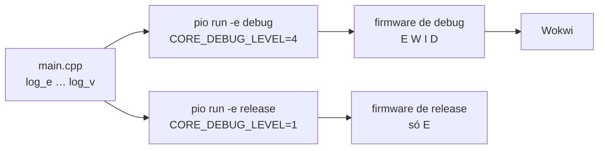

import { GitLogOut } from "@site/src/components/shared/InstructionsSite";

<div style={{ display: "flex", justifyContent: "center" }}>
  <LabTable index={3} internal={false} />
</div>

## Checklist — logs no ESP32 e ambientes de build (debug × release) {/* #checklist */}

- [ ] Os cinco níveis de log (`log_e` … `log_v`) aparecendo no Wokwi com `CORE_DEBUG_LEVEL=5` (T1)
- [ ] O mesmo código com `CORE_DEBUG_LEVEL=2`, e a prova de que as mensagens **saíram do binário** (T2)
- [ ] `platformio.ini` com dois ambientes, `debug` e `release`, compilando os dois (T3)
- [ ] Logs com dados formatados, falhas, taxa de erro e _hexdump_, sem `delay()` (T4)
- [ ] Firmware com relatório de boot, nos dois ambientes, com as evidências (T5)
- [ ] Previsões P1–P3 respondidas no `README.md`
- [ ] Nenhum `push --force`; cada tarefa num commit `Tn:`
- [ ] Logout do Git e do `gh` no computador do laboratório

:::info[Pontuação]
**T1…T5 = 100 pts** (esta aula não tem desafios): T1 15 · T2 20 · T3 20 · T4 20 · T5 25. O
autograder normaliza para 0–10. Vale o commit `Tn:` mais recente de cada tarefa.
:::

<LabSetup />

### Configuração do ambiente de desenvolvimento {/* #setup */}

<DevTools />

---

Até aqui, o firmware falava com você por `Serial.println()`. Funciona, mas não escala: um erro
grave e um detalhe sem importância saem iguais, não se sabe de que arquivo veio cada linha, e
os `print` de depuração ficam no produto, a não ser que alguém se lembre de apagá-los.

O core Arduino do ESP32 tem um **sistema de log** com cinco níveis. Cada mensagem sai com o
instante, o nível, o arquivo, a linha e a função. E o mais importante: o nível é escolhido
**na compilação**. As mensagens abaixo do nível escolhido não são escondidas, elas **deixam de
existir** no firmware. Com dois **ambientes** no `platformio.ini`, o mesmo código vira um
firmware de desenvolvimento, falante, e um de produto, que só registra erros.

Os labs seguintes usam os logs o tempo todo: o Lab 04 mostra, com eles, o que o Wi-Fi e o MQTT
estão fazendo por dentro.



## Objetivos

- Usar as macros `log_e`, `log_w`, `log_i`, `log_d` e `log_v`, com formatação estilo `printf`.
- Entender o **`CORE_DEBUG_LEVEL`**: o filtro acontece na **compilação**, não na execução.
- **Provar** que as mensagens filtradas saíram do binário.
- Criar ambientes **`debug`** e **`release`** no `platformio.ini` e escolher qual compilar.
- Usar o log para contar uma história: falha, recuperação, estatística e _dump_ de bytes.

## Material

- O ambiente dos Labs 01 e 02: Windows 11, VS Code no perfil `ESP32IO` com o terminal no
  **Prompt de Comando** (`cmd`), PlatformIO com o `pio` no **Path** e o Wokwi com licença ativa.
- Nenhuma placa: tudo roda no Wokwi.

## Clonar o repositório do grupo {/* #clonar */}

<LabTeamMembers labName="lab03" />

## Envie o link do repositório do seu grupo no Moodle: {/* #moodle-link */}

<LabSubmit labName="lab03" />

<details>
<summary><strong>Mapa de tarefas</strong> — 5 tarefas · 100 pts</summary>

- [T1 — Os cinco niveis de log](#t1) · 15 pts
- [T2 — Filtrar na compilacao](#t2) · 20 pts
- [T3 — Ambientes debug e release](#t3) · 20 pts
- [T4 — Logs com dados e falhas](#t4) · 20 pts
- [T5 — Firmware com relatorio de boot](#t5) · 25 pts

</details>

O repositório nasce do `lab03-template`, com o `README.md`, o `.gitignore` e o
`.vscode/settings.json` (terminal `cmd`):

<FileTree
  details={true}
  defaultOpen={false}
  title="Estrutura de Arquivos do Projeto (no fim da aula)"
  root="lab03-grupo-X"
  files={[
    ".gitignore r",
    ".vscode/settings.json r",
    "README.md u",
    "platformio.ini c",
    "src/main.cpp c",
    "diagram.json c",
    "wokwi.toml c",
    "evidencias/t1-serial.txt c",
    "evidencias/t2-nivel5.txt c",
    "evidencias/t2-nivel2.txt c",
    "evidencias/t3-ambientes.txt c",
    "evidencias/t4-serial.txt c",
    "evidencias/t5-serial.txt c",
    "evidencias/t5-build.txt c",
  ]}
/>

### Como a correção funciona

O autograder roda no GitHub a cada `push`. Para cada tarefa, ele acha o commit `Tn:` mais
recente, volta o repositório **àquele ponto** e confere duas coisas: se o projeto **compila**
(`pio run`) e se os requisitos da tarefa estão lá (as macros, o `CORE_DEBUG_LEVEL` pedido, os
ambientes, as evidências). A nota de cada tarefa é proporcional às verificações que passam, e
o resumo aparece na aba **Actions** do repositório.

Por isso cada tarefa é **um commit**: a T2 pede `CORE_DEBUG_LEVEL=2` e a T3 volta a subir o
nível. Sem o commit `T2:`, não haveria como corrigir a T2.

---

## Parte 1 — Os cinco níveis {/* #parte-1 */}

### 1.1 Projeto e circuito

Abra o repositório no perfil da disciplina (`code --profile "ESP32IO" .`) e, no terminal do VS
Code (`cmd`), crie o projeto:

```shell title="Terminal do VS Code (cmd)"
pio project init -b esp32dev -O "framework=arduino" -O "monitor_speed=115200"
if not exist evidencias mkdir evidencias
```

O circuito é o do Lab 02: o LED com resistor no GPIO2. Copie o `diagram.json` do Lab 02 (ou
crie-o de novo) e o `wokwi.toml`:

<details>
<summary><strong><code>diagram.json</code> e <code>wokwi.toml</code></strong> (iguais aos do Lab 02)</summary>

```json title="diagram.json"
{
  "version": 1,
  "author": "ELT85B - Lab 03",
  "editor": "wokwi",
  "parts": [
    { "type": "board-esp32-devkit-c-v4", "id": "esp", "top": 0, "left": 0, "attrs": {} },
    { "type": "wokwi-resistor", "id": "r1", "top": 130, "left": 120, "attrs": { "value": "220" } },
    { "type": "wokwi-led", "id": "led1", "top": 80, "left": 220, "attrs": { "color": "red", "label": "GPIO2" } }
  ],
  "connections": [
    ["esp:TX", "$serialMonitor:RX", "", []],
    ["esp:RX", "$serialMonitor:TX", "", []],
    ["esp:2", "r1:1", "green", []],
    ["r1:2", "led1:A", "green", []],
    ["led1:C", "esp:GND.2", "black", []]
  ],
  "dependencies": {}
}
```

```toml title="wokwi.toml"
[wokwi]
version = 1
firmware = '.pio/build/esp32dev/firmware.bin'
elf = '.pio/build/esp32dev/firmware.elf'
```

</details>

### 1.2 Ligar todos os níveis

O nível de log é uma **macro do pré-processador**, passada ao compilador pelo `build_flags`:

```ini title="platformio.ini"
[env:esp32dev]
platform = espressif32@6.9.0
board = esp32dev
framework = arduino
monitor_speed = 115200
build_flags =
    -DCORE_DEBUG_LEVEL=5           ; 0 nada · 1 E · 2 W · 3 I · 4 D · 5 V
```

| Macro | Nível | Valor | Quando usar |
| --- | --- | --- | --- |
| `log_e()` | **E**rror | 1 | falhas que impedem a operação (o sensor não responde) |
| `log_w()` | **W**arning | 2 | algo estranho, mas o programa segue (valor fora da faixa) |
| `log_i()` | **I**nfo | 3 | marcos normais ("Wi-Fi conectado") |
| `log_d()` | **D**ebug | 4 | detalhes úteis durante o desenvolvimento |
| `log_v()` | **V**erbose | 5 | tudo, inclusive valores brutos e laços internos |

Uma macro só gera código se o **seu valor for menor ou igual** ao `CORE_DEBUG_LEVEL`.

```cpp title="src/main.cpp (T1)"
#include <Arduino.h>

#define LED_PIN 2

int chamadas = 0;                     // quantas vezes medir() rodou

int medir() {                         // uma "medida" com efeito colateral
  chamadas++;
  return 42;
}

void setup() {
  Serial.begin(115200);
  pinMode(LED_PIN, OUTPUT);
  Serial.println("=== Lab 03 - logs no ESP32 ===");

  log_e("Isto e um ERRO (log_e)");
  log_w("Isto e um AVISO (log_w)");
  log_i("Isto e uma INFO (log_i): LED no GPIO %d", LED_PIN);
  log_d("Isto e DEBUG (log_d): medida = %d", medir());
  log_v("Isto e VERBOSE (log_v)");

  Serial.printf("Nivel de log compilado = %d; medir() rodou %d vez(es)\r\n", ARDUHAL_LOG_LEVEL, chamadas);
}

void loop() {}
```

O `ARDUHAL_LOG_LEVEL` é o nível que o core realmente usou: o `CORE_DEBUG_LEVEL`, se ele foi
definido, ou um padrão, se não foi (P1).

### 1.3 Compilar e simular

```shell title="Terminal do VS Code (cmd)"
pio run
```

**F1** → **Wokwi: Start Simulator**:

```text title="Monitor serial do Wokwi (os instantes variam)"
[   239][D][esp32-hal-cpu.c:244] setCpuFrequencyMhz(): PLL: 480 / 2 = 240 Mhz, APB: 80000000 Hz
[   371][V][esp32-hal-uart.c:330] uartBegin(): UART0 baud(115200) Mode(800001c) rxPin(3) txPin(1)
[   375][V][esp32-hal-uart.c:416] uartBegin(): UART0 not installed. Starting installation
[   381][V][esp32-hal-uart.c:463] uartBegin(): UART0 initialization done.
=== Lab 03 - logs no ESP32 ===
[   385][E][main.cpp:18] setup(): Isto e um ERRO (log_e)
[   386][W][main.cpp:19] setup(): Isto e um AVISO (log_w)
[   386][I][main.cpp:20] setup(): Isto e uma INFO (log_i): LED no GPIO 2
[   387][D][main.cpp:21] setup(): Isto e DEBUG (log_d): medida = 42
[   387][V][main.cpp:22] setup(): Isto e VERBOSE (log_v)
Nivel de log compilado = 5; medir() rodou 1 vez(es)
```

Uma linha de log, da esquerda para a direita:

| Trecho | Significado |
| --- | --- |
| `[   385]` | milissegundos desde o boot |
| `[E]` | o nível (E, W, I, D ou V) |
| `[main.cpp:18]` | arquivo e linha de onde a mensagem saiu |
| `setup():` | a função que chamou |
| `Isto e um ERRO...` | a sua mensagem |

As quatro primeiras linhas não são suas: o **próprio core** usa os mesmos logs (a CPU a
240 MHz, a UART sendo configurada pelo `Serial.begin`). Com o nível 5, você vê também o que as
bibliotecas fazem por dentro.

As macros aceitam os especificadores do `printf`: `%d` (inteiro), `%u` (sem sinal), `%lu`
(`unsigned long`), `%.1f` (`float` com uma casa), `%s` (texto), `%x` (hexadecimal) e `%%` (o
próprio `%`).

Copie o monitor serial para `evidencias/t1-serial.txt`.

:::tip[Preveja antes de rodar]
**P1:** (a) apague as duas linhas do `build_flags` e compile de novo. Quantas linhas `[E]`,
`[W]`, `[I]`... aparecem? Que número o `Nivel de log compilado` mostra? (Dica: o PlatformIO não
define o `CORE_DEBUG_LEVEL`, e o core usa um valor padrão. A Arduino IDE define, com o valor do
menu _Core Debug Level_.) (b) Por que a linha `Serial.printf` aparece em **qualquer** nível?
Volte o `build_flags` para 5 antes do commit.
:::

```shell title="Terminal do VS Code (cmd)"
git add platformio.ini src diagram.json wokwi.toml evidencias/t1-serial.txt
git commit -m "T1: os cinco niveis de log"
git push
```

<FileTree
  root="lab03-grupo-X"
  files={["platformio.ini c", "src/main.cpp c", "diagram.json c", "wokwi.toml c", "evidencias/t1-serial.txt c"]}
/>

<CommitPoint
  id="t1"
  task="Os cinco niveis de log"
  pontos={15}
  files="platformio.ini src/main.cpp diagram.json wokwi.toml evidencias/t1-serial.txt"
/>

---

## Parte 2 — Filtrar na compilação {/* #parte-2 */}

Antes de mudar o nível, registre o firmware atual (nível 5). O `pio run` grava o tamanho, e o
`findstr /m` procura um texto **dentro do binário**: se achar, imprime o nome do arquivo; se
não achar, não imprime nada.

```shell title="Terminal do VS Code (cmd), com CORE_DEBUG_LEVEL=5"
pio run > evidencias\t2-nivel5.txt 2>&1
findstr /m /c:"Isto e DEBUG" .pio\build\esp32dev\firmware.bin >> evidencias\t2-nivel5.txt
type evidencias\t2-nivel5.txt
```

Agora, **sem mudar o código**, troque o nível no `platformio.ini`:

```ini title="platformio.ini"
build_flags =
    -DCORE_DEBUG_LEVEL=2
```

```shell title="Terminal do VS Code (cmd), com CORE_DEBUG_LEVEL=2"
pio run > evidencias\t2-nivel2.txt 2>&1
findstr /m /c:"Isto e DEBUG" .pio\build\esp32dev\firmware.bin >> evidencias\t2-nivel2.txt
type evidencias\t2-nivel2.txt
```

Simule:

```text title="Monitor serial do Wokwi"
=== Lab 03 - logs no ESP32 ===
[   341][E][main.cpp:18] setup(): Isto e um ERRO (log_e)
[   344][W][main.cpp:19] setup(): Isto e um AVISO (log_w)
Nivel de log compilado = 2; medir() rodou 0 vez(es)
```

Compare os dois arquivos de evidência:

| | Nível 5 | Nível 2 |
| --- | --- | --- |
| Linhas no monitor | as 5 suas + as do core | só `[E]` e `[W]` |
| `findstr` acha `Isto e DEBUG` no `.bin`? | sim (imprime o nome do arquivo) | **não** (linha vazia) |
| Tamanho do firmware (linha `Flash:`) | maior | ~2,4 KB menor |
| `medir()` rodou | 1 vez | **0** vez |

As linhas de Info, Debug e Verbose não foram filtradas na hora de imprimir: no nível 2, o
pré-processador troca `log_d(...)` por um comando vazio, e o texto nem chega ao firmware.

:::tip[Preveja antes de rodar]
**P2:** (a) por que o `medir()` deixou de rodar no nível 2, se a linha `log_d(..., medir())`
continua no código? O que aconteceria num firmware que fizesse `log_d("lido: %d",
fila.retira())`? (b) Por que o filtro na compilação é melhor que um `if (nivel <= X)` dentro do
código, em memória e em tempo de CPU?
:::

O commit da T2 fica **com o nível 2**: é o que o autograder confere.

```shell title="Terminal do VS Code (cmd)"
git add platformio.ini evidencias/t2-nivel5.txt evidencias/t2-nivel2.txt
git commit -m "T2: filtra os logs com CORE_DEBUG_LEVEL=2"
git push
```

<FileTree
  root="lab03-grupo-X"
  files={["platformio.ini u", "evidencias/t2-nivel5.txt c", "evidencias/t2-nivel2.txt c"]}
/>

<CommitPoint
  id="t2"
  task="Filtrar na compilacao"
  pontos={20}
  files="platformio.ini evidencias/t2-nivel5.txt evidencias/t2-nivel2.txt"
/>

---

## Parte 3 — Ambientes `debug` e `release` {/* #parte-3 */}

Trocar o nível na mão a cada build é fácil de esquecer. O PlatformIO permite vários
**ambientes** (`[env:nome]`) no mesmo `platformio.ini`: o que for comum fica no `[env]`, e cada
ambiente acrescenta o que é dele.

```ini title="platformio.ini"
[platformio]
default_envs = debug              ; o "pio run" sem -e compila só este

[env]                             ; comum a todos os ambientes
platform = espressif32@6.9.0
board = esp32dev
framework = arduino
monitor_speed = 115200

[env:debug]                       ; desenvolvimento: logs até DEBUG
build_flags =
    -DCORE_DEBUG_LEVEL=4
    -DMODO_DEBUG

[env:release]                     ; produto: só os erros
build_flags =
    -DCORE_DEBUG_LEVEL=1
```

O `default_envs` fica na seção **`[platformio]`**, e não no `[env]`: é uma opção do projeto,
não do build. O `-DMODO_DEBUG` é uma macro **sua**, que o código pode testar:

```cpp title="src/main.cpp (no setup, logo depois do println do título)"
#ifdef MODO_DEBUG
  Serial.printf("Firmware de DEBUG (CORE_DEBUG_LEVEL=%d)\r\n", CORE_DEBUG_LEVEL);
#else
  Serial.printf("Firmware de RELEASE (CORE_DEBUG_LEVEL=%d)\r\n", CORE_DEBUG_LEVEL);
#endif
```

Cada ambiente compila numa pasta própria, `.pio\build\<ambiente>\`. O Wokwi precisa saber
qual delas rodar:

```toml title="wokwi.toml"
[wokwi]
version = 1
firmware = '.pio/build/debug/firmware.bin'
elf = '.pio/build/debug/firmware.elf'
```

Compile os dois ambientes de uma vez e confira o resumo no fim:

```shell title="Terminal do VS Code (cmd)"
pio run -e debug -e release > evidencias\t3-ambientes.txt 2>&1
type evidencias\t3-ambientes.txt
```

```text title="evidencias/t3-ambientes.txt (fim; os tempos variam)"
Environment    Status    Duration
-------------  --------  ------------
debug          SUCCESS   00:00:05.123
release        SUCCESS   00:00:04.876
========================= 2 succeeded in 00:00:10.000 =========================
```

Simule (roda o `debug`) e confira o título `Firmware de DEBUG (CORE_DEBUG_LEVEL=4)`.

| Comando | O que compila |
| --- | --- |
| `pio run` | só o `default_envs` (`debug`) |
| `pio run -e release` | só o `release` |
| `pio run -e debug -e release` | os dois |
| `pio run -t clean -e release` | apaga o build do `release` |

:::note[Simular o release]
O `wokwi.toml` aponta para um ambiente só. Para ver o `release` no Wokwi, troque `debug` por
`release` nos dois caminhos, compile o `release` e inicie o simulador. Volte para `debug` antes
do commit.
:::

```shell title="Terminal do VS Code (cmd)"
git add platformio.ini src/main.cpp wokwi.toml evidencias/t3-ambientes.txt
git commit -m "T3: ambientes debug e release"
git push
```

<FileTree
  root="lab03-grupo-X"
  files={["platformio.ini u", "src/main.cpp u", "wokwi.toml u", "evidencias/t3-ambientes.txt c"]}
/>

<CommitPoint
  id="t3"
  task="Ambientes debug e release"
  pontos={20}
  files="platformio.ini src/main.cpp wokwi.toml evidencias/t3-ambientes.txt"
/>

---

## Parte 4 — Logs com dados e falhas {/* #parte-4 */}

Um "sensor" simulado: uma leitura por segundo, que **falha a cada quatro**. Os níveis contam a
história: o `log_e` marca a falha exata, o `log_w` mostra a recuperação, o `log_i` o
funcionamento normal e o `log_v` o detalhe que só interessa às vezes. Tudo com `millis()`, sem
`delay()` (Lab 02).

Acrescente ao `main.cpp` (antes do `setup()`):

```cpp title="src/main.cpp (T4)"
#define LEITURA_MS 1000               // ms: uma leitura do "sensor" por segundo
#define LIMITE_C   30.0f              // acima disto, aviso

uint32_t leituras = 0, falhas = 0;
float ultimoValor = NAN;

bool lerSensor(float *saida) {
  static uint32_t tentativa = 0;
  tentativa++;
  if (tentativa % 4 == 0) {           // a cada 4 leituras, uma "falha"
    log_e("Falha ao ler o sensor (tentativa %lu)", (unsigned long)tentativa);
    return false;
  }
  *saida = 20.0f + (tentativa % 15);  // valor fake que varia de 20 a 34
  log_v("Sensor respondeu na tentativa %lu", (unsigned long)tentativa);
  return true;
}

void tarefaSensor() {
  float t;
  leituras++;
  if (lerSensor(&t)) {
    ultimoValor = t;
    if (t > LIMITE_C) log_w("Temperatura alta: %.1f C (limite %.0f)", t, LIMITE_C);
    else log_i("Temperatura: %.1f C", t);
  } else {
    falhas++;
    log_w("Leitura ignorada; ultimo valor valido: %.1f C", ultimoValor);
  }

  if (leituras % 10 == 0) {
    log_i("Taxa de falhas: %lu de %lu = %.1f%%", (unsigned long)falhas, (unsigned long)leituras,
          100.0f * falhas / leituras);
    // o "pacote" que iria pela rede: cabeçalho, temperatura em décimos, contadores, checksum
    uint16_t decimos = (uint16_t)(ultimoValor * 10);
    uint8_t pacote[8] = {0xA5, 0x03, (uint8_t)(decimos >> 8), (uint8_t)decimos,
                         (uint8_t)(leituras >> 8), (uint8_t)leituras, (uint8_t)falhas, 0};
    for (int i = 0; i < 7; i++) pacote[7] ^= pacote[i];
    log_buf_i(pacote, sizeof(pacote));
  }
}

unsigned long tLed = 0, tLeitura = 0;
bool ledAceso = false;
```

E troque o `loop()`:

```cpp title="src/main.cpp (T4)"
void loop() {
  unsigned long agora = millis();

  if (agora - tLed >= 500) {          // pisca, como no Lab 02
    tLed += 500;
    ledAceso = !ledAceso;
    digitalWrite(LED_PIN, ledAceso ? HIGH : LOW);
    log_v("LED %s", ledAceso ? "aceso" : "apagado");
  }

  if (agora - tLeitura >= LEITURA_MS) {
    tLeitura += LEITURA_MS;
    tarefaSensor();
  }
}
```

```text title="Monitor serial do Wokwi (debug, trecho; os números de linha dependem do seu arquivo)"
[  3000][I][main.cpp:78] tarefaSensor(): Temperatura: 23.0 C
[  4000][E][main.cpp:64] lerSensor(): Falha ao ler o sensor (tentativa 4)
[  4001][W][main.cpp:81] tarefaSensor(): Leitura ignorada; ultimo valor valido: 23.0 C
...
[  9000][I][main.cpp:78] tarefaSensor(): Temperatura: 29.0 C
[ 10000][I][main.cpp:78] tarefaSensor(): Temperatura: 30.0 C
[ 10000][I][main.cpp:86] tarefaSensor(): Taxa de falhas: 2 de 10 = 20.0%
0xa5, 0x03, 0x01, 0x2c, 0x00, 0x0a, 0x02, 0x83, // ...,....
[ 11000][W][main.cpp:77] tarefaSensor(): Temperatura alta: 31.0 C (limite 30)
```

O `log_buf_i` imprime os bytes em hexadecimal e, depois do `//`, os que são texto (os outros
viram `.`). Ele **não** tem o prefixo `[I][arquivo:linha]`. Confira o pacote: `0x01, 0x2c` é
300, ou 30,0 °C em décimos; `0x00, 0x0a` são 10 leituras; `0x02`, 2 falhas.

Os `log_v` (o LED e o sensor que respondeu) não aparecem: o `debug` vai até o nível 4.

:::tip[Preveja antes de rodar]
**P3:** (a) a 115200 baud, cada caractere leva 10 bits na UART. Quanto tempo leva uma linha de
log de 80 caracteres? O `log_printf` do core **espera** a UART terminar de enviar antes de
voltar. O que aconteceria com um `log_d` dentro de um laço que precisa rodar a cada 1 ms? (b)
Por que o pisca do LED usa `log_v`, e não `log_d`? (c) Por que o `release` mantém o nível 1,
e não 0?
:::

Copie pelo menos 12 s do monitor (com uma linha de taxa e o _hexdump_) para
`evidencias/t4-serial.txt`.

<FileTree root="lab03-grupo-X" files={["src/main.cpp u", "evidencias/t4-serial.txt c"]} />

<CommitPoint id="t4" task="Logs com dados e falhas" pontos={20} files="src/main.cpp evidencias/t4-serial.txt" />

---

## Projeto integrador — firmware com relatório de boot {/* #integrador */}

Todo firmware de produto deveria dizer, ao ligar, **em que** está rodando e **por que**
reiniciou. Um reset por _watchdog_ ou por queda de tensão é a primeira pista de um defeito no
campo, e só aparece se o firmware registrar.

### Requisitos

1. **`relatorioBoot()`**, chamado no fim do `setup()`, com:
   - modelo do chip, revisão, número de núcleos e frequência da CPU (`log_i`);
   - tamanho da flash e heap livre agora e o mínimo desde o boot (`log_i`);
   - versão do ESP-IDF por baixo do core Arduino (`log_d`);
   - motivo do último reset: `log_i` se foi o normal (ligar ou o botão EN), **`log_w`** se foi
     qualquer outro (_watchdog_, pânico, queda de tensão...).

   ```cpp title="src/main.cpp (T5)"
   #include <esp_system.h>              // esp_reset_reason()

   const char *nomeReset(esp_reset_reason_t r) {
     switch (r) {
       case ESP_RST_POWERON:  return "liga/desliga (POWERON)";
       case ESP_RST_EXT:      return "pino EN (EXT)";
       case ESP_RST_SW:       return "por software (SW)";
       case ESP_RST_PANIC:    return "panico/excecao (PANIC)";
       case ESP_RST_INT_WDT:  return "watchdog de interrupcao (INT_WDT)";
       case ESP_RST_TASK_WDT: return "watchdog de tarefa (TASK_WDT)";
       case ESP_RST_WDT:      return "outro watchdog (WDT)";
       case ESP_RST_BROWNOUT: return "queda de tensao (BROWNOUT)";
       case ESP_RST_DEEPSLEEP:return "saida do deep sleep (DEEPSLEEP)";
       default:               return "desconhecido";
     }
   }

   void relatorioBoot() {
     log_i("Chip %s rev %d, %d nucleo(s) a %lu MHz", ESP.getChipModel(), ESP.getChipRevision(),
           ESP.getChipCores(), (unsigned long)ESP.getCpuFreqMHz());
     log_i("Flash %lu KB", (unsigned long)(ESP.getFlashChipSize() / 1024));
     log_i("Heap livre %lu bytes (menor desde o boot: %lu)", (unsigned long)ESP.getFreeHeap(),
           (unsigned long)ESP.getMinFreeHeap());
     log_d("ESP-IDF %s", ESP.getSdkVersion());

     esp_reset_reason_t r = esp_reset_reason();
     if (r == ESP_RST_POWERON || r == ESP_RST_EXT) log_i("Reset: %s", nomeReset(r));
     else log_w("Reset inesperado: %s", nomeReset(r));
   }
   ```

2. **Organização:** o código da T1 (os cinco níveis e o `medir()`) vai para uma função
   `cincoNiveis()`, chamada no `setup()`. O `setup()` fica: `Serial.begin`, `pinMode`, título,
   `#ifdef MODO_DEBUG`, `cincoNiveis()`, `relatorioBoot()`.

3. **Os dois ambientes compilam**, e o `release` não tem as mensagens de debug:

   ```shell title="Terminal do VS Code (cmd)"
   pio run -e debug -e release > evidencias\t5-build.txt 2>&1
   echo == "Isto e DEBUG" no debug: >> evidencias\t5-build.txt
   findstr /m /c:"Isto e DEBUG" .pio\build\debug\firmware.bin >> evidencias\t5-build.txt
   echo == "Isto e DEBUG" no release: >> evidencias\t5-build.txt
   findstr /m /c:"Isto e DEBUG" .pio\build\release\firmware.bin >> evidencias\t5-build.txt
   type evidencias\t5-build.txt
   ```

4. **Simulação do `debug`**, com pelo menos 12 s, em `evidencias/t5-serial.txt`:

   ```text title="Monitor serial do Wokwi (debug, início; valores e números de linha variam)"
   [   145][D][esp32-hal-cpu.c:244] setCpuFrequencyMhz(): PLL: 480 / 2 = 240 Mhz, APB: 80000000 Hz
   === Lab 03 - logs no ESP32 ===
   Firmware de DEBUG (CORE_DEBUG_LEVEL=4)
   [   263][E][main.cpp:19] cincoNiveis(): Isto e um ERRO (log_e)
   [   265][W][main.cpp:20] cincoNiveis(): Isto e um AVISO (log_w)
   [   265][I][main.cpp:21] cincoNiveis(): Isto e uma INFO (log_i): LED no GPIO 2
   [   266][D][main.cpp:22] cincoNiveis(): Isto e DEBUG (log_d): medida = 42
   Nivel de log compilado = 4; medir() rodou 1 vez(es)
   [   266][I][main.cpp:45] relatorioBoot(): Chip ESP32-D0WDQ6 rev 0, 2 nucleo(s) a 240 MHz
   [   268][I][main.cpp:46] relatorioBoot(): Flash 4096 KB
   [   268][I][main.cpp:48] relatorioBoot(): Heap livre 351452 bytes (menor desde o boot: 346320)
   [   269][D][main.cpp:49] relatorioBoot(): ESP-IDF v4.4.7-dirty
   [   269][I][main.cpp:52] relatorioBoot(): Reset: liga/desliga (POWERON)
   [  1001][I][main.cpp:78] tarefaSensor(): Temperatura: 21.0 C
   ```

   E o `release`, para comparar (troque o `wokwi.toml` como na nota da Parte 3):

   ```text title="Monitor serial do Wokwi (release)"
   === Lab 03 - logs no ESP32 ===
   Firmware de RELEASE (CORE_DEBUG_LEVEL=1)
   [   263][E][main.cpp:19] cincoNiveis(): Isto e um ERRO (log_e)
   Nivel de log compilado = 1; medir() rodou 0 vez(es)
   [  4008][E][main.cpp:64] lerSensor(): Falha ao ler o sensor (tentativa 4)
   [  8003][E][main.cpp:64] lerSensor(): Falha ao ler o sensor (tentativa 8)
   ```

5. **No `README.md`:** as respostas de P1, P2 e P3, e uma tabela com o tamanho do firmware
   (linha `Flash:`) nos ambientes `debug` e `release`.

<FileTree
  root="lab03-grupo-X"
  files={[
    "src/main.cpp u",
    "wokwi.toml u",
    "evidencias/t5-serial.txt c",
    "evidencias/t5-build.txt c",
    "README.md u",
  ]}
/>

<CommitPoint
  id="t5"
  task="Firmware com relatorio de boot"
  pontos={25}
  files="src/main.cpp wokwi.toml evidencias/t5-serial.txt evidencias/t5-build.txt README.md"
/>

---

## Referência rápida {/* #referencia */}

| Macro | Aparece se `CORE_DEBUG_LEVEL` ≥ | Uso típico |
| --- | --- | --- |
| `log_e("...", ...)` | 1 | erro |
| `log_w("...", ...)` | 2 | aviso |
| `log_i("...", ...)` | 3 | informação |
| `log_d("...", ...)` | 4 | depuração |
| `log_v("...", ...)` | 5 | detalhe fino |
| `log_buf_i(buf, tam)` | 3 | _dump_ hexadecimal (também `log_buf_e`, `_w`, `_d`, `_v`) |

| Para… | Comando ou configuração |
| --- | --- |
| Escolher o nível | `build_flags = -DCORE_DEBUG_LEVEL=<0..5>` |
| Compilar um ambiente | `pio run -e release` |
| Compilar todos os do `default_envs` | `pio run` |
| Procurar um texto no firmware | `findstr /m /c:"texto" .pio\build\debug\firmware.bin` |
| Gravar a saída e os erros de um comando | `comando > arquivo.txt 2>&1` (e `>>` para acrescentar) |
| Ver um arquivo | `type arquivo.txt` |

| Sintoma | Causa provável | O que fazer |
| --- | --- | --- |
| Só aparecem os `log_e` | `CORE_DEBUG_LEVEL` não definido: o padrão do core é 1 (P1) | defina o nível no `build_flags` e recompile |
| Só aparecem erros e avisos | nível 1 ou 2 | suba o `CORE_DEBUG_LEVEL` |
| O Wokwi mostra o firmware antigo | simulou sem recompilar, ou o `wokwi.toml` aponta para outro ambiente | compile o ambiente certo e confira os caminhos |
| `firmware.bin not found` | o `wokwi.toml` ainda aponta para `esp32dev` depois da T3 | troque para `.pio/build/debug/` |
| Caracteres estranhos | `monitor_speed` diferente do `Serial.begin()` | os dois em 115200 |
| `%f` imprime algo estranho | passou um `int` para `%f`, ou um `float` para `%d` | confira o tipo de cada argumento |
| `'pio' não é reconhecido...` | falta o **Path** (aba **PlatformIO**) | veja a configuração do ambiente |

Mais sobre o core e a plataforma: [arduino-esp32](https://github.com/espressif/arduino-esp32),
[PlatformIO — Espressif 32](https://docs.platformio.org/en/latest/platforms/espressif32.html)
e a [referência da linguagem Arduino](https://docs.arduino.cc/language-reference/pt/).

---

## Logout do seu ambiente dev, git e gh {/* #logout */}

<GitLogOut />

<LabLogout />
