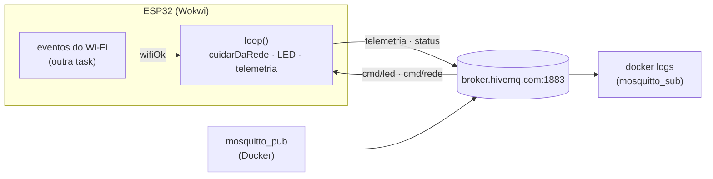

## Checklist — Wi-Fi e MQTT no ESP32 {/* #checklist */}

- [ ] Varredura das redes Wi-Fi com logs, e o custo de uma chamada bloqueante (T1)
- [ ] Conexão ao Wi-Fi por **eventos**, com os detalhes da rede e o LED de estado (T2)
- [ ] MQTT: telemetria a cada 5 s, comando do LED e `status` com LWT, conferidos pelo terminal (T3)
- [ ] Rede **robusta**: reconexão do Wi-Fi e do MQTT com _backoff_, testada com quedas forçadas (T4)
- [ ] O mesmo firmware em dois ambientes, `wokwi` e `lab`, com os segredos fora do Git (T5)
- [ ] Previsões P1–P4 respondidas no `README.md`
- [ ] Nenhum `push --force`; cada tarefa num commit `Tn:`
- [ ] Logout do Git e do `gh` no computador do laboratório

:::info[Pontuação]
**T1…T5 = 100 pts** (esta aula não tem desafios): T1 15 · T2 20 · T3 20 · T4 20 · T5 25. O
autograder normaliza para 0–10. Vale o commit `Tn:` mais recente de cada tarefa.
:::

<LabSetup />

### Configuração do ambiente de desenvolvimento {/* #setup */}

<DevTools />

---

No Lab 02, o ESP32 simulado já conversou com o broker MQTT, com um código pronto. Aquele código
tinha dois defeitos que não apareceram no teste: ele **parava tudo** enquanto o Wi-Fi ou o
broker não respondiam (os `while` de `conectarWiFi()` e `conectarMQTT()`), e só funcionava no
Wokwi.

Nesta aula você monta a conexão do zero, peça por peça, olhando por dentro com os **logs** do
Lab 03: a varredura, os eventos do Wi-Fi, a conexão ao broker, a telemetria e os comandos.
Depois, derruba a rede de propósito e faz o firmware **se recuperar sozinho**, sem travar o
`loop()`. No fim, o mesmo código compila para o Wokwi e para a placa real no laboratório, com
as senhas fora do repositório.

O Lab 05 parte deste firmware e acrescenta o sensor DHT22.



## Objetivos

- Varrer as redes Wi-Fi e entender o custo de uma chamada **bloqueante**.
- Conectar ao Wi-Fi por **eventos** (`WiFi.onEvent`), sem `while` de espera.
- Publicar telemetria em **JSON**, assinar comandos e usar `status` com **LWT**.
- Reconectar o Wi-Fi e o MQTT com **_backoff_ exponencial**, com o `loop()` sempre rodando.
- Separar a **configuração** (rede, broker, senhas) do código, com ambientes do PlatformIO e um
  `segredos.h` fora do Git.

## Material

- O ambiente dos Labs 01 a 03: Windows 11, VS Code no perfil `ESP32IO` com o terminal no
  **Prompt de Comando** (`cmd`), PlatformIO, Wokwi e **Docker Desktop** aberto.
- Opcional: um ESP32 DevKit, para a placa real no laboratório (T5).

:::info[Tópicos do Lab 04]
No Wokwi, tudo fica sob `elt85b/lab04/grupo-X/`, no broker público `broker.hivemq.com`. Troque
o `X` (e o `#define GRUPO`) pela letra do seu grupo. O broker é **público**: não publique nada
que não possa ser público.
:::

## Clonar o repositório do grupo {/* #clonar */}

<LabTeamMembers labName="lab04" />

## Envie o link do repositório do seu grupo no Moodle: {/* #moodle-link */}

<LabSubmit labName="lab04" />

<details>
<summary><strong>Mapa de tarefas</strong> — 5 tarefas · 100 pts</summary>

- [T1 — Varredura das redes](#t1) · 15 pts
- [T2 — Conexao por eventos](#t2) · 20 pts
- [T3 — MQTT nos dois sentidos](#t3) · 20 pts
- [T4 — Rede robusta](#t4) · 20 pts
- [T5 — Wokwi e laboratorio no mesmo firmware](#t5) · 25 pts

</details>

O repositório nasce do `lab04-template`, com o `README.md`, o `.gitignore`, o
`.vscode/settings.json` e o circuito do Lab 03 (`diagram.json`, o LED no GPIO2):

<FileTree
  details={true}
  defaultOpen={false}
  title="Estrutura de Arquivos do Projeto (no fim da aula)"
  root="lab04-grupo-X"
  files={[
    ".gitignore u",
    ".vscode/settings.json r",
    "README.md u",
    "diagram.json r",
    "platformio.ini c",
    "wokwi.toml c",
    "include/config.h c",
    "include/segredos.exemplo.h c",
    "src/main.cpp c",
    "evidencias/t1-serial.txt c",
    "evidencias/t2-serial.txt c",
    "evidencias/t3-mqtt.txt c",
    "evidencias/t3-serial.txt c",
    "evidencias/t4-backoff.txt c",
    "evidencias/t4-quedas.txt c",
    "evidencias/t4-mqtt.txt c",
    "evidencias/t5-build.txt c",
    "evidencias/t5-mqtt.txt c",
  ]}
/>

---

## Parte 1 — Varredura das redes {/* #parte-1 */}

### 1.1 Projeto

No terminal do VS Code (`cmd`), na raiz do repositório:

```shell title="Terminal do VS Code (cmd)"
pio project init -b esp32dev -O "framework=arduino" -O "monitor_speed=115200"
if not exist evidencias mkdir evidencias
```

Troque o `platformio.ini` por um ambiente chamado `wokwi`, com os logs até o nível DEBUG (o
core mostra o que o Wi-Fi faz por dentro), e aponte o `wokwi.toml` para ele:

```ini title="platformio.ini (T1)"
[platformio]
default_envs = wokwi

[env:wokwi]
platform = espressif32@6.9.0
board = esp32dev
framework = arduino
monitor_speed = 115200
build_flags =
    -DCORE_DEBUG_LEVEL=4
```

```toml title="wokwi.toml"
[wokwi]
version = 1
firmware = '.pio/build/wokwi/firmware.bin'
elf = '.pio/build/wokwi/firmware.elf'
```

A biblioteca `WiFi.h` faz parte do core do ESP32: não precisa de `lib_deps`.

### 1.2 Varrer

```cpp title="src/main.cpp (T1)"
// ELT85B - Lab 04 (T1): varredura das redes Wi-Fi
#include <Arduino.h>
#include <WiFi.h>

#define LED_PIN    2
#define VARRER_MS  15000               // uma varredura a cada 15 s

const char *nomeSeguranca(wifi_auth_mode_t m) {
  switch (m) {
    case WIFI_AUTH_OPEN:         return "aberta";
    case WIFI_AUTH_WEP:          return "WEP";
    case WIFI_AUTH_WPA_PSK:      return "WPA";
    case WIFI_AUTH_WPA2_PSK:     return "WPA2";
    case WIFI_AUTH_WPA_WPA2_PSK: return "WPA/WPA2";
    case WIFI_AUTH_WPA3_PSK:     return "WPA3";
    default:                     return "outra";
  }
}

void varrer() {
  log_i("Varrendo as redes...");
  unsigned long t0 = millis();
  int total = WiFi.scanNetworks();     // bloqueia ate terminar
  log_i("%d rede(s) em %lu ms", total, millis() - t0);
  for (int i = 0; i < total; i++) {
    log_i("%2d: %-16s canal %2ld  %4ld dBm  %s", i + 1, WiFi.SSID(i).c_str(), (long)WiFi.channel(i),
          (long)WiFi.RSSI(i), nomeSeguranca(WiFi.encryptionType(i)));
  }
  WiFi.scanDelete();                   // devolve a memoria da lista
}

unsigned long tVarredura = 0, tLed = 0;
bool ledAceso = false;

void setup() {
  Serial.begin(115200);
  pinMode(LED_PIN, OUTPUT);
  Serial.println("=== Lab 04 - Wi-Fi e MQTT ===");
  WiFi.mode(WIFI_STA);                 // estacao (cliente), nao ponto de acesso
  WiFi.disconnect();
  varrer();
  tVarredura = millis();
}

void loop() {
  unsigned long agora = millis();
  if (agora - tLed >= 250) {           // o LED mostra se o loop() esta rodando
    tLed = agora;
    ledAceso = !ledAceso;
    digitalWrite(LED_PIN, ledAceso ? HIGH : LOW);
  }
  if (agora - tVarredura >= VARRER_MS) {
    varrer();
    tVarredura = millis();
  }
}
```

`WiFi.mode(WIFI_STA)` põe o rádio no modo **estação** (cliente de um ponto de acesso), e o
`WiFi.disconnect()` garante que ele não tente se conectar a uma rede guardada na flash.

```shell title="Terminal do VS Code (cmd)"
pio run
```

**F1** → **Wokwi: Start Simulator**:

```text title="Monitor serial do Wokwi (trecho; tempos, RSSI e números de linha variam)"
=== Lab 04 - Wi-Fi e MQTT ===
[   512][D][WiFiGeneric.cpp:1040] _eventCallback(): Arduino Event: 0 - WIFI_READY
[   601][D][WiFiGeneric.cpp:1040] _eventCallback(): Arduino Event: 2 - STA_START
[   602][I][main.cpp:21] varrer(): Varrendo as redes...
[  4710][D][WiFiGeneric.cpp:1040] _eventCallback(): Arduino Event: 1 - SCAN_DONE
[  4711][I][main.cpp:24] varrer(): 1 rede(s) em 4109 ms
[  4712][I][main.cpp:26] varrer():  1: Wokwi-GUEST      canal  6   -54 dBm  aberta
```

As linhas `[D][WiFiGeneric.cpp...]` são do **core**: com o `CORE_DEBUG_LEVEL=4` do Lab 03, você
vê cada evento do Wi-Fi. A rede do simulador é a `Wokwi-GUEST`: aberta, no canal 6.

:::tip[Preveja antes de rodar]
**P1:** (a) o LED pisca a cada 250 ms pelo `millis()`. O que acontece com ele **durante** a
varredura, a cada 15 s? Por quê? O que isso diria de um firmware que precisasse ler um sensor a
cada 100 ms? (b) A varredura passa por todos os canais. Na T2, o `WiFi.begin()` recebe o canal
6: quanto tempo isso deve economizar na conexão? Confira na T2.
:::

Copie o monitor (duas varreduras) para `evidencias/t1-serial.txt`.

```shell title="Terminal do VS Code (cmd)"
git add platformio.ini wokwi.toml src evidencias/t1-serial.txt
git commit -m "T1: varredura das redes Wi-Fi"
git push
```

<FileTree
  root="lab04-grupo-X"
  files={[
    "platformio.ini c",
    "wokwi.toml c",
    "src/main.cpp c",
    "evidencias/t1-serial.txt c",
  ]}
/>

<CommitPoint
  id="t1"
  task="Varredura das redes"
  pontos={15}
  files="platformio.ini wokwi.toml src/main.cpp evidencias/t1-serial.txt"
/>

---

## Parte 2 — Conexão por eventos {/* #parte-2 */}

### 2.1 A configuração num arquivo só

Rede, broker e tópicos não são "código": mudam conforme **onde** o firmware roda. Eles vão para
`include/config.h` (a pasta `include/` já está no caminho de busca do PlatformIO):

```cpp title="include/config.h (T2)"
// ELT85B - Lab 04: rede e broker (T2-T4: so o Wokwi)
#pragma once

#define GRUPO "x"                       // troque pela letra do seu grupo

#define WIFI_SSID    "Wokwi-GUEST"
#define WIFI_SENHA   ""
#define WIFI_CANAL   6                  // o AP do Wokwi fica no canal 6
#define MQTT_HOST    "broker.hivemq.com"
#define MQTT_PORTA   1883
#define MQTT_USUARIO ""                 // broker publico: sem login
#define MQTT_SENHA   ""
#define TOPICO_BASE  "elt85b/lab04/grupo-" GRUPO
```

O `TOPICO_BASE` junta textos pelo pré-processador: `"elt85b/lab04/grupo-" "x"` vira
`"elt85b/lab04/grupo-x"`. A T3 usa os dados do broker.

### 2.2 Eventos em vez de `while`

O Lab 02 esperava o Wi-Fi assim:

```cpp
while (WiFi.status() != WL_CONNECTED) { delay(250); }   // o ESP32 fica PARADO aqui
```

Aqui, o `WiFi.begin()` só **inicia** a conexão e volta na hora. O core avisa quando algo
acontece, chamando uma função **sua**:

```cpp title="src/main.cpp (T2): o callback de eventos"
volatile bool wifiOk = false;          // escrito no callback de eventos (outra task)
unsigned long tInicioWiFi = 0, tTentativaWiFi = 0;

void aoEventoWiFi(WiFiEvent_t evento, WiFiEventInfo_t info) {
  switch (evento) {
    case ARDUINO_EVENT_WIFI_STA_CONNECTED:
      log_i("Wi-Fi: associado ao AP (canal %d)", info.wifi_sta_connected.channel);
      break;
    case ARDUINO_EVENT_WIFI_STA_GOT_IP:
      wifiOk = true;
      log_i("Wi-Fi: IP %s em %lu ms", IPAddress(info.got_ip.ip_info.ip.addr).toString().c_str(),
            millis() - tInicioWiFi);
      break;
    case ARDUINO_EVENT_WIFI_STA_DISCONNECTED:
      wifiOk = false;
      log_w("Wi-Fi: desconectado (motivo %d)", info.wifi_sta_disconnected.reason);
      break;
    default:
      break;
  }
}

void iniciarWiFi() {
  log_i("Wi-Fi: conectando a %s", WIFI_SSID);
  tInicioWiFi = tTentativaWiFi = millis();
  WiFi.begin(WIFI_SSID, WIFI_SENHA, WIFI_CANAL);
}

void detalhesRede() {
  log_i("IP %s  mascara %s  gateway %s  DNS %s", WiFi.localIP().toString().c_str(),
        WiFi.subnetMask().toString().c_str(), WiFi.gatewayIP().toString().c_str(),
        WiFi.dnsIP().toString().c_str());
  log_i("MAC %s  RSSI %d dBm  canal %d", WiFi.macAddress().c_str(), WiFi.RSSI(), WiFi.channel());
}

```

:::warning[O callback roda em outra task]
O `aoEventoWiFi()` não é chamado pelo `loop()`, e sim pela task de eventos do Wi-Fi do core. Por
isso ele só **registra e marca** (`wifiOk`), e o trabalho de verdade fica no `loop()`. O
`volatile` avisa ao compilador que a variável muda "por fora" do `loop()`.
:::

O `setup()` registra o callback e inicia a conexão. O `loop()` mostra o estado no LED (pisca
rápido sem Wi-Fi, aceso com Wi-Fi) e imprime os detalhes uma vez por conexão:

```cpp title="src/main.cpp (T2): setup e loop"
bool redeDetalhada = false;

void setup() {
  Serial.begin(115200);
  pinMode(LED_PIN, OUTPUT);
  Serial.println("=== Lab 04 - Wi-Fi e MQTT ===");
  WiFi.mode(WIFI_STA);
  WiFi.disconnect();
  varrer();

  WiFi.onEvent(aoEventoWiFi);
  iniciarWiFi();
}

void loop() {
  unsigned long agora = millis();
  // LED de estado: pisca rapido sem Wi-Fi, aceso com Wi-Fi
  digitalWrite(LED_PIN, wifiOk ? HIGH : (agora / 100) % 2);

  if (wifiOk && !redeDetalhada) {      // uma vez por conexao
    redeDetalhada = true;
    detalhesRede();
  } else if (!wifiOk) {
    redeDetalhada = false;
  }
}
```

No começo do arquivo, inclua o `config.h` (`#include "config.h"`) e mantenha o `varrer()` da T1,
agora chamado só uma vez, no `setup()`, e tire o pisca da T1 (o LED passa a mostrar o estado da rede). O arquivo completo, já com tudo até a T4, está no fim da Parte 4.

```text title="Monitor serial do Wokwi (trecho; tempos, endereços e números de linha variam)"
[  4712][I][main.cpp:29] varrer():  1: Wokwi-GUEST      canal  6   -54 dBm  aberta
[  4713][I][main.cpp:56] iniciarWiFi(): Wi-Fi: conectando a Wokwi-GUEST
[  5240][D][WiFiGeneric.cpp:1040] _eventCallback(): Arduino Event: 4 - STA_CONNECTED
[  5241][I][main.cpp:39] aoEventoWiFi(): Wi-Fi: associado ao AP (canal 6)
[  6105][D][WiFiGeneric.cpp:1040] _eventCallback(): Arduino Event: 7 - STA_GOT_IP
[  6107][I][main.cpp:43] aoEventoWiFi(): Wi-Fi: IP 10.10.0.2 em 1394 ms
[  6110][I][main.cpp:62] detalhesRede(): IP 10.10.0.2  mascara 255.255.255.0  gateway 10.10.0.1  DNS 10.10.0.1
[  6111][I][main.cpp:65] detalhesRede(): MAC 24:0A:C4:xx:xx:xx  RSSI -54 dBm  canal 6
```

Repare na ordem: **associado** (a camada de rádio) e só depois **IP** (o DHCP). Sem IP, não há
como falar com o broker.

**Evidência:** o monitor em `evidencias/t2-serial.txt`, e no `README.md` o tempo até o IP com
`WIFI_CANAL 6` e com `WIFI_CANAL 0` (0 = procurar em todos os canais).

```shell title="Terminal do VS Code (cmd)"
git add include/config.h src/main.cpp evidencias/t2-serial.txt README.md
git commit -m "T2: conexao ao Wi-Fi por eventos"
git push
```

<FileTree
  root="lab04-grupo-X"
  files={[
    "include/config.h c",
    "src/main.cpp u",
    "evidencias/t2-serial.txt c",
    "README.md u",
  ]}
/>

<CommitPoint
  id="t2"
  task="Conexao por eventos"
  pontos={20}
  files="include/config.h src/main.cpp evidencias/t2-serial.txt README.md"
/>

---

## Parte 3 — MQTT nos dois sentidos {/* #parte-3 */}

### 3.1 Biblioteca e tópicos

Acrescente ao `[env:wokwi]` do `platformio.ini`:

```ini title="platformio.ini (T3)"
lib_deps =
    knolleary/PubSubClient@2.8
```

| Tópico           | Sentido | Conteúdo                                                                           |
| ---------------- | ------- | ---------------------------------------------------------------------------------- |
| `.../status`     | ESP32 → | `online` ao conectar; `offline` pelo **broker** (LWT) se o ESP32 sumir. **Retido** |
| `.../telemetria` | ESP32 → | JSON a cada 5 s                                                                    |
| `.../cmd/led`    | → ESP32 | `on`, `off` ou `auto` (o LED volta a mostrar o estado da rede)                     |

```cpp title="src/main.cpp (T3): objetos e tópicos"
#include <PubSubClient.h>

#define TELEMETRIA_MS  5000            // uma telemetria a cada 5 s
#define ESPERA_MQTT_MS 5000            // sem MQTT: nova tentativa a cada 5 s

const char *TOPICO_STATUS     = TOPICO_BASE "/status";      // online / offline (retido, LWT)
const char *TOPICO_TELEMETRIA = TOPICO_BASE "/telemetria";  // JSON a cada 5 s
const char *TOPICO_CMD_LED    = TOPICO_BASE "/cmd/led";     // on | off | auto

WiFiClient wifiClient;                 // o TCP
PubSubClient mqtt(wifiClient);         // o MQTT, por cima do TCP
char clientId[24];
uint32_t conexoesMQTT = 0, falhasMQTT = 0, n = 0;
unsigned long tTentativaMQTT = 0;

enum ModoLed { LED_AUTO, LED_LIGADO, LED_DESLIGADO };
ModoLed modoLed = LED_AUTO;
```

### 3.2 Conectar, publicar e receber

```cpp title="src/main.cpp (T3)"
void aoReceberMensagem(char *topico, byte *payload, unsigned int tam) {
  char txt[16];
  size_t k = tam < sizeof(txt) - 1 ? tam : sizeof(txt) - 1;
  memcpy(txt, payload, k);
  txt[k] = '\0';                       // o payload NAO termina com '\0'
  log_i("MQTT: %s <- '%s'", topico, txt);

  if (strcmp(txt, "on") == 0) modoLed = LED_LIGADO;
  else if (strcmp(txt, "off") == 0) modoLed = LED_DESLIGADO;
  else if (strcmp(txt, "auto") == 0) modoLed = LED_AUTO;
  else log_w("cmd/led: use on, off ou auto");
}

bool tentarMQTT() {                    // UMA tentativa; quem repete e o loop()
  log_i("MQTT: conectando a %s:%d como %s", MQTT_HOST, MQTT_PORTA, clientId);
  const char *usuario = strlen(MQTT_USUARIO) ? MQTT_USUARIO : nullptr;
  const char *senha = strlen(MQTT_SENHA) ? MQTT_SENHA : nullptr;
  unsigned long t0 = millis();
  // LWT: se o ESP32 sumir sem avisar, o broker publica "offline" (retido) no lugar dele
  bool ok = mqtt.connect(clientId, usuario, senha, TOPICO_STATUS, 1, true, "offline");
  if (!ok) {
    falhasMQTT++;
    log_w("MQTT: falhou (rc=%d) em %lu ms", mqtt.state(), millis() - t0);
    return false;
  }
  conexoesMQTT++;
  log_i("MQTT: conectado em %lu ms (conexao %lu)", millis() - t0, (unsigned long)conexoesMQTT);
  mqtt.publish(TOPICO_STATUS, "online", true);
  mqtt.subscribe(TOPICO_CMD_LED);      // (re)assina a cada conexao
  return true;
}

void publicarTelemetria(unsigned long agora) {
  char json[96];
  snprintf(json, sizeof(json), "{\"n\":%lu,\"uptime_s\":%lu,\"rssi\":%d,\"heap\":%lu}",
           (unsigned long)++n, agora / 1000, WiFi.RSSI(), (unsigned long)ESP.getFreeHeap());
  bool ok = mqtt.publish(TOPICO_TELEMETRIA, json);
  if (ok) log_i("PUB %s %s", TOPICO_TELEMETRIA, json);
  else log_e("PUB falhou: %s", TOPICO_TELEMETRIA);
}

void cuidarDoLed(unsigned long agora) {
  bool aceso;
  if (modoLed == LED_LIGADO) aceso = true;
  else if (modoLed == LED_DESLIGADO) aceso = false;
  else if (!wifiOk) aceso = (agora / 100) % 2;
  else if (!mqtt.connected()) aceso = (agora / 500) % 2;
  else aceso = true;
  digitalWrite(LED_PIN, aceso ? HIGH : LOW);
}

```

O `tentarMQTT()` faz **uma** tentativa e volta: quem repete é o `loop()`, a cada 5 s. O
`client id` identifica o ESP32 no broker. Dois clientes com o **mesmo** id derrubam um ao
outro (o broker fecha a sessão antiga quando a nova chega), por isso ele leva um sufixo
aleatório. No Wokwi isso importa: dois integrantes simulando o mesmo firmware ao mesmo tempo.

No `setup()`, depois do `varrer()`, e no `loop()`:

```cpp title="src/main.cpp (T3): setup e loop"
void setup() {
  Serial.begin(115200);
  pinMode(LED_PIN, OUTPUT);
  Serial.println("=== Lab 04 - Wi-Fi e MQTT ===");
  // sufixo aleatorio: dois ESP32 com o mesmo client id derrubam um ao outro no broker
  snprintf(clientId, sizeof(clientId), "lab04-%s-%04lX", GRUPO, (unsigned long)(esp_random() & 0xFFFF));
  log_i("Topicos em %s/  (cliente %s)", TOPICO_BASE, clientId);

  WiFi.mode(WIFI_STA);
  WiFi.disconnect();
  varrer();

  WiFi.onEvent(aoEventoWiFi);
  mqtt.setServer(MQTT_HOST, MQTT_PORTA);
  mqtt.setCallback(aoReceberMensagem);
  iniciarWiFi();
}

void loop() {
  unsigned long agora = millis();

  if (wifiOk) {
    if (mqtt.connected()) {
      mqtt.loop();                     // processa a rede e chama o callback
    } else if (agora - tTentativaMQTT >= ESPERA_MQTT_MS) {
      tTentativaMQTT = agora;
      tentarMQTT();
    }
  }
  cuidarDoLed(agora);

  if (wifiOk && !redeDetalhada) {
    redeDetalhada = true;
    detalhesRede();
  } else if (!wifiOk) {
    redeDetalhada = false;
  }

  if (agora - tTelemetria >= TELEMETRIA_MS) {
    tTelemetria = agora;
    if (mqtt.connected()) publicarTelemetria(agora);
  }
}
```

| `mqtt.state()` | Significado                                | Causa provável                             |
| -------------- | ------------------------------------------ | ------------------------------------------ |
| `-4`           | sem resposta do broker a tempo             | rede lenta, broker parado                  |
| `-3`           | conexão perdida                            | caiu o Wi-Fi, ou o broker fechou a conexão |
| `-2`           | a conexão TCP falhou                       | host ou porta errados, DNS, sem rede       |
| `-1`           | desconectado (normal)                      | `mqtt.disconnect()`                        |
| `0`            | conectado                                  |                                            |
| `2`            | `client id` recusado                       | id vazio ou inválido                       |
| `4` / `5`      | usuário ou senha errados / sem autorização | credenciais do broker (T5)                 |

### 3.3 Conferir pelo terminal

Como no Lab 02: o assinante roda em segundo plano, e o `docker logs` mostra e grava o que chegou.
Assine **antes** de iniciar a simulação.

<GroupCommands
  commands={[
    {
      title: "1. Assinar",
      codeTitle: "Terminal 1 (cmd) — assinante em segundo plano",
      command: `docker run -d --name sub-lab04 eclipse-mosquitto:2 mosquitto_sub -h broker.hivemq.com -t "{course}/lab04/grupo-{group}/#" -v
docker logs -f sub-lab04`,
    },
    {
      title: "2. Comandar o LED",
      codeTitle: "Terminal 2 (cmd) — comandos",
      command: `docker run --rm eclipse-mosquitto:2 mosquitto_pub -h broker.hivemq.com -t "{course}/lab04/grupo-{group}/cmd/led" -m off
docker run --rm eclipse-mosquitto:2 mosquitto_pub -h broker.hivemq.com -t "{course}/lab04/grupo-{group}/cmd/led" -m on
docker run --rm eclipse-mosquitto:2 mosquitto_pub -h broker.hivemq.com -t "{course}/lab04/grupo-{group}/cmd/led" -m auto`,
    },
    {
      title: "3. Gravar e encerrar",
      codeTitle:
        "Terminal 1 (cmd) — depois de parar a simulação e ver o offline",
      command: `docker logs sub-lab04 > evidencias\\t3-mqtt.txt 2>&1
type evidencias\\t3-mqtt.txt
docker rm -f sub-lab04`,
    },
  ]}
/>

```text title="evidencias/t3-mqtt.txt (trecho; os valores variam)"
elt85b/lab04/grupo-x/status online
elt85b/lab04/grupo-x/telemetria {"n":1,"uptime_s":10,"rssi":-54,"heap":228184}
elt85b/lab04/grupo-x/cmd/led off
elt85b/lab04/grupo-x/telemetria {"n":2,"uptime_s":15,"rssi":-54,"heap":228184}
elt85b/lab04/grupo-x/cmd/led on
elt85b/lab04/grupo-x/cmd/led auto
elt85b/lab04/grupo-x/status offline
```

O `offline` do fim não foi enviado pelo ESP32: foi o **broker**, pouco depois de a simulação
parar (até ~25 s), cumprindo o LWT (_Last Will and Testament_) registrado no `connect()`.

:::tip[Preveja antes de rodar]
**P2:** (a) com a simulação rodando, rode **outro** `mosquitto_sub` (sem `-d`, Ctrl+C para
sair). A primeira linha é o `status online`, mesmo que ele tenha sido publicado minutos antes.
Por quê? E a telemetria antiga, também aparece? (b) O `aoReceberMensagem()` copia o `payload`
para um vetor e põe `'\0'` no fim. O que daria errado num `strcmp(payload, "on")` direto? (c)
O `offline` chegou na hora em que a simulação parou, ou alguns segundos depois? Do que isso
depende? Pense nas duas formas de o broker perceber que um cliente sumiu: a conexão TCP fechada
ou o _keepalive_ de 15 s do PubSubClient vencido (1,5 × 15 s).
:::

**Evidências:** `evidencias/t3-mqtt.txt` (do `docker logs`) e o monitor serial em
`evidencias/t3-serial.txt`.

```shell title="Terminal do VS Code (cmd)"
git add platformio.ini src/main.cpp evidencias/t3-mqtt.txt evidencias/t3-serial.txt
git commit -m "T3: MQTT com telemetria, comando e LWT"
git push
```

<FileTree
  root="lab04-grupo-X"
  files={[
    "platformio.ini u",
    "src/main.cpp u",
    "evidencias/t3-mqtt.txt c",
    "evidencias/t3-serial.txt c",
  ]}
/>

<CommitPoint
  id="t3"
  task="MQTT nos dois sentidos"
  pontos={20}
  files="platformio.ini src/main.cpp evidencias/t3-mqtt.txt evidencias/t3-serial.txt"
/>

---

## Parte 4 — Rede robusta {/* #parte-4 */}

A T3 já reconecta o MQTT, mas tenta a cada 5 s para sempre e não cuida do Wi-Fi. Um firmware de
campo precisa de mais:

1. **Wi-Fi:** se cair, tentar de novo a cada 10 s. O core só reconecta sozinho em algumas
   quedas, e **nunca** depois de um `WiFi.disconnect()` voluntário.
2. **MQTT com _backoff_ exponencial:** esperar 1 s, 2 s, 4 s… até 30 s entre as tentativas.
   Um broker fora do ar não deve receber centenas de tentativas por minuto de cada ESP32.
3. **Contadores** na telemetria: quedas do Wi-Fi, conexões e falhas do MQTT.
4. **Testes:** um tópico `cmd/rede` que derruba o MQTT (`cai-mqtt`) ou o Wi-Fi (`cai-wifi`).

```cpp title="src/main.cpp (T4): o que muda"
#define ESPERA_WIFI_MS  10000          // sem Wi-Fi: nova tentativa a cada 10 s
#define ESPERA_MQTT_MAX 30000          // backoff do MQTT: no máximo 30 s

const char *TOPICO_CMD_REDE = TOPICO_BASE "/cmd/rede";   // cai-mqtt | cai-wifi

volatile uint32_t quedasWiFi = 0;      // contado no aoEventoWiFi (if (wifiOk) quedasWiFi++;)
unsigned long esperaMQTT = 1000;       // a espera atual do backoff
bool pedidoCaiWiFi = false, pedidoCaiMQTT = false;

void cuidarDaRede(unsigned long agora) {
  if (pedidoCaiWiFi) {                 // teste: derruba o Wi-Fi
    pedidoCaiWiFi = false;
    log_w("TESTE: derrubando o Wi-Fi");
    WiFi.disconnect();                 // queda voluntaria: o core NAO reconecta sozinho
    tTentativaWiFi = agora;
  }
  if (pedidoCaiMQTT) {                 // teste: derruba so o MQTT
    pedidoCaiMQTT = false;
    log_w("TESTE: derrubando o MQTT");
    mqtt.publish(TOPICO_STATUS, "offline", true);  // saida educada: o LWT nao dispara
    mqtt.disconnect();
    tTentativaMQTT = agora;
  }

  if (!wifiOk) {
    if (mqtt.connected()) mqtt.disconnect();   // o TCP antigo morreu com o Wi-Fi: fecha
    if (agora - tTentativaWiFi >= ESPERA_WIFI_MS) iniciarWiFi();
    return;                            // sem Wi-Fi, nem tenta o MQTT
  }

  if (mqtt.connected()) {
    mqtt.loop();                       // processa a rede e chama o callback
    return;
  }
  if (agora - tTentativaMQTT >= esperaMQTT) {
    tTentativaMQTT = millis();
    if (tentarMQTT()) {
      esperaMQTT = 1000;
    } else {
      esperaMQTT = min(esperaMQTT * 2, (unsigned long)ESPERA_MQTT_MAX);
      log_i("MQTT: proxima tentativa em %lu s", esperaMQTT / 1000);
    }
  }
}

```

O `aoReceberMensagem()` ganha o `cmd/rede`: ele só **marca** o pedido, e quem derruba a rede é o
`cuidarDaRede()`, fora do callback. O `tentarMQTT()` passa a assinar os dois tópicos de comando,
e a telemetria ganha os contadores. No `setup()`, `mqtt.setSocketTimeout(5)` limita a espera
pela resposta do broker a 5 s (o padrão é 15 s). E o `loop()` fica curto:

```cpp title="src/main.cpp (T4): loop"
void loop() {
  unsigned long agora = millis();
  cuidarDaRede(agora);
  cuidarDoLed(agora);

  if (wifiOk && !redeDetalhada) {      // uma vez por conexao
    redeDetalhada = true;
    detalhesRede();
  } else if (!wifiOk) {
    redeDetalhada = false;
  }

  if (agora - tTelemetria >= TELEMETRIA_MS) {
    tTelemetria = agora;
    if (mqtt.connected()) publicarTelemetria(agora);
    else log_d("Telemetria adiada: sem MQTT");
  }
}
```

<details>
<summary><strong><code>src/main.cpp</code> completo</strong> (T4, e também o da T5)</summary>

```cpp title="src/main.cpp"
// ELT85B - Lab 04 (final, T1-T5): Wi-Fi e MQTT robustos, em dois ambientes
#include <Arduino.h>
#include <WiFi.h>
#include <PubSubClient.h>
#include "config.h"

#define LED_PIN        2
#define TELEMETRIA_MS  5000            // uma telemetria a cada 5 s
#define ESPERA_WIFI_MS 10000           // sem Wi-Fi: nova tentativa a cada 10 s
#define ESPERA_MQTT_MAX 30000          // backoff do MQTT: no maximo 30 s

const char *TOPICO_STATUS     = TOPICO_BASE "/status";      // online / offline (retido, LWT)
const char *TOPICO_TELEMETRIA = TOPICO_BASE "/telemetria";  // JSON a cada 5 s
const char *TOPICO_CMD_LED    = TOPICO_BASE "/cmd/led";     // on | off | auto
const char *TOPICO_CMD_REDE   = TOPICO_BASE "/cmd/rede";    // cai-mqtt | cai-wifi

WiFiClient wifiClient;
PubSubClient mqtt(wifiClient);
char clientId[24];

// ---------- estado ----------
volatile bool wifiOk = false;          // escrito no callback de eventos (outra task)
volatile uint32_t quedasWiFi = 0;
unsigned long tInicioWiFi = 0, tTentativaWiFi = 0;

uint32_t conexoesMQTT = 0, falhasMQTT = 0;
unsigned long esperaMQTT = 1000, tTentativaMQTT = 0;

enum ModoLed { LED_AUTO, LED_LIGADO, LED_DESLIGADO };
ModoLed modoLed = LED_AUTO;
bool pedidoCaiWiFi = false, pedidoCaiMQTT = false;
uint32_t n = 0;

// ---------- T1: varredura ----------
const char *nomeSeguranca(wifi_auth_mode_t m) {
  switch (m) {
    case WIFI_AUTH_OPEN:         return "aberta";
    case WIFI_AUTH_WEP:          return "WEP";
    case WIFI_AUTH_WPA_PSK:      return "WPA";
    case WIFI_AUTH_WPA2_PSK:     return "WPA2";
    case WIFI_AUTH_WPA_WPA2_PSK: return "WPA/WPA2";
    case WIFI_AUTH_WPA3_PSK:     return "WPA3";
    default:                     return "outra";
  }
}

void varrer() {
  log_i("Varrendo as redes...");
  unsigned long t0 = millis();
  int total = WiFi.scanNetworks();     // bloqueia ate terminar
  log_i("%d rede(s) em %lu ms", total, millis() - t0);
  for (int i = 0; i < total; i++) {
    log_i("%2d: %-16s canal %2ld  %4ld dBm  %s", i + 1, WiFi.SSID(i).c_str(), (long)WiFi.channel(i),
          (long)WiFi.RSSI(i), nomeSeguranca(WiFi.encryptionType(i)));
  }
  WiFi.scanDelete();
}

// ---------- T2: eventos do Wi-Fi (rodam na task de eventos, nao no loop) ----------
void aoEventoWiFi(WiFiEvent_t evento, WiFiEventInfo_t info) {
  switch (evento) {
    case ARDUINO_EVENT_WIFI_STA_CONNECTED:
      log_i("Wi-Fi: associado ao AP (canal %d)", info.wifi_sta_connected.channel);
      break;
    case ARDUINO_EVENT_WIFI_STA_GOT_IP:
      wifiOk = true;
      log_i("Wi-Fi: IP %s em %lu ms", IPAddress(info.got_ip.ip_info.ip.addr).toString().c_str(),
            millis() - tInicioWiFi);
      break;
    case ARDUINO_EVENT_WIFI_STA_DISCONNECTED:
      if (wifiOk) quedasWiFi++;
      wifiOk = false;
      log_w("Wi-Fi: desconectado (motivo %d)", info.wifi_sta_disconnected.reason);
      break;
    default:
      break;
  }
}

void iniciarWiFi() {
  log_i("Wi-Fi: conectando a %s", WIFI_SSID);
  tInicioWiFi = tTentativaWiFi = millis();
  WiFi.begin(WIFI_SSID, WIFI_SENHA, WIFI_CANAL);
}

void detalhesRede() {
  log_i("IP %s  mascara %s  gateway %s  DNS %s", WiFi.localIP().toString().c_str(),
        WiFi.subnetMask().toString().c_str(), WiFi.gatewayIP().toString().c_str(),
        WiFi.dnsIP().toString().c_str());
  log_i("MAC %s  RSSI %d dBm  canal %d", WiFi.macAddress().c_str(), WiFi.RSSI(), WiFi.channel());
}

// ---------- T3: MQTT ----------
void aoReceberMensagem(char *topico, byte *payload, unsigned int tam) {
  char txt[16];
  size_t k = tam < sizeof(txt) - 1 ? tam : sizeof(txt) - 1;
  memcpy(txt, payload, k);
  txt[k] = '\0';                       // o payload NAO termina com '\0'
  log_i("MQTT: %s <- '%s'", topico, txt);

  if (strcmp(topico, TOPICO_CMD_LED) == 0) {
    if (strcmp(txt, "on") == 0) modoLed = LED_LIGADO;
    else if (strcmp(txt, "off") == 0) modoLed = LED_DESLIGADO;
    else if (strcmp(txt, "auto") == 0) modoLed = LED_AUTO;
    else log_w("cmd/led: use on, off ou auto");
  } else if (strcmp(topico, TOPICO_CMD_REDE) == 0) {
    // so marca o pedido: derrubar a rede DENTRO do callback do mqtt.loop() seria pedir problema
    if (strcmp(txt, "cai-mqtt") == 0) pedidoCaiMQTT = true;
    else if (strcmp(txt, "cai-wifi") == 0) pedidoCaiWiFi = true;
    else log_w("cmd/rede: use cai-mqtt ou cai-wifi");
  }
}

bool tentarMQTT() {                    // UMA tentativa; quem repete e o loop()
  log_i("MQTT: conectando a %s:%d como %s", MQTT_HOST, MQTT_PORTA, clientId);
  const char *usuario = strlen(MQTT_USUARIO) ? MQTT_USUARIO : nullptr;
  const char *senha = strlen(MQTT_SENHA) ? MQTT_SENHA : nullptr;
  unsigned long t0 = millis();
  // LWT: se o ESP32 sumir sem avisar, o broker publica "offline" (retido) no lugar dele
  bool ok = mqtt.connect(clientId, usuario, senha, TOPICO_STATUS, 1, true, "offline");
  if (!ok) {
    falhasMQTT++;
    log_w("MQTT: falhou (rc=%d) em %lu ms", mqtt.state(), millis() - t0);
    return false;
  }
  conexoesMQTT++;
  log_i("MQTT: conectado em %lu ms (conexao %lu)", millis() - t0, (unsigned long)conexoesMQTT);
  mqtt.publish(TOPICO_STATUS, "online", true);
  mqtt.subscribe(TOPICO_CMD_LED);      // (re)assina a cada conexao
  mqtt.subscribe(TOPICO_CMD_REDE);
  return true;
}

void publicarTelemetria(unsigned long agora) {
  char json[160];
  snprintf(json, sizeof(json),
           "{\"n\":%lu,\"uptime_s\":%lu,\"rssi\":%d,\"heap\":%lu,\"quedas_wifi\":%lu,"
           "\"conexoes_mqtt\":%lu,\"falhas_mqtt\":%lu}",
           (unsigned long)++n, agora / 1000, WiFi.RSSI(), (unsigned long)ESP.getFreeHeap(),
           (unsigned long)quedasWiFi, (unsigned long)conexoesMQTT, (unsigned long)falhasMQTT);
  bool ok = mqtt.publish(TOPICO_TELEMETRIA, json);
  if (ok) log_i("PUB %s %s", TOPICO_TELEMETRIA, json);
  else log_e("PUB falhou: %s", TOPICO_TELEMETRIA);
}

// ---------- T4: rede robusta ----------
void cuidarDaRede(unsigned long agora) {
  if (pedidoCaiWiFi) {                 // teste: derruba o Wi-Fi
    pedidoCaiWiFi = false;
    log_w("TESTE: derrubando o Wi-Fi");
    WiFi.disconnect();                 // queda voluntaria: o core NAO reconecta sozinho
    tTentativaWiFi = agora;
  }
  if (pedidoCaiMQTT) {                 // teste: derruba so o MQTT
    pedidoCaiMQTT = false;
    log_w("TESTE: derrubando o MQTT");
    mqtt.publish(TOPICO_STATUS, "offline", true);  // saida educada: o LWT nao dispara
    mqtt.disconnect();
    tTentativaMQTT = agora;
  }

  if (!wifiOk) {
    if (mqtt.connected()) mqtt.disconnect();   // o TCP antigo morreu com o Wi-Fi: fecha
    if (agora - tTentativaWiFi >= ESPERA_WIFI_MS) iniciarWiFi();
    return;                            // sem Wi-Fi, nem tenta o MQTT
  }

  if (mqtt.connected()) {
    mqtt.loop();                       // processa a rede e chama o callback
    return;
  }
  if (agora - tTentativaMQTT >= esperaMQTT) {
    tTentativaMQTT = millis();
    if (tentarMQTT()) {
      esperaMQTT = 1000;
    } else {
      esperaMQTT = min(esperaMQTT * 2, (unsigned long)ESPERA_MQTT_MAX);
      log_i("MQTT: proxima tentativa em %lu s", esperaMQTT / 1000);
    }
  }
}

// LED de estado: rapido = sem Wi-Fi, lento = sem MQTT, aceso = tudo ok
void cuidarDoLed(unsigned long agora) {
  bool aceso;
  if (modoLed == LED_LIGADO) aceso = true;
  else if (modoLed == LED_DESLIGADO) aceso = false;
  else if (!wifiOk) aceso = (agora / 100) % 2;
  else if (!mqtt.connected()) aceso = (agora / 500) % 2;
  else aceso = true;
  digitalWrite(LED_PIN, aceso ? HIGH : LOW);
}

// ---------- setup / loop ----------
unsigned long tTelemetria = 0;
bool redeDetalhada = false;

void setup() {
  Serial.begin(115200);
  pinMode(LED_PIN, OUTPUT);
  Serial.println("=== Lab 04 - Wi-Fi e MQTT ===");
  // sufixo aleatorio: dois ESP32 com o mesmo client id derrubam um ao outro no broker
  snprintf(clientId, sizeof(clientId), "lab04-%s-%04lX", GRUPO, (unsigned long)(esp_random() & 0xFFFF));
  log_i("Topicos em %s/  (cliente %s)", TOPICO_BASE, clientId);

  WiFi.mode(WIFI_STA);
  WiFi.disconnect();
  varrer();

  WiFi.onEvent(aoEventoWiFi);
  mqtt.setServer(MQTT_HOST, MQTT_PORTA);
  mqtt.setCallback(aoReceberMensagem);
  mqtt.setSocketTimeout(5);            // espera do CONNACK: 5 s, e nao 15
  iniciarWiFi();
}

void loop() {
  unsigned long agora = millis();
  cuidarDaRede(agora);
  cuidarDoLed(agora);

  if (wifiOk && !redeDetalhada) {      // uma vez por conexao
    redeDetalhada = true;
    detalhesRede();
  } else if (!wifiOk) {
    redeDetalhada = false;
  }

  if (agora - tTelemetria >= TELEMETRIA_MS) {
    tTelemetria = agora;
    if (mqtt.connected()) publicarTelemetria(agora);
    else log_d("Telemetria adiada: sem MQTT");
  }
}
```

</details>

### 4.1 Teste 1 — broker inexistente

Troque, **temporariamente**, o `MQTT_HOST` do `config.h` por um nome que não existe (o domínio
`.invalid` é reservado para isso), compile e simule por ~1 min:

```cpp title="include/config.h (só para o teste)"
#define MQTT_HOST    "broker.lab04.invalid"
```

```text title="Monitor serial do Wokwi (trecho; tempos variam)"
[  6120][I][main.cpp:115] tentarMQTT(): MQTT: conectando a broker.lab04.invalid:1883 como lab04-x-3F2A
[  6188][W][main.cpp:123] tentarMQTT(): MQTT: falhou (rc=-2) em 68 ms
[  6189][I][main.cpp:178] cuidarDaRede(): MQTT: proxima tentativa em 2 s
[  8189][I][main.cpp:115] tentarMQTT(): MQTT: conectando a broker.lab04.invalid:1883 como lab04-x-3F2A
[  8240][W][main.cpp:123] tentarMQTT(): MQTT: falhou (rc=-2) em 51 ms
[  8241][I][main.cpp:178] cuidarDaRede(): MQTT: proxima tentativa em 4 s
...
[ 36400][I][main.cpp:178] cuidarDaRede(): MQTT: proxima tentativa em 30 s
```

Durante todo o teste, o LED pisca **lento** (Wi-Fi ok, MQTT não). Guarde o trecho em
`evidencias/t4-backoff.txt` e **volte** o `MQTT_HOST` para `broker.hivemq.com`.

### 4.2 Teste 2 — quedas forçadas

Suba de novo o assinante da T3 (`docker run -d --name sub-lab04 ...` e `docker logs -f sub-lab04`) e, com a simulação rodando, mande:

<GroupCommands
  commands={[
    {
      title: "Derrubar o MQTT",
      codeTitle: "Terminal 2 (cmd)",
      command: `docker run --rm eclipse-mosquitto:2 mosquitto_pub -h broker.hivemq.com -t "{course}/lab04/grupo-{group}/cmd/rede" -m cai-mqtt`,
    },
    {
      title: "Derrubar o Wi-Fi",
      codeTitle: "Terminal 2 (cmd), uns 30 s depois",
      command: `docker run --rm eclipse-mosquitto:2 mosquitto_pub -h broker.hivemq.com -t "{course}/lab04/grupo-{group}/cmd/rede" -m cai-wifi`,
    },
    {
      title: "Gravar e encerrar",
      codeTitle: "Terminal 1 (cmd)",
      command: `docker logs sub-lab04 > evidencias\\t4-mqtt.txt 2>&1
type evidencias\\t4-mqtt.txt
docker rm -f sub-lab04`,
    },
  ]}
/>

```text title="Monitor serial do Wokwi (trecho; tempos variam)"
[ 40210][I][main.cpp:99] aoReceberMensagem(): MQTT: elt85b/lab04/grupo-x/cmd/rede <- 'cai-mqtt'
[ 40215][W][main.cpp:156] cuidarDaRede(): TESTE: derrubando o MQTT
[ 41216][I][main.cpp:115] tentarMQTT(): MQTT: conectando a broker.hivemq.com:1883 como lab04-x-3F2A
[ 41790][I][main.cpp:127] tentarMQTT(): MQTT: conectado em 574 ms (conexao 2)
...
[ 71030][I][main.cpp:99] aoReceberMensagem(): MQTT: elt85b/lab04/grupo-x/cmd/rede <- 'cai-wifi'
[ 71033][W][main.cpp:150] cuidarDaRede(): TESTE: derrubando o Wi-Fi
[ 71040][W][WiFiGeneric.cpp:1062] _eventCallback(): Reason: 8 - ASSOC_LEAVE
[ 71041][W][main.cpp:73] aoEventoWiFi(): Wi-Fi: desconectado (motivo 8)
[ 81034][I][main.cpp:81] iniciarWiFi(): Wi-Fi: conectando a Wokwi-GUEST
[ 82410][I][main.cpp:67] aoEventoWiFi(): Wi-Fi: IP 10.10.0.2 em 1376 ms
[ 82420][I][main.cpp:115] tentarMQTT(): MQTT: conectando a broker.hivemq.com:1883 como lab04-x-3F2A
[ 83002][I][main.cpp:127] tentarMQTT(): MQTT: conectado em 582 ms (conexao 3)
```

O motivo `8` (`ASSOC_LEAVE`) é a saída **voluntária**: por isso o core não reconecta, e quem
chama o `iniciarWiFi()` 10 s depois é o seu `cuidarDaRede()`. A telemetria seguinte mostra
`"quedas_wifi":1,"conexoes_mqtt":3`.

:::tip[Preveja antes de rodar]
**P3:** (a) no teste 1, cada tentativa falha em poucos ms. Se o host existisse, mas não
respondesse, o `connect()` do TCP esperaria até ~3 s, e o do MQTT até o `setSocketTimeout`. O
que o LED e a telemetria fariam nesse tempo? Por que isso ainda é bem melhor que o `while` do
Lab 02? (b) No `cai-mqtt`, o firmware publica `offline` **antes** do `disconnect()`. Por que o
LWT não dispararia sozinho nesse caso? (c) No `cai-wifi`, o broker vê o ESP32 sumir sem
`DISCONNECT`. O que aparece no `status` e quando?
:::

**Evidências:** `evidencias/t4-backoff.txt` (teste 1), `evidencias/t4-quedas.txt` (o monitor
serial do teste 2) e `evidencias/t4-mqtt.txt` (o `docker logs` do teste 2).

```shell title="Terminal do VS Code (cmd)"
git add include/config.h src/main.cpp evidencias/t4-backoff.txt evidencias/t4-quedas.txt evidencias/t4-mqtt.txt
git commit -m "T4: reconexao com backoff e quedas forcadas"
git push
```

<FileTree
  root="lab04-grupo-X"
  files={[
    "src/main.cpp u",
    "evidencias/t4-backoff.txt c",
    "evidencias/t4-quedas.txt c",
    "evidencias/t4-mqtt.txt c",
  ]}
/>

<CommitPoint
  id="t4"
  task="Rede robusta"
  pontos={20}
  files="include/config.h src/main.cpp evidencias/t4-backoff.txt evidencias/t4-quedas.txt evidencias/t4-mqtt.txt"
/>

---

## Projeto integrador — Wokwi e laboratório no mesmo firmware {/* #integrador */}

No laboratório, a placa real usa a rede **`IoT-Broker`** e o broker do **LAB IoT**, que exige
usuário e senha do grupo. Os dados estão na **página de acesso** do grupo. O firmware é o mesmo:
muda só a configuração, escolhida pelo **ambiente** do PlatformIO (Lab 03). E as senhas **não**
podem ir para o GitHub.

### Requisitos

1. **Dois ambientes** no `platformio.ini`. O `wokwi` continua sendo o padrão (é o que o
   autograder compila):

   ```ini title="platformio.ini (T5)"
   ; ELT85B - Lab 04 (final): o mesmo firmware para o Wokwi e para o laboratorio
   [platformio]
   default_envs = wokwi              ; o "pio run" (e o autograder) compila so este

   [env]
   platform = espressif32@6.9.0
   board = esp32dev
   framework = arduino
   monitor_speed = 115200
   lib_deps =
       knolleary/PubSubClient@2.8

   [env:wokwi]                       ; simulador: Wokwi-GUEST + broker publico
   build_flags =
       -DCORE_DEBUG_LEVEL=4
       -DREDE_WOKWI

   [env:lab]                         ; placa real: rede e broker do laboratorio
   build_flags =
       -DCORE_DEBUG_LEVEL=3
       -DREDE_LAB
   ```

   E o `wokwi.toml` continua apontando para `.pio/build/wokwi/`.

2. **`include/config.h`** escolhe a rede pelo ambiente:

   ```cpp title="include/config.h (T5)"
   // ELT85B - Lab 04: rede e broker de cada ambiente do platformio.ini
   #pragma once

   #define GRUPO "x"                       // troque pela letra do seu grupo

   #if defined(REDE_LAB)
     // ---- [env:lab]: Wi-Fi e broker do laboratorio, com placa real ----
     #if __has_include("segredos.h")
       #include "segredos.h"               // NAO vai para o Git (.gitignore)
     #else
       #error "Falta include/segredos.h: copie include/segredos.exemplo.h e preencha (Lab 04, T5)"
     #endif
     // a ACL do broker do lab so libera os topicos <usuario>/# para cada grupo
     #define TOPICO_BASE MQTT_USUARIO
   #else
     // ---- [env:wokwi]: rede do simulador e broker publico ----
     #define WIFI_SSID    "Wokwi-GUEST"
     #define WIFI_SENHA   ""
     #define WIFI_CANAL   6                // o AP do Wokwi fica no canal 6
     #define MQTT_HOST    "broker.hivemq.com"
     #define MQTT_PORTA   1883
     #define MQTT_USUARIO ""               // broker publico: sem login
     #define MQTT_SENHA   ""
     #define TOPICO_BASE  "elt85b/lab04/grupo-" GRUPO
   #endif
   ```

3. **Os segredos fora do Git.** O `segredos.exemplo.h` vai para o repositório, como modelo. O
   `segredos.h` de verdade, só no seu computador:

   ```cpp title="include/segredos.exemplo.h"
   // ELT85B - Lab 04: modelo dos segredos do [env:lab]
   // Copie para include/segredos.h (que o .gitignore ignora) e preencha com os dados da
   // pagina de acesso do seu grupo no LAB IoT. Nunca faca commit do segredos.h.
   #pragma once

   #define WIFI_SSID    "IoT-Broker"
   #define WIFI_SENHA   "ESP32IoTLab"
   #define WIFI_CANAL   0                  // 0 = procura o AP em todos os canais
   #define MQTT_HOST    "192.168.0.10"     // o "IP do lab" da pagina de acesso
   #define MQTT_PORTA   1883
   #define MQTT_USUARIO "lab04-x"          // o usuario do grupo
   #define MQTT_SENHA   "senha-do-grupo"   // a senha do grupo
   ```

   ```text title=".gitignore (acrescente a linha)"
   include/segredos.h
   ```

   ```shell title="Terminal do VS Code (cmd)"
   copy include\segredos.exemplo.h include\segredos.h
   code include\segredos.h
   git status
   ```

   Preencha o `segredos.h` com os dados da página de acesso. O `git status` **não** pode
   mostrar o `segredos.h`. Se mostrar, o `.gitignore` está errado: corrija antes de qualquer
   `git add`.

   :::danger[Senha no GitHub]
   Uma senha que foi para o GitHub **vazou**, mesmo que um commit seguinte a apague: ela continua
   no histórico. Se acontecer, avise o professor para trocar a senha do grupo, e tire o arquivo
   do repositório com `git rm --cached include/segredos.h`.
   :::

4. **Os dois ambientes compilam:**

   ```shell title="Terminal do VS Code (cmd)"
   pio run -e wokwi -e lab > evidencias\t5-build.txt 2>&1
   type evidencias\t5-build.txt
   ```

   Sem o `segredos.h`, o `lab` para com a mensagem do `#error`: é o que acontece no computador
   de um colega que clonou o repositório e ainda não criou o arquivo.

5. **Wokwi:** simule o `wokwi` com o assinante da T3 e grave `evidencias/t5-mqtt.txt` com o
   `status online`, três telemetrias e um comando.

6. **Placa real (opcional, no laboratório):** grave o ambiente `lab` e acompanhe pelo monitor.
   Os tópicos ficam sob `lab04-x/` (o usuário do grupo), e o MQTT Explorer do LAB IoT mostra
   as mensagens.

   ```shell title="Terminal do VS Code (cmd)"
   pio run -e lab -t upload
   pio device monitor -e lab
   ```

7. **No `README.md`:** as respostas de P1 a P4.

:::tip[Preveja antes de rodar]
**P4:** (a) no broker do laboratório, cada grupo só pode publicar e assinar em `<usuário>/#`
(ACL). Se o `TOPICO_BASE` do `lab` fosse `elt85b/lab04/grupo-x`, o `connect()` funcionaria? E o
`publish()`, retornaria `true`? A mensagem chegaria a alguém? (b) Por que o `config.h` vai para
o Git e o `segredos.h` não? (c) A senha do Wi-Fi do laboratório está no `segredos.exemplo.h`.
Isso é um problema? Que diferença há entre ela e a senha do MQTT do grupo?
:::

<FileTree
  root="lab04-grupo-X"
  files={[
    ".gitignore u",
    "platformio.ini u",
    "include/config.h u",
    "include/segredos.exemplo.h c",
    "evidencias/t5-build.txt c",
    "evidencias/t5-mqtt.txt c",
    "README.md u",
  ]}
/>

<CommitPoint
  id="t5"
  task="Wokwi e laboratorio no mesmo firmware"
  pontos={25}
  files=".gitignore platformio.ini include/config.h include/segredos.exemplo.h evidencias/t5-build.txt evidencias/t5-mqtt.txt README.md"
/>

:::note[Broker local, com placa real em casa]
O Wokwi só alcança a internet pelo gateway público: ele não enxerga um broker rodando no seu
computador. Com uma placa real, sim: suba o LAB IoT (guia **LAB IoT na sua máquina**) ou só um
broker, e ponha o IP do seu PC (`ipconfig`, _Endereço IPv4_) no `MQTT_HOST` do `segredos.h`.

```shell title="Terminal (cmd): um broker sem senha, só para testes"
docker run -d --name broker -p 1883:1883 eclipse-mosquitto:2 mosquitto -c /mosquitto-no-auth.conf
```

Nesse caso, sem login, deixe `MQTT_USUARIO` e `MQTT_SENHA` vazios e mude o `TOPICO_BASE` do
`lab` para `"elt85b/lab04/grupo-" GRUPO`.
:::

---

## Referência rápida {/* #referencia */}

| Para…                            | Código                                                                               |
| -------------------------------- | ------------------------------------------------------------------------------------ |
| Modo estação                     | `WiFi.mode(WIFI_STA)`                                                                |
| Iniciar a conexão (não bloqueia) | `WiFi.begin(ssid, senha, canal)`                                                     |
| Ser avisado dos eventos          | `WiFi.onEvent(funcao)`                                                               |
| Endereços                        | `WiFi.localIP()`, `gatewayIP()`, `dnsIP()`, `subnetMask()`, `macAddress()`, `RSSI()` |
| Conectar ao broker com LWT       | `mqtt.connect(id, usuario, senha, topicoWill, qos, retido, "offline")`               |
| Publicar (retido)                | `mqtt.publish(topico, texto, true)`                                                  |
| Assinar                          | `mqtt.subscribe(topico)` (a cada conexão)                                            |
| Processar a rede                 | `mqtt.loop()` em todo `loop()`                                                       |

| Problema                                            | O que fazer                                                                               |
| --------------------------------------------------- | ----------------------------------------------------------------------------------------- |
| `Wi-Fi: conectando...` e nada                       | o SSID tem de ser exatamente `Wokwi-GUEST`, senha vazia                                   |
| `rc=-2` sempre                                      | `MQTT_HOST` ou porta errados, ou sem Wi-Fi                                                |
| `rc=5` no laboratório                               | usuário ou senha do grupo errados no `segredos.h`                                         |
| Conecta e cai a cada poucos segundos                | outro cliente com o mesmo `client id`                                                     |
| Publica, mas nada chega no `mosquitto_sub`          | tópico diferente (maiúsculas, `grupo-x` × `grupo-X`) ou, no laboratório, fora da ACL (P4) |
| `Falta include/segredos.h` ao compilar o `lab`      | `copy include\segredos.exemplo.h include\segredos.h` e preencha                           |
| `The container name "/sub-lab04" is already in use` | `docker rm -f sub-lab04`                                                                  |
| O LED não muda com `cmd/led`                        | o `subscribe` só vale depois da conexão: confira o `MQTT: conectado` no monitor           |

---

## Logout do seu ambiente dev, git e gh {/* #logout */}

<GitLogOut />

<LabLogout />
