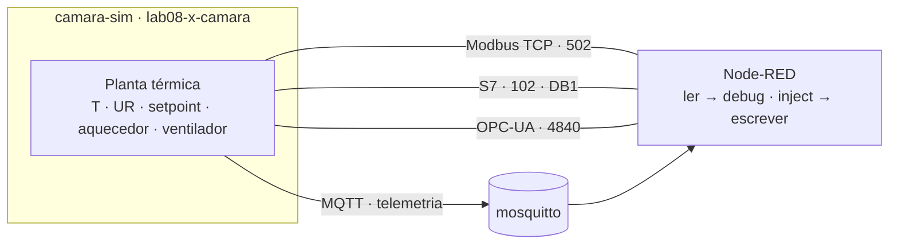
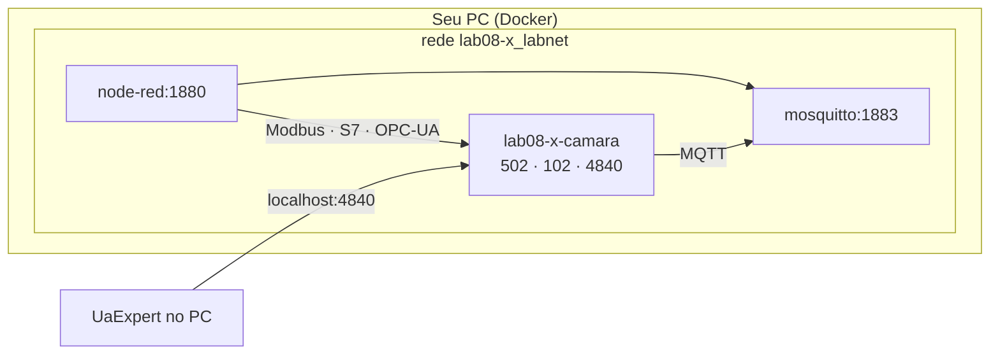
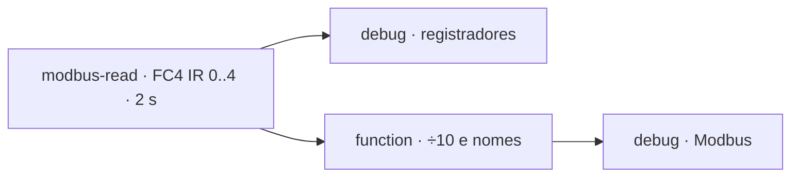
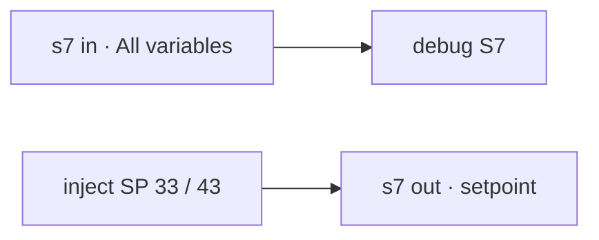
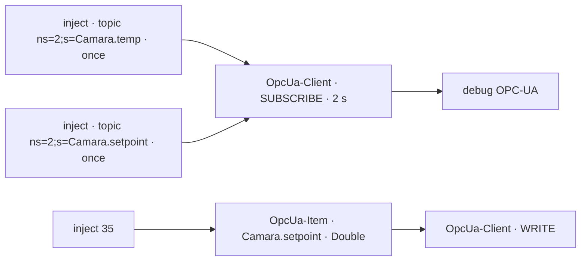

## Checklist — protocolos industriais: Modbus, S7 e OPC-UA (conceitos iniciais) {/* #checklist */}

- [ ] `camara-sim` rodando na rede do stack do curso, com o `testar_clientes.py` passando (T1)
- [ ] Modbus TCP no Node-RED: leitura dos registradores com escala e escrita do setpoint e da bobina (T2)
- [ ] S7: leitura do DB1 por endereço e escrita do setpoint (T3)
- [ ] OPC-UA: assinatura de dois nós e escrita do setpoint por NodeId (T4)
- [ ] Uma planta, quatro portas: o setpoint escrito por cada protocolo e lido por todos, e a contagem de mensagens (T5)
- [ ] Previsões P1–P4 respondidas no `README.md`
- [ ] Nenhum `push --force`; cada tarefa num commit `Tn:`

:::info[Pontuação]
**T1…T5 = 100 pts** (esta aula não tem desafios): T1 15 · T2 25 · T3 20 · T4 20 · T5 20. O
autograder normaliza para 0–10. Vale o commit `Tn:` mais recente de cada tarefa.
:::

<LabSetup />

### Configuração do ambiente de desenvolvimento {/* #setup */}

<DevTools />

---

Nos Labs 05 a 07, o ESP32 montou uma **câmara climática** (DHT22, OLED, potenciômetro,
aquecedor e ventilador) que falava **MQTT**, o protocolo típico de IoT.

Na indústria, quem conversa com o chão de fábrica são **CLPs**, **IHMs** e **SCADAs**, e eles
falam outros protocolos: **Modbus**, **S7** (Siemens) e **OPC-UA**. Nesta aula, a câmara vira
uma "máquina" industrial: o **`camara-sim`** é a mesma câmara, simulada num contêiner, que
expõe **a mesma planta** pelos quatro protocolos ao mesmo tempo.

O objetivo é entender **como cada protocolo organiza os dados** e **como o dado chega** ao
cliente. Por isso, o Node-RED faz só o mínimo: um nó que **lê** e mostra no _debug_, e um
_inject_ que **escreve**. Sem dashboard, sem banco, sem controle.



## Os quatro protocolos em uma tabela

Guarde esta tabela: cada parte da aula preenche uma linha dela na prática.

|                          | **Modbus TCP**                                 | **S7**                                                       | **OPC-UA**                                   | **MQTT**                                       |
| ------------------------ | ---------------------------------------------- | ------------------------------------------------------------ | -------------------------------------------- | ---------------------------------------------- |
| Origem                   | Modicon, 1979 (serial); aberto                 | Siemens; proprietário                                        | OPC Foundation; aberto (IEC 62541)           | IBM, 1999; aberto (OASIS)                      |
| Como o dado é endereçado | **número** do registrador (`IR0`, `HR3`)       | **bloco + byte** (`DB1,REAL20`)                              | **nó com nome** (`ns=2;s=Camara.temp`)       | **tópico** (`.../telemetria`)                  |
| Tipos                    | só bits e palavras de 16 bits                  | os do CLP (`BOOL`, `INT`, `REAL`…), mas o cliente é quem diz | o servidor **declara** o tipo de cada nó     | nenhum: o _payload_ é texto ou bytes           |
| O que é cada endereço    | um **mapa** em documento à parte               | uma **tabela de variáveis** à parte                          | o próprio servidor descreve (_browse_)       | combinado entre as partes                      |
| Como o dado chega        | **varredura**: o cliente pergunta a cada _x_ s | **varredura**                                                | **assinatura**: o servidor avisa quando muda | **publicação**: quem tem o dado envia          |
| Quem é servidor          | o equipamento (escravo)                        | o CLP                                                        | o equipamento                                | o **broker**; equipamento e SCADA são clientes |

## Objetivos

- Subir um **simulador de equipamento** em contêiner, ligado à rede do stack do curso.
- Entender o **modelo de dados** de cada protocolo: registradores (Modbus), blocos de dados com
  endereço em bytes (S7) e nós com nome e tipo (OPC-UA).
- Ler e escrever pelos três no Node-RED, com o mínimo de nós, incluindo a **escala** (×10) do
  Modbus.
- Comparar **varredura** (Modbus e S7), **assinatura** (OPC-UA) e **publicação** (MQTT).

## Material

- Stack Docker do curso (o **LAB IoT** do `lab08-x`): **mosquitto** e **Node-RED** com
  `node-red-contrib-modbus`, `node-red-contrib-s7` e `node-red-contrib-opcua`, que já vêm na
  imagem.
- O simulador **`camara-sim`**, na pasta `camara-sim/` do repositório do grupo.
- **Sem ESP32 nem Wokwi nesta aula.** O "equipamento" é o simulador.
- Opcional: **UaExpert** (Unified Automation, gratuito com cadastro), para navegar no servidor
  OPC-UA.

:::info[O que o camara-sim simula]
O mesmo modelo térmico da câmara dos Labs 05 a 07: aquecedor, perdas para o ambiente,
umidade que **cai** quando a câmara aquece, ruído do DHT22 e o controle ON/OFF do "firmware".
Com `SIM_SPEED=5`, a dinâmica fica **5× mais rápida**. Ele **não** simula a segurança do
OPC-UA: o servidor aceita qualquer cliente, sem senha e sem criptografia (P4).
:::

## Clonar o repositório do grupo {/* #clonar */}

<LabTeamMembers labName="lab08" />

## Envie o link do repositório do seu grupo no Moodle: {/* #moodle-link */}

<LabSubmit labName="lab08" />

<details>
<summary><strong>Mapa de tarefas</strong> — 5 tarefas · 100 pts</summary>

- [T1 — Simulador na rede do stack](#t1) · 15 pts
- [T2 — Modbus TCP](#t2) · 25 pts
- [T3 — S7: o DB1](#t3) · 20 pts
- [T4 — OPC-UA: assinatura e escrita](#t4) · 20 pts
- [T5 — Uma planta, quatro portas](#t5) · 20 pts

</details>

O repositório do grupo nasce do `lab08-template`, que traz uma cópia do simulador em
`camara-sim/`:

<FileTree
  details={true}
  defaultOpen={false}
  title="Estrutura de Arquivos do Projeto"
  root="lab08-grupo-X"
  files={[
    "camara-sim/camara_sim.py r",
    "camara-sim/camara_model.py r",
    "camara-sim/proto_modbus.py r",
    "camara-sim/proto_s7.py r",
    "camara-sim/proto_opcua.py r",
    "camara-sim/proto_mqtt.py r",
    "camara-sim/testar_clientes.py r",
    "camara-sim/Dockerfile r",
    "camara-sim/docker-compose.yml r",
    "camara-sim/docker-compose.lab.yml r",
    "camara-sim/.env.example r",
    "camara-sim/.env c",
    "camara-sim/README.md r",
    "nodered/flows-lab08.json c",
    "evidencias/t1-testar.txt c",
    "evidencias/t2-modbus.txt c",
    "evidencias/t3-s7.txt c",
    "evidencias/t4-opcua.txt c",
    "evidencias/t5-contagem.png c",
    "README.md u",
  ]}
/>

:::info[Nomes do Lab 08]
Troque o `x` pela letra do seu grupo em **todos** os nomes abaixo.

| O quê                    | Valor                         |
| ------------------------ | ----------------------------- |
| Contêiner e host na rede | `lab08-x-camara`              |
| Tópico base MQTT         | `elt85b/lab08/grupo-x/camara` |
| Rede do stack do curso   | `lab08-x_labnet`              |
| LAB IoT do lab08-x       | `http://localhost`            |

:::

---

## Parte 1 — O simulador na rede do stack {/* #parte-1 */}

O simulador **não** traz broker nem Node-RED: ele **entra na rede** do stack, onde já estão o
`mosquitto` e o `node-red`. Lá dentro, o Node-RED o encontra pelo nome **`lab08-x-camara`**,
como encontraria um CLP pelo nome na rede da fábrica.



### 1.1 Subir

1. Suba o [stack do curso](/infra/setup/gen_iot_aluno#lab-08), se ainda não estiver rodando, e
   confira o nome da rede:

   ```shell title="Terminal (cmd)"
   docker network ls
   ```

2. Na pasta `camara-sim/` do repositório, crie o `.env`:

<GroupCommands
  language="ini"
  commands={[
    {
      title: "Arquivo .env",
      codeTitle: "camara-sim/.env",
      command: `GRUPO=lab08-{group}
MQTT_BASE={course}/lab08/grupo-{group}/camara
LAB_REDE=lab08-{group}_labnet
SIM_SPEED=5

PORTA_MODBUS_TCP=1502
PORTA_MODBUS_RTU=5021
PORTA_S7=1102
PORTA_OPCUA=4840`,
},
]}
/>

3. Suba o simulador **com o complemento de rede** (`docker-compose.lab.yml`), que o liga à rede
   do stack e aponta o MQTT para o `mosquitto`:

<GroupCommands
  commands={[
    {
      title: "0. Pasta camara-sim",
      codeTitle: "Terminal (cmd)",
      command: `cd /d %USERPROFILE%\\ELT85BN21\\lab08-grupo-{group}\\camara-sim`,
    },
    {
      title: "1. Subir",
      codeTitle: "Terminal (cmd), na pasta camara-sim",
      command: `docker compose -f docker-compose.yml -f docker-compose.lab.yml up -d --build`,
    },
    {
      title: "2. Logs",
      codeTitle: "Terminal (cmd)",
      command: `docker logs -f lab08-{group}-camara`,
    },
    {
      title: "3. Saída esperada",
      codeTitle: "Saída esperada",
      language: "text",
      command: `[planta] câmara climática simulada do lab08-{group}, speed=5.0x
[s7] servidor na porta 102 (DB1, I, Q, M)
[modbus] TCP em 0.0.0.0:502 (unit 1)
[modbus] RTU sobre TCP em 0.0.0.0:5021
[opcua] opc.tcp://<host>:4840/  (escutando em 0.0.0.0)  'urn:utfpr:camara-climatica' = ns=2
[mqtt] conectando a mosquitto:1883, base '{course}/lab08/grupo-{group}/camara'
[mqtt] conectado; assinando {course}/lab08/grupo-{group}/camara/cmd e {course}/lab08/grupo-{group}/camara/cmd/+`,
    },
  ]}
/>

:::warning[Porta ocupada?]
Se o `up` reclamar de _port is already allocated_, outro programa do PC já usa a porta (o mais
comum é a 502 ou a 102). Troque só o lado do PC no `.env`, por exemplo `PORTA_MODBUS_TCP=1502`.
**Dentro da rede**, o Node-RED continua usando 502 e 102: o mapeamento de portas só vale para
quem acessa de fora (o seu PC).
:::

### 1.2 Testar todos os protocolos

O `testar_clientes.py` **escreve** o setpoint por um protocolo e **lê** pelos outros. Ele roda
**dentro** do contêiner, onde já conhece o tópico base. Na raiz do repositório:

<GroupCommands
  commands={[
    {
      title: "0. Raiz do repositório",
      codeTitle: "Terminal (cmd)",
      command: `cd /d %USERPROFILE%\\ELT85BN21\\lab08-grupo-{group}
if not exist evidencias mkdir evidencias`,
    },
    {
      title: "1. Testar e gravar",
      codeTitle: "Terminal (cmd)",
      command: `docker exec lab08-{group}-camara python testar_clientes.py --mqtt-host mosquitto > evidencias\\t1-testar.txt
type evidencias\\t1-testar.txt`,
    },
  ]}
/>

```text title="evidencias/t1-testar.txt (exemplo)"
MQTT escreve SP=36.0         {'temp': 37.0, 'umid': 35.8, 'setpoint': 36.0, 'estado_txt': 'ESTAVEL', 'aquecedor_pwm': 0.0}
Modbus TCP lê                {'temp': 36.9, 'umid': 35.1, 'sp': 36.0, 'sp_ef': 36.0, 'aq': 0, 've': 20, 'estado': 3, 'leds(v,a,r)': [1, 0, 0]}
Modbus TCP escreve SP=37.5   ok
S7 lê                        {'temp': 36.7, 'umid': 35.4, 'sp': 37.5, 'sp_ef': 37.5, 'aq': 100.0, 've': 20.0, 'estado': 3}
S7 escreve SP=38.0           ok
OPC-UA lê                    {'temp': 36.9, 'umid': 35.4, 'setpoint': 38.0, 'sp_efetivo': 38.0, ...}
OPC-UA escreve SP=39.0       ok
Modbus RTU/TCP lê            {'temp': 37.7, 'umid': 32.8, 'sp': 39.0, 'sp_ef': 39.0, 'aq': 100, 've': 20, 'estado': 1, ...}
MQTT escreve SP=35.0 e lê    {'temp': 38.6, 'umid': 32.8, 'setpoint': 35.0, 'estado_txt': 'RESFRIANDO', 'aquecedor_pwm': 0.0}
```

Siga a "corrente" do setpoint: o que o MQTT escreveu (36,0) o Modbus lê; o que o Modbus
escreveu (37,5) o S7 lê; e assim por diante. É **uma** planta com **várias** portas de acesso.

### 1.3 Conferir os endereços para o Node-RED {/* #enderecos */}

Dentro do Node-RED, os endereços são os **nomes dos contêineres na rede `labnet`**, e não
`localhost` nem o IP do PC: o `localhost` do Node-RED é o próprio contêiner do Node-RED. Três
comandos conferem tudo antes de montar o fluxo.

<GroupCommands
  commands={[
    {
      title: "1. Endereços do LAB IoT",
      codeTitle: "Terminal (cmd), na pasta do LAB IoT (lab08-{group})",
      command: `type credenciais.txt`,
    },
    {
      title: "2. Quem está na rede",
      codeTitle: "Terminal (cmd)",
      command: `docker network ls | findstr labnet
docker network inspect lab08-{group}_labnet --format "{{range .Containers}}{{.Name}} {{end}}"`,
    },
    {
      title: "3. O Node-RED alcança as portas?",
      codeTitle: "Terminal (cmd)",
      command: `docker exec lab08-{group}-nodered node -e "for(const[h,p]of[['lab08-{group}-camara',502],['lab08-{group}-camara',102],['lab08-{group}-camara',4840],['mosquitto',1883]]){const s=require('net').connect(p,h,()=>{console.log('ok    '+h+':'+p);s.end()});s.on('error',e=>console.log('FALHA '+h+':'+p+' '+e.code));s.setTimeout(3000,()=>{console.log('FALHA '+h+':'+p+' timeout');s.destroy()})}"`,
    },
  ]}
/>

1. No `credenciais.txt`, interessam as linhas `Node-RED: <base>/lab08-x/` e `MQTT:
mosquitto:1883 (Node-RED/FUXA)`, e se o MQTT pede login.
2. A rede leva o nome da **pasta** do LAB IoT mais `_labnet` (é o `LAB_REDE` do `.env`). A lista
   tem de incluir `lab08-x-mosquitto`, `lab08-x-nodered` e **`lab08-x-camara`**. Sem o
   `lab08-x-camara`, o simulador subiu sem o `docker-compose.lab.yml` ou com outro `LAB_REDE`.
3. O teste roda **de dentro** do contêiner do Node-RED, de onde os nós vão se conectar. As quatro
   linhas devem sair `ok`. `ENOTFOUND` quer dizer que o nome não existe na rede (volte ao passo 2);
   `ECONNREFUSED`, que o contêiner existe, mas nada escuta naquela porta.

| Nó de configuração no Node-RED | Endereço                                           |
| ------------------------------ | -------------------------------------------------- |
| modbus-client                  | `lab08-x-camara`, porta `502`, unit `1`            |
| s7 endpoint                    | `lab08-x-camara`, porta `102`, rack `0` / slot `1` |
| OpcUa-Endpoint                 | `opc.tcp://lab08-x-camara:4840/`                   |
| mqtt-broker                    | `mosquitto`, porta `1883`                          |
| Editor do Node-RED (navegador) | `http://localhost/lab08-x/`                        |

As portas do `.env` (`PORTA_MODBUS_TCP` etc.) só valem para quem acessa **de fora**, como o
UaExpert em `localhost:4840`. Dentro da rede, o Node-RED usa sempre 502, 102 e 4840.

:::warning[LAB IoT gerado com `--mqtt-sem-anonimo`]
Esta aula usa o padrão do `gen_iot_aluno.py`, em que o broker aceita clientes sem login. Com
`--mqtt-sem-anonimo`, o `camara-sim` (que conecta sem login) é recusado, e o usuário do grupo só
pode usar os tópicos `lab08-x/#`: os tópicos `elt85b/lab08/...` são descartados sem aviso. Gere o
LAB IoT sem essa opção.
:::

<FileTree
  root="lab08-grupo-X"
  files={["camara-sim/.env c", "evidencias/t1-testar.txt c"]}
/>

<CommitPoint
  id="t1"
  task="Simulador na rede do stack"
  pontos={15}
  files="camara-sim/.env evidencias/t1-testar.txt"
/>

---

## Parte 2 — Modbus TCP {/* #parte-2 */}

### 2.1 O modelo de dados do Modbus

O Modbus não tem nomes nem tipos: só **quatro tabelas** de endereços numerados, de bits ou de
palavras de 16 bits. O significado de cada endereço vem de um **mapa de registradores**, o
documento que o fabricante entrega com o equipamento. Este é o trecho do mapa da câmara que
vamos usar (unit 1, endereços a partir de 0):

| Tabela                | Função (FC)          | Acesso              | End.      | Variável                                                |
| --------------------- | -------------------- | ------------------- | --------- | ------------------------------------------------------- |
| **Coils**             | FC1 lê · FC5 escreve | bit, R/W            | 0         | `habilitado`                                            |
| **Discrete inputs**   | FC2                  | bit, só leitura     | 0–2       | LEDs verde, amarelo, vermelho                           |
| **Holding registers** | FC3 lê · FC6 escreve | 16 bits, R/W        | 3         | `setpoint` × 10 (350 = 35,0 °C)                         |
| **Input registers**   | FC4                  | 16 bits, só leitura | 0 / 1 / 2 | temperatura × 10 / umidade × 10 / setpoint efetivo × 10 |
|                       |                      |                     | 3 / 4     | aquecedor / ventilador (%)                              |

O mapa completo está no `camara-sim/README.md`.

:::note[Escala ×10]
Um registrador guarda só **inteiros** de 0 a 65535. Para ter uma casa decimal, o valor vai
**multiplicado por 10**: 35,2 °C viram `352`. Quem lê divide; quem escreve multiplica.
:::

### 2.2 Ler

Crie uma aba **Lab 08** no Node-RED e um nó de configuração **modbus-client**:

| Campo       | `câmara Modbus TCP`      |
| ----------- | ------------------------ |
| Type        | TCP                      |
| Host / Port | `lab08-x-camara` / `502` |
| TCP Type    | DEFAULT                  |
| Unit-Id     | `1`                      |



- **modbus-read** "FC4 IR 0..4": _FC 4: Read Input Registers_, Address `0`, Quantity `5`,
  Poll Rate `2 s`. A saída vai a um **debug** "Modbus (registradores)" e a uma function:

```js title="function: ÷10 e nomes"
// IR0..4 -> nomes e unidades (o mapa de registradores diz o que é cada um)
const r = msg.payload;
msg.payload = {
  temp: r[0] / 10, // IR0: °C x 10
  umid: r[1] / 10, // IR1: % x 10
  sp_efetivo: r[2] / 10, // IR2: °C x 10
  aquecedor: r[3], // IR3: %
  ventilador: r[4], // IR4: %
};
return msg;
```

- Ligue a function a um **debug** "Modbus" (_status_: `payload.temp`) e faça o **Deploy**.

```text title="Debug (o que chega do equipamento × o que ele significa)"
Modbus (registradores):  [ 362, 363, 350, 0, 20 ]
Modbus:                  { temp: 36.2, umid: 36.3, sp_efetivo: 35, aquecedor: 0, ventilador: 20 }
```

Sem o mapa, `[362, 363, 350, 0, 20]` são só números.

### 2.3 Escrever

| Nó                                   | Configuração                                                      |
| ------------------------------------ | ----------------------------------------------------------------- |
| inject "SP 30 °C" / "SP 40 °C"       | payload número `30` / `40`                                        |
| function "°C → HR3 (×10)"            | `msg.payload = Math.round(Number(msg.payload) * 10); return msg;` |
| modbus-write "FC6 HR3 setpoint"      | _FC 6: Preset Single Register_, Address `3`, Quantity `1`         |
| inject "Liga" / "Desliga"            | payload booleano `true` / `false`                                 |
| modbus-write "FC5 coil 0 habilitado" | _FC 5: Force Single Coil_, Address `0`, Quantity `1`              |

Clique "SP 40 °C": o `sp_efetivo` do debug vai a 40 e o aquecedor liga. Clique "Desliga": o
aquecedor vai a 0. Cada escrita aparece no log do simulador, com o protocolo de origem:

```shell title="Terminal (cmd)"
docker logs lab08-x-camara 2>&1 | findstr /l /c:"[cmd]"
```

```text title="Saída esperada (trecho)"
[15:45:03] [cmd] modbus: setpoint = 40.0
[15:45:08] [cmd] modbus coil: habilitado = False
[15:45:12] [cmd] modbus coil: habilitado = True
```

:::note[Dois conceitos que você vai encontrar em equipamentos reais]

- **Float32 em dois registradores:** para não perder precisão, muitos equipamentos guardam um
  `float` de 32 bits em **dois** registradores seguidos. A ordem das palavras (ABCD, CDAB…) muda
  de fabricante para fabricante, e errar a ordem dá números absurdos. A câmara faz isso nos
  IR12–13 (temperatura).
- **Modbus RTU:** o mesmo protocolo na linha serial **RS-485**, com o quadro endereço + função +
  dados + **CRC-16**. A câmara também responde em RTU (porta 5021, "RTU sobre TCP", como um
  conversor serial-Ethernet), mas não vamos usá-la hoje.
  :::

:::tip[Preveja antes de rodar]
**P1:** (a) o que acontece se você esquecer a function "×10" e mandar `37.5` direto para o HR3?
(Dica: o registrador só guarda inteiros, e o simulador limita o setpoint a 20…55 °C.) Teste e
confira no debug e no log. (b) O equipamento avisou algum erro? Por que não?
:::

**Evidência:** em `evidencias/t2-modbus.txt`, cole uma mensagem de cada debug ("registradores"
e "Modbus") e as linhas `[cmd]` do log.

<FileTree root="lab08-grupo-X" files={["evidencias/t2-modbus.txt c"]} />

<CommitPoint
  id="t2"
  task="Modbus TCP"
  pontos={25}
  files="evidencias/t2-modbus.txt"
/>

---

## Parte 3 — S7: o DB1 {/* #parte-3 */}

### 3.1 O modelo de dados do S7

Num CLP Siemens, os dados do programa ficam em **blocos de dados** (DB). Um DB é uma sequência
de **bytes**, e cada variável é um **tipo** num **deslocamento** (_offset_): `REAL` (float) ocupa
4 bytes, `INT` 2 bytes, e um `BOOL` é **um bit** de um byte. O protocolo S7 (ISO-on-TCP,
porta 102) lê e escreve faixas desses bytes. O cliente precisa saber o **endereço** e o **tipo**
de cada variável.

| Endereço (nodes7) | Bytes           | Variável                          | Acesso |
| ----------------- | --------------- | --------------------------------- | ------ |
| `DB1,X0.0`        | bit 0 do byte 0 | `habilitado`                      | R/W    |
| `DB1,INT2`        | 2–3             | `modo`                            | R/W    |
| `DB1,REAL4`       | 4–7             | `setpoint` (°C)                   | R/W    |
| `DB1,REAL20`      | 20–23           | `temp` (°C)                       | R      |
| `DB1,REAL24`      | 24–27           | `umid` (%)                        | R      |
| `DB1,REAL28`      | 28–31           | `sp_efetivo` (°C)                 | R      |
| `DB1,INT40`       | 40–41           | `estado` (0 DESLIGADO … 4 ALARME) | R      |

Repare que **não há escala**: o `REAL` já é o valor em °C.

### 3.2 Ler e escrever

Crie um nó de configuração **s7 endpoint** "câmara S7 (DB1)":

| Campo          | Valor                                                                                                                 |
| -------------- | --------------------------------------------------------------------------------------------------------------------- |
| Transport      | Ethernet (ISO-on-TCP)                                                                                                 |
| Address / Port | `lab08-x-camara` / `102`                                                                                              |
| Mode           | Rack/Slot: `0` / `1`                                                                                                  |
| Cycle time     | `2000` ms                                                                                                             |
| Variables      | `habilitado`, `setpoint`, `temp`, `umid`, `sp_efetivo` e `estado`, com os endereços da tabela (o `modo` fica de fora) |



- **s7 in**, _Mode_ **All variables** → **debug** "S7" (_status_: `payload.temp`). A cada ciclo,
  chega um objeto com todas as variáveis da tabela.
- **s7 out**, _Variable_ `setpoint`, alimentado por injects `33` e `43`.

```text title="Debug S7"
{ habilitado: true, setpoint: 36, temp: 36.400001525878906, umid: 37.099998474121094, sp_efetivo: 36, estado: 3 }
```

O `36.400001525878906` não é erro: 36,4 não tem representação exata em `float` de 32 bits, e o
Node-RED (JavaScript) mostra o número com a precisão de 64 bits.

Escreva SP 43 °C pelo S7 e confira, no debug "Modbus", que o `sp_efetivo` também mudou.

:::tip[Preveja antes de rodar]
**P2:** um colega declarou o setpoint como `DB1,REAL2`, em vez de `DB1,REAL4`, e escreveu `40`.
Quais bytes do DB1 foram alterados? O que acontece com o **modo** (bytes 2–3)? Por que o S7 não
avisa nada?
:::

**Evidência:** em `evidencias/t3-s7.txt`, uma mensagem do debug "S7" e as linhas `[cmd] s7:` do
log do simulador.

<FileTree root="lab08-grupo-X" files={["evidencias/t3-s7.txt c"]} />

<CommitPoint
  id="t3"
  task="S7: o DB1"
  pontos={20}
  files="evidencias/t3-s7.txt"
/>

---

## Parte 4 — OPC-UA: assinatura e escrita {/* #parte-4 */}

### 4.1 O modelo de dados do OPC-UA

No OPC-UA, o servidor publica um **espaço de endereçamento**: uma árvore de **nós**, cada um
com **nome**, **tipo**, **unidade** e permissões. O cliente não precisa de um mapa externo: ele
**navega** (_browse_) e descobre. Cada nó tem um **NodeId**. Na câmara:

```text title="Objects/Camara  (namespace urn:utfpr:camara-climatica = ns=2)"
Medicoes/    temp · umid                                  ns=2;s=Camara.temp ...
Atuadores/   aquecedor_pwm · ventilador_pwm
Estado/      estado · estado_txt · heartbeat · ...
Comandos/    habilitado · modo · setpoint · ...           (graváveis)
```

E o dado não precisa ser **perguntado** a cada 2 s. O cliente faz uma **assinatura**
(_subscription_): "me avise quando este nó mudar, verificando a cada 2 s".

:::info[Opcional: UaExpert]
No PC, conecte o UaExpert em `opc.tcp://localhost:4840/` (_Security_ None, anônimo). Navegue até
`Objects/Camara` e arraste `temp`, `setpoint` e `estado_txt` para o _Data Access View_. Repare
nos atributos de cada nó: `DataType`, `AccessLevel` e `Description`. Nenhum mapa foi preciso.
:::

### 4.2 Assinar e escrever no Node-RED

Crie um **OpcUa-Endpoint** "câmara OPC-UA": `opc.tcp://lab08-x-camara:4840/`, _Security
Policy_ None, _Mode_ None, anônimo.



- Dois **inject** que disparam **uma vez** (_Inject once after_ 3 s), com o NodeId no **topic**:
  `ns=2;s=Camara.temp` e `ns=2;s=Camara.setpoint`. Cada mensagem cria uma assinatura.
- **OpcUa-Client** "assina (2 s)": _Action_ **SUBSCRIBE**, _Interval_ `2` s → **debug**
  "OPC-UA". Cada mudança chega numa mensagem, com o NodeId no `msg.topic` e o valor no
  `msg.payload`. A primeira mensagem (`topic: subscriptionId`) só informa o número da assinatura.
- Para escrever: inject `35` → **OpcUa-Item** (_Item_ `ns=2;s=Camara.setpoint`, _Type_ `Double`)
  → **OpcUa-Client** "escreve", _Action_ **WRITE**.

O tipo **tem** de bater com o do servidor: escrever um `Float` num nó `Double` é recusado com
`BadTypeMismatch`. Ao contrário do S7, o OPC-UA **sabe** o tipo e **avisa**.

:::tip[Preveja antes de rodar]
**P3:** a câmara está estável, a temperatura oscila um pouco por causa do ruído do sensor, e
ninguém mexe no setpoint. Em 1 minuto, quantas mensagens de `temp` e quantas de `setpoint` o
OPC-UA entrega? E quantas leituras o Modbus faz no mesmo minuto? Responda antes e confira na T5.
:::

**Evidência:** em `evidencias/t4-opcua.txt`, algumas mensagens do debug "OPC-UA" (com o
`topic`) e as linhas `[cmd] opcua:` do log do simulador.

<FileTree root="lab08-grupo-X" files={["evidencias/t4-opcua.txt c"]} />

<CommitPoint
  id="t4"
  task="OPC-UA: assinatura e escrita"
  pontos={20}
  files="evidencias/t4-opcua.txt"
/>

---

## Projeto integrador — uma planta, quatro portas {/* #integrador */}

Falta o quarto caminho, o MQTT, que você já conhece. Com ele, a aba **Lab 08** fica com uma
leitura e uma escrita **por protocolo**, e dá para comparar os quatro lado a lado.

### Requisitos

1. **MQTT.** Um nó de configuração **mqtt-broker** (`mosquitto`, porta `1883`) e:
   - **mqtt in** `elt85b/lab08/grupo-x/camara/telemetria` (_Output_: a parsed JSON object) →
     **debug** "MQTT" (_status_: `payload.temp`);
   - inject `36` → **mqtt out** `elt85b/lab08/grupo-x/camara/cmd/setpoint`.

2. **O setpoint por cada porta.** Escreva o setpoint **uma vez por protocolo**, com uns 10 s
   entre as escritas: Modbus (40), S7 (33), OPC-UA (35) e MQTT (36). Depois de cada escrita,
   anote o que os **quatro** debugs mostram. No `README.md`:

   ```markdown title="README.md"
   ## T5 — Uma planta, quatro portas

   | Escrito por         | Valor | Modbus lê (`sp_efetivo`) | S7 lê (`setpoint`) | OPC-UA lê (`setpoint`) | MQTT lê (`setpoint`) |
   | ------------------- | ----- | ------------------------ | ------------------ | ---------------------- | -------------------- |
   | Modbus (FC6 HR3)    | 40    |                          |                    |                        |                      |
   | S7 (DB1,REAL4)      | 33    |                          |                    |                        |                      |
   | OPC-UA (Double)     | 35    |                          |                    |                        |                      |
   | MQTT (cmd/setpoint) | 36    |                          |                    |                        |                      |
   ```

3. **Contar as mensagens.** Em cada um dos debugs "Modbus", "S7", "OPC-UA" e "MQTT", troque o
   _status_ para **contador de mensagem** (_message count_) e faça o **Deploy** (o Deploy zera
   os contadores). Sem escrever nada, espere **1 minuto** e capture a aba em
   `evidencias/t5-contagem.png`. Anote os números no `README.md`.

   | Debug  | Mensagens em 1 min | Por quê                                        |
   | ------ | ------------------ | ---------------------------------------------- |
   | Modbus |                    | varredura a cada 2 s                           |
   | S7     |                    | varredura a cada 2 s (_Cycle time_)            |
   | OPC-UA |                    | uma por **mudança** de `temp` ou de `setpoint` |
   | MQTT   |                    | o equipamento publica a cada 2 s               |

   No debug "OPC-UA", filtre a barra lateral pelo nó e confira: quantas mensagens são de
   `Camara.setpoint`?

4. **Exporte o fluxo:** Menu ☰ → _Export_ → _Current flow_ → _Download_, e salve como
   `nodered/flows-lab08.json`.

5. **No `README.md`:** as respostas de P1 a P4.

:::tip[Preveja antes de rodar]
**P4:** nenhum dos caminhos desta aula pediu usuário ou senha. (a) Quem, na mesma rede, poderia
mudar o setpoint da câmara? (b) O que o OPC-UA oferece para evitar isso (veja as opções de
_Security Policy_ e _Mode_ do OpcUa-Endpoint) que o Modbus não tem? (c) Por que, mesmo assim,
redes industriais costumam ficar **separadas** da rede do escritório e da internet?
:::

<FileTree
  root="lab08-grupo-X"
  files={[
    "nodered/flows-lab08.json c",
    "evidencias/t5-contagem.png c",
    "README.md u",
  ]}
/>

<CommitPoint
  id="t5"
  task="Uma planta, quatro portas"
  pontos={20}
  files="nodered/flows-lab08.json evidencias/t5-contagem.png README.md"
/>

---

## Referência rápida {/* #referencia */}

| Protocolo  | Nó de configuração                                                        | Ler                                                          | Escrever                                                |
| ---------- | ------------------------------------------------------------------------- | ------------------------------------------------------------ | ------------------------------------------------------- |
| Modbus TCP | **modbus-client** `lab08-x-camara:502`, unit 1                            | **modbus-read** (FC1/2/3/4, endereço, quantidade, intervalo) | **modbus-write** (FC5 bobina, FC6 registrador)          |
| S7         | **s7 endpoint** `lab08-x-camara:102`, rack 0, slot 1, tabela de variáveis | **s7 in** (uma variável ou todas)                            | **s7 out** (uma variável)                               |
| OPC-UA     | **OpcUa-Endpoint** `opc.tcp://lab08-x-camara:4840/`                       | **OpcUa-Client** READ ou SUBSCRIBE, NodeId no `msg.topic`    | **OpcUa-Item** (NodeId + tipo) → **OpcUa-Client** WRITE |
| MQTT       | **mqtt-broker** `mosquitto:1883`                                          | **mqtt in** (tópico)                                         | **mqtt out** (tópico)                                   |

| Problema                                        | O que fazer                                                                                                                                                             |
| ----------------------------------------------- | ----------------------------------------------------------------------------------------------------------------------------------------------------------------------- |
| Nó Modbus/S7/OPC-UA "desconectado"              | o simulador está na rede do stack? `docker logs lab08-x-camara`; no Node-RED, o host é `lab08-x-camara`, e não `localhost`                                              |
| Nós Modbus com "propriedades inválidas: Server" | no `modbus-client`, o campo _Serial port_ não pode ficar vazio, mesmo com _Type_ TCP: mude o _Type_ para Serial, preencha `/dev/ttyUSB`, volte para TCP e faça o Deploy |
| `port is already allocated` no `up`             | troque a porta do lado do PC no `.env`                                                                                                                                  |
| Setpoint "errado" pelo Modbus                   | faltou o ×10 (P1)                                                                                                                                                       |
| Valores sem sentido no S7                       | endereço ou tipo errado na tabela de variáveis (P2)                                                                                                                     |
| `BadTypeMismatch` no OPC-UA                     | o _Type_ do OpcUa-Item tem de ser o do nó (`Double` para o setpoint)                                                                                                    |
| Nada chega no debug "MQTT"                      | o tópico tem de ser **idêntico** ao `MQTT_BASE` do `.env`, mais `/telemetria`                                                                                           |
| Parar o simulador                               | na pasta `camara-sim`: `docker compose -f docker-compose.yml -f docker-compose.lab.yml down`                                                                            |

---

<LabLogout />
