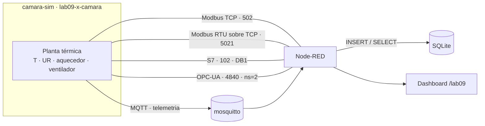
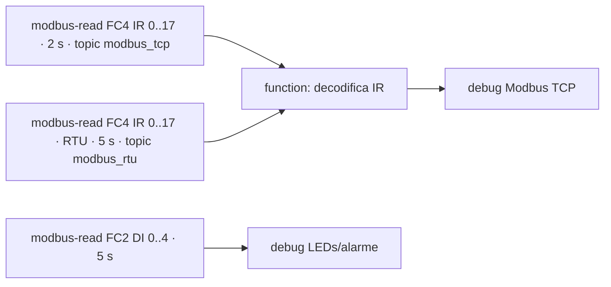
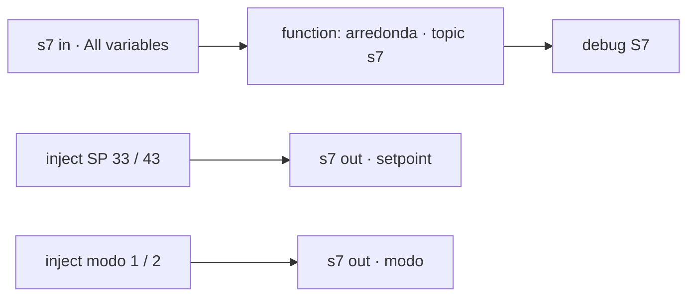
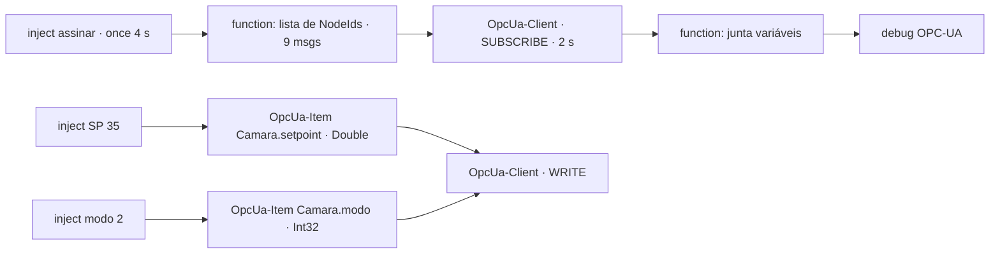
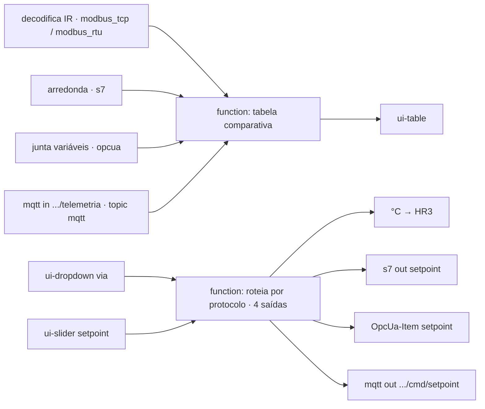
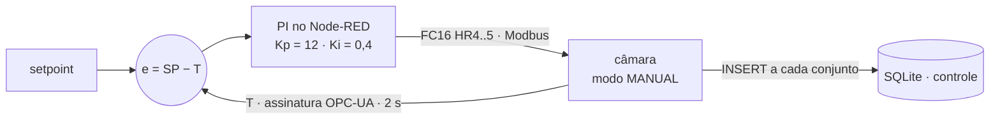

## Checklist — Modbus, S7 e OPC-UA a fundo: painel SCADA e controle pela rede {/* #checklist */}

- [ ] `camara-sim` do Lab 09 na rede do stack, endereços conferidos e o fluxo do Lab 08 reaproveitado (T1)
- [ ] Modbus completo: mapa inteiro, float32, bits empacotados, entradas discretas e RTU sobre TCP (T2)
- [ ] S7 completo: tabela de 15 variáveis, valores arredondados e escrita do modo (T3)
- [ ] OPC-UA em conjunto: 9 variáveis assinadas, juntas num único objeto, e escrita do modo (T4)
- [ ] Painel multiprotocolo: a mesma câmara vista por 5 caminhos e o setpoint escrito por qualquer um (T5)
- [ ] Controle PI no Node-RED (lê por OPC-UA, escreve por Modbus) comparado com o PI interno no SQLite (T6)
- [ ] Previsões P1–P4 respondidas no `README.md`
- [ ] Nenhum `push --force`; cada tarefa num commit `Tn:`
- [ ] Logout do Git e do `gh` no computador do laboratório

:::info[Pontuação]
**T1…T6 = 100 pts** (esta aula não tem desafios): T1 10 · T2 20 · T3 15 · T4 15 · T5 15 ·
T6 25. O autograder normaliza para 0–10. Vale o commit `Tn:` mais recente de cada tarefa.
:::

<LabSetup />

### Configuração do ambiente de desenvolvimento {/* #setup */}

<DevTools />

---

No **Lab 08**, a câmara simulada apareceu pelos quatro protocolos, com o mínimo: um nó que lê
e um _inject_ que escreve. Você viu os **conceitos**: registradores e escala no Modbus, bytes e
tipos no S7, nós com nome e assinatura no OPC-UA.

Agora o Node-RED faz o papel de um **SCADA** de verdade:

1. lê **todo** o mapa de cada protocolo, com os truques que aparecem em equipamentos reais
   (_float_ em dois registradores, bits empacotados, Modbus RTU);
2. junta as leituras e mostra **a mesma câmara por cinco caminhos** num painel;
3. por fim, **assume o controle**: mede pelo OPC-UA, calcula um PI e atua pelo Modbus, e o
   SQLite registra tudo para comparar com o PI que roda dentro do "equipamento".



## Objetivos

- Ler o **mapa completo** de um equipamento Modbus: escala, _float32_ em dois registradores
  (e a ordem das palavras), bits empacotados e entradas discretas, por **TCP** e por **RTU**.
- Montar a **tabela de variáveis** de um CLP S7 e tratar os `REAL`.
- Assinar **várias** variáveis OPC-UA e juntar as notificações, que chegam em **lotes**.
- Montar um **painel** com a mesma planta vista por cinco caminhos e escrever por qualquer um.
- (Integrador) Fechar uma **malha de controle PI no SCADA** e comparar com o PI embarcado,
  usando o **SQLite**.

## Material

- O **LAB IoT** do `lab09-x` (gerado pelo `gen_iot_aluno.py`): **mosquitto** e **Node-RED** com
  `node-red-contrib-modbus`, `node-red-contrib-s7`, `node-red-contrib-opcua`,
  `node-red-node-sqlite` e Dashboard 2.0, que já vêm na imagem.
- O simulador **`camara-sim`**, na pasta `camara-sim/` do repositório do grupo.
- O fluxo do Lab 08 (`nodered/flows-lab08.json`, no repositório do Lab 08).
- **Sem ESP32 nem Wokwi nesta aula.**
- Opcional: **UaExpert**, para navegar no servidor OPC-UA.

:::info[O que o camara-sim simula (e o que não)]
O modelo tem **dois estados térmicos** (resistência e câmara), perdas para o ambiente (25 °C),
umidade calculada pela fórmula de Magnus (aquecer **derruba** a UR), ruído e falhas de leitura
do DHT22, e o ON/OFF e o PI do "firmware". Ele **não** simula atraso de rede, perda de pacotes
nem a segurança do OPC-UA. Com `SIM_SPEED=5`, um degrau de 30 → 40 °C assenta em cerca de 30 s,
em vez de 2,5 min.
:::

## Clonar o repositório do grupo {/* #clonar */}

<LabTeamMembers labName="lab09" />

## Envie o link do repositório do seu grupo no Moodle: {/* #moodle-link */}

<LabSubmit labName="lab09" />

<details>
<summary><strong>Mapa de tarefas</strong> — 6 tarefas · 100 pts</summary>

- [T1 — Simulador, endereços e o fluxo do Lab 08](#t1) · 10 pts
- [T2 — Modbus completo](#t2) · 20 pts
- [T3 — S7 completo](#t3) · 15 pts
- [T4 — OPC-UA em conjunto](#t4) · 15 pts
- [T5 — Painel multiprotocolo](#t5) · 15 pts
- [T6 — PI no Node-RED × PI interno](#t6) · 25 pts

</details>

O repositório do grupo nasce do `lab09-template`, que traz uma cópia do simulador em
`camara-sim/`:

<FileTree
  details={true}
  defaultOpen={false}
  title="Estrutura de Arquivos do Projeto"
  root="lab09-grupo-x"
  files={[
    "camara-sim/camara_sim.py r",
    "camara-sim/testar_clientes.py r",
    "camara-sim/docker-compose.yml r",
    "camara-sim/docker-compose.lab.yml r",
    "camara-sim/.env.example r",
    "camara-sim/.env c",
    "camara-sim/README.md r",
    "nodered/flows-lab09.json c",
    "evidencias/t1-testar.txt c",
    "evidencias/t1-enderecos.txt c",
    "evidencias/t2-modbus.txt c",
    "evidencias/t3-s7.txt c",
    "evidencias/t4-opcua.txt c",
    "evidencias/t5-dashboard.png c",
    "evidencias/t6-sqlite.txt c",
    "evidencias/t6-dashboard.png c",
    "README.md u",
  ]}
/>

:::info[Nomes do Lab 09]
Troque o `x` pela letra do seu grupo em **todos** os nomes abaixo.

| O quê                      | Valor                                      |
| -------------------------- | ------------------------------------------ |
| Contêiner e host na rede   | `lab09-x-camara`                           |
| Tópico base MQTT           | `elt85b/lab09/grupo-x/camara`              |
| Rede do stack do curso     | `lab09-x_labnet`                           |
| Banco SQLite (no Node-RED) | `/data/sqlite/lab09.sqlite`                |
| Editor do Node-RED         | `http://localhost/lab09-x/`                |
| Dashboard                  | `http://localhost/lab09-x/dashboard/lab09` |

:::

---

## Parte 1 — Simulador, endereços e o fluxo do Lab 08 {/* #parte-1 */}

### 1.1 Subir o simulador

Como no Lab 08, agora com os nomes do Lab 09. Com o LAB IoT do `lab09-x` rodando, crie o `.env`
na pasta `camara-sim/`:

<GroupCommands
  language="ini"
  commands={[
    {
      title: "Arquivo .env",
      codeTitle: "camara-sim/.env",
      command: `GRUPO=lab09-{group}
MQTT_BASE={course}/lab09/grupo-{group}/camara
LAB_REDE=lab09-{group}_labnet
SIM_SPEED=5

PORTA_MODBUS_TCP=1502
PORTA_MODBUS_RTU=5021
PORTA_S7=1102
PORTA_OPCUA=4840`,
},
]}
/>

<GroupCommands
  commands={[
    {
      title: "1. Subir",
      codeTitle: "Terminal (cmd)",
      command: `cd /d %USERPROFILE%\\ELT85BN21\\lab09-grupo-{group}\\camara-sim
docker compose -f docker-compose.yml -f docker-compose.lab.yml up -d --build
docker logs lab09-{group}-camara`,
    },
    {
      title: "2. Testar e gravar",
      codeTitle: "Terminal (cmd), na raiz do repositório",
      command: `cd /d %USERPROFILE%\\ELT85BN21\\lab09-grupo-{group}
if not exist evidencias mkdir evidencias
docker exec lab09-{group}-camara python testar_clientes.py --mqtt-host mosquitto > evidencias\\t1-testar.txt
type evidencias\\t1-testar.txt`,
    },
  ]}
/>

### 1.2 Conferir os endereços

Os mesmos três testes do Lab 08 (seção 1.3), agora gravando a evidência:

<GroupCommands
  commands={[
    {
      title: "Rede e portas",
      codeTitle: "Terminal (cmd), na raiz do repositório",
      command: `docker network inspect lab09-{group}_labnet --format "{{range .Containers}}{{.Name}} {{end}}" > evidencias\\t1-enderecos.txt
docker exec lab09-{group}-nodered node -e "for(const[h,p]of[['lab09-{group}-camara',502],['lab09-{group}-camara',5021],['lab09-{group}-camara',102],['lab09-{group}-camara',4840],['mosquitto',1883]]){const s=require('net').connect(p,h,()=>{console.log('ok    '+h+':'+p);s.end()});s.on('error',e=>console.log('FALHA '+h+':'+p+' '+e.code));s.setTimeout(3000,()=>{console.log('FALHA '+h+':'+p+' timeout');s.destroy()})}" >> evidencias\\t1-enderecos.txt
type evidencias\\t1-enderecos.txt`,
    },
  ]}
/>

As cinco portas (agora com a **5021**, do Modbus RTU) devem sair `ok`.

### 1.3 Reaproveitar o fluxo do Lab 08

O fluxo do Lab 08 já tem um cliente para cada protocolo. Num SCADA, o endereço de cada
equipamento fica **num só lugar**, o **nó de configuração**, e todos os nós de leitura e
escrita apontam para ele. Para levar o fluxo para o Lab 09, basta trocar esses nós.

1. No Node-RED do Lab 09 (`http://localhost/lab09-x/`): Menu ☰ → _Import_ → selecione o
   `nodered/flows-lab08.json` do repositório do **Lab 08** → _Import_.
2. Dê dois cliques na aba importada e troque o nome para **Lab 09**.
3. Na barra lateral, abra **Configuration nodes** (ícone de engrenagem) e troque `lab08` por
   `lab09` em:

   | Nó de configuração                  | Campo    | Novo valor                       |
   | ----------------------------------- | -------- | -------------------------------- |
   | `câmara Modbus TCP` (modbus-client) | Host     | `lab09-x-camara`                 |
   | `câmara S7 (DB1)` (s7 endpoint)     | Address  | `lab09-x-camara`                 |
   | `câmara OPC-UA` (OpcUa-Endpoint)    | Endpoint | `opc.tcp://lab09-x-camara:4840/` |

4. Troque `lab08` por `lab09` nos tópicos do **mqtt in** (telemetria) e do **mqtt out**
   (`cmd/setpoint`). Esses ficam nos próprios nós, não num nó de configuração.
5. **Deploy**. Os quatro debugs voltam a receber dados.
6. Exporte: Menu ☰ → _Export_ → _Current flow_ → _Download_, e salve como
   `nodered/flows-lab09.json`. Repita a exportação no fim de cada tarefa.

:::tip[Busca no editor]
**Ctrl+F** no editor procura por texto em todos os nós: procure `lab08` e confira que não
sobrou nenhum.
:::

<FileTree
  root="lab09-grupo-x"
  files={[
    "camara-sim/.env c",
    "nodered/flows-lab09.json c",
    "evidencias/t1-testar.txt c",
    "evidencias/t1-enderecos.txt c",
  ]}
/>

<CommitPoint
  id="t1"
  task="Simulador, endereços e o fluxo do Lab 08"
  pontos={10}
  files="camara-sim/.env nodered/flows-lab09.json evidencias/t1-testar.txt evidencias/t1-enderecos.txt"
/>

---

## Parte 2 — Modbus completo {/* #parte-2 */}

### 2.1 O mapa inteiro

No Lab 08, você leu os IR 0 a 4. Este é o mapa completo da câmara (unit 1, endereços base 0):

| Tabela (código de função)                     | Acesso      | End.      | Variável                                                      |
| --------------------------------------------- | ----------- | --------- | ------------------------------------------------------------- |
| Coils (FC1 lê · FC5/FC15 escreve)             | R/W bit     | 0 / 1     | `habilitado` / `falha_dht` (simulação)                        |
| Discrete inputs (FC2)                         | R bit       | 0–4       | LED verde, amarelo, vermelho, `dht_ok`, alarme ativo          |
| Holding registers (FC3 lê · FC6/FC16 escreve) | R/W 16 bits | 0 / 1 / 2 | `habilitado` / `modo` (0 MANUAL, 1 ON/OFF, 2 PI) / `fonte_sp` |
|                                               |             | 3         | `setpoint` × 10 (350 = 35,0 °C)                               |
|                                               |             | 4 / 5     | `aquecedor_cmd` / `ventilador_cmd` (%), valem no modo MANUAL  |
| Input registers (FC4)                         | R 16 bits   | 0 / 1 / 2 | temperatura × 10 / umidade × 10 / setpoint efetivo × 10       |
|                                               |             | 3 / 4 / 5 | aquecedor / ventilador aplicados (%) / `pot_raw`              |
|                                               |             | 6 / 7     | `estado` (0 DESLIGADO … 4 ALARME) / `alarme` (bits)           |
|                                               |             | 8         | LEDs: bit0 verde, bit1 amarelo, bit2 vermelho                 |
|                                               |             | 10        | `heartbeat` (conta a cada ciclo do "firmware")                |
|                                               |             | 12–13     | temperatura em **float32** (palavra alta primeiro, ABCD)      |
|                                               |             | 14–15     | umidade em **float32** (ABCD)                                 |

Além da **escala** (Lab 08), dois truques que aparecem em quase todo equipamento real:

- **Float32 em dois registradores:** o mesmo valor aparece como `float` IEEE 754 ocupando
  **dois** registradores. A ordem das palavras (ABCD, CDAB…) muda de fabricante para
  fabricante, e errar a ordem dá números absurdos.
- **Bits empacotados:** vários sinais booleanos dentro de um registrador (o IR8 dos LEDs).

### 2.2 Dois clientes: TCP e RTU sobre TCP

O mesmo escravo responde em **duas** portas. A 502 usa **Modbus TCP** (cabeçalho MBAP, sem
CRC). A 5021 usa o quadro **RTU** (endereço + função + dados + **CRC-16**), o mesmo da RS-485,
só que transportado por TCP, como faz um conversor serial-Ethernet. Crie um segundo
**modbus-client**:

| Campo    | `câmara Modbus TCP` (do Lab 08) | `câmara Modbus RTU/TCP` (novo) |
| -------- | ------------------------------- | ------------------------------ |
| Type     | TCP                             | TCP                            |
| Host     | `lab09-x-camara`                | `lab09-x-camara`               |
| Port     | `502`                           | `5021`                         |
| TCP Type | **DEFAULT**                     | **TELNET**                     |
| Unit-Id  | `1`                             | `1`                            |

:::warning[TELNET, não RTU-BUFFERED]
No `node-red-contrib-modbus`, o tipo que envia quadros **RTU crus** pelo socket se chama
**TELNET**. O "TCP-RTU-BUFFERED", apesar do nome, envia cabeçalho Modbus TCP, e o simulador na
5021 não responde (o nó fica em _timeout_).
:::

### 2.3 Ler e decodificar tudo



- Troque o **modbus-read** do Lab 08 para Address `0`, Quantity **`18`**, Topic `modbus_tcp`,
  e o nome para "FC4 IR 0..17".
- Um segundo **modbus-read**, pelo cliente RTU, a cada `5 s`, Topic `modbus_rtu`.
- **modbus-read** "FC2 DI 0..4": _FC 2: Read Discrete Inputs_, Address `0`, Quantity `5`,
  direto num **debug** "LEDs/alarme (bits)".
- A function "÷10 e nomes" do Lab 08 vira esta:

```js title="function: decodifica IR"
// Input registers 0..17 da câmara -> objeto com nomes e unidades
const r = msg.payload;
if (!Array.isArray(r) || r.length < 18) return null;
const s16 = (v) => (v > 0x7fff ? v - 0x10000 : v); // int16 com sinal
const f32 = (i) => {
  // float32 big-endian (ABCD)
  const b = Buffer.alloc(4);
  b.writeUInt16BE(r[i], 0);
  b.writeUInt16BE(r[i + 1], 2);
  return b.readFloatBE(0);
};
const ESTADOS = ["DESLIGADO", "AQUECENDO", "RESFRIANDO", "ESTAVEL", "ALARME"];
msg.payload = {
  temp_x10: s16(r[0]) / 10, // IR0: °C x 10
  temp: Number(f32(12).toFixed(2)), // IR12-13: float32
  umid: Number(f32(14).toFixed(1)), // IR14-15
  sp_efetivo: s16(r[2]) / 10, // IR2
  aquecedor_pwm: r[3],
  ventilador_pwm: r[4],
  pot_raw: r[5],
  estado: r[6],
  estado_txt: ESTADOS[r[6]] ?? "?",
  alarme: r[7],
  leds: {
    verde: r[8] & 1,
    amarelo: (r[8] >> 1) & 1,
    vermelho: (r[8] >> 2) & 1,
  },
  heartbeat: r[10],
};
return msg;
```

Ligue a function a um **debug** "Modbus TCP" (_status_: `payload.temp`). As leituras TCP e RTU
caem no **mesmo** debug: o `msg.topic` (`modbus_tcp` ou `modbus_rtu`) diz de onde veio cada uma.

```text title="Debug (trecho)"
Modbus TCP:          { temp_x10: 34.8, temp: 34.8, umid: 37.8, sp_efetivo: 35, aquecedor_pwm: 0,
                       ventilador_pwm: 20, pot_raw: 1758, estado: 3, estado_txt: 'ESTAVEL', alarme: 0,
                       leds: { verde: 1, amarelo: 0, vermelho: 0 }, heartbeat: 152 }
LEDs/alarme (bits):  [ true, false, false, true, false, false, false, false ]
```

As entradas discretas chegam como **8** booleanos, embora você tenha pedido 5: o Modbus
transporta bits em **bytes** inteiros. Só os 5 primeiros têm significado (verde, amarelo,
vermelho, `dht_ok`, alarme).

:::tip[Preveja antes de rodar]
**P1:** (a) com 36,2 °C, os IR12–13 valem `0x4210` e `0xCCCD`. Se o seu cliente lesse na
ordem **CDAB** (palavra baixa primeiro), que número apareceria? Troque `r[i]` e `r[i + 1]` na
`f32` e confira. Que tipo de valor denuncia uma ordem de palavras errada? (b) O IR8 vale `6`.
Quais LEDs estão acesos? Se o equipamento já entrega os LEDs nos DI 0–2, por que também os
empacota no IR8?
:::

**Evidência:** em `evidencias/t2-modbus.txt`, um objeto do debug "Modbus TCP" com `topic`
`modbus_tcp`, outro com `modbus_rtu`, um array do debug de LEDs e as linhas `[cmd]` do log
(`docker logs lab09-x-camara 2>&1 | findstr /l /c:"[cmd]"`) depois de usar os injects do Lab 08.

<FileTree
  root="lab09-grupo-x"
  files={["nodered/flows-lab09.json u", "evidencias/t2-modbus.txt c"]}
/>

<CommitPoint
  id="t2"
  task="Modbus completo"
  pontos={20}
  files="nodered/flows-lab09.json evidencias/t2-modbus.txt"
/>

---

## Parte 3 — S7 completo {/* #parte-3 */}

### 3.1 A tabela de variáveis inteira

| Endereço nodes7         | Bytes | Variável                                   | Acesso |
| ----------------------- | ----- | ------------------------------------------ | ------ |
| `DB1,X0.0`              | 0.0   | `habilitado`                               | R/W    |
| `DB1,X0.1`              | 0.1   | `fonte_sp` (0 remoto, 1 potenciômetro)     | R/W    |
| `DB1,INT2`              | 2–3   | `modo`                                     | R/W    |
| `DB1,REAL4`             | 4–7   | `setpoint` (°C)                            | R/W    |
| `DB1,REAL8`             | 8–11  | `aquecedor_cmd` (%)                        | R/W    |
| `DB1,REAL12`            | 12–15 | `ventilador_cmd` (%)                       | R/W    |
| `DB1,REAL20`            | 20–23 | `temp` (°C)                                | R      |
| `DB1,REAL24`            | 24–27 | `umid` (%)                                 | R      |
| `DB1,REAL28`            | 28–31 | `sp_efetivo` (°C)                          | R      |
| `DB1,REAL32` / `REAL36` | 32–39 | `aquecedor_pwm` / `ventilador_pwm` (%)     | R      |
| `DB1,INT40` / `INT42`   | 40–43 | `estado` / `alarme`                        | R      |
| `DB1,X44.0` … `X44.2`   | 44    | `led_verde`, `led_amarelo`, `led_vermelho` | R      |
| `DB1,DINT48`            | 48–51 | `heartbeat`                                | R      |

O DB1 do simulador é **sem acesso otimizado**: os endereços são fixos, como num S7-300 ou num
S7-1200 com _Optimized block access_ desligado. Num S7-1200/1500 real, isso e o _PUT/GET_
precisam ser liberados no TIA Portal.

### 3.2 Ler, arredondar e escrever o modo

No **s7 endpoint** "câmara S7 (DB1)", complete a tabela com as **15** variáveis (o nome à
direita, o endereço à esquerda), com os nomes exatamente como na coluna "Variável".



Entre o **s7 in** e o debug, uma function que arredonda os `REAL` (no Lab 08 eles chegavam como
`36.400001525878906`) e marca a origem:

```js title="function: arredonda"
// "s7 in" (todas as variáveis) -> números arredondados
const p = msg.payload;
const r = (v) => Math.round(v * 100) / 100;
msg.payload = Object.assign({}, p, {
  temp: r(p.temp),
  umid: r(p.umid),
  setpoint: r(p.setpoint),
  sp_efetivo: r(p.sp_efetivo),
  aquecedor_pwm: r(p.aquecedor_pwm),
  ventilador_pwm: r(p.ventilador_pwm),
});
msg.topic = "s7";
return msg;
```

E um **s7 out** _Variable_ `modo`, com injects `1` (ON/OFF) e `2` (PI). Escreva `2` e confira,
no debug "Modbus TCP", que o comportamento do aquecedor muda: o ON/OFF liga e desliga a 100 %,
o PI modula.

```text title="Debug S7"
{ habilitado: true, fonte_sp: false, modo: 1, setpoint: 35, temp: 34.9, umid: 37.9, sp_efetivo: 35,
  aquecedor_pwm: 0, ventilador_pwm: 20, estado: 3, alarme: 0, led_verde: true, led_amarelo: false,
  led_vermelho: false, heartbeat: 149 }
```

:::tip[Preveja antes de rodar]
**P2:** a mesma informação dos LEDs aparece de **três** formas: os DI 0–2 do Modbus (3 bits), o
IR8 (um registrador com 3 bits dentro) e os `DB1,X44.0…X44.2` do S7 (3 bits do mesmo byte).
Quantas **requisições** cada cliente precisa para ler os 3 LEDs **e** a temperatura? Por que o
**s7 in** "All variables" lê 15 variáveis sem fazer 15 requisições?
:::

**Evidência:** em `evidencias/t3-s7.txt`, um objeto do debug "S7" e as linhas `[cmd] s7:` do
log do simulador.

<FileTree
  root="lab09-grupo-x"
  files={["nodered/flows-lab09.json u", "evidencias/t3-s7.txt c"]}
/>

<CommitPoint
  id="t3"
  task="S7 completo"
  pontos={15}
  files="nodered/flows-lab09.json evidencias/t3-s7.txt"
/>

---

## Parte 4 — OPC-UA em conjunto {/* #parte-4 */}

No Lab 08, você assinou `temp` e `setpoint`, cada um com um inject. Para um painel, é preciso
assinar **várias** variáveis e trabalhar com elas como **um** objeto.

```text title="Objects/Camara  (namespace urn:utfpr:camara-climatica = ns=2)"
Medicoes/    temp · umid · pot_raw                       ns=2;s=Camara.temp ...
Atuadores/   aquecedor_pwm · ventilador_pwm · *_duty
Estado/      estado · estado_txt · alarme · led_* · heartbeat · uptime · oled
Comandos/    habilitado · modo · fonte_sp · setpoint · aquecedor_cmd · ventilador_cmd   (graváveis)
Simulacao/   pot_raw_sim · falha_dht                                                     (graváveis)
```



### 4.1 Assinar nove variáveis

Troque os dois injects do Lab 08 por **um** inject "assinar" (_once_, 4 s) e uma function que
gera **uma mensagem por variável**, cada uma com o NodeId no `topic`:

```js title="function: lista de NodeIds"
// Uma mensagem por variável a assinar: msg.topic = NodeId, msg.datatype = tipo OPC-UA
const vars = {
  temp: "Double",
  umid: "Double",
  setpoint: "Double",
  sp_efetivo: "Double",
  aquecedor_pwm: "Double",
  ventilador_pwm: "Double",
  modo: "Int32",
  estado_txt: "String",
  heartbeat: "Int32",
};
return [
  Object.entries(vars).map(([n, t]) => ({
    topic: `ns=2;s=Camara.${n}`,
    datatype: t,
    payload: "",
  })),
];
```

Retornar `[ [msg1, msg2, …] ]` (um array **dentro** de outro) faz a function enviar as nove
mensagens em sequência pela mesma saída.

### 4.2 Juntar as notificações

Cada mudança chega numa mensagem separada (o NodeId no `topic`, o valor no `payload`). Entre o
OpcUa-Client e o debug, esta function guarda o último valor de cada variável e emite **um**
objeto:

```js title="function: junta variáveis"
// Cada variável assinada chega numa mensagem separada (msg.topic = NodeId).
// O servidor entrega as mudanças em LOTES (a cada ~2 s): guarda o último valor de
// cada variável e emite UM conjunto 200 ms depois da última mensagem do lote.
const nome = String(msg.topic).split("Camara.")[1];
if (!nome) return null; // ex.: a mensagem "subscriptionId"
const v =
  msg.payload && msg.payload.value !== undefined
    ? msg.payload.value.value // versões antigas do node-red-contrib-opcua
    : msg.payload;
const d = context.get("d") || {};
d[nome] = v;
context.set("d", d);
if (Object.keys(d).length < 9) return null; // ainda faltam variáveis
clearTimeout(context.get("tmr"));
context.set(
  "tmr",
  setTimeout(() => {
    const r = (x) => Math.round(x * 100) / 100;
    node.send({
      topic: "opcua",
      payload: Object.assign({}, d, {
        temp: r(d.temp),
        umid: r(d.umid),
        aquecedor_pwm: r(d.aquecedor_pwm),
        ventilador_pwm: r(d.ventilador_pwm),
      }),
    });
  }, 200),
);
return null;
```

```text title="Debug OPC-UA"
{ temp: 34.9, umid: 37.9, setpoint: 35, sp_efetivo: 35, aquecedor_pwm: 0, ventilador_pwm: 20,
  modo: 1, estado_txt: 'ESTAVEL', heartbeat: 149 }
```

:::warning[Por que o atraso de 200 ms?]
O servidor guarda **todas** as mudanças de cada item monitorado e as entrega juntas, a cada
2 s. O `heartbeat` muda a cada ciclo do simulador: chegam 4 ou 5 mensagens dele no mesmo
milissegundo. Emitir a cada mensagem geraria **4 ou 5 conjuntos repetidos** a cada 2 s (e 4 ou
5 linhas por ciclo no SQLite da T6). O `setTimeout` reiniciado a cada mensagem (_debounce_)
espera o lote terminar e emite **um** conjunto, com os valores mais recentes.
:::

### 4.3 Escrever o modo

Um segundo **OpcUa-Item** no OpcUa-Client "escreve" do Lab 08: _Item_ `ns=2;s=Camara.modo`,
_Type_ **`Int32`**, com um inject `2`. O tipo tem de ser o do nó: `Double` para o setpoint,
`Int32` para o modo.

:::tip[Preveja antes de rodar]
**P3:** (a) sem o `setTimeout`, quantos objetos o "junta variáveis" emitiria a cada 2 s? Tire o
_debounce_ (emita a cada mensagem) e conte no debug. (b) No Lab 08 você contou ~100 mensagens
de `temp` por minuto com `SIM_SPEED=5`. Um SCADA com 500 variáveis, das quais 480 quase nunca
mudam, gera mais ou menos tráfego com assinatura do que com varredura a cada 2 s?
:::

**Evidência:** em `evidencias/t4-opcua.txt`, um objeto do debug "OPC-UA" e as linhas
`[cmd] opcua:` do log do simulador (setpoint e modo).

<FileTree
  root="lab09-grupo-x"
  files={["nodered/flows-lab09.json u", "evidencias/t4-opcua.txt c"]}
/>

<CommitPoint
  id="t4"
  task="OPC-UA em conjunto"
  pontos={15}
  files="nodered/flows-lab09.json evidencias/t4-opcua.txt"
/>

---

## Parte 5 — Painel multiprotocolo {/* #parte-5 */}

Agora o dashboard mostra **a mesma câmara vista por cinco caminhos** e permite escrever o
setpoint **por qualquer um deles**.



### 5.1 Tabela comparativa

Ligue as saídas de "decodifica IR", "arredonda" e "junta variáveis" a uma nova function. Para o
MQTT, ligue o **mqtt in** da telemetria do Lab 08 a uma function que só faz
`msg.topic = "mqtt"; return msg;`, e dela à mesma function.

```js title="function: tabela comparativa"
// Guarda a última leitura de cada caminho e monta a tabela comparativa
const fonte = msg.topic; // modbus_tcp | modbus_rtu | s7 | opcua | mqtt
const p = msg.payload;
const ult = flow.get("ultimas") || {};
ult[fonte] = {
  t: p.temp,
  sp: p.sp_efetivo ?? p.setpoint,
  aq: p.aquecedor_pwm,
  estado:
    p.estado_txt ??
    ["DESLIGADO", "AQUECENDO", "RESFRIANDO", "ESTAVEL", "ALARME"][p.estado] ??
    "?",
  em: Date.now(),
};
flow.set("ultimas", ult);
const NOMES = {
  modbus_tcp: "Modbus TCP (FC4)",
  modbus_rtu: "Modbus RTU/TCP",
  s7: "S7 (DB1)",
  opcua: "OPC-UA (assinatura)",
  mqtt: "MQTT (telemetria)",
};
const agora = Date.now();
msg.payload = Object.keys(NOMES)
  .filter((k) => ult[k])
  .map((k) => ({
    caminho: NOMES[k],
    "T (°C)": ult[k].t?.toFixed(2),
    "SP (°C)": ult[k].sp?.toFixed(1),
    "aquecedor (%)": Math.round(ult[k].aq),
    estado: ult[k].estado,
    "idade (s)": ((agora - ult[k].em) / 1000).toFixed(1),
  }));
return msg;
```

No Dashboard 2.0, crie a página **Lab 09** (_path_ `/lab09`) e os grupos _Mesma câmara, quatro
protocolos_ (largura 8), _Escrever o setpoint_ (4), _Controle PI no Node-RED_ (4) e
_Temperatura × setpoint_ (8). Ligue a function a um **ui-table** (colunas automáticas, _Max
rows_ 6) no primeiro grupo. O painel abre em `http://localhost/lab09-x/dashboard/lab09`.

### 5.2 Escrever por qualquer protocolo

- **ui-dropdown** "Escrever por": opções `modbus` (rótulo "Modbus (FC6 HR3)"), `s7`, `opcua` e
  `mqtt`; _Topic_ `via`.
- **ui-slider** "Setpoint (°C)": 20 a 55, passo 0,5, envia **ao soltar**, _Topic_ `sp`.
- Os dois entram na mesma function de **4 saídas**:

```js title="function: roteia por protocolo"
// Encaminha o setpoint para o protocolo escolhido no dropdown
if (msg.topic === "via") {
  context.set("via", msg.payload);
  node.status({ text: "via " + msg.payload });
  return null;
}
const via = context.get("via") || "modbus";
const sp = Number(msg.payload);
flow.set("escrita", { via, sp, em: Date.now() });
node.status({ fill: "blue", shape: "dot", text: `SP ${sp} °C via ${via}` });
const out = [null, null, null, null];
out[["modbus", "s7", "opcua", "mqtt"].indexOf(via)] = { payload: sp };
return out;
```

| Saída | Liga em                                                           |
| ----- | ----------------------------------------------------------------- |
| 1     | function "°C → HR3 (×10)" do Lab 08 (que já leva ao FC6 HR3)      |
| 2     | **s7 out** `setpoint` do Lab 08                                   |
| 3     | **OpcUa-Item** `Camara.setpoint` do Lab 08                        |
| 4     | **mqtt out** `elt85b/lab09/grupo-x/camara/cmd/setpoint` do Lab 08 |

Escolha cada protocolo, mova o slider e veja **as cinco linhas** convergirem para o novo SP. A
coluna **idade** mostra há quanto tempo cada caminho foi atualizado: o RTU, lido a cada 5 s, é o
mais "velho".

**Evidência:** a captura do dashboard com as cinco linhas em `evidencias/t5-dashboard.png` e o
fluxo exportado.

<FileTree
  root="lab09-grupo-x"
  files={["nodered/flows-lab09.json u", "evidencias/t5-dashboard.png c"]}
/>

<CommitPoint
  id="t5"
  task="Painel multiprotocolo"
  pontos={15}
  files="nodered/flows-lab09.json evidencias/t5-dashboard.png"
/>

---

## Projeto integrador — PI no Node-RED × PI interno {/* #integrador */}

Até aqui, quem controla a temperatura é o "firmware" da câmara (modo 1 ON/OFF ou modo 2 PI).
Agora o **SCADA assume o controle**: a câmara vai para o modo **0 MANUAL**, em que obedece aos
registradores **HR4** (aquecedor) e **HR5** (ventilador), e o Node-RED calcula esses valores
com um **PI**. A medição vem pelo **OPC-UA** e a atuação vai pelo **Modbus**, como num sistema
real em que o SCADA conversa com equipamentos de fabricantes diferentes.



O controlador é discreto, executado a cada conjunto do OPC-UA (~2 s):

```text title="PI com anti-windup"
e  = SP − T                              (°C)
I  = I + Ki · e · dt                     só se a saída não estiver saturada no sentido do erro
u  = Kp · e + I       → aquecedor = u limitado a 0…100 %
ventilador = 20 + 30 · (−e − 0,5)        limitado a 20…100 %  (20 % = circulação)
```

### Requisitos

1. **Ativação.** Um **ui-switch** "PI no Node-RED (modo MANUAL)" ligado a uma function de 2
   saídas:
   - **ligado:** guarda `flow.pi_ativo = true` e escreve `[1, 0]` em **HR0..1** (habilitado,
     modo MANUAL) com **FC16**;
   - **desligado:** escreve `2` no **HR1** com FC6 (volta ao PI interno).

   ```js title="function: ativa / desativa"
   // Liga/desliga o controle externo.
   // Ligar: HR0..1 = [1, 0]  -> habilitado, modo MANUAL (a câmara obedece HR4/HR5)
   // Desligar: HR1 = 2       -> volta ao PI interno
   flow.set("pi_ativo", msg.payload === true);
   node.status({
     fill: msg.payload ? "green" : "grey",
     shape: "ring",
     text: msg.payload ? "externo" : "interno",
   });
   return msg.payload ? [{ payload: [1, 0] }, null] : [null, { payload: 2 }];
   ```

2. **Controlador.** Function "PI" alimentada pelo **"junta variáveis"** da T4, com 2 saídas:
   `[aquecedor, ventilador]` para um **modbus-write** **FC16** em **HR4**, quantidade 2, e um
   objeto de diagnóstico para um debug. Ela só atua com `pi_ativo` **e** `modo === 0`. Fora
   disso, zera o integrador.

   ```js title="function: PI (Kp=12, Ki=0,4)"
   // Controlador PI EXTERNO. Entrada: conjunto do OPC-UA (a cada ~2 s).
   // Só atua quando o controle externo está ativo e a câmara está em modo MANUAL (0).
   const p = msg.payload;
   const ativo = flow.get("pi_ativo") === true;
   if (!ativo || p.modo !== 0) {
     context.set("I", 0);
     context.set("t0", null);
     return [null, null];
   }

   const KP = 12,
     KI = 0.4; // %/°C e %/(°C·s)  <-- ajuste aqui
   const agora = Date.now() / 1000;
   const t0 = context.get("t0");
   const dt = t0 ? Math.min(agora - t0, 10) : 0;
   context.set("t0", agora);

   const e = p.setpoint - p.temp; // erro (°C)
   let I = context.get("I") || 0;
   let u = KP * e + I;
   // anti-windup: só integra se não estiver saturado no sentido do erro
   if ((u < 100 || e < 0) && (u > 0 || e > 0))
     I = Math.min(100, Math.max(0, I + KI * e * dt));
   context.set("I", I);
   const aq = Math.round(Math.min(100, Math.max(0, KP * e + I)));
   const ve = Math.round(Math.min(100, Math.max(20, 20 + 30 * (-e - 0.5)))); // 20 % = circulação

   node.status({
     fill: "green",
     shape: "dot",
     text: `e=${e.toFixed(2)} I=${I.toFixed(1)} aq=${aq}% ve=${ve}%`,
   });
   return [{ payload: [aq, ve] }, { payload: { e, I, aq, ve } }];
   ```

   :::warning[FC16 no modbus-write]
   Para escrever **dois** registradores, o _FC_ do modbus-write tem de ser **FC 16: Preset
   Multiple Registers** (no fluxo exportado, `"dataType": "MHoldingRegisters"`) e o payload,
   um **array**. Com _FC 6_ e quantidade 2, o nó escreve **só o primeiro** valor e não dá
   erro: o ventilador nunca muda e o modo nunca vai a 0.
   :::

3. **Registro.** Tabela `controle` no **`/data/sqlite/lab09.sqlite`**: um nó de configuração
   **sqlitedb** com esse caminho (modo _Read-Write-Create_), um nó **sqlite** "consultas" em
   _Via msg.topic_ e um inject _once_ (0,5 s) com o `CREATE` no **topic**. Uma linha **por
   conjunto do OPC-UA**:

   ```sql title="msg.topic do inject 'Criar tabela'"
   CREATE TABLE IF NOT EXISTS controle (
       id          INTEGER PRIMARY KEY AUTOINCREMENT,
       recebido_em TEXT DEFAULT (strftime('%Y-%m-%d %H:%M:%f', 'now', 'localtime')),
       modo        INTEGER,   -- 0 MANUAL (PI no Node-RED), 1 ON/OFF, 2 PI interno
       t           REAL,      -- °C (OPC-UA)
       sp          REAL,      -- setpoint efetivo (°C)
       aq          REAL,      -- % aquecedor aplicado
       ve          REAL       -- % ventilador aplicado
   );
   ```

   ```js title="function: monta parâmetros"
   // Cada conjunto do OPC-UA -> uma linha (com parâmetros)
   const p = msg.payload;
   if (typeof p.temp !== "number" || typeof p.sp_efetivo !== "number")
     return null;
   msg.params = {
     $modo: p.modo,
     $t: p.temp,
     $sp: p.sp_efetivo,
     $aq: p.aquecedor_pwm,
     $ve: p.ventilador_pwm,
   };
   return msg;
   ```

   ```sql title="sqlite 'INSERT' (Prepared Statement)"
   INSERT INTO controle (modo, t, sp, aq, ve) VALUES ($modo, $t, $sp, $aq, $ve);
   ```

4. **Gráfico.** O mesmo conjunto vira 3 pontos num **ui-chart** "Temperatura × setpoint"
   (séries `T (°C)`, `SP (°C)` e `aquecedor (%/2)`, X = key `ts`, Y = key `valor`, série = key
   `serie`, 15 minutos):

   ```js title="function: pontos"
   // Conjunto do OPC-UA -> pontos do gráfico
   const p = msg.payload,
     ts = Date.now();
   return {
     payload: [
       { ts, serie: "T (°C)", valor: p.temp },
       { ts, serie: "SP (°C)", valor: p.sp_efetivo },
       { ts, serie: "aquecedor (%/2)", valor: p.aquecedor_pwm / 2 },
     ],
   };
   ```

5. **Experimento** (com `SIM_SPEED=5`):
   1. inject "Apagar tudo" (`DELETE FROM controle;` no topic);
   2. **PI interno:** inject **modo PI (2)** (do S7 ou do OPC-UA; a câmara começa em ON/OFF), SP
      **30 °C**, espere ~1 min; SP **40 °C**, espere ~1 min;
   3. **PI no Node-RED:** SP **30 °C**, ligue o switch, espere ~1 min; SP **40 °C**, espere
      ~1 min;
   4. rode as duas consultas abaixo (cada uma num inject com a consulta no **topic**, ligado ao
      nó "consultas" e a um debug "resultado").

   ```sql title="Comparar controladores (10 min)"
   SELECT CASE modo WHEN 0 THEN 'PI Node-RED' WHEN 1 THEN 'ON/OFF interno'
                    WHEN 2 THEN 'PI interno' END AS controlador,
          COUNT(*)                                             AS n,
          ROUND(AVG(ABS(sp - t)), 2)                           AS erro_medio,
          ROUND(100.0 * SUM(ABS(sp - t) > 0.5) / COUNT(*), 0)  AS pct_fora_banda,
          ROUND(AVG(aq), 1)                                    AS aq_medio
   FROM controle
   WHERE recebido_em >= datetime('now', 'localtime', '-10 minutes')
   GROUP BY modo;
   ```

   ```sql title="Último degrau (pico e tempo)"
   -- Último degrau de SUBIDA de cada controlador: sobressinal e tempo até a banda de 0,5 °C
   WITH m AS (
     SELECT id, recebido_em, modo, t, sp, LAG(sp) OVER (ORDER BY id) AS sp_ant FROM controle
   ),
   d AS (
     SELECT modo, MAX(id) AS id0 FROM m WHERE sp > sp_ant GROUP BY modo
   ),
   j AS (
     SELECT m.*, (SELECT recebido_em FROM m AS a WHERE a.id = d.id0) AS t0
     FROM m JOIN d ON m.modo = d.modo AND m.id >= d.id0
     WHERE m.sp = (SELECT sp FROM m AS b WHERE b.id = d.id0)
   )
   SELECT CASE modo WHEN 0 THEN 'PI Node-RED' WHEN 1 THEN 'ON/OFF interno'
                    WHEN 2 THEN 'PI interno' END AS controlador,
          MAX(sp) AS sp, COUNT(*) AS n,
          ROUND(MAX(t) - MAX(sp), 2) AS sobressinal,
          ROUND((julianday(MIN(CASE WHEN t >= sp - 0.5 THEN recebido_em END))
                 - julianday(MIN(t0))) * 86400, 0) AS s_ate_banda
   FROM j GROUP BY modo;
   ```

   A segunda consulta usa `LAG()` para achar a linha em que o SP **subiu**. A partir dela, mede o
   pico acima do SP e quanto tempo a temperatura levou para chegar a 0,5 °C dele.

6. **Evidências:**
   - `evidencias/t6-sqlite.txt`: a saída das duas consultas;
   - `evidencias/t6-dashboard.png`: o gráfico com os dois degraus (interno e externo);
   - o fluxo exportado de novo em `nodered/flows-lab09.json`;
   - no `README.md`, as respostas de P1 a P4.

**Resultado de referência** (simulador com `SIM_SPEED=5`; os seus números vão variar um pouco
por causa do ruído):

```text title="evidencias/t6-sqlite.txt (exemplo)"
controlador     n   erro_medio  pct_fora_banda  aq_medio
PI Node-RED     60  2.01        62              32.4
ON/OFF interno  1   0.6         100             100
PI interno      61  1.46        39              33.7

controlador   sp    n   sobressinal  s_ate_banda
PI Node-RED   40.0  31  -0.2         26
PI interno    40.0  30  0.0          22
```

Os dois PIs chegam ao SP sem sobressinal (o negativo quer dizer que o pico ficou abaixo do SP).
O externo é um pouco **mais lento**: ele só corrige a cada ~2 s, e cada correção atravessa
**dois** protocolos (OPC-UA na ida, Modbus na volta), enquanto o interno roda a cada ciclo do
"firmware". O `erro_medio` alto vem dos degraus: logo depois de cada mudança, o erro é de 10 °C.
A linha "ON/OFF interno" é a leitura de antes do "modo PI (2)".

:::tip[Preveja antes de rodar]
**P4:** com o PI externo ligado e o aquecedor a 80 %, o contêiner do **Node-RED cai**. O que
acontece com o HR4 e com a temperatura da câmara? Alguém desliga o aquecedor? A proteção de
sobretemperatura do simulador (60 °C, veja o `camara-sim/README.md`) chega a atuar? Teste:
`docker stop lab09-x-nodered`, acompanhe a temperatura com o `testar_clientes.py` ou o UaExpert
por alguns minutos e depois `docker start lab09-x-nodered`. Proponha **uma** forma de evitar o
problema, por exemplo um _watchdog_ no equipamento que volta ao modo 2 se o HR4 não for reescrito
em 10 s, e diga por que ela precisa ficar no **equipamento** e não no Node-RED.
:::

<FileTree
  root="lab09-grupo-x"
  files={[
    "nodered/flows-lab09.json u",
    "evidencias/t6-sqlite.txt c",
    "evidencias/t6-dashboard.png c",
    "README.md u",
  ]}
/>

<CommitPoint
  id="t6"
  task="PI no Node-RED × PI interno"
  pontos={25}
  files="nodered/flows-lab09.json evidencias/t6-sqlite.txt evidencias/t6-dashboard.png README.md"
/>

---

## Referência rápida {/* #referencia */}

| Problema                                        | O que fazer                                                                                                                              |
| ----------------------------------------------- | ---------------------------------------------------------------------------------------------------------------------------------------- |
| Nós Modbus com "propriedades inválidas: Server" | no `modbus-client`, o _Serial port_ não pode ficar vazio, mesmo com _Type_ TCP: mude para Serial, preencha `/dev/ttyUSB`, volte para TCP |
| RTU em _timeout_                                | o _TCP Type_ do cliente da porta 5021 é **TELNET**                                                                                       |
| Temperatura absurda (±10⁸ ou 10⁻³⁸)             | ordem das palavras do float32 trocada (P1)                                                                                               |
| Ventilador não muda no PI externo               | o modbus-write de HR4..5 está em FC6; use **FC16** com payload array                                                                     |
| `BadTypeMismatch`                               | o _Type_ do OpcUa-Item tem de ser o do nó (`Double` no setpoint, `Int32` no modo)                                                        |
| Linhas repetidas no SQLite                      | falta o _debounce_ no "junta variáveis" (P3)                                                                                             |
| `SQLITE_CANTOPEN`                               | o caminho é `/data/sqlite/lab09.sqlite` (pasta `sqlite` dentro do `/data` do Node-RED)                                                   |
| O dashboard não abre                            | `http://localhost/lab09-x/dashboard/lab09`; a página precisa do _path_ `/lab09`                                                          |
| Sobrou `lab08` em algum nó                      | Ctrl+F no editor procura em todos os nós                                                                                                 |

---

## Logout do seu ambiente dev, git e gh {/* #logout */}

<GitLogOut />

<LabLogout />
