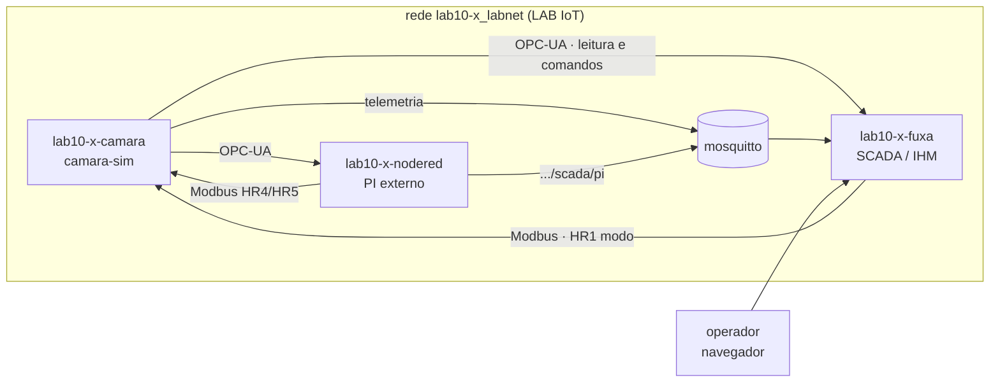
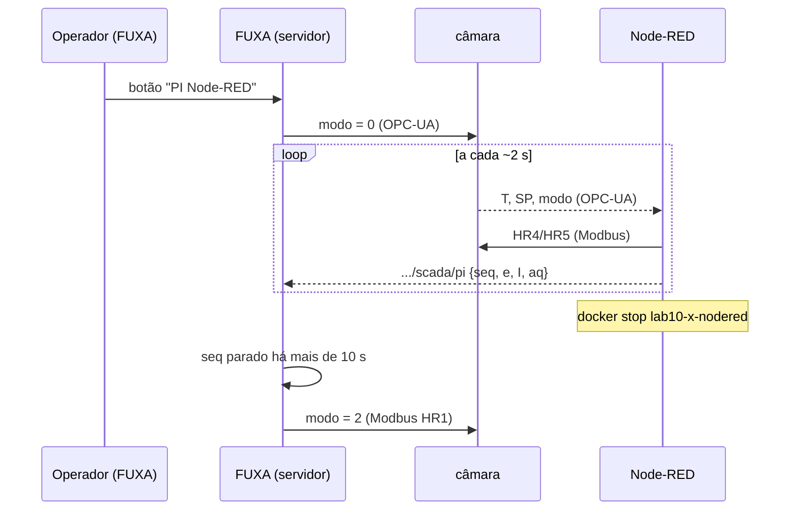

## Checklist — SCADA da câmara com FUXA {/* #checklist */}

- [ ] LAB IoT do `lab10-x` com a câmara, o fluxo do Lab 09 no Node-RED e os drivers do FUXA instalados (T1)
- [ ] Três conexões no FUXA (OPC-UA, Modbus TCP e MQTT), em verde e com as tags lendo (T2)
- [ ] Sinótico da câmara: estado em cores, valores, barra do aquecedor, setpoint e botões de modo (T3)
- [ ] Dois alarmes, testados e reconhecidos (T4)
- [ ] Histórico e tendência de T, SP e aquecedor (T5)
- [ ] FUXA + Node-RED: o operador escolhe o controlador no FUXA, e um supervisor devolve a câmara ao PI interno se o Node-RED cair (T6)
- [ ] Previsões P1–P4 respondidas no `README.md`
- [ ] Nenhum `push --force`; cada tarefa num commit `Tn:`

:::info[Pontuação]
**T1…T6 = 100 pts** (esta aula não tem desafios): T1 10 · T2 20 · T3 20 · T4 15 · T5 15 ·
T6 20. O autograder normaliza para 0–10. Vale o commit `Tn:` mais recente de cada tarefa.
:::

<LabSetup />

### Configuração do ambiente de desenvolvimento {/* #setup */}

<DevTools />

---

Nos Labs 08 e 09, o Node-RED fez o papel de SCADA: cada leitura, cada escala e cada botão foram
**programados** em nós e funções. Funciona, mas não é assim que se supervisiona uma fábrica. Lá,
o operador olha para um **sinótico** desenhado num software de **SCADA/IHM**, onde conexões,
tags, alarmes e histórico são **configurados**, e não programados.

Nesta aula, você monta o SCADA da mesma câmara climática no **FUXA**, um SCADA web de código
aberto que **já vem no LAB IoT**. Tudo o que você aprendeu nos Labs 08 e 09 reaparece, agora
como configuração:

| No Lab 08/09 (Node-RED)                                               | No FUXA                                                        |
| --------------------------------------------------------------------- | -------------------------------------------------------------- |
| nó de configuração (`modbus-client`, `OpcUa-Endpoint`, `mqtt-broker`) | **conexão** (_Connection_)                                     |
| endereço lido por um nó (`IR0`, `ns=2;s=Camara.temp`, chave do JSON)  | **tag**                                                        |
| function "÷10"                                                        | campo **Divisor** da tag                                       |
| debug, ui-table, ui-chart                                             | **sinótico**, **tendência**                                    |
| PI externo (Lab 09, T6)                                               | continua no Node-RED; o FUXA escolhe quem controla e **vigia** |



## Objetivos

- Configurar um **SCADA**: drivers, conexões e tags.
- Comparar como cada protocolo é endereçado num SCADA: NodeId (OPC-UA), registrador **base 1**
  com divisor (Modbus) e chave de JSON (MQTT).
- Desenhar um **sinótico**: formas e cores ligadas ao estado, valores, barras e comandos.
- Configurar **alarmes** com nível, texto e reconhecimento.
- Registrar **histórico** e montar uma **tendência**.
- (Integrador) Dividir o trabalho entre SCADA e controlador e implementar um **supervisor de
  falha** do controlador externo.

## Material

- O **LAB IoT** do `lab10-x` (gerado pelo `gen_iot_aluno.py`, **sem** `--sem-fuxa`): mosquitto,
  Node-RED e **FUXA**.
- O simulador `camara-sim`, na pasta `camara-sim/` do repositório do grupo.
- O fluxo do Lab 09 (`nodered/flows-lab09.json`, no repositório do Lab 09).
- Acesso à internet **no primeiro uso**: os drivers do FUXA são baixados do npm.

:::info[FUXA: o que esta aula usa]
O FUXA tem **editor** (`/editor`) e **runtime** (a tela do operador) no mesmo servidor. As
conexões rodam no **servidor**, e não no navegador: 10 operadores com a tela aberta não
multiplicam o tráfego com a câmara. A aula não usa usuários e permissões, relatórios,
receitas nem o Node-RED embutido do FUXA. Também fica de fora o driver **S7**: ele não resolve
nomes de host e exigiria o IP do contêiner.
:::

## Clonar o repositório do grupo {/* #clonar */}

<LabTeamMembers labName="lab10" />

## Envie o link do repositório do seu grupo no Moodle: {/* #moodle-link */}

<LabSubmit labName="lab10" />

<details>
<summary><strong>Mapa de tarefas</strong> — 6 tarefas · 100 pts</summary>

- [T1 — Câmara, Node-RED e drivers do FUXA](#t1) · 10 pts
- [T2 — Conexões e tags](#t2) · 20 pts
- [T3 — Sinótico da câmara](#t3) · 20 pts
- [T4 — Alarmes](#t4) · 15 pts
- [T5 — Histórico e tendência](#t5) · 15 pts
- [T6 — FUXA + Node-RED: quem controla e quem vigia](#t6) · 20 pts

</details>

<FileTree
  details={true}
  defaultOpen={false}
  title="Estrutura de Arquivos do Projeto"
  root="lab10-grupo-x"
  files={[
    "camara-sim/docker-compose.yml r",
    "camara-sim/docker-compose.lab.yml r",
    "camara-sim/.env.example r",
    "camara-sim/.env c",
    "fuxa/projeto-lab10.json c",
    "nodered/flows-lab10.json c",
    "evidencias/t1-enderecos.txt c",
    "evidencias/t1-plugins.png c",
    "evidencias/t2-conexoes.png c",
    "evidencias/t3-sinotico.png c",
    "evidencias/t4-alarmes.png c",
    "evidencias/t5-tendencia.png c",
    "evidencias/t6-fallback.png c",
    "evidencias/t6-log.txt c",
    "README.md u",
  ]}
/>

:::info[Nomes do Lab 10]
Troque o `x` pela letra do seu grupo em **todos** os nomes abaixo.

| O quê                       | Valor                                                                                                |
| --------------------------- | ---------------------------------------------------------------------------------------------------- |
| Câmara (host na rede)       | `lab10-x-camara`                                                                                     |
| Telemetria da câmara (MQTT) | `elt85b/lab10/grupo-x/camara/telemetria`                                                             |
| Estado do PI externo (T6)   | `elt85b/lab10/grupo-x/scada/pi`                                                                      |
| Node-RED                    | `http://localhost/lab10-x/` (contêiner `lab10-x-nodered`)                                            |
| FUXA: editor / runtime      | `http://localhost/fuxa/lab10-x/editor` · `http://localhost/fuxa/lab10-x/` (contêiner `lab10-x-fuxa`) |
| Login do FUXA               | o usuário e a senha do grupo (`credenciais.txt` do LAB IoT)                                          |

O projeto do FUXA fica **dentro** do LAB IoT (pasta `fuxa/lab10-x/` dele). O que vai para o
repositório é a **exportação**: no menu do projeto (ícone de disquete), **Save Project As...**
baixa o arquivo; salve-o como `fuxa/projeto-lab10.json`. Exporte de novo ao fim de **cada**
tarefa.
:::

---

## Parte 1 — Câmara, Node-RED e drivers do FUXA {/* #parte-1 */}

### 1.1 A câmara e o fluxo do Lab 09

O mesmo do Lab 09 (Parte 1), com os nomes do Lab 10:

1. **Câmara:** o `.env` da pasta `camara-sim/` com `GRUPO=lab10-x`,
   `MQTT_BASE=elt85b/lab10/grupo-x/camara`, `LAB_REDE=lab10-x_labnet` e `SIM_SPEED=5`, e o
   `docker compose -f docker-compose.yml -f docker-compose.lab.yml up -d --build`.
2. **Endereços:** grave a evidência e confira que a lista tem `lab10-x-camara`,
   `lab10-x-nodered` e **`lab10-x-fuxa`**:

<GroupCommands
  commands={[
    {
      title: "Quem está na rede",
      codeTitle: "Terminal (cmd), na raiz do repositório",
      command: `if not exist evidencias mkdir evidencias
docker network inspect lab10-{group}_labnet --format "{{range .Containers}}{{.Name}} {{end}}" > evidencias\\t1-enderecos.txt
type evidencias\\t1-enderecos.txt`,
    },
  ]}
/>

3. **Node-RED:** importe o `nodered/flows-lab09.json` do repositório do Lab 09, chame a aba de
   **Lab 10** e troque `lab09` por `lab10` nos três nós de configuração (Modbus, S7 e OPC-UA),
   nos tópicos MQTT e no caminho do SQLite (`/data/sqlite/lab10.sqlite`). Use **Ctrl+F** para
   achar o que sobrou. **Deploy** e confira o painel em
   `http://localhost/lab10-x/dashboard/lab09`.

### 1.2 Drivers do FUXA

Abra o editor do FUXA (`http://localhost/fuxa/lab10-x/editor`) e entre com o usuário do grupo.
No FUXA, só o MQTT vem instalado: **Modbus e OPC-UA são plugins**, baixados do npm na primeira
vez. Na engrenagem (**Setup**) ▸ **Plugins**, instale:

| Plugin          | Versão  | Protocolo                             |
| --------------- | ------- | ------------------------------------- |
| `modbus-serial` | 8.0.19  | Modbus TCP e RTU                      |
| `node-opcua`    | 2.149.0 | OPC-UA (o maior: leva cerca de 1 min) |

Os plugins ficam na pasta `fuxa/lab10-x/pkg/` do LAB IoT: sobrevivem a um `docker compose down`.

**Evidência:** `evidencias/t1-plugins.png`, a tela de plugins com os dois instalados.

<FileTree
  root="lab10-grupo-x"
  files={[
    "camara-sim/.env c",
    "nodered/flows-lab10.json c",
    "evidencias/t1-enderecos.txt c",
    "evidencias/t1-plugins.png c",
  ]}
/>

<CommitPoint
  id="t1"
  task="Camara, Node-RED e drivers do FUXA"
  pontos={10}
  files="camara-sim/.env nodered/flows-lab10.json evidencias/t1-enderecos.txt evidencias/t1-plugins.png"
/>

---

## Parte 2 — Conexões e tags {/* #parte-2 */}

No FUXA, uma **conexão** é um equipamento, e uma **tag** é uma variável dele. Telas, alarmes,
histórico e scripts só enxergam **tags**. Em **Setup ▸ Connections**, o botão **＋** cria uma
conexão; o ícone de corrente 🔗 de cada conexão abre a lista de tags, onde o **＋** cria uma tag.
A coluna _Value_ mostra o valor ao vivo: use-a para conferir cada tag.

Crie as três conexões, todas com _Polling_ **1 sec**:

| Name            | Type         | Endereço                                 | Outros campos                                  |
| --------------- | ------------ | ---------------------------------------- | ---------------------------------------------- |
| `Camara OPC-UA` | `OPCUA`      | `opc.tcp://lab10-x-camara:4840/`         | _Without Security_                             |
| `Camara Modbus` | `ModbusTCP`  | _Slave IP and Port_ `lab10-x-camara:502` | _Connection options_ `TcpPort`, _Slave ID_ `1` |
| `Broker MQTT`   | `MQTTclient` | `mqtt://mosquitto:1883`                  | _Without Security_                             |

São os mesmos endereços dos nós de configuração do Node-RED (Lab 08, seção 1.3): o FUXA está na
mesma rede.

### 2.1 OPC-UA: o servidor diz o que tem

Na lista de tags da `Camara OPC-UA`, o **＋** abre o **navegador** do servidor (o _browse_ do
Lab 08). Expanda `Objects ▸ Camara` e marque:

| Pasta       | Variáveis                        |
| ----------- | -------------------------------- |
| `Medicoes`  | `temp`, `umid`, `sp_efetivo`     |
| `Atuadores` | `aquecedor_pwm`                  |
| `Estado`    | `estado`, `estado_txt`, `alarme` |
| `Comandos`  | `modo`, `setpoint`               |
| `Simulacao` | `falha_dht`                      |

Cada tag fica com o **NodeId** como endereço e o **tipo que o servidor declara**. É o caminho
mais simples: nada de mapa de registradores.

:::warning[O FUXA não avisa quando a escrita OPC-UA falha]
O servidor recusa uma escrita com tipo errado (`BadTypeMismatch`, Lab 08), mas o FUXA **não**
mostra esse erro: o valor simplesmente não muda. Mantenha o tipo que o navegador trouxe.
:::

### 2.2 Modbus TCP: endereço base 1 e divisor

Na `Camara Modbus`, crie as tags à mão, com o mapa do Lab 09. Atenção: no FUXA, o campo
**Address offset vai de 1 a 65536**. O **registrador 0** do mapa é o endereço **1** no FUXA, o
IR12 é o **13**, e assim por diante. O **Divisor** faz o papel da function "÷10" do Lab 08 (÷ na
leitura, × na escrita).

| Tagname           | Register          | Address offset | Type      | Divisor | No Lab 09   |
| ----------------- | ----------------- | -------------- | --------- | ------- | ----------- |
| `IR0 temp x10`    | Input Registers   | **1**          | `Int16`   | `10`    | `r[0] / 10` |
| `IR12 temp float` | Input Registers   | **13**         | `Float32` |         | `f32(12)`   |
| `HR1 modo`        | Holding Registers | **2**          | `UInt16`  |         | HR1         |

`IR0 temp x10` e `IR12 temp float` devem mostrar **a mesma temperatura**. Se não mostrarem, o
endereço está deslocado de um.

### 2.3 MQTT: uma chave do JSON

Na `Broker MQTT`, o **＋** abre o assinante de tópicos. Em _Topic path_, coloque
`elt85b/lab10/grupo-x/camara/telemetria`, escolha **json**, clique _Subscribe_ e marque a chave
`temp` (nome `telemetria temp`). A chave vira uma tag com o tópico como endereço.

**Evidências:** `evidencias/t2-conexoes.png` (**Setup ▸ Connections** com as três conexões em
**verde**) e o projeto exportado em `fuxa/projeto-lab10.json`.

:::tip[Preveja antes de rodar]
**P1:** um colega configurou `IR12 temp float` com _Address offset_ **12**, em vez de 13. Quais
registradores da câmara o FUXA lê nesse caso? Olhe o mapa do Lab 09: o que é o IR11? Que tipo
de número aparece: próximo da temperatura, enorme ou minúsculo? E se ele tivesse escolhido
`Float32MLE` (ordem de palavras trocada, a P1 do Lab 09) com o endereço certo? Teste os dois.
:::

<FileTree
  root="lab10-grupo-x"
  files={["fuxa/projeto-lab10.json c", "evidencias/t2-conexoes.png c"]}
/>

<CommitPoint
  id="t2"
  task="Conexoes e tags"
  pontos={20}
  files="fuxa/projeto-lab10.json evidencias/t2-conexoes.png"
/>

---

## Parte 3 — Sinótico da câmara {/* #parte-3 */}

Um sinótico mostra **o processo**, e não uma lista de números: o operador entende o estado da
câmara num relance e age sem procurar.

### 3.1 Como um widget se liga a uma tag

No editor, crie a tela **Camara** (painel _Views_ ▸ **＋**). Desenhe com as ferramentas de
_General_ e _Controls_. Com o objeto selecionado, **Property** (ou duplo clique) abre a ligação:

- **Tag**: a variável que o widget mostra ou que dirige a animação;
- **Ranges**: faixas de valor → cor (formas, botões) ou unidade e casas (valores);
- **Events**: o que acontece no clique (_Click ▸ Set Value_).

### 3.2 O que a tela precisa ter

| Elemento                                           | Ferramenta            | Tag                                          | Configuração                                                               |
| -------------------------------------------------- | --------------------- | -------------------------------------------- | -------------------------------------------------------------------------- |
| Corpo da câmara                                    | retângulo (_General_) | `estado`                                     | Ranges: 0 cinza · 1 laranja · 2 azul · 3 verde · 4 vermelho                |
| T, UR, estado                                      | _Value_               | `temp`, `umid`, `estado_txt`                 | unidade `°C` / `%`, 1 casa                                                 |
| Aquecedor                                          | _Progress_ (vertical) | `aquecedor_pwm`                              | 0 a 100                                                                    |
| Setpoint                                           | _Input_               | `setpoint` (OPC-UA)                          | numérico, mín. 20, máx. 55                                                 |
| Botões **ON/OFF**, **PI interno**, **PI Node-RED** | _Button_              | `modo` (OPC-UA)                              | _Click ▸ Set Value_ `1`, `2`, `0`; Ranges: o botão do modo atual fica azul |
| Falha do DHT22                                     | _Button_              | `falha_dht`                                  | _Click ▸ Set Value_ `1` / outro botão `0`                                  |
| Temperatura por protocolo                          | 3 × _Value_           | `temp`, `IR12 temp float`, `telemetria temp` | a mesma câmara por três portas (Lab 08)                                    |

:::warning[Botões que "ficam acesos"]
Quando o valor sai de **todas** as faixas de um botão, o FUXA **não** volta à cor original: ele
mantém a última cor aplicada. Por isso, cada botão de modo precisa de uma faixa para **cada**
valor possível, `0`, `1` e `2` (a do próprio modo azul, as outras brancas).
:::

Em **Setup ▸ Layout**, defina a tela inicial (_Start_ `Camara`) e mostre os **alarmes** no
cabeçalho (o sino com o contador, para a T4).

Abra o runtime (`http://localhost/fuxa/lab10-x/`) e teste: mude o setpoint e troque o modo.
Os botões acompanham o modo **mesmo quando outro programa o muda**: escreva o modo pelo
dashboard do Node-RED (Lab 09) e veja o FUXA acompanhar.

**Evidência:** `evidencias/t3-sinotico.png`, com a câmara **aquecendo** (laranja), e o projeto
exportado.

<FileTree
  root="lab10-grupo-x"
  files={["fuxa/projeto-lab10.json u", "evidencias/t3-sinotico.png c"]}
/>

<CommitPoint
  id="t3"
  task="Sinotico da camara"
  pontos={20}
  files="fuxa/projeto-lab10.json evidencias/t3-sinotico.png"
/>

---

## Parte 4 — Alarmes {/* #parte-4 */}

Um alarme é uma **condição anormal que exige ação do operador**: tem prioridade, texto, instante
de entrada e de saída e **reconhecimento** (_ack_). Em **Setup ▸ Alarms ▸ ＋**, escolha a tag e
preencha o nível, a faixa **min–max**, o texto e o modo de reconhecimento.

| Alarme         | Tag      | Nível     | Faixa  | Texto                       | Ack                           |
| -------------- | -------- | --------- | ------ | --------------------------- | ----------------------------- |
| `Temperatura`  | `temp`   | High      | 45–200 | Temperatura alta (>= 45 °C) | _Floating_                    |
| `Sensor DHT22` | `alarme` | High High | 2–3    | Falha do sensor DHT22       | _Ack by active Alarm allowed_ |

- O `alarme` da câmara é um **campo de bits** (Lab 09): bit 0 = sobretemperatura, bit 1 =
  sensor. Valor 2 ou 3 significa "sensor com falha".
- Em ambos, **Time in Min-Max range** `1` s e **Check interval** `1` s.
- **Ack mode**: _Floating_ some sozinho quando a condição acaba; _Ack by active Alarm allowed_
  fica na lista até o operador reconhecer.

**Teste:**

1. Modo **ON/OFF** e setpoint **50 °C**: quando T passa de 45 °C, entra "Temperatura alta".
2. Clique **Falha do DHT22**: a câmara vai para ALARME (vermelho), e entra "Falha do sensor".
   Tire a falha.
3. No sino do cabeçalho, abra a lista e **reconheça** (✔) o alarme do sensor.

**Evidência:** `evidencias/t4-alarmes.png` com a lista de alarmes aberta.

:::tip[Preveja antes de rodar]
**P2:** com o setpoint em 45 °C e o PI interno, a temperatura oscila ±0,1 °C em torno de 45 °C.
O que acontece com o alarme "Temperatura alta" (_Floating_, 1 s na faixa)? Ele entra e sai
quantas vezes por minuto? Por que normas de alarme (ISA-18.2) pedem uma **banda morta** no
limite? Como você a imitaria no FUXA, que só tem faixas min–max?
:::

<FileTree
  root="lab10-grupo-x"
  files={["fuxa/projeto-lab10.json u", "evidencias/t4-alarmes.png c"]}
/>

<CommitPoint
  id="t4"
  task="Alarmes"
  pontos={15}
  files="fuxa/projeto-lab10.json evidencias/t4-alarmes.png"
/>

---

## Parte 5 — Histórico e tendência {/* #parte-5 */}

No Lab 09, o histórico foi **programado**: tabela, `INSERT` e consultas no SQLite. O FUXA tem
um **historiador** próprio (o DAQ), que só precisa ser **ligado** em cada tag.

1. Na lista de tags, o menu **⋮ ▸ Tag options** de cada tag tem **Registration Enabled** (grava
   a tag), **Save if changed** (grava quando o valor muda) e **Save value interval** (grava
   também a cada N s, mesmo parado; use 60). Ligue o registro em `temp`, `sp_efetivo` e
   `aquecedor_pwm`.
2. **Setup ▸ Line charts ▸ ＋**: gráfico `Camara` com `temp` (vermelho), `sp_efetivo`
   (laranja) e `aquecedor_pwm` (cinza, no eixo **Y2**, em %).
3. Crie a tela **Tendencia** com um _Chart_: _Chart to show_ `Camara`, _Show mode_
   **Realtime**, _Max minutes_ **15** e **Load history** ligado. Acrescente-a ao menu
   (**Setup ▸ Layout**).

Faça um degrau (35 → 40 °C, PI interno) e veja a resposta na tendência.

**Evidência:** `evidencias/t5-tendencia.png`, com o degrau visível.

:::tip[Preveja antes de rodar]
**P3:** na tendência, quando você muda o setpoint de 35 para 40 °C, a linha do SP aparece como
uma **rampa** inclinada, e não como um degrau. Por quê? (Dica: quando o DAQ gravou o SP, e como
o gráfico liga dois pontos?) Compare com o gráfico do Lab 09, alimentado a cada conjunto do
OPC-UA.
:::

<FileTree
  root="lab10-grupo-x"
  files={["fuxa/projeto-lab10.json u", "evidencias/t5-tendencia.png c"]}
/>

<CommitPoint
  id="t5"
  task="Historico e tendencia"
  pontos={15}
  files="fuxa/projeto-lab10.json evidencias/t5-tendencia.png"
/>

---

## Projeto integrador — FUXA + Node-RED: quem controla e quem vigia {/* #integrador */}

No Lab 09, o PI externo era ligado por um switch no dashboard do próprio Node-RED, e a P4
mostrou o problema: se o Node-RED cai com o aquecedor ligado, **ninguém** desliga. Agora as
responsabilidades se separam:

| Quem     | Faz                                                                                                    |
| -------- | ------------------------------------------------------------------------------------------------------ |
| Câmara   | **executa**: obedece ao modo (0 MANUAL, 1 ON/OFF, 2 PI interno)                                        |
| Node-RED | **controla**: roda o PI sempre que a câmara está em modo 0 e publica um sinal de vida                  |
| FUXA     | **opera e vigia**: o operador escolhe o modo; um script devolve a câmara ao modo 2 se o Node-RED parar |



### Requisitos

1. **Node-RED: o PI obedece ao modo.** Na function "PI" do Lab 09, troque o começo (a parte que
   olha o `pi_ativo` do switch):

   ```js title="function: PI — início (o resto é igual ao Lab 09)"
   // Lab 10: atua sempre que a câmara está em modo 0 (MANUAL), não importa quem escolheu
   // o modo (FUXA, dashboard, Modbus...). Fora do modo 0, fica parado.
   const p = msg.payload;
   if (p.modo !== 0) {
     context.set("I", 0);
     context.set("t0", null);
     node.status({
       fill: "grey",
       shape: "ring",
       text: `parado (modo ${p.modo})`,
     });
     return [null, null];
   }
   ```

2. **Node-RED: sinal de vida.** Ligue a **2ª saída** do PI (diagnóstico) a esta function e a um
   **mqtt out** `elt85b/lab10/grupo-x/scada/pi`:

   ```js title="function: estado do PI -> SCADA"
   // Estado do PI -> FUXA. O 'seq' é o sinal de vida que o supervisor do FUXA vigia.
   const seq = (context.get("seq") || 0) + 1;
   context.set("seq", seq);
   const p = msg.payload;
   msg.payload = {
     seq,
     e: Number(p.e.toFixed(3)),
     I: Number(p.I.toFixed(2)),
     aq: p.aq,
     ts: Date.now(),
   };
   return msg;
   ```

3. **FUXA: tags do PI.** Na `Broker MQTT`, tópico `elt85b/lab10/grupo-x/scada/pi`, **json**,
   chaves `seq` (nome `pi seq`), `e` (`pi erro`) e `aq` (`pi aquecedor`). Mostre `pi erro` e
   `pi aquecedor` no sinótico, ao lado dos botões de modo.

4. **FUXA: supervisor.** Em **Setup ▸ Scripts ▸ ＋**: nome `supervisor_pi_externo`, _Execute
   mode_ **Server**, e em _Script scheduling_ **Loop with interval** de **2 s**:

   ```js title="script: supervisor_pi_externo"
   // Supervisor do PI externo: roda no SERVIDOR do FUXA a cada 2 s.
   // Se a câmara está em MANUAL (modo 0) e o Node-RED parou de publicar .../scada/pi
   // (o seq não muda há mais de 10 s), volta ao PI interno (modo 2) pelo Modbus.
   const LIMITE_S = 10;
   // tags pelo NOME (tag, conexão): os nomes têm de ser exatamente os da T2
   const MODO = $getTagId("modo", "Camara OPC-UA"); // leitura do modo
   const MODO_MB = $getTagId("HR1 modo", "Camara Modbus"); // escrita do fallback
   const SEQ = $getTagId("pi seq", "Broker MQTT"); // sinal de vida do Node-RED

   const modo = Number($getTag(MODO));
   const seq = $getTag(SEQ);
   const agora = Date.now();
   const wd =
     globalThis.wd ||
     (globalThis.wd = { seq: seq, desde: agora, modo: modo, disparou: false });
   // recomeça a contar quando chega seq novo OU quando o operador acabou de escolher o modo 0
   if (seq !== wd.seq || (modo === 0 && wd.modo !== 0)) {
     wd.seq = seq;
     wd.desde = agora;
     wd.disparou = false;
   }
   wd.modo = modo;
   const idade = Math.round((agora - wd.desde) / 1000);
   if (modo === 0 && idade > LIMITE_S && !wd.disparou) {
     wd.disparou = true; // uma vez só (a leitura do modo demora um ciclo)
     $setTag(MODO_MB, 2); // fallback: PI interno
     console.log(
       "supervisor: PI externo sem resposta ha " + idade + " s -> modo 2",
     );
   }
   ```

   O fallback escreve pelo **Modbus** de propósito: no log da câmara, `opcua: modo = …` é o
   operador e `modbus: modo = 2` é o supervisor.

5. **Experimento** (setpoint 40 °C):
   1. No FUXA, clique **PI Node-RED**: `pi erro` e `pi aquecedor` mudam a cada ~2 s.
   2. Pare o controlador e cronometre: em 10 a 14 s, a câmara volta ao **PI interno** (o botão
      "PI interno" acende).

      ```shell title="Terminal (cmd)"
      docker stop lab10-x-nodered
      ```

   3. `docker start lab10-x-nodered`, espere o Node-RED subir e clique **PI Node-RED** de novo.

6. **Evidências:**
   - `evidencias/t6-fallback.png`: o sinótico depois do fallback;
   - `evidencias/t6-log.txt`: as escritas de modo vistas pela câmara;

<GroupCommands
  commands={[
    {
      title: "Log das escritas de modo",
      codeTitle: "Terminal (cmd), na raiz do repositório",
      command: `docker logs lab10-{group}-camara 2>&1 | findstr /l /c:"modo =" > evidencias\\t6-log.txt
type evidencias\\t6-log.txt`,
    },
  ]}
/>

```text title="evidencias/t6-log.txt (exemplo)"
[14:25:49] [cmd] opcua: modo = 0
[14:26:32] [cmd] modbus: modo = 2
[14:26:57] [cmd] opcua: modo = 0
```

- `nodered/flows-lab10.json` e `fuxa/projeto-lab10.json` exportados de novo;
- no `README.md`, as respostas de P1 a P4.

:::tip[Preveja antes de rodar]
**P4:** (a) o que acontece se o operador clicar **ON/OFF** no FUXA enquanto o PI externo está
agindo? (b) E se o **FUXA** cair com a câmara em modo 0 e, depois, o Node-RED também cair? (c)
Com base na P4 do Lab 09: o supervisor no FUXA substitui um _watchdog_ dentro do equipamento?
Onde cada proteção deve ficar?
:::

<FileTree
  root="lab10-grupo-x"
  files={[
    "nodered/flows-lab10.json u",
    "fuxa/projeto-lab10.json u",
    "evidencias/t6-fallback.png c",
    "evidencias/t6-log.txt c",
    "README.md u",
  ]}
/>

<CommitPoint
  id="t6"
  task="FUXA + Node-RED: quem controla e quem vigia"
  pontos={20}
  files="nodered/flows-lab10.json fuxa/projeto-lab10.json evidencias/t6-fallback.png evidencias/t6-log.txt README.md"
/>

---

## Referência rápida {/* #referencia */}

| Problema                                         | O que fazer                                                                                                               |
| ------------------------------------------------ | ------------------------------------------------------------------------------------------------------------------------- |
| Conexão OPC-UA ou Modbus vermelha logo de início | o plugin (`node-opcua`, `modbus-serial`) não foi instalado (T1)                                                           |
| Conexão vermelha com o plugin instalado          | o endereço é o nome na rede (`lab10-x-camara`), e não `localhost`; confira com o `docker network inspect` da T1           |
| `IR0 temp x10` e `IR12 temp float` diferentes    | _Address offset_ deslocado de um: no FUXA, o registrador 0 é o endereço 1 (P1)                                            |
| Escrevi no setpoint e nada mudou                 | tipo da tag OPC-UA trocado; mantenha o que o navegador trouxe                                                             |
| Botão de modo continua azul                      | falta uma faixa para cada valor do modo (`0`, `1`, `2`)                                                                   |
| O supervisor não faz nada                        | os nomes no `$getTagId` têm de ser idênticos aos das tags e das conexões; o script está em modo **Server** e com **Loop** |
| O editor do FUXA pede login                      | use o usuário e a senha do grupo (`credenciais.txt`)                                                                      |

---

<LabLogout />
