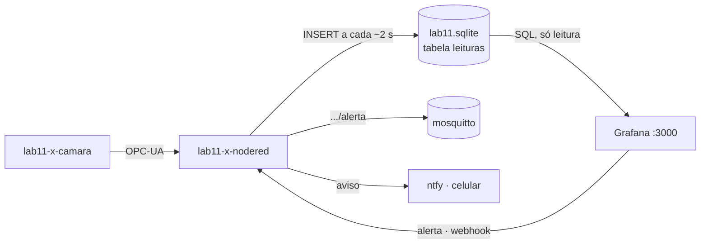
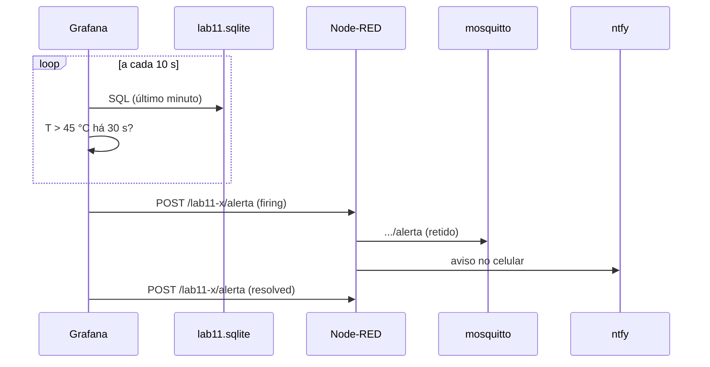

## Checklist — histórico e análise da câmara com Grafana {/* #checklist */}

- [ ] Tabela `leituras` (tempo em ms, UTC) gravada pelo Node-RED a cada ~2 s (T1)
- [ ] Grafana no ar, na rede do LAB IoT, com a fonte de dados SQLite testada (T2)
- [ ] Painel "Câmara climática": série T × SP × aquecedor, valor atual, umidade e linha do tempo do estado (T3)
- [ ] Análise: comparação dos controladores, anotações das trocas de modo e médias por minuto (T4)
- [ ] Alerta do Grafana → Node-RED → MQTT e ntfy, testado com a câmara quente (T5)
- [ ] Previsões P1–P4 respondidas no `README.md`
- [ ] Nenhum `push --force`; cada tarefa num commit `Tn:`

:::info[Pontuação]
**T1…T5 = 100 pts** (esta aula não tem desafios): T1 15 · T2 15 · T3 25 · T4 20 · T5 25. O
autograder normaliza para 0–10. Vale o commit `Tn:` mais recente de cada tarefa.
:::

<LabSetup />

### Configuração do ambiente de desenvolvimento {/* #setup */}

<DevTools />

---

A câmara já tem quem a **controle** (o PI interno ou o do Node-RED, Lab 09) e quem a **opere**
(o FUXA, Lab 10). Falta quem **olhe para trás**: o engenheiro de processo que quer saber como a
câmara se comportou ontem, qual controlador gasta menos aquecedor, quantas vezes ela passou do
limite e quando isso aconteceu.

Esse é o papel do **Grafana**: ler o histórico guardado num banco e transformá-lo em painéis,
comparações e alertas. Ele **não escreve** na câmara. É uma ferramenta de **análise**, não de
operação.

|                         | Node-RED (Labs 08–09)  | FUXA (Lab 10)          | Grafana (Lab 11)              |
| ----------------------- | ---------------------- | ---------------------- | ----------------------------- |
| Para quem               | o desenvolvedor        | o **operador**         | o **analista** / engenheiro   |
| Fonte                   | os protocolos, ao vivo | os protocolos, ao vivo | o **banco** (histórico)       |
| Escreve no equipamento? | sim                    | sim (setpoint, modo)   | **não**                       |
| Pergunta típica         | "o fluxo funciona?"    | "o que faço agora?"    | "o que aconteceu, e por quê?" |



## Objetivos

- Guardar uma **série temporal** com o tempo em formato adequado (ms desde 1970, UTC).
- Subir o **Grafana** em contêiner, com a fonte de dados e os painéis **provisionados** por
  arquivo.
- Montar um painel com séries, valor atual, medidor e linha do tempo de estados.
- Escrever **SQL de análise**: agregação por controlador, detecção de trocas (`LAG`) e médias por
  minuto (_downsampling_).
- Criar uma **regra de alerta** e entregá-la ao Node-RED por _webhook_.

## Material

- O **LAB IoT** do `lab11-x` (`gen_iot_aluno.py`), a câmara (`camara-sim/`) e o fluxo do Lab 10
  (`nodered/flows-lab10.json`).
- A pasta `grafana/` do repositório: `docker-compose.yml`, `.env.example` e `provisioning/`.
- Acesso à internet **no primeiro `up`**: a imagem do Grafana e o plugin SQLite são baixados.

:::info[Por que SQLite, e não um banco de séries temporais?]
Numa planta real, o histórico iria para um banco feito para séries temporais (InfluxDB,
TimescaleDB, Prometheus) e o Grafana leria de lá. Aqui, o SQLite do Node-RED já existe desde o
Lab 09 e o plugin `frser-sqlite-datasource` permite lê-lo direto. O SQL e os painéis são os
mesmos que você usaria com outro banco.
:::

## Clonar o repositório do grupo {/* #clonar */}

<LabTeamMembers labName="lab11" />

## Envie o link do repositório do seu grupo no Moodle: {/* #moodle-link */}

<LabSubmit labName="lab11" />

<details>
<summary><strong>Mapa de tarefas</strong> — 5 tarefas · 100 pts</summary>

- [T1 — Tabela de leituras](#t1) · 15 pts
- [T2 — Grafana e fonte de dados](#t2) · 15 pts
- [T3 — Painel da câmara](#t3) · 25 pts
- [T4 — Análise com SQL](#t4) · 20 pts
- [T5 — Alerta do Grafana no Node-RED](#t5) · 25 pts

</details>

<FileTree
  details={true}
  defaultOpen={false}
  title="Estrutura de Arquivos do Projeto"
  root="lab11-grupo-X"
  files={[
    "camara-sim/.env c",
    "grafana/docker-compose.yml r",
    "grafana/.env.example r",
    "grafana/.env c",
    "grafana/provisioning/datasources/camara.yml r",
    "grafana/provisioning/dashboards/lab11.yml r",
    "grafana/dashboards/camara.json c",
    "nodered/flows-lab11.json c",
    "evidencias/t1-leituras.txt c",
    "evidencias/t2-fonte.png c",
    "evidencias/t3-painel.png c",
    "evidencias/t4-analise.png c",
    "evidencias/t5-alerta.png c",
    "evidencias/t5-mqtt.txt c",
    "README.md u",
  ]}
/>

:::info[Nomes do Lab 11]
Troque o `x` pela letra do seu grupo em **todos** os nomes abaixo.

| O quê                           | Valor                                                                  |
| ------------------------------- | ---------------------------------------------------------------------- |
| Câmara (host na rede)           | `lab11-x-camara`                                                       |
| Banco SQLite (no Node-RED)      | `/data/sqlite/lab11.sqlite`                                            |
| O mesmo banco, no Grafana       | `/sqlite/lab11.sqlite` (somente leitura)                               |
| Grafana                         | `http://localhost:3000` (contêiner `lab11-x-grafana`, usuário `admin`) |
| Webhook do alerta (no Node-RED) | `http://lab11-x-nodered:1880/lab11-x/alerta`                           |
| Tópico do alerta (MQTT)         | `elt85b/lab11/grupo-x/alerta`                                          |

:::

---

## Parte 1 — Tabela de leituras {/* #parte-1 */}

### 1.1 Câmara e fluxo

Como nos Labs 09 e 10 (Parte 1), com os nomes do Lab 11:

1. **Câmara:** `.env` da pasta `camara-sim/` com `GRUPO=lab11-x`,
   `MQTT_BASE=elt85b/lab11/grupo-x/camara`, `LAB_REDE=lab11-x_labnet` e `SIM_SPEED=5`, e o
   `docker compose -f docker-compose.yml -f docker-compose.lab.yml up -d --build`.
2. **Node-RED:** importe o `nodered/flows-lab10.json` do repositório do Lab 10, chame a aba de
   **Lab 11** e troque `lab10` por `lab11` nos nós de configuração, nos tópicos MQTT e no caminho
   do SQLite (`/data/sqlite/lab11.sqlite`). **Ctrl+F** acha o que sobrou.

### 1.2 Uma tabela para séries temporais

A tabela `controle` do Lab 09 guarda o instante como **texto na hora local**
(`2026-10-22 14:05:31.270`). Serve para uma consulta, mas atrapalha uma ferramenta de séries
temporais: o texto depende do fuso do contêiner, se repete na volta do horário de verão e
precisa ser convertido a cada consulta. A nova tabela guarda o instante como **número**: os
milissegundos desde 1970 em **UTC**, exatamente o que o `Date.now()` devolve.

| Node-RED                       | Configuração                                                                |
| ------------------------------ | --------------------------------------------------------------------------- |
| inject "Criar tabela leituras" | _once_ após 1 s; o SQL abaixo no **topic**                                  |
| sqlite "esquema (batch)"       | _SQL Query_ **Batch without response** (executa vários comandos de uma vez) |

```sql title="topic do inject 'Criar tabela leituras'"
CREATE TABLE IF NOT EXISTS leituras (
    ts      INTEGER NOT NULL,  -- instante em ms desde 1970-01-01 (UTC), como o Date.now()
    temp    REAL,              -- °C
    umid    REAL,              -- %
    sp      REAL,              -- setpoint efetivo (°C)
    aq      REAL,              -- % aquecedor aplicado
    ve      REAL,              -- % ventilador aplicado
    modo    INTEGER,           -- 0 MANUAL, 1 ON/OFF, 2 PI interno
    estado  TEXT               -- DESLIGADO, AQUECENDO, RESFRIANDO, ESTAVEL, ALARME
);
CREATE INDEX IF NOT EXISTS leituras_ts ON leituras (ts);
```

O **índice** em `ts` deixa rápidas as consultas por intervalo de tempo, que são todas as do
Grafana.

Ligue a saída do **"junta variáveis"** (Lab 09, T4) a uma function e a um sqlite em _Prepared
Statement_:

```js title="function: monta leitura"
// Cada conjunto do OPC-UA -> uma linha em 'leituras' (ts em ms, UTC)
const p = msg.payload;
if (typeof p.temp !== "number") return null;
msg.params = {
  $ts: Date.now(),
  $temp: p.temp,
  $umid: p.umid,
  $sp: p.sp_efetivo,
  $aq: p.aquecedor_pwm,
  $ve: p.ventilador_pwm,
  $modo: p.modo,
  $estado: p.estado_txt,
};
return msg;
```

```sql title="sqlite 'INSERT leituras' (Prepared Statement)"
INSERT INTO leituras (ts, temp, umid, sp, aq, ve, modo, estado)
VALUES ($ts, $temp, $umid, $sp, $aq, $ve, $modo, $estado);
```

Um inject "Contar leituras", ligado ao nó de consultas do Lab 09 e ao debug "resultado":

```sql title="topic do inject 'Contar leituras'"
SELECT COUNT(*) AS linhas, MIN(ts) AS primeiro_ms, MAX(ts) AS ultimo_ms FROM leituras;
```

```text title="Debug resultado (exemplo, depois de ~20 s)"
[ { linhas: 10, primeiro_ms: 1792722082769, ultimo_ms: 1792722100765 } ]
```

Uma linha a cada ~2 s: o ritmo da assinatura OPC-UA (Lab 09).

:::tip[Preveja antes de rodar]
**P1:** (a) `1792722100765` ms: quantos dias desde 1970? Que data isso dá? (b) Um colega gravou
o tempo como `new Date().toLocaleString()` ("22/10/2026, 23:21:40"). Que problemas isso daria
para ordenar, filtrar por intervalo e no fim do horário de verão, quando a mesma hora acontece
duas vezes?
:::

**Evidência:** em `evidencias/t1-leituras.txt`, a saída do "Contar leituras" duas vezes, com
1 minuto de intervalo. Exporte o fluxo em `nodered/flows-lab11.json`.

<FileTree
  root="lab11-grupo-X"
  files={[
    "camara-sim/.env c",
    "nodered/flows-lab11.json c",
    "evidencias/t1-leituras.txt c",
  ]}
/>

<CommitPoint
  id="t1"
  task="Tabela de leituras"
  pontos={15}
  files="camara-sim/.env nodered/flows-lab11.json evidencias/t1-leituras.txt"
/>

---

## Parte 2 — Grafana e fonte de dados {/* #parte-2 */}

### 2.1 Subir

O Grafana entra na **mesma rede** do LAB IoT e monta a pasta `sqlite` do Node-RED em
**somente leitura** (`:ro`): ele pode ler o banco, nunca alterá-lo.

```yaml title="grafana/docker-compose.yml (já está no repositório)"
services:
  grafana:
    image: grafana/grafana-oss:11.6.0
    container_name: ${GRUPO}-grafana
    restart: unless-stopped
    environment:
      - TZ=America/Sao_Paulo
      - GF_INSTALL_PLUGINS=frser-sqlite-datasource # SQLite como fonte de dados
      - GF_SECURITY_ADMIN_USER=admin
      - GF_SECURITY_ADMIN_PASSWORD=${GRAFANA_SENHA}
    ports:
      - "3000:3000"
    volumes:
      - grafana_dados:/var/lib/grafana # usuários, alertas, painéis criados na tela
      - ./provisioning:/etc/grafana/provisioning:ro # fonte de dados e pasta de painéis
      - ./dashboards:/var/lib/grafana/dashboards:ro # painéis exportados (vão para o Git)
      - ${PASTA_LAB_IOT}/data/${GRUPO}/sqlite:/sqlite:ro # o SQLite do Node-RED, só leitura
    networks:
      - labnet
```

Crie o `.env` a partir do exemplo. O `PASTA_LAB_IOT` é a pasta do LAB IoT, a que tem o
`credenciais.txt`, escrita com **barras normais**:

<GroupCommands
  commands={[
    {
      title: "1. .env",
      codeTitle: "Terminal (cmd), na pasta grafana",
      command: `cd /d %USERPROFILE%\\ELT85BN21\\lab11-grupo-{group}\\grafana
copy .env.example .env
notepad .env`,
    },
    {
      title: "2. Conteúdo",
      codeTitle: "grafana/.env",
      language: "ini",
      command: `GRUPO=lab11-{group}
LAB_REDE=lab11-{group}_labnet
PASTA_LAB_IOT=C:/iot/lab11-{group}
GRAFANA_SENHA=uma-senha-sua`,
    },
    {
      title: "3. Subir",
      codeTitle: "Terminal (cmd), na pasta grafana",
      command: `docker compose up -d
docker logs -f lab11-{group}-grafana`,
    },
  ]}
/>

Espere a linha `HTTP Server Listen` no log (no primeiro `up`, o download do plugin leva alguns
segundos) e abra `http://localhost:3000` com `admin` e a sua senha.

:::warning[O `.env` não vai para o Git]
O `grafana/.env` tem a senha do Grafana: confira que o `.gitignore` o ignora (`git status` não
pode mostrá-lo).
:::

### 2.2 Provisionamento: configuração em arquivo

Você não precisa criar a fonte de dados na tela: ela já está em
`grafana/provisioning/datasources/camara.yml`, que o Grafana lê ao subir.

```yaml title="grafana/provisioning/datasources/camara.yml"
apiVersion: 1
datasources:
  - name: Camara (SQLite)
    uid: camara-sqlite
    type: frser-sqlite-datasource
    access: proxy
    isDefault: true
    editable: true
    jsonData:
      path: /sqlite/lab11.sqlite
```

É o mesmo princípio do `wokwi.toml` ou do `platformio.ini`: a configuração é um **arquivo
versionado**, e qualquer colega que suba o Grafana tem a mesma fonte de dados, com o mesmo
`uid`. Os painéis exportados se referem a esse `uid`.

Em **Connections ▸ Data sources ▸ Camara (SQLite)**, clique **Save & test**: deve aparecer
_Data source is working_. Depois, em **Explore**, rode:

```sql title="Explore (Format as: Table)"
SELECT ts / 1000.0 AS time, temp, sp FROM leituras ORDER BY ts DESC LIMIT 20;
```

O Grafana espera o tempo numa coluna chamada **`time`**, em **segundos** desde 1970: por isso o
`/ 1000.0`. Se a coluna não virar tempo, no editor de consulta preencha _Time formatted columns_
com `time`.

**Evidência:** `evidencias/t2-fonte.png` com o _Data source is working_ e a consulta do Explore.

<FileTree
  root="lab11-grupo-X"
  files={["grafana/.env c", "evidencias/t2-fonte.png c"]}
/>

<CommitPoint
  id="t2"
  task="Grafana e fonte de dados"
  pontos={15}
  files="evidencias/t2-fonte.png"
/>

---

## Parte 3 — Painel da câmara {/* #parte-3 */}

Em **Dashboards ▸ New ▸ New dashboard**, crie o painel **Câmara climática**. Cada painel tem
uma **consulta** (a aba _Query_, com a fonte `Camara (SQLite)`) e uma **visualização**. No canto
superior direito, use o intervalo **Last 15 minutes** e a atualização automática **5s**.

As consultas usam as variáveis **`$__from`** e **`$__to`**: o início e o fim do intervalo
escolhido na tela, em **ms**. Como o `ts` também está em ms, o filtro é direto (e usa o índice).

| Painel                 | Visualização       | Consulta             | Configuração                                                                                                    |
| ---------------------- | ------------------ | -------------------- | --------------------------------------------------------------------------------------------------------------- |
| Temperatura e setpoint | **Time series**    | série (abaixo)       | _Overrides_: `aquecedor (%)` no eixo da **direita** (_Axis placement: Right_), em cinza                         |
| Temperatura agora      | **Stat**           | atual                | _Unit_ Celsius; _Thresholds_: verde, 45 amarelo, 55 vermelho                                                    |
| Umidade                | **Gauge**          | atual (campo `umid`) | _Unit_ Percent (0-100); mín. 0, máx. 100                                                                        |
| Estado                 | **State timeline** | estado               | _Value mappings_: `AQUECENDO` laranja, `RESFRIANDO` azul, `ESTAVEL` verde, `ALARME` vermelho, `DESLIGADO` cinza |

```sql title="consulta 'série'"
SELECT ts / 1000.0 AS time, temp AS "T (°C)", sp AS "SP (°C)", aq AS "aquecedor (%)"
FROM leituras
WHERE ts BETWEEN $__from AND $__to
ORDER BY ts;
```

```sql title="consulta 'atual'"
SELECT ts / 1000.0 AS time, temp, umid
FROM leituras
ORDER BY ts DESC
LIMIT 1;
```

```sql title="consulta 'estado'"
SELECT ts / 1000.0 AS time, estado
FROM leituras
WHERE ts BETWEEN $__from AND $__to
ORDER BY ts;
```

São as mesmas cores do sinótico do FUXA (Lab 10). Faça um degrau no setpoint (pelo FUXA ou pelo
painel do Lab 09) e veja a série, o valor e o estado acompanharem.

### 3.1 Exportar o painel para o repositório

**Salve** o painel. Depois, **Export ▸ Export as JSON** (ou _Share ▸ Export_), **Save to file**, e
grave o arquivo como `grafana/dashboards/camara.json`. Esse arquivo é lido pelo provisionamento
(`grafana/provisioning/dashboards/lab11.yml`): num `docker compose down -v` + `up`, o painel
volta sozinho, na pasta **Lab 11**.

:::tip[Preveja antes de rodar]
**P2:** com o intervalo de 15 min e a atualização a cada 5 s, quantas linhas a consulta "série"
lê a cada atualização? E com o intervalo de **7 dias**? Quantos pixels tem a largura do painel?
O que o Grafana faz com mais pontos do que pixels, e por que isso é um desperdício (a T4 resolve)?
:::

**Evidência:** `evidencias/t3-painel.png` com um degrau visível e o `grafana/dashboards/camara.json`.

<FileTree
  root="lab11-grupo-X"
  files={["grafana/dashboards/camara.json c", "evidencias/t3-painel.png c"]}
/>

<CommitPoint
  id="t3"
  task="Painel da camara"
  pontos={25}
  files="grafana/dashboards/camara.json evidencias/t3-painel.png"
/>

---

## Parte 4 — Análise com SQL {/* #parte-4 */}

Antes de começar, gere um pouco de história: PI interno com SP 30 → 40 °C, depois ON/OFF, depois
o PI do Node-RED (o experimento do Lab 09, agora sem precisar das consultas na mão).

### 4.1 Comparar os controladores

Um painel **Table** com a comparação do Lab 09, agora sobre o intervalo da tela:

```sql title="consulta 'comparar'"
SELECT CASE modo WHEN 0 THEN 'PI Node-RED' WHEN 1 THEN 'ON/OFF interno'
                 WHEN 2 THEN 'PI interno' END        AS controlador,
       COUNT(*)                                          AS amostras,
       ROUND(AVG(ABS(sp - temp)), 2)                     AS erro_medio,
       ROUND(100.0 * SUM(ABS(sp - temp) > 0.5) / COUNT(*), 0) AS pct_fora_banda,
       ROUND(AVG(aq), 1)                                 AS aq_medio
FROM leituras
WHERE ts BETWEEN $__from AND $__to
GROUP BY modo
ORDER BY modo;
```

```text title="Resultado (exemplo)"
controlador     amostras  erro_medio  pct_fora_banda  aq_medio
ON/OFF interno  55        0.96        58              30.9
PI interno      35        1.87        89              26.9
```

Mude o intervalo da tela (5 min, 1 h): a tabela se recalcula. Uma consulta, várias perguntas.

### 4.2 Anotações: quando o modo mudou

Uma **anotação** é uma marca vertical sobre todos os gráficos do painel. Em **Dashboard
settings ▸ Annotations ▸ New**, fonte `Camara (SQLite)`, com a consulta abaixo. O `LAG()` (Lab 09) compara cada linha com a anterior e só devolve as linhas em que o modo trocou:

```sql title="anotação 'trocas de modo'"
SELECT ts / 1000.0 AS time,
       'modo ' || ant || ' -> ' || modo AS text
FROM (SELECT ts, modo, LAG(modo) OVER (ORDER BY ts) AS ant
      FROM leituras
      WHERE ts BETWEEN $__from AND $__to)
WHERE ant IS NOT NULL AND modo <> ant
ORDER BY ts;
```

```text title="Resultado (exemplo)"
time            text
1792722152.765  modo 1 -> 2
1792722222.764  modo 2 -> 1
```

### 4.3 Médias por minuto

Um **Time series** "Temperatura por minuto" que **agrega** antes de desenhar: uma linha por
minuto, com a média, o mínimo e o máximo.

```sql title="consulta 'minuto'"
SELECT (ts / 60000) * 60 AS time,
       ROUND(AVG(temp), 2) AS "T média",
       MIN(temp)           AS "T mín",
       MAX(temp)           AS "T máx"
FROM leituras
WHERE ts BETWEEN $__from AND $__to
GROUP BY ts / 60000
ORDER BY time;
```

Como `ts` é inteiro, `ts / 60000` é a **divisão inteira**: todas as leituras do mesmo minuto
caem no mesmo grupo.

:::tip[Preveja antes de rodar]
**P3:** em 7 dias, quantas linhas tem a `leituras` (uma a cada 2 s)? E a consulta "minuto",
quantas devolve? O que se perde ao desenhar só a média por minuto, e por que guardar também o
**mínimo e o máximo** recupera boa parte disso (pense num pico de 1 s acima de 55 °C)?
:::

**Evidência:** `evidencias/t4-analise.png` com a tabela, as anotações sobre a série e o painel
por minuto. Exporte o painel de novo em `grafana/dashboards/camara.json`.

<FileTree
  root="lab11-grupo-X"
  files={["grafana/dashboards/camara.json u", "evidencias/t4-analise.png c"]}
/>

<CommitPoint
  id="t4"
  task="Analise com SQL"
  pontos={20}
  files="grafana/dashboards/camara.json evidencias/t4-analise.png"
/>

---

## Projeto integrador — alerta do Grafana no Node-RED {/* #integrador */}

O FUXA (Lab 10) tem alarmes para o **operador**, na tela, a cada segundo. O Grafana tem
**alertas** para quem **não está olhando**: avaliam o histórico de tempos em tempos e avisam por
fora (e-mail, chat, _webhook_). Aqui, o aviso vai para o Node-RED, que o republica no MQTT e no
**ntfy** do LAB IoT (o celular do grupo).



### Requisitos

1. **Node-RED: receber o webhook.** Um **http in** _POST_ `/alerta`, ligado a um **http
   response** (código 200) e a esta function:

   ```js title="function: alerta do Grafana"
   // Webhook do Grafana (contact point): status firing/resolved e a lista de alertas
   const g = msg.payload || {};
   const a = (g.alerts || [])[0] || {};
   const nome = (a.labels && a.labels.alertname) || "Grafana";
   const disparou = g.status === "firing";
   msg.topic = (disparou ? "ALERTA: " : "Normalizado: ") + nome;
   msg.payload = {
     status: g.status,
     alerta: nome,
     resumo: (a.annotations && a.annotations.summary) || g.title || "",
     valor: a.valueString || "",
     desde: a.startsAt || "",
   };
   node.status({
     fill: disparou ? "red" : "green",
     shape: "dot",
     text: msg.topic,
   });
   return msg;
   ```

   A saída vai para um **debug** "alerta", um **mqtt out** `elt85b/lab11/grupo-x/alerta` (QoS 1,
   **retido**: quem assinar depois sabe o último estado) e para o aviso no ntfy:

   ```js title="function: aviso no ntfy (seguida de um http request, método 'set by msg.method')"
   // Alerta -> ntfy do LAB IoT (as variáveis NTFY_* já estão no contêiner do Node-RED)
   msg.url = env.get("NTFY_URL");
   msg.method = "POST";
   msg.headers = {
     Authorization: "Bearer " + env.get("NTFY_TOKEN"),
     "Content-Type": "application/json",
   };
   msg.payload = {
     topic: env.get("NTFY_TOPIC"),
     title: msg.topic,
     message:
       msg.payload.resumo +
       (msg.payload.valor ? " (" + msg.payload.valor + ")" : ""),
     priority: msg.payload.status === "firing" ? 4 : 2,
     tags: [msg.payload.status === "firing" ? "warning" : "white_check_mark"],
   };
   return msg;
   ```

   É o mesmo formato do fluxo de exemplo do LAB IoT (`avisos/exemplo-node-red.json`). No
   celular, assine o tópico do grupo no app do ntfy (veja a página de avisos do LAB IoT).

2. **Grafana: ponto de contato.** **Alerting ▸ Contact points ▸ Add contact point**: nome
   `Node-RED`, integração **Webhook**, URL `http://lab11-x-nodered:1880/lab11-x/alerta`, método
   POST. **Test** deve chegar no debug "alerta" do Node-RED. Em **Notification policies**, mude o
   _Default contact point_ para `Node-RED`.

   O endereço é o **nome do contêiner** do Node-RED na rede do LAB IoT, mais o `httpNodeRoot`
   do grupo (`/lab11-x/`). Se o LAB IoT foi gerado com `--proteger-http`, preencha também
   _Username_ e _Password_ (o usuário e a senha do grupo).

3. **Grafana: regra de alerta.** **Alerting ▸ Alert rules ▸ New alert rule**:

   | Campo               | Valor                                                                                         |
   | ------------------- | --------------------------------------------------------------------------------------------- |
   | Nome                | `Temperatura alta`                                                                            |
   | Consulta A          | `Camara (SQLite)`, intervalo **Last 1 minute** (abaixo)                                       |
   | Expressões          | **B** = _Reduce_ de A, _Last_; **C** = _Threshold_ de B, **is above 45** (condição do alerta) |
   | Pasta / grupo       | `Lab 11` / `camara`, avaliado a cada **10s**                                                  |
   | _Pending period_    | **30s** (tem de ficar acima de 45 °C por 30 s)                                                |
   | _Summary_           | `Câmara acima de 45 °C`                                                                       |
   | _No data_ / _Error_ | **Alerting** (sem dados também é problema: P4)                                                |

   ```sql title="consulta A da regra"
   SELECT ts / 1000.0 AS time, temp
   FROM leituras
   WHERE ts BETWEEN $__from AND $__to
   ORDER BY ts;
   ```

4. **Teste.** Modo **ON/OFF** e setpoint **50 °C** (pelo FUXA ou pelo painel do Lab 09). Quando
   T passar de 45 °C, acompanhe a regra: _Normal_ → _Pending_ → _Firing_. O aviso chega ao
   Node-RED, ao MQTT e ao celular. Volte o setpoint para 35 °C e espere o _Normalizado_.

   Grave o tópico retido (o mosquitto do LAB IoT está na porta 1883 do PC):

<GroupCommands
  commands={[
    {
      title: "Último alerta (retido)",
      codeTitle: "Terminal (cmd), na raiz do repositório",
      command: `docker run --rm eclipse-mosquitto:2 mosquitto_sub -h host.docker.internal -t "{course}/lab11/grupo-{group}/alerta" -C 1 -v > evidencias\\t5-mqtt.txt
type evidencias\\t5-mqtt.txt`,
    },
  ]}
/>

```text title="evidencias/t5-mqtt.txt (exemplo)"
elt85b/lab11/grupo-x/alerta {"status":"firing","alerta":"Temperatura alta","resumo":"Câmara acima de 45 °C","valor":"[ var='B' labels={} value=46.2 ]","desde":"2026-10-22T23:40:00-03:00"}
```

5. **Evidências:** `evidencias/t5-alerta.png` (a regra em _Firing_ e o debug do Node-RED, ou o
   aviso no celular), `evidencias/t5-mqtt.txt`, o fluxo e o painel exportados de novo, e as
   respostas de P1 a P4 no `README.md`.

:::tip[Preveja antes de rodar]
**P4:** (a) somando a avaliação (10 s), o _pending period_ (30 s) e a espera da política de
notificação (_group wait_, 30 s por padrão), quanto tempo passa entre a câmara cruzar 45 °C e o
celular tocar? Compare com o alarme do FUXA (Lab 10). (b) Pare o Node-RED
(`docker stop lab11-x-nodered`): a tabela para de crescer. O que a regra mostra, e por que
configurar _No data_ como **Alerting**? Mas quem entrega esse alerta, se o Node-RED é o ponto de
contato? (c) Por que o Grafana, e não o FUXA, é o lugar certo para um alerta como "a câmara
passou mais de 10 % do dia fora da banda"?
:::

<FileTree
  root="lab11-grupo-X"
  files={[
    "nodered/flows-lab11.json u",
    "grafana/dashboards/camara.json u",
    "evidencias/t5-alerta.png c",
    "evidencias/t5-mqtt.txt c",
    "README.md u",
  ]}
/>

<CommitPoint
  id="t5"
  task="Alerta do Grafana no Node-RED"
  pontos={25}
  files="nodered/flows-lab11.json grafana/dashboards/camara.json evidencias/t5-alerta.png evidencias/t5-mqtt.txt README.md"
/>

---

## Referência rápida {/* #referencia */}

| Problema                                                          | O que fazer                                                                                                   |
| ----------------------------------------------------------------- | ------------------------------------------------------------------------------------------------------------- |
| `invalid mount config` / pasta vazia em `/sqlite`                 | confira o `PASTA_LAB_IOT` do `grafana/.env` (barras normais, a pasta que tem o `credenciais.txt`) e o `GRUPO` |
| _Data source is working_ falha com `unable to open database file` | a tabela ainda não existe ou o caminho está errado: rode o Node-RED da T1 e confira `/sqlite/lab11.sqlite`    |
| O plugin `frser-sqlite-datasource` não aparece                    | o primeiro `up` precisa de internet; `docker logs lab11-x-grafana` mostra o download                          |
| A série aparece em 1970 ou em 55 mil anos no futuro               | o `time` tem de estar em **segundos** (`ts / 1000.0`)                                                         |
| Painel vazio                                                      | o intervalo da tela não tem dados: use **Last 15 minutes** e confira o `$__from`/`$__to`                      |
| O teste do contact point não chega ao Node-RED                    | o URL é `http://lab11-x-nodered:1880/lab11-x/alerta` (nome do contêiner, porta 1880, `httpNodeRoot`)          |
| Perdi o painel ao recriar o Grafana                               | importe de novo o `grafana/dashboards/camara.json` (ou deixe o provisionamento carregá-lo)                    |
| Grafana: senha do `admin` esquecida                               | `docker exec lab11-x-grafana grafana cli admin reset-admin-password nova-senha`                               |

---

<LabLogout />
