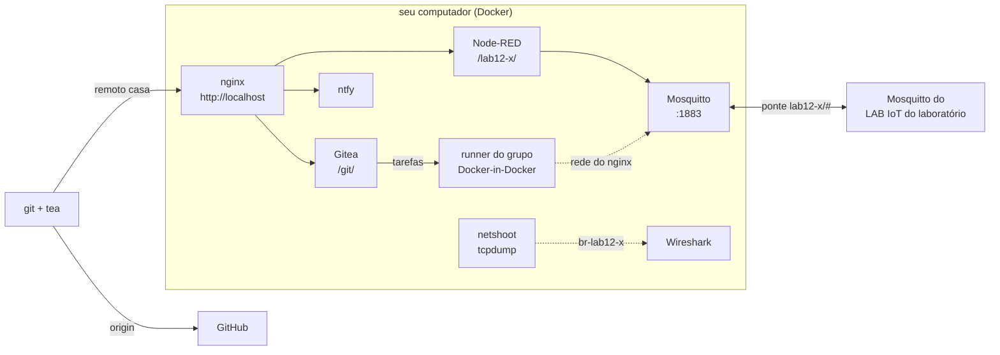

## Checklist — o LAB IoT na sua máquina {/* #checklist */}

- [ ] LAB IoT do grupo gerado com o `gen_iot_aluno.py` e no ar no seu computador, com o consumo de memória medido (T1)
- [ ] Repositório no Gitea **da sua máquina** (remoto `casa`), o CI do Lab 11 verde no seu runner e a 3ª coluna da tabela "o que o job enxerga" (T2)
- [ ] Tempos do CI em casa medidos com `ci/duracoes.py` (cache frio e quente) e comparados com os do laboratório (T3)
- [ ] O MQTT "no fio": CONNECT, SUBSCRIBE, PUBLISH QoS 0 e 1, retain e PING identificados no Wireshark, a ACL do broker testada e as senhas do MQTT e do Node-RED achadas na captura (T4)
- [ ] Workflow `integracao.yml`: o CI conversa com o Node-RED pelo broker, só onde existe broker, e o job identificado na captura (T5)
- [ ] Ponte MQTT casa ↔ laboratório: o fluxo de casa respondendo a um comando enviado do LAB IoT do laboratório (T6)
- [ ] Previsões P1–P5 respondidas no `README.md`
- [ ] Nenhum `credenciais.txt`, `.segredos.json`, `.pcap` completo ou CONNECT com senha no repositório; nenhum `push --force`; cada tarefa num commit `Tn:`

:::info[Pontuação]
**T1…T6 = 100 pts** (esta aula não tem desafios): T1 10 · T2 15 · T3 15 · T4 20 · T5 20 ·
T6 20. O autograder normaliza para 0–10. Vale o commit `Tn:` mais recente de cada tarefa **no
GitHub**.
:::

<LabSetup />

### Configuração do ambiente de desenvolvimento {/* #setup */}

<DevTools />

---

No Lab 11, o pipeline saiu do GitHub e foi para o **runner do laboratório**. Ficou perto, mas
continua sendo um servidor **da turma**: uma fila para todos, secrets que só o professor vê, e
nenhuma forma de olhar o que passa na rede entre o Node-RED, o broker e o Gitea.

Nesta aula, o LAB IoT inteiro vem para **o seu computador**. O **`gen_iot_aluno.py`** gera, numa
pasta, o mesmo conjunto do laboratório (Node-RED, FUXA, Mosquitto, Gitea com Actions e runner,
ntfy, MicroBin e MQTT Explorer), **com os mesmos caminhos e nomes**: `/lab12-x/`,
`mosquitto:1883`, tópicos `lab12-x/...`. Por isso:

1. o que você faz em casa funciona no laboratório sem mudar nada (e vice-versa);
2. o runner é **só do grupo**: dá para medir o CI sem a fila da turma;
3. você é o **dono** de tudo, inclusive da rede: com `--captura`, um container
   [netshoot](https://github.com/nicolaka/netshoot) grava os pacotes para o **Wireshark**;
4. com `--ponte-mqtt`, o broker de casa e o do laboratório trocam as mensagens do grupo.



## Objetivos

- Gerar, subir e manter um ambiente de vários serviços com **Docker Compose** a partir de um
  gerador, e saber o que cada opção muda.
- Comparar o **mesmo pipeline** em três runners (GitHub, laboratório, sua máquina): o que o job
  enxerga, quanto espera, quanto o cache economiza.
- Ler o protocolo **MQTT no fio**: sessão, assinatura, QoS, retain e keepalive.
- Ver, na captura, por que **HTTP sem TLS** expõe senhas e tokens.
- Escrever um **teste de integração** que só roda onde o ambiente permite.
- Ligar dois brokers com uma **ponte** e acompanhar as mensagens de um lado ao outro.

## Material

- O mesmo do Lab 11: VS Code + PlatformIO + extensão Wokwi, o `git` e o `tea` no terminal, e o
  acesso do grupo ao LAB IoT do laboratório (usuário `lab12-x`, organização `lab12-grupo-x`).
- **Docker Desktop** com pelo menos **6 GB** de memória (_Settings → Resources_), **Python 3** com
  `bcrypt` (`py -m pip install bcrypt`) e o **Wireshark**. O passo a passo da instalação e o
  script que confere tudo (`verificar.ps1`) estão no guia **LAB IoT na sua máquina** (seção 1).
- O seu **token do Wokwi CI** (o do Lab 10), para a simulação rodar no seu runner.
- O app **ntfy** no celular.
- A T6 é feita **na rede do laboratório**.

:::info[LAB IoT do laboratório × LAB IoT na sua máquina]
| | Laboratório (Lab 11) | Sua máquina (Lab 12) |
| --- | --- | --- |
| Gerado por | `gen_iot_scada_portal.py` (o professor) | `gen_iot_aluno.py` (você) |
| Endereço | `http://<IP do LAB IoT>/` | `http://localhost/` (e `http://<seu IP>/` na sua rede) |
| Contas | todos os grupos | só `lab12-x` (e `lab12-x-view`, só leitura) |
| Runner | um para a turma, `capacity: 2` | o do grupo, `capacity: 1` (`--runner-capacidade`) |
| Rede dos jobs | a do runner do lab (T2 do Lab 11) | a do **nginx**: `http://localhost/` é o seu portal (`--ci-rede nginx`) |
| Secrets da organização | criados pelo professor | criados pelo gerador (`NTFY_*`, e `WOKWI_CLI_TOKEN` com `--wokwi-token`) |
| Captura de pacotes | não | `--captura` (netshoot + Wireshark) |
| Broker para o ESP32 | `<IP do LAB IoT>:1883` | `<seu IP>:1883`; `--ponte-mqtt` liga os dois |
| Login no MQTT | opcional: sem usuário entra (`allow_anonymous true`); com `lab12-x` e a senha do grupo, só `lab12-x/#` (ACL) | igual (`--mqtt-sem-anonimo` exige login de todos) |
:::

## Clonar o repositório do grupo {/* #clonar */}

<LabTeamMembers labName="lab12" />

## Envie o link do repositório do seu grupo no Moodle: {/* #moodle-link */}

<LabSubmit labName="lab12" />

<details>
<summary><strong>Mapa de tarefas</strong> — 6 tarefas · 100 pts</summary>

- [T1 — O LAB IoT na sua máquina](#t1) · 10 pts
- [T2 — O mesmo pipeline no seu runner](#t2) · 15 pts
- [T3 — Fila e cache em casa](#t3) · 15 pts
- [T4 — O MQTT no fio (Wireshark)](#t4) · 20 pts
- [T5 — Um teste de integração com o broker](#t5) · 20 pts
- [T6 — Ponte MQTT casa ↔ laboratório](#t6) · 20 pts

</details>

O repositório nasce do `lab12-template`, com o **Lab 11 resolvido** (o firmware, os testes e os
workflows de `.github/` e `.gitea/`) e quatro arquivos novos:

- `ferramentas/gen_iot_aluno.py`: o gerador do LAB IoT;
- `flows/eco-mqtt.json`: um fluxo do Node-RED para observar o MQTT e responder ao CI;
- `ci/mqtt_eco.py`: o teste de integração da T5;
- `.gitignore`: já bloqueia `credenciais.txt`, `.segredos.json`, `*.pcap` e `*.pcapng`.

---

<FileTree
  details={true}
  defaultOpen={false}
  title="Estrutura de Arquivos do Projeto"
  root="lab12-grupo-x"
  files={[
    ".github/workflows/ci.yml r",
    ".github/workflows/diagnostico.yml r",
    ".gitea/workflows/ci.yml r",
    ".gitea/workflows/diagnostico.yml r",
    ".gitea/workflows/integracao.yml c",
    "ferramentas/gen_iot_aluno.py r",
    "flows/eco-mqtt.json r",
    "ci/mqtt_eco.py r",
    "ci/duracoes.py r",
    "ci/release_gitea.py r",
    "ci/notificar.sh r",
    "lib/camara_logica/camara_logica.cpp r",
    "src/main.cpp r",
    "test/test_logica/test_logica.cpp r",
    "platformio.ini r",
    ".gitignore r",
    "evidencias/t1-compose-ps.txt c",
    "evidencias/t1-stats.txt c",
    "evidencias/t1-portal.png c",
    "evidencias/t2-remotos.txt c",
    "evidencias/t2-diagnostico-casa.txt c",
    "evidencias/t2-gitea-casa.png c",
    "evidencias/t3-duracoes.md c",
    "evidencias/t3-espaco.txt c",
    "evidencias/t4-mqtt.pcapng c",
    "evidencias/t4-wireshark.png c",
    "evidencias/t4-senha-no-fio.png c",
    "evidencias/t5-integracao.png c",
    "evidencias/t5-job-no-fio.png c",
    "evidencias/t6-ponte.pcapng c",
    "evidencias/t6-ponte-wireshark.png c",
    "evidencias/t6-mqtt-explorer-lab.png c",
    "README.md u",
  ]}
/>

:::danger[O que nunca vai para o repositório]
O LAB IoT é gerado **fora** do clone (em `C:\iot\lab12-x`). Lá ficam o `credenciais.txt` e o
`.segredos.json`, com a senha do grupo, e a pasta `captura/`, com pacotes que **contêm senhas**.
Nas evidências entram só capturas **filtradas** (T4 e T6), **sem os CONNECT que levam senha**,
e telas com a senha **tarjada**.
:::

## Parte 1 — O LAB IoT na sua máquina {/* #parte-1 */} {/* #t1 */}

### 1.1 O que o gerador faz

O `gen_iot_aluno.py` não instala nada: ele **escreve arquivos** numa pasta. O
`docker compose up` é que baixa as imagens e cria os containers.

| Gerado               | Para quê                                                                                                              |
| -------------------- | --------------------------------------------------------------------------------------------------------------------- |
| `docker-compose.yml` | os serviços, a rede `labnet` e os volumes                                                                             |
| `nginx/`             | o portal e os caminhos (`/lab12-x/`, `/git/`, `/ntfy/`, `/bin/`…)                                                     |
| `mosquitto/`         | o broker: `mosquitto.conf` (e a ponte, com `--ponte-mqtt`), os usuários (`passwd`) e as permissões por tópico (`acl`) |
| `settings/`, `data/` | o Node-RED (login, `credentialSecret`, fluxos; `data/lab12-x/sqlite/` para os bancos SQLite)                          |
| `runner/config.yaml` | o runner do CI: rótulos, `capacity`, rede dos jobs                                                                    |
| `credenciais.txt`    | endereços, usuário e senha                                                                                            |
| `.segredos.json`     | as senhas sorteadas, reaproveitadas quando você roda o gerador de novo                                                |
| `LEIA-ME.md`         | o guia **da sua** instalação                                                                                          |

Rodar o gerador de novo na mesma pasta é seguro: as senhas vêm do `.segredos.json` e os dados
(`data/`, `fuxa/`, volumes) não são tocados. Você vai fazer isso duas vezes nesta aula.

:::tip[Preveja antes de rodar]
**P1:** (a) depois do `docker compose up -d`, quantos containers vão estar **rodando**? Algum
roda uma vez e sai? Qual e por quê? (b) Quanta memória o LAB IoT inteiro vai usar **parado**
(sem nenhum job de CI)? E qual serviço vai usar mais?
:::

### 1.2 Gerar e subir

Na pasta do clone, gere o LAB IoT **fora** do repositório, com o seu token do Wokwi:

<GroupCommands
  commands={[
    {
      title: "1. Gerar e subir (PowerShell)",
      codeTitle: "Terminal",
      language: "powershell",
      command: `cd C:\\iot\\lab12-grupo-{group}
py ferramentas\\gen_iot_aluno.py --lab lab12 --grupo {group} --saida C:\\iot\\lab12-{group} --wokwi-token SEU_TOKEN_WOKWI
cd C:\\iot\\lab12-{group}
docker compose up -d --build
docker compose ps`,
    },
    {
      title: "2. Saída esperada do gerador (fim)",
      codeTitle: "Saída esperada",
      language: "text",
      command: `✅ LAB IoT do lab12-{group}: Node-RED + FUXA + MQTT + Gitea (Actions) + ntfy + MicroBin + MQTT Explorer

Nesta máquina: http://localhost/
Rede local: http://192.168.0.20/ · MQTT 192.168.0.20:1883

🔒 Usuário lab12-{group} · senha em credenciais.txt`,
},
]}
/>

A primeira vez demora alguns minutos (a imagem do Node-RED é montada aqui). Porta 80 ocupada?
Gere de novo com `--porta-http 8080` e use `http://localhost:8080/` em todo o roteiro. Erro
`ETARGET` no `npm install`, ou `failed to open /data/sqlite/...` no Node-RED? Veja a seção 4 do
guia **LAB IoT na sua máquina**.

:::warning[Não use `--sem-senha` nesta aula]
O gerador tem a opção `--sem-senha`, que tira o login de todos os serviços. Ela não serve para
este roteiro: a T2 usa o login do `tea`, e a T4 procura as senhas **no fio**.
:::

1. Abra `http://localhost/` e entre no Node-RED, no Gitea e no ntfy com `lab12-x` e a senha do
   `credenciais.txt`. Captura do portal em `evidencias/t1-portal.png`.
2. Salve o estado e o consumo, com o LAB IoT parado há pelo menos 2 minutos:

   ```powershell
   docker compose ps -a --format "table {{.Name}}\t{{.Status}}" > C:\iot\lab12-grupo-x\evidencias\t1-compose-ps.txt
   docker stats --no-stream --format "table {{.Name}}\t{{.MemUsage}}\t{{.CPUPerc}}" > C:\iot\lab12-grupo-x\evidencias\t1-stats.txt
   ```

3. No `README.md`: o comando de geração **sem o token**, a versão do Docker
   (`docker version --format "{{.Server.Version}}"`), a memória total somada e a resposta do P1.

<FileTree
  root="lab12-grupo-x"
  files={[
    "evidencias/t1-compose-ps.txt c",
    "evidencias/t1-stats.txt c",
    "evidencias/t1-portal.png c",
    "README.md u",
  ]}
/>

<CommitPoint
  id="t1"
  task="LAB IoT na sua maquina"
  pontos={10}
  files="evidencias/t1-compose-ps.txt evidencias/t1-stats.txt evidencias/t1-portal.png README.md"
/>

---

## Parte 2 — O mesmo pipeline no seu runner {/* #parte-2 */} {/* #t2 */}

### 2.1 O repositório no Gitea de casa

O gerador já criou a organização **`lab12-grupo-x`**, com os secrets `NTFY_TOPIC`, `NTFY_TOKEN` e
`WOKWI_CLI_TOKEN` e a variable `NTFY_URL`. Agora, quem vê a lista é **você**: abra
`http://localhost/git/lab12-grupo-x` → **Configurações → Actions → Secrets**.

Desta vez, use o **tea**: ele cria um token de acesso e o registra como ajudante de credenciais
do `git`, então nenhum `git push` pede senha.

```powershell
tea login add --name casa --url http://localhost/git --user lab12-x --password SUA_SENHA --git-credentials
tea login default casa
tea repos create --owner lab12-grupo-x --name camara-ci --private

cd C:\iot\lab12-grupo-x
git remote add casa http://localhost/git/lab12-grupo-x/camara-ci.git
git push casa main
git remote -v > evidencias\t2-remotos.txt
```

:::note[Por que um remoto separado]
No Lab 11, o `origin` ganhou duas URLs de push (GitHub e laboratório). O Gitea de casa **não**
entra nessa lista: no laboratório, `http://localhost/git` é a máquina de lá, e o `push` falharia.
Envie para `casa` quando quiser rodar o CI em casa: `git push casa main`.
:::

O repositório já tem `.gitea/workflows/`, então o `push` dispara o `ci.yml` do Lab 11 no **seu**
runner (`lab12-x-runner`). Acompanhe em **Actions** ou no terminal:

```powershell
tea actions runs list
tea actions runs view <id> --jobs
docker compose -f C:\iot\lab12-x\docker-compose.yml logs -f gitea-runner
```

A execução precisa ficar **verde** (`publicar` aparece pulado: não é tag). Captura em
`evidencias/t2-gitea-casa.png`.

### 2.2 O que o job enxerga em casa

No Lab 11, você preencheu a tabela **O que o job enxerga** com duas colunas: o runner do
laboratório e o do GitHub. Agora vem a terceira. O seu runner é configurado de outro jeito:

```yaml title="C:\iot\lab12-x\runner\config.yaml (gerado, trecho)"
runner:
  capacity: 1 # jobs ao mesmo tempo
container:
  # "host" = a rede do runner, que é a do nginx: no job, http://localhost/git/ é o
  # Gitea e http://localhost/ntfy é o ntfy. O job também alcança mosquitto:1883.
  network: host
  privileged: false
```

```yaml title="C:\iot\lab12-x\docker-compose.yml (trecho)"
gitea-runner:
  image: docker.io/gitea/runner:3-dind
  privileged: true # o dockerd embutido (dind) exige
  network_mode: "service:nginx" # localhost = nginx (para o runner e para os jobs)
```

:::tip[Preveja antes de rodar]
**P2:** (a) preencha a coluna **casa** da tabela **antes** de rodar: ✅ ou ❌ em cada linha do
diagnóstico, com o porquê. Atenção à linha `broker MQTT em ${host}:1883`: aqui, `NTFY_URL` é
`http://localhost/ntfy`, então `host` é `localhost`. Dentro do job, quem é `localhost`, e quem
escuta na porta 1883 dele? (b) A notificação do CI chega ao celular com o botão **Abrir no
Gitea**. O link começa com `http://localhost/git/`. O que acontece ao tocar nele **no celular**?
:::

Rode o diagnóstico e salve o log:

```powershell
tea actions workflows dispatch diagnostico.yml --ref main
tea actions runs list                       # pegue o id da execução
tea actions runs logs <id> > evidencias\t2-diagnostico-casa.txt
```

No `README.md`: a tabela com as três colunas (copie as duas do Lab 11) e, para cada linha em
que **casa** difere do **laboratório**, a explicação. Confira o P2(b) no celular e explique o que
a opção `--ci-rede ip` do gerador mudaria (veja `py ferramentas\gen_iot_aluno.py --help` e a
seção de CI do `LEIA-ME.md` gerado).

<FileTree
  root="lab12-grupo-x"
  files={[
    "evidencias/t2-remotos.txt c",
    "evidencias/t2-diagnostico-casa.txt c",
    "evidencias/t2-gitea-casa.png c",
    "README.md u",
  ]}
/>

<CommitPoint
  id="t2"
  task="O mesmo pipeline no seu runner"
  pontos={15}
  files="evidencias/t2-remotos.txt evidencias/t2-diagnostico-casa.txt evidencias/t2-gitea-casa.png README.md"
/>

---

## Parte 3 — Fila e cache em casa {/* #parte-3 */} {/* #t3 */}

No laboratório, a fila vinha dos **outros grupos**. Em casa não há outros grupos, mas há outros
limites: **uma** vaga (`capacity: 1`), a CPU e a memória do seu computador, e o disco onde ficam
as imagens dos jobs e o cache do PlatformIO.

:::tip[Preveja antes de rodar]
**P3:** (a) com o cache **frio**, o CI em casa vai ser mais rápido ou mais lento que no
laboratório? E com o cache **quente**? Em que job a diferença vai ser maior? (b) Você faz dois
`push` seguidos, com 10 s entre eles. Com `capacity: 1`, quanto tempo a segunda execução fica na
**fila**? Quanto ficaria com `--runner-capacidade 2`, e o que você arriscaria com isso num
computador de 8 GB?
:::

1. Crie um token de acesso no Gitea de casa (avatar → **Configurações → Aplicações → Gerar
   token**, permissão **repository: leitura**) e meça as últimas execuções:

   ```powershell
   $env:GITEA_TOKEN = "<token>"
   python ci/duracoes.py http://localhost/git lab12-grupo-x/camara-ci 5
   ```

2. **Cache frio**: troque o prefixo das duas chaves de cache no `.gitea/workflows/ci.yml` (por
   exemplo, `v2-` → `v3-`), faça commit e `git push casa main`.
3. **Cache quente**: `git commit --allow-empty -m "cache quente"` e `git push casa main`.
4. **Fila**: mais dois commits vazios, enviados com 10 s de intervalo. Durante o job de firmware,
   rode `docker stats --no-stream` e guarde a linha do `lab12-x-gitea-runner`.
5. Rode o `duracoes.py` de novo e salve a tabela em `evidencias/t3-duracoes.md`, junto com a
   tabela do laboratório (o `t4-duracoes.md` do Lab 11) e a linha do `docker stats`.
6. O espaço que o CI ocupa:

   ```powershell
   docker system df -v | Select-String "lab12-x_runner" > evidencias\t3-espaco.txt
   ```

7. No `README.md`: a comparação casa × laboratório (fila, cache frio, cache quente, por job), a
   resposta do P3 e quanto disco o runner usa.

:::note[Liberar espaço depois]
As imagens dos jobs e o cache ficam no volume `lab12-x_runner_docker`. Para devolver o espaço
ao fim do semestre: `docker compose down`, `docker volume rm lab12-x_runner_docker` e
`docker compose up -d`. O próximo job baixa tudo de novo.
:::

<FileTree
  root="lab12-grupo-x"
  files={[
    ".gitea/workflows/ci.yml u",
    "evidencias/t3-duracoes.md c",
    "evidencias/t3-espaco.txt c",
    "README.md u",
  ]}
/>

<CommitPoint
  id="t3"
  task="Fila e cache em casa"
  pontos={15}
  files=".gitea/workflows/ci.yml evidencias/t3-duracoes.md evidencias/t3-espaco.txt README.md"
/>

---

## Parte 4 — O MQTT no fio (Wireshark) {/* #parte-4 */} {/* #t4 */}

Até aqui, o MQTT foi uma caixa-preta: `publish` de um lado, mensagem do outro. Nesta parte, você
olha os **bytes**. Os serviços do LAB IoT conversam pela rede `labnet`, uma **ponte** (bridge)
do Linux dentro do Docker. Quem estiver nessa ponte vê todo o tráfego entre os containers.

### 4.1 Ligar a captura

Gere de novo com `--captura`. A ponte ganha um nome fixo (`br-lab12-x`) e o container
`lab12-x-netshoot` passa a rodar o `tcpdump` nela, gravando em `C:\iot\lab12-x\captura\`:

```powershell
cd C:\iot\lab12-grupo-x
py ferramentas\gen_iot_aluno.py --lab lab12 --grupo x --saida C:\iot\lab12-x --captura
cd C:\iot\lab12-x
docker compose down
docker compose up -d --build
docker compose logs netshoot     # "[captura] gravando br-lab12-x em captura/ ..."
```

O `down` antes do `up` é obrigatório: o Docker só muda o nome da ponte recriando a rede. Os dados
continuam lá. Repare que o `--wokwi-token` não precisou ser repetido: o gerador guardou o token
no `.segredos.json`.

### 4.2 Um fluxo para observar

Importe `flows/eco-mqtt.json` no Node-RED (menu → _Import_). Antes, troque `lab12-x` pela conta do
grupo no arquivo (Ctrl+H no VS Code). O fluxo usa o broker `mosquitto:1883` e faz três coisas:

| Nó                    | Tópico                                                   | QoS | retain  | Quando              |
| --------------------- | -------------------------------------------------------- | --- | ------- | ------------------- |
| publica a temperatura | `lab12-x/sensor/temperatura`                             | 0   | não     | a cada 5 s          |
| publica o estado      | `lab12-x/status/online`                                  | 1   | **sim** | ao fazer o _Deploy_ |
| responde a comandos   | assina `lab12-x/cmd/#`, responde em `lab12-x/status/eco` | 1   | não     | a cada comando      |

Abra o MQTT Explorer (`http://localhost:3001/`), que já está conectado e assinando `#`.

### 4.3 Capturar e ler

Abra o Wireshark ao vivo, só com o MQTT:

```powershell
cd C:\iot\lab12-x
.\wireshark-ao-vivo.cmd port 1883
```

Com a captura rodando, provoque cada evento: **Restart** no MQTT Explorer (_Disconnect_ e
_Connect_), _Deploy_ → _Full_ no Node-RED, e uma publicação pelo MQTT Explorer em
`lab12-x/cmd/ping` com o payload `{"de":"explorer"}`, **QoS 1**. Espere pelo menos 2 minutos sem
mexer em nada.

Para saber quem é quem (os pacotes mostram IPs):

```powershell
docker network inspect lab12-x_labnet --format '{{range .Containers}}{{.IPv4Address}}  {{.Name}}{{println}}{{end}}'
```

:::tip[Preveja antes de olhar]
**P4:** (a) quantos **bytes** tem a mensagem MQTT (cabeçalho fixo + cabeçalho variável +
payload) de um PUBLISH QoS 0 com o payload `23.5` no tópico `lab12-x/sensor/temperatura`? E o
quadro Ethernet inteiro que leva essa mensagem? Faça a conta antes; confira no Wireshark. (b) Quando
o MQTT Explorer reconecta, ele recebe o `status/online` **antes** de o Node-RED publicar de
novo. Por quê? (c) Com nada sendo publicado, que pacotes continuam passando entre o Node-RED e o
broker, e de quanto em quanto tempo?
:::

Use os filtros de exibição para achar cada item e preencha a tabela no `README.md`, com o número
do pacote no Wireshark e o que você leu nele:

| O que encontrar                                                      | Filtro de exibição                           |
| -------------------------------------------------------------------- | -------------------------------------------- |
| CONNECT do MQTT Explorer: _client id_, _keep alive_, _clean session_ | `mqtt.msgtype == 1`                          |
| CONNACK: o código de retorno                                         | `mqtt.msgtype == 2`                          |
| SUBSCRIBE do Node-RED a `lab12-x/cmd/#` e o SUBACK (QoS concedido)   | `mqtt.msgtype == 8 \|\| mqtt.msgtype == 9`   |
| PUBLISH QoS 0 da temperatura: tamanho e bytes do payload             | `mqtt.topic contains "temperatura"`          |
| PUBLISH QoS 1 do comando, o PUBACK e o _Message Identifier_ dos dois | `mqtt.msgtype == 3 \|\| mqtt.msgtype == 4`   |
| a flag **retain** no `status/online`                                 | `mqtt.retain == 1`                           |
| PINGREQ / PINGRESP: o intervalo (compare com o _keep alive_)         | `mqtt.msgtype == 12 \|\| mqtt.msgtype == 13` |

Um PUBLISH QoS 1 vai **do MQTT Explorer ao broker** e depois **do broker ao Node-RED**: são duas
entregas, cada uma com o seu PUBACK. Ache as duas.

Salve uma captura de tela com a árvore de um PUBLISH aberta em `evidencias/t4-wireshark.png`. Depois,
com o filtro `mqtt` aplicado, _File → Export Specified Packets_ → **All packets: Displayed** →
`evidencias/t4-mqtt.pcapng`. O Node-RED e o MQTT Explorer conectam **sem usuário**, então os
CONNECT deles não levam senha. Mas o broker também tem usuários: é o que vai na próxima seção.

### 4.4 Usuário, senha e ACL no broker

O gerador cria `mosquitto/passwd` (o usuário `lab12-x`, com a senha do grupo) e `mosquitto/acl`:

```text title="C:\iot\lab12-x\mosquitto\acl (gerado)"
# Clientes sem login (allow_anonymous true): acesso livre, como sem ACL
topic readwrite #
topic read $SYS/#

user servicos
topic readwrite #
topic read $SYS/#

user lab12-x
topic readwrite lab12-x/#
```

Com o Wireshark ao vivo em `port 1883`, publique **com login** a partir de um container
temporário ligado à `labnet` (assim o tráfego passa pela ponte capturada):

```powershell
docker run --rm --network lab12-x_labnet eclipse-mosquitto:2 `
  mosquitto_pub -h mosquitto -u lab12-x -P SUA_SENHA -q 1 -t lab12-x/teste/login -m com-login

docker run --rm --network lab12-x_labnet eclipse-mosquitto:2 `
  mosquitto_pub -h mosquitto -u lab12-x -P SUA_SENHA -q 1 -t lab12-y/teste/login -m intruso

docker run --rm --network lab12-x_labnet eclipse-mosquitto:2 `
  mosquitto_pub -h mosquitto -u lab12-x -P errada -t lab12-x/teste/login -m x
```

1. Filtre `mqtt.passwd` e abra o CONNECT do primeiro comando: usuário e senha aparecem **em
   texto puro**. Tarje a senha e salve a tela em `evidencias/t4-senha-no-fio.png` (a mesma
   imagem leva as duas senhas: a do MQTT e a do Node-RED, da seção 4.5).
2. O segundo comando publica fora de `lab12-x/#`. O MQTT Explorer (assinando `#`) recebe a
   mensagem? Na captura, o broker responde com PUBACK? O que isso diz sobre como o MQTT 3.1.1
   avisa (ou não) uma recusa por ACL?
3. O terceiro usa a senha errada: qual o código de retorno do CONNACK?

No `README.md`: as respostas dos itens 2 e 3 e o que mudaria, para o ESP32 e para o
`mqtt_eco.py` da T5, se o LAB IoT fosse gerado com `--mqtt-sem-anonimo`.

:::caution[Exportar sem senha]
Ao exportar `evidencias/t4-mqtt.pcapng`, use o filtro `mqtt && !mqtt.passwd`: assim nenhum
CONNECT com senha entra no arquivo. Abra o arquivo exportado e confira com o filtro `mqtt.passwd`
(não pode aparecer nada).
:::

### 4.5 O que mais passa no fio

O Lab 11 recomendou um **token**, e não a senha do grupo, para o `git`, porque o LAB IoT usa HTTP
sem criptografia. Agora, veja com os próprios olhos:

1. Pare o Wireshark ao vivo e abra outro, só com o tráfego web: `.\wireshark-ao-vivo.cmd port 80 or port 1880`.
2. No Node-RED, saia (avatar → _Logout_) e entre de novo.
3. No Wireshark, filtre `urlencoded-form` ou `http.request.method == "POST"`. Ache o POST para
   `/lab12-x/auth/token` e abra o formulário.

Tarje a senha **antes** de juntá-la à tela da seção 4.4 em `evidencias/t4-senha-no-fio.png`.
No `README.md`, responda: quem, na rede do laboratório, poderia ver esse mesmo pacote quando você usa o LAB IoT
de lá? O que mudaria com HTTPS?

:::danger[A pasta `captura/`]
O netshoot continua gravando **tudo** em `C:\iot\lab12-x\captura\`, inclusive esses logins. Não
copie esses arquivos para o repositório nem os envie para ninguém. Apague a pasta ao terminar a
aula; para desligar a captura, gere de novo **sem** `--captura`, depois `docker compose down` e
`docker compose up -d --remove-orphans`.
:::

<FileTree
  root="lab12-grupo-x"
  files={[
    "evidencias/t4-mqtt.pcapng c",
    "evidencias/t4-wireshark.png c",
    "evidencias/t4-senha-no-fio.png c",
    "README.md u",
  ]}
/>

<CommitPoint
  id="t4"
  task="O MQTT no fio"
  pontos={20}
  files="evidencias/t4-mqtt.pcapng evidencias/t4-wireshark.png evidencias/t4-senha-no-fio.png README.md"
/>

---

## Parte 5 — Um teste de integração com o broker {/* #parte-5 */} {/* #t5 */}

Os testes do Lab 10 (`pio test -e native`) testam a lógica **sozinha**. Um teste de
**integração** testa as peças **juntas**: aqui, o CI manda um comando pelo broker e espera a
resposta do fluxo do Node-RED. Em casa isso é possível porque o job alcança `mosquitto:1883`
(T2). No laboratório e no GitHub, não.

O `ci/mqtt_eco.py` (pronto) faz o papel do cliente:

1. conecta em `HOST:1883` e assina `<grupo>/status/eco`;
2. publica em `<grupo>/cmd/ping`, QoS 1, um JSON com o número da execução (`GITHUB_RUN_ID`);
3. espera até 10 s pela resposta **com o mesmo número**, imprime o tempo de ida e volta e o
   escreve no resumo do job; sem resposta, sai com erro.

### 5.1 O workflow

```yaml title=".gitea/workflows/integracao.yml"
name: Integração MQTT

on:
  push:
    branches: [main]
  workflow_dispatch:

permissions:
  contents: read

jobs:
  eco:
    name: Eco do Node-RED pelo broker
    # só onde existe um broker alcançável: a variable MQTT_HOST existe no Gitea de casa
    if: vars.MQTT_HOST != ''
    runs-on: ubuntu-latest
    timeout-minutes: 5
    steps:
      - uses: actions/checkout@v4
        with:
          sparse-checkout: ci

      - uses: actions/setup-python@v5
        with:
          python-version: "3.12"

      - name: Instala o cliente MQTT
        run: pip install paho-mqtt==2.1.0

      - name: Comando e resposta pelo broker
        env:
          MQTT_HOST: ${{ vars.MQTT_HOST }}
          MQTT_GRUPO: ${{ vars.MQTT_GRUPO }}
        run: python3 ci/mqtt_eco.py "$MQTT_HOST" "$MQTT_GRUPO"
```

As duas variables ficam **só no repositório de casa**:

```powershell
tea actions variables set MQTT_HOST mosquitto --repo lab12-grupo-x/camara-ci
tea actions variables set MQTT_GRUPO lab12-x --repo lab12-grupo-x/camara-ci
```

O `mqtt_eco.py` conecta **sem usuário**: funciona porque o broker é gerado com
`allow_anonymous true` e, para clientes sem login, a ACL libera todos os tópicos.

:::tip[Preveja antes de rodar]
**P5:** (a) o mesmo `integracao.yml` chega ao GitHub (pelo `origin`). O GitHub lê
`.github/workflows/`, não `.gitea/`. O que acontece lá? E no Gitea **do laboratório**, que
lê `.gitea/` mas não tem a variable? (b) Na captura, de que **IP** vão sair os pacotes MQTT do
job: de um IP novo, de um container do job, ou de algum container que já existia? Pense na
linha `network_mode: "service:nginx"` do runner e no `network: host` dos jobs.
:::

### 5.2 Rodar e observar

1. Deixe o Wireshark ao vivo rodando com `port 1883`.
2. Crie o arquivo, faça commit e envie para os dois lados:

   ```powershell
   git add .gitea/workflows/integracao.yml
   git commit -m "T5: integracao MQTT"
   git push casa main
   git push
   ```

3. No Gitea de casa, a execução **Integração MQTT** fica verde; o resumo mostra o tempo de ida e
   volta. Captura em `evidencias/t5-integracao.png`.
4. No Wireshark, ache o CONNECT do job (o _client id_ é o do `mqtt_eco.py`), o PUBLISH do
   comando e o PUBLISH da resposta. Identifique o IP de origem com o `docker network inspect` da
   T4. Captura em `evidencias/t5-job-no-fio.png`.
5. **O teste pega um defeito?** Desative o nó que responde (duplo clique → _Disabled_ → _Deploy_),
   rode de novo com `tea actions workflows dispatch integracao.yml --ref main` e veja o job ficar
   vermelho. Reative e rode mais uma vez.
6. No `README.md`: o P5, o tempo de ida e volta, e o que aconteceu no GitHub e no item 5.

:::note[Variáveis por ambiente]
O `if: vars.MQTT_HOST != ''` é o mesmo padrão de um projeto real: o workflow é um só, e cada
ambiente diz o que tem. O teste de integração roda onde existe broker e é **pulado** (não
falha) onde não existe. Um workflow que quebrasse no laboratório só por estar lá ensinaria o
grupo a ignorar o vermelho.
:::

<FileTree
  root="lab12-grupo-x"
  files={[
    ".gitea/workflows/integracao.yml c",
    "evidencias/t5-integracao.png c",
    "evidencias/t5-job-no-fio.png c",
    "README.md u",
  ]}
/>

<CommitPoint
  id="t5"
  task="Teste de integracao com o broker"
  pontos={20}
  files=".gitea/workflows/integracao.yml evidencias/t5-integracao.png evidencias/t5-job-no-fio.png README.md"
/>

---

## Projeto integrador — Ponte MQTT casa ↔ laboratório {/* #integrador */} {/* #t6 */}

Um fluxo feito em casa só é útil se funcionar no laboratório. Os nomes iguais resolvem a
**configuração**; a **ponte MQTT** resolve as **mensagens**: o Mosquitto do seu computador abre
uma conexão com o broker do laboratório e os dois trocam tudo o que está em `lab12-x/#`, nos dois
sentidos. Os outros grupos não passam pela ponte.

```text title="C:\iot\lab12-x\mosquitto\mosquitto.conf (gerado com --ponte-mqtt, trecho)"
connection ponte-lab12-x
address 192.168.0.10:1883
topic lab12-x/# both 0
cleansession true
restart_timeout 10 60
try_private true
remote_username lab12-x
remote_password ********
```

As duas últimas linhas só aparecem quando o gerador usa o `.segredos.json` do laboratório
(`--segredos`): a ponte entra no broker de lá **como o grupo**. Por isso ela continua
funcionando mesmo que o laboratório passe a exigir login, e a ACL de lá só a deixa mexer em
`lab12-x/#`.

:::warning[Na rede do laboratório]
O broker do laboratório só é alcançável na rede de lá. Leve o seu computador e faça esta parte
na aula. Fora dessa rede, a ponte tenta reconectar sozinha e o resto do LAB IoT segue normal.
:::

### Requisitos

1. **A mesma senha nos dois lugares.** Gere de novo com o `.segredos.json` do grupo (está na
   página de acesso do repositório), a ponte e a captura só do MQTT:

   ```powershell
   py ferramentas\gen_iot_aluno.py --lab lab12 --grupo x --saida C:\iot\lab12-x `
      --segredos C:\iot\lab12-segredos.json --ponte-mqtt <IP do LAB IoT> `
      --captura --captura-filtro "port 1883"
   cd C:\iot\lab12-x
   docker compose up -d --build
   docker compose logs mosquitto     # "Connecting bridge ponte-lab12-x (...)"
   Select-String remote_username mosquitto\mosquitto.conf   # a ponte vai entrar como lab12-x
   ```

   A senha de casa passa a ser a do laboratório em todos os serviços. O `gitea-init` troca a
   senha no Gitea; se o login falhar, rode `docker compose run --rm gitea-init`. O token do `tea`
   continua valendo. No `README.md`, explique por que, a partir de agora, as credenciais salvas
   nos nós do Node-RED ficam legíveis nos dois lugares, e o que acontece com as que foram salvas
   em casa **antes** dessa troca (pista: `credentialSecret`).

2. **O fluxo dos dois lados.** Exporte o fluxo `eco-mqtt` do Node-RED de casa e importe no
   Node-RED do grupo **no laboratório** (`http://<IP do LAB IoT>/lab12-x/`). Desative lá o nó que
   responde: quem vai responder é o de **casa**.

3. **Um comando atravessando a ponte.** No MQTT Explorer **do laboratório**, publique em
   `lab12-x/cmd/ping` o payload `{"de":"laboratorio"}`. A resposta em `lab12-x/status/eco` tem de
   vir do Node-RED **da sua máquina**. Captura em `evidencias/t6-mqtt-explorer-lab.png`, com a
   temperatura de casa chegando lá também.

4. **A ponte no fio.** No Wireshark, abra o `.pcap` mais novo de `C:\iot\lab12-x\captura\`.
   Ache a conexão da ponte: o CONNECT que **sai do container do Mosquitto** para
   `<IP do LAB IoT>:1883`. Anote o _client id_, a versão do protocolo, o **usuário** (a senha
   também está lá, em texto puro) e o SUBSCRIBE que a ponte faz. Siga o comando do item 3:
   chegando pela ponte, indo ao Node-RED, voltando pela ponte. Exporte só o MQTT, **sem o
   CONNECT da ponte** (filtro `mqtt && !mqtt.passwd`), para `evidencias/t6-ponte.pcapng` e salve
   a tela (senha tarjada) em `evidencias/t6-ponte-wireshark.png`.

5. **No `README.md`:**
   - o caminho completo do comando, do MQTT Explorer do laboratório ao Node-RED de casa e de
     volta, com os IPs e as portas de cada trecho;
   - `topic lab12-x/# both 0`: a ponte publica no laboratório o que recebe de casa, e o
     laboratório devolve à ponte tudo o que chega em `lab12-x/#`. Por que a mensagem **não**
     fica dando voltas? O que o `try_private true` tem a ver com isso? Mostre na captura;
   - o `0` no fim da linha `topic` é o QoS da ponte. O comando do item 3 foi publicado com
     QoS 1 no laboratório. Com que QoS ele chegou ao Node-RED de casa? Por quê?
   - a ponte entra no laboratório como `lab12-x`. Se alguém trocasse a linha para
     `topic # both 0`, o que a ACL do broker do laboratório deixaria passar? E quem, na rede do
     laboratório, consegue ler a senha da ponte (item 4)?
   - e se **dois** integrantes do grupo ligarem a ponte ao mesmo tempo, cada um com o seu
     Node-RED respondendo, quantas respostas chegam ao MQTT Explorer do laboratório?

```text title="Exemplo no MQTT Explorer do laboratório (valores ilustrativos)"
lab12-x
├── cmd/ping              {"de":"laboratorio"}
├── sensor/temperatura    23.5                       ← publicado em casa, a cada 5 s
└── status
    ├── online            {"nodered":"casa"}          (retain)
    └── eco               {"de":"laboratorio","eco":true,"rtt_ms":...}
```

:::note[Depois da aula]
Para tirar a ponte e a captura, gere de novo **sem** `--ponte-mqtt` e sem `--captura` e rode
`docker compose down` e `docker compose up -d --remove-orphans`. Apague
`C:\iot\lab12-x\captura\` e o `lab12-segredos.json`, se não for mais usá-lo.
:::

<FileTree
  root="lab12-grupo-x"
  files={[
    "evidencias/t6-ponte.pcapng c",
    "evidencias/t6-ponte-wireshark.png c",
    "evidencias/t6-mqtt-explorer-lab.png c",
    "README.md u",
  ]}
/>

<CommitPoint
  id="t6"
  task="Ponte MQTT casa e laboratorio"
  pontos={20}
  files="evidencias/t6-ponte.pcapng evidencias/t6-ponte-wireshark.png evidencias/t6-mqtt-explorer-lab.png README.md"
/>

---

<LabLogout />
