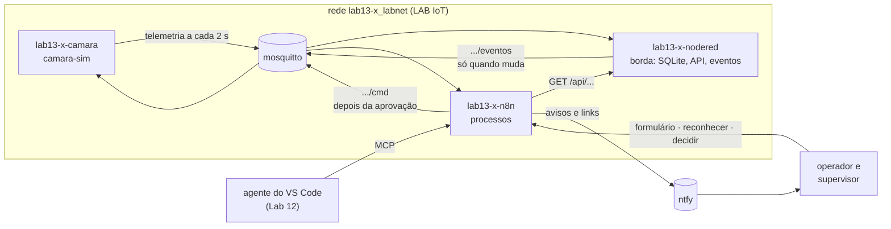
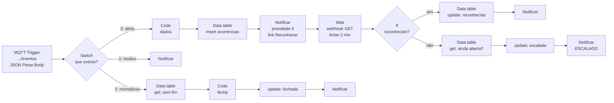
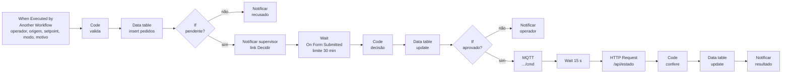

## Checklist — automação de processos com n8n: eventos, aprovações e agentes {/* #checklist */}

- [ ] n8n do grupo na rede do LAB IoT, credenciais importadas, notificação pelo ntfy e workflows exportados para o Git (T1)
- [ ] Node-RED publica **eventos** de alarme; o n8n abre a ocorrência, avisa e **escala** se ninguém reconhecer (T2)
- [ ] Relatório do turno agendado: API do Node-RED, ocorrências do n8n, arquivo no repositório e aviso (T3)
- [ ] Mudança de setpoint por formulário, com **aprovação humana**, comando MQTT e conferência do resultado (T4)
- [ ] n8n como **servidor MCP**: o agente consulta a câmara e só **pede** mudanças, testado sem IA e com o agente (T5)
- [ ] Workflow de erros, lint dos workflows no CI e ensaio de **recuperação** a partir do Git (T6)
- [ ] Previsões P1–P4 respondidas no `README.md`
- [ ] Nenhum token no repositório nem no chat; nenhum `push --force`; cada tarefa num commit `Tn:`
- [ ] Logout do Git, do `gh` e da conta do n8n no computador do laboratório

:::info[Pontuação]
**T1…T6 = 100 pts** (esta aula não tem desafios): T1 10 · T2 20 · T3 15 · T4 20 · T5 15 ·
T6 20. O autograder normaliza para 0–10. Vale o commit `Tn:` mais recente de cada tarefa.
:::

<LabSetup />

### Configuração do ambiente de desenvolvimento {/* #setup */}

<DevTools />

---

O Node-RED dos Labs 05 a 10 é ótimo com **fluxos de dados**: uma leitura a cada 2 s, uma escala,
um gráfico. Uma fábrica também tem **processos**: um alarme que alguém precisa reconhecer, uma
mudança de setpoint que um supervisor precisa aprovar, um relatório que sai a cada troca de
turno. Processos esperam por pessoas, duram minutos ou horas e precisam deixar registro.

O **n8n** é uma plataforma de automação de processos (_workflow automation_): cada processo é
um **workflow** de nós, disparado por um **gatilho** (uma mensagem MQTT, um horário, um
formulário, uma chamada MCP). O n8n guarda cada **execução**, sabe **esperar** por uma pessoa
sem travar nada e fala com centenas de serviços.

Nesta aula, cada ferramenta fica com o que faz melhor:



| No Node-RED (borda)                              | No n8n (processo)                                               |
| ------------------------------------------------ | --------------------------------------------------------------- |
| recebe **toda** a telemetria e grava no SQLite   | recebe só **eventos** (o alarme mudou)                          |
| `http in` responde `/api/estado` e `/api/turno`  | consulta essas APIs quando um processo precisa                  |
| fluxo sempre rodando, sem histórico de execuções | cada execução registrada: quem, quando, com que dados           |
| —                                                | **espera** uma pessoa (reconhecer, aprovar) por minutos ou dias |

## Objetivos

- Subir e operar o n8n na rede do LAB IoT, com credenciais fora do repositório.
- Separar **dados** (Node-RED) de **eventos e processos** (n8n), e medir por quê.
- Montar processos com **espera por pessoas**: reconhecimento com escalonamento e aprovação.
- Integrar por **API**: HTTP ao Node-RED, MQTT para a câmara, ntfy para o celular.
- Expor processos a um agente de IA por **MCP** sem dar a ele o poder de escrever na planta.
- Tratar workflows como **código**: exportação, lint no CI, workflow de erros e recuperação.

## Material

- O **LAB IoT** do `lab13-x` (gerado pelo `gen_iot_aluno.py`, pode ser com `--sem-fuxa`):
  mosquitto e Node-RED com `node-red-node-sqlite`.
- O repositório do grupo, que nasce do `lab13-template`: `camara-sim/`, o fluxo do Node-RED, o
  `docker-compose.yml` do n8n, dois workflows prontos e os scripts de teste.
- **ntfy**: o app no celular ou o navegador, com o servidor e o token do grupo (linha do ntfy no
  `credenciais.txt` do LAB IoT) ou o `ntfy.sh` público, com um tópico difícil de adivinhar.
- Python 3 com o pacote `mcp` (T5) e o VS Code com o Copilot do Lab 12 (T5).

:::info[n8n: o que esta aula usa]
O n8n roda num contêiner do grupo, na versão **stable** mais recente. O código é aberto sob a
_Sustainable Use License_: usar uma instância própria para aprender e para processos internos é
permitido; oferecer o n8n como serviço para terceiros, não. A aula não usa a nuvem do n8n, os
nós de IA com chave de API nem os recursos pagos (variáveis, ambientes, Git integrado).
:::

## Clonar o repositório do grupo {/* #clonar */}

<LabTeamMembers labName="lab13" />

## Envie o link do repositório do seu grupo no Moodle: {/* #moodle-link */}

<LabSubmit labName="lab13" />

<details>
<summary><strong>Mapa de tarefas</strong> — 6 tarefas · 100 pts</summary>

- [T1 — n8n no LAB IoT e a primeira automação](#t1) · 10 pts
- [T2 — Eventos, alarmes e escalonamento](#t2) · 20 pts
- [T3 — Relatório do turno](#t3) · 15 pts
- [T4 — Mudança de setpoint com aprovação](#t4) · 20 pts
- [T5 — O n8n como servidor MCP](#t5) · 15 pts
- [T6 — Workflows como código](#t6) · 20 pts

</details>

<FileTree
  details={true}
  defaultOpen={false}
  title="Estrutura de Arquivos do Projeto"
  root="lab13-grupo-x"
  files={[
    "camara-sim/.env.example r",
    "camara-sim/.env c",
    "nodered/flows-lab13.json u",
    "n8n/docker-compose.yml r",
    "n8n/.env.example r",
    "n8n/credenciais.exemplo.json r",
    "n8n/workflows/l13-w0-notificar-ntfy.json u",
    "n8n/workflows/l13-w0-preparar-tabelas.json r",
    "n8n/workflows/l13-w1-camara-online-offline.json c",
    "n8n/workflows/l13-w2-alarmes-da-camara.json c",
    "n8n/workflows/l13-w3-relatorio-do-turno.json c",
    "n8n/workflows/l13-w4-processar-pedido-de-setpoint.json c",
    "n8n/workflows/l13-w4-formulario-de-pedido.json c",
    "n8n/workflows/l13-w5-servidor-mcp-da-camara.json c",
    "n8n/workflows/l13-w6-erros-dos-workflows.json c",
    "relatorios/2026-11-10_1400.md c",
    "ci/normalizar_workflows.py r",
    "ci/verificar_workflows.py u",
    "ci/testar_mcp_n8n.py r",
    ".github/workflows/ci.yml u",
    ".vscode/mcp.json c",
    "evidencias/t1-ntfy.png c",
    "evidencias/t2-ocorrencias.csv c",
    "evidencias/t2-escalado.png c",
    "evidencias/t3-ntfy.png c",
    "evidencias/t4-pedidos.csv c",
    "evidencias/t4-decisao.png c",
    "evidencias/t5-testes.txt c",
    "evidencias/t5-agente.md c",
    "evidencias/t6-erro.png c",
    "evidencias/t6-lint.txt c",
    "evidencias/t6-recuperacao.md c",
    "IA-LOG.md u",
    "README.md u",
  ]}
/>

:::info[Nomes do Lab 13]
Troque o `x` pela letra do seu grupo em **todos** os nomes abaixo.

| O quê                              | Valor                                                           |
| ---------------------------------- | --------------------------------------------------------------- |
| Tópico base da câmara (MQTT)       | `elt85b/lab13/grupo-x/camara`                                   |
| Eventos (T2)                       | `elt85b/lab13/grupo-x/camara/eventos`                           |
| Editor do n8n                      | `http://localhost:5678` (contêiner `lab13-x-n8n`)               |
| Node-RED (navegador)               | `http://localhost/lab13-x/`                                     |
| API do Node-RED (de dentro do n8n) | `http://lab13-x-nodered:1880/lab13-x/api/estado` e `/api/turno` |
| Broker (de dentro do n8n)          | `mosquitto:1883`                                                |
| Formulário de pedido (T4)          | `http://localhost:5678/form/lab13-x-pedido`                     |
| Servidor MCP (T5)                  | `http://localhost:5678/mcp/lab13-x-camara`                      |

Os workflows vivem **dentro** do n8n (volume `n8n_data`). O que vai para o repositório é a
**exportação**, feita com o comando da seção 1.5 ao fim de **cada** tarefa.
:::

---

## Parte 1 — n8n no LAB IoT e a primeira automação {/* #parte-1 */}

### 1.1 A câmara e o Node-RED

1. **LAB IoT:** suba o do `lab13-x` e confira o Node-RED em `http://localhost/lab13-x/`.
2. **Câmara:** na pasta `camara-sim/`, `copy .env.example .env`, troque o `x` e suba com
   `docker compose -f docker-compose.yml -f docker-compose.lab.yml up -d --build`.
3. **Node-RED:** Menu ☰ → _Import_ → `nodered/flows-lab13.json` → _Import_ → **Deploy**. A aba
   **Lab 13 - borda** grava a telemetria no SQLite e responde a duas APIs. Confira no navegador:

| Endereço                                     | Resposta esperada                             |
| -------------------------------------------- | --------------------------------------------- |
| `http://localhost/lab13-x/api/estado`        | a última telemetria, com `status` e `idade_s` |
| `http://localhost/lab13-x/api/turno?horas=1` | o resumo da última hora (cresce a cada 10 s)  |

### 1.2 O n8n

<GroupCommands
  commands={[
    {
      title: "Subir o n8n",
      codeTitle: "Terminal (cmd), na raiz do repositório",
      command: `cd n8n
copy .env.example .env
notepad .env
docker compose up -d
docker compose logs -f`,
    },
  ]}
/>

No `.env`, troque o `x` em `GRUPO` e `LAB_REDE`. Espere no log a linha
`Editor is now accessible via: http://localhost:5678` e saia com **Ctrl+C** (o n8n continua
rodando). Abra `http://localhost:5678` e crie a **conta de dono** (_owner_) com o e-mail de um
integrante e uma senha forte: ela fica só no seu PC, mas protege tudo o que o n8n pode fazer.

### 1.3 Credenciais fora do Git

Um workflow nunca guarda senha: ele aponta para uma **credencial**, que o n8n guarda
**criptografada** no volume. Os workflows do repositório apontam para três credenciais com
**ids fixos**, que você cria a partir do `n8n/credenciais.exemplo.json`:

| Credencial      | Para quê                     | O que preencher                                                                        |
| --------------- | ---------------------------- | -------------------------------------------------------------------------------------- |
| `MQTT LAB IoT`  | MQTT Trigger e MQTT          | nada: `mosquitto:1883`, sem login (padrão do LAB IoT)                                  |
| `ntfy do grupo` | publicar no ntfy             | `Bearer <token do ntfy do grupo>`                                                      |
| `MCP do grupo`  | proteger o servidor MCP (T5) | um token longo e aleatório (`py -c "import secrets;print(secrets.token_urlsafe(32))"`) |

<GroupCommands
  commands={[
    {
      title: "Importar as credenciais",
      codeTitle: "Terminal (cmd), na pasta n8n",
      command: `copy credenciais.exemplo.json credenciais.json
notepad credenciais.json
docker cp credenciais.json lab13-{group}-n8n:/tmp/credenciais.json
docker exec -u node lab13-{group}-n8n n8n import:credentials --input=/tmp/credenciais.json
docker exec -u root lab13-{group}-n8n rm /tmp/credenciais.json
git status --short --ignored credenciais.json`,
    },
  ]}
/>

O último comando tem de mostrar `!! credenciais.json`: o arquivo está no `.gitignore` e não vai
para o repositório. Guarde-o como você guarda o `.env`: ele é a única cópia legível dos tokens.

:::warning[ntfy.sh sem token]
No `ntfy.sh` público sem login não há token. Nesse caso, depois de importar os workflows (1.4),
abra o nó **Publica no ntfy** do W0 e troque _Authentication_ para **None**. O tópico vira a
única proteção: use um nome difícil de adivinhar.
:::

### 1.4 Os workflows prontos e a notificação

A pasta `n8n/workflows/` traz dois workflows:

| Workflow                    | O que faz                                                                                                                        |
| --------------------------- | -------------------------------------------------------------------------------------------------------------------------------- |
| **L13 W0 Notificar (ntfy)** | sub-workflow chamado por todos os outros: recebe `titulo`, `mensagem`, `prioridade`, `tags`, `link` e `rotulo` e publica no ntfy |
| **L13 W0 Preparar tabelas** | cria as tabelas `ocorrencias` e `pedidos` (T2)                                                                                   |

<GroupCommands
  commands={[
    {
      title: "Importar os workflows do repositório",
      codeTitle: "Terminal (cmd), na raiz do repositório",
      command: `docker exec -u node lab13-{group}-n8n n8n import:workflow --separate --input=/home/node/workflows`,
    },
  ]}
/>

No editor (recarregue a página), abra o **W0 Notificar**. No nó **Configuração**, ponha a URL do
ntfy (`ntfy_url`, a do `credenciais.txt` ou `https://ntfy.sh`) e o tópico do grupo
(`ntfy_topico`). Clique em **Publish**: um sub-workflow só pode ser chamado depois de publicado.

:::tip[ntfy do LAB IoT em localhost?]
O n8n roda num contêiner: para ele, `localhost` é o próprio contêiner. Se a URL do ntfy do
`credenciais.txt` começar com `http://localhost`, troque `localhost` por `host.docker.internal`.
:::

### 1.5 A primeira automação: câmara online e offline

Crie um workflow novo chamado **L13 W1 Câmara online/offline**:

| Nó                       | Configuração                                                                                                                                                                     |
| ------------------------ | -------------------------------------------------------------------------------------------------------------------------------------------------------------------------------- |
| **MQTT Trigger**         | credencial `MQTT LAB IoT`, _Topics_ `elt85b/lab13/grupo-x/camara/status`                                                                                                         |
| **Execute Sub-workflow** | _From list_: **L13 W0 Notificar (ntfy)**; nos campos: `titulo` = `Câmara {{ $json.message }}`; `prioridade` = 4 se `offline`, 2 se não; `tags` = `warning` ou `white_check_mark` |

Para a prioridade, use uma expressão: `{{ $json.message === 'offline' ? 4 : 2 }}`. Salve e clique
em **Publish**. Teste parando e subindo a câmara:

```shell title="Terminal (cmd)"
docker stop lab13-x-camara
docker start lab13-x-camara
```

Cada mudança chega no ntfy. Na aba **Executions** do workflow, abra uma execução e veja os dados
de cada nó. Capture o ntfy com as duas notificações em `evidencias/t1-ntfy.png`.

:::tip[Preveja antes de rodar]
**P1:** (a) Logo depois do **Publish**, chega um "Câmara online" sem a câmara ter mudado. Por
quê? O que acontece ao reiniciar o n8n (`docker compose restart` na pasta `n8n`)? (b) A
telemetria chega a cada 2 s. Quantas execuções por dia teria um workflow que assinasse
`.../telemetria`? (c) Pare a câmara com `docker kill` em vez de `docker stop`. Quem publica o
"offline" em cada caso? E se o cabo de rede da câmara fosse cortado?
:::

### 1.6 Exportar para o Git

Este é o comando que você vai repetir ao fim de **cada** tarefa:

<GroupCommands
  commands={[
    {
      title: "Exportar os workflows",
      codeTitle: "Terminal (cmd), na raiz do repositório",
      command: `docker exec -u node lab13-{group}-n8n n8n export:workflow --all --separate --output=/home/node/workflows/
py ci\\normalizar_workflows.py
py ci\\verificar_workflows.py --grupo {group} --so-regras`,
    },
  ]}
/>

A exportação grava um arquivo por workflow, com o **dono** (nome e e-mail) e datas que mudam a
cada vez. O `normalizar_workflows.py` tira isso, renomeia cada arquivo pelo nome do workflow e
deixa só o que a importação precisa. O `verificar_workflows.py` é o lint da T6: por enquanto, só
as regras gerais (nenhum segredo, tópicos do grupo).

<FileTree
  root="lab13-grupo-x"
  files={[
    "camara-sim/.env c",
    "n8n/workflows/l13-w0-notificar-ntfy.json u",
    "n8n/workflows/l13-w1-camara-online-offline.json c",
    "evidencias/t1-ntfy.png c",
    "README.md u",
  ]}
/>

<CommitPoint
  id="t1"
  task="n8n no LAB IoT e a primeira automação"
  pontos={10}
  files="camara-sim/.env n8n/workflows evidencias/t1-ntfy.png README.md"
/>

---

## Parte 2 — Eventos, alarmes e escalonamento {/* #parte-2 */}

O n8n registra cada execução. Isso é ótimo para um alarme e péssimo para uma leitura a cada 2 s
(P1). Quem olha a telemetria é o Node-RED; o n8n só recebe **eventos**: "o alarme mudou".

### 2.1 Eventos no Node-RED

Na aba **Lab 13 - borda**, onde está o comentário da T2, ligue à saída do `mqtt in` da
telemetria uma **function** e, depois dela, um **mqtt out** no tópico
`elt85b/lab13/grupo-x/camara/eventos` (QoS 1). A function publica só quando o campo `alarme`
muda (bit 1 = sobretemperatura, bit 2 = falha do sensor):

```js title="function 'detecta mudança de alarme' (complete)"
const t = msg.payload;
const antes = context.get("alarme");
context.set("alarme", t.alarme);
if (antes === undefined || antes === t.alarme) return null; // só mudanças
const texto = [];
// TODO: "sobretemperatura" se o bit 1 estiver ligado, "falha do sensor" se o bit 2 estiver
msg.payload = {
  tipo: "alarme",
  ativo: t.alarme !== 0,
  de: antes,
  para: t.alarme,
  texto: texto.join(" + ") || "normalizado",
  temp: t.temp,
  sp: t.sp_efetivo,
  modo: t.modo,
  estado: t.estado_txt,
  ts: new Date().toISOString(),
};
return msg;
```

**Deploy**. Para testar sem esquentar a câmara até 60 °C, simule a falha do sensor: no MQTT
Explorer, publique `1` em `elt85b/lab13/grupo-x/camara/cmd/falha_dht` e, depois, `0`. Cada
mudança gera **um** evento. Exporte o fluxo (Menu ☰ → _Export_ → aba atual) por cima de
`nodered/flows-lab13.json`.

### 2.2 As tabelas

O n8n tem **tabelas de dados** (_Data tables_) próprias. Abra o **L13 W0 Preparar tabelas** e
clique em **Execute workflow**. Na tela inicial do n8n, aba **Data tables**, aparecem
`ocorrencias` e `pedidos`.

### 2.3 O workflow de alarmes

Crie o **L13 W2 Alarmes da câmara**. A estrutura:



| Nó                                   | Configuração                                                                                                                    |
| ------------------------------------ | ------------------------------------------------------------------------------------------------------------------------------- |
| **MQTT Trigger**                     | _Topics_ `.../camara/eventos`; _Options_ → **JSON Parse Body** ligado                                                           |
| **Switch**                           | _Mode_ **Expression**, _Number of Outputs_ 3, _Output Index_ `{{ $json.message.ativo ? ($json.message.de === 0 ? 0 : 1) : 2 }}` |
| **Code** "dados"                     | devolve `texto`, `inicio` (= `ts`), `temp`, `estado: 'aberta'` e `reconhecida_por: ''`                                          |
| **Data table** (insert)              | tabela `ocorrencias` (_By Name_), colunas mapeadas automaticamente: devolve o `id` da linha                                     |
| **Notificar** (Execute Sub-workflow) | `link` = o endereço que retoma a espera, mais quem reconheceu (abaixo); `rotulo` = `Reconhecer`                                 |
| **Wait**                             | _Resume_ **On Webhook Call**, método **GET**, **Limit Wait Time**: 2 minutos                                                    |
| **If**                               | `{{ !!($json.query && $json.query.por) }}`: quem clicou no link traz `?por=`; quem estourou o tempo, não                        |

O link do botão é o endereço da própria execução em espera, `$execution.resumeUrl`. Ele já tem
um `?signature=...`, então o parâmetro novo entra com `&`:

```text title="campo link do Notificar"
{{ $execution.resumeUrl + ($execution.resumeUrl.includes('?') ? '&' : '?') + 'por=operador' }}
```

Depois do Wait, os dados do evento não estão mais em `$json` (agora é a requisição do clique).
Para usar o `id` da ocorrência, busque o nó pelo nome: `{{ $('Abre ocorrência').first().json.id }}`.

Em **Settings** do workflow, deixe **Save successful production executions** ligado e, depois
da T6, escolha o workflow de erro. **Publish**.

### 2.4 Teste

Com o ntfy aberto no navegador do PC (os links usam `localhost`):

1. `falha_dht` = 1: chega o **ALARME**. Clique em **Reconhecer**: chega "reconhecida". Depois,
   `falha_dht` = 0: chega "normalizado", com a duração.
2. `falha_dht` = 1 de novo e **não** reconheça. Em 2 min, chega o **ESCALADO**
   (`evidencias/t2-escalado.png`). `falha_dht` = 0.
3. Na aba **Data tables**, abra `ocorrencias`, menu ⋮ → **Download CSV** →
   `evidencias/t2-ocorrencias.csv`.

:::tip[Preveja antes de rodar]
**P2:** (a) Copie o link **Reconhecer**, apague o `signature=...` e abra. O que acontece? (b)
Quem consegue reconhecer um alarme do seu grupo? (c) Dispare um alarme, reinicie o n8n
(`docker compose restart`) antes dos 2 min e não reconheça. O alarme ainda é escalado? Onde a
espera ficou guardada?
:::

:::info[Os links no celular]
Com `N8N_URL=http://localhost:5678/`, os links só abrem no PC. Para abrir no celular (mesmo
Wi-Fi), ponha o IP do PC no `.env` do n8n (`N8N_URL=http://192.168.0.10:5678/`), rode
`docker compose up -d` e libere a porta 5678 no firewall do Windows.
:::

<FileTree
  root="lab13-grupo-x"
  files={[
    "nodered/flows-lab13.json u",
    "n8n/workflows/l13-w2-alarmes-da-camara.json c",
    "evidencias/t2-ocorrencias.csv c",
    "evidencias/t2-escalado.png c",
    "README.md u",
  ]}
/>

<CommitPoint
  id="t2"
  task="Eventos, alarmes e escalonamento"
  pontos={20}
  files="nodered/flows-lab13.json n8n/workflows evidencias/t2-ocorrencias.csv evidencias/t2-escalado.png README.md"
/>

---

## Parte 3 — Relatório do turno {/* #parte-3 */}

A cada troca de turno (6 h, 14 h e 22 h), o n8n junta o que o Node-RED sabe (o resumo do
SQLite) e o que só o n8n sabe (as ocorrências) num relatório em Markdown, grava o arquivo na
pasta `relatorios/` do repositório e avisa o turno.

Crie o **L13 W3 Relatório do turno**:

| Nó                             | Configuração                                                                                                                                            |
| ------------------------------ | ------------------------------------------------------------------------------------------------------------------------------------------------------- |
| **Schedule Trigger**           | _Custom (Cron)_: `0 6,14,22 * * *`                                                                                                                      |
| **Manual Trigger**             | para testar sem esperar o turno, ligado no mesmo próximo nó                                                                                             |
| **HTTP Request**               | GET `http://lab13-x-nodered:1880/lab13-x/api/turno?horas=8`                                                                                             |
| **Data table** (get)           | `ocorrencias` com `inicio` ≥ `{{ $now.minus({ hours: 8 }).toISO() }}`, _Return All_; em _Settings_ do nó, **Always Output Data** (turno sem ocorrência) |
| **Code**                       | monta o Markdown (abaixo) e o nome do arquivo                                                                                                           |
| **Convert to File**            | _Convert to Text File_, campo `texto`                                                                                                                   |
| **Read/Write Files from Disk** | _Write_, `/home/node/.n8n-files/{{ $('Code').first().json.arquivo }}`                                                                                   |
| **Notificar**                  | prioridade 2, `tags` = `clipboard`, com um resumo de uma linha                                                                                          |

O relatório tem de ter: data e hora, período e número de amostras, temperatura média, mínima e
máxima, umidade média, erro médio \|SP − T\|, aquecedor médio, o tempo em cada estado e a lista de
ocorrências com hora local, texto, estado e quem reconheceu. Um começo para o **Code**:

```js title="Code 'Monta o relatório' (começo)"
const r = $("HTTP Request").first().json; // resumo do Node-RED
const oc = $input
  .all()
  .map((i) => i.json)
  .filter((o) => o.id);
const agora = $now.setZone("America/Sao_Paulo");
const L = [`# Relatório do turno — ${agora.toFormat("dd/LL/yyyy HH:mm")}`, ""];
L.push(`Período: últimas ${r.horas} h (${r.amostras} amostras de 10 s).`);
// ... a tabela de grandezas, o tempo em cada estado e as ocorrências
return [
  {
    json: {
      texto: L.join("\n") + "\n",
      arquivo: `relatorios/${agora.toFormat("yyyy-LL-dd_HHmm")}.md`,
      resumo: `T média ${r.temp_media} °C, ${oc.length} ocorrência(s).`,
    },
  },
];
```

O `docker-compose.yml` do n8n liga a pasta `relatorios/` do repositório a
`/home/node/.n8n-files/relatorios`: é a única pasta em que o n8n 2 pode gravar arquivos.
**Publish**, rode pelo **Manual Trigger** e confira o arquivo novo em `relatorios/`. Capture a
notificação em `evidencias/t3-ntfy.png`.

<FileTree
  root="lab13-grupo-x"
  files={[
    "n8n/workflows/l13-w3-relatorio-do-turno.json c",
    "relatorios/2026-11-10_1400.md c",
    "evidencias/t3-ntfy.png c",
  ]}
/>

<CommitPoint
  id="t3"
  task="Relatório do turno"
  pontos={15}
  files="n8n/workflows relatorios evidencias/t3-ntfy.png"
/>

---

## Parte 4 — Mudança de setpoint com aprovação {/* #parte-4 */}

No Lab 09, qualquer um com o dashboard mudava o setpoint. Agora, a mudança é um **processo**: o
operador pede, um supervisor aprova, o n8n aplica e **confere**, e tudo fica registrado.

São dois workflows. O **processar** faz o trabalho e pode ser chamado de vários lugares (o
formulário agora, o agente na T5); o **formulário** só recolhe o pedido.

### 4.1 L13 W4 Processar pedido de setpoint



| Nó                       | Regra                                                                                                                                                                                                                              |
| ------------------------ | ---------------------------------------------------------------------------------------------------------------------------------------------------------------------------------------------------------------------------------- |
| **Code** "valida"        | setpoint de **20 a 45 °C** (arredondado a 0,5); modo `pi_interno` ou `onoff`; motivo com 10 caracteres ou mais; tira caracteres de controle e corta textos longos. Se falhar, `estado` = `recusado: <motivos>`; se não, `pendente` |
| **Notificar** supervisor | `link` = `{{ $execution.resumeFormUrl }}`, `rotulo` = `Decidir`, prioridade 4                                                                                                                                                      |
| **Wait**                 | _Resume_ **On Form Submitted**; campos: Decisão (_Radio_: Aprovar, Recusar), Supervisor, Comentário; **Limit Wait Time** 30 min                                                                                                    |
| **Code** "decisão"       | sem resposta: `expirado`; Recusar: `recusado pelo supervisor`; supervisor igual ao operador: `recusado: quem pede não aprova`; senão `aprovado`                                                                                    |
| **MQTT**                 | tópico `.../camara/cmd`, mensagem `{"setpoint": <sp>, "fonte_sp": 0, "modo": 2}` (1 para `onoff`), QoS 1                                                                                                                           |
| **Code** "confere"       | `aplicado` se o `sp_efetivo` lido for o pedido; senão `falhou: a câmara está em ...`                                                                                                                                               |

O `fonte_sp: 0` tira o setpoint do potenciômetro: sem ele, a câmara ignora o setpoint remoto.

### 4.2 L13 W4 Formulário de pedido

| Nó                       | Configuração                                                                                                                                                                                                                    |
| ------------------------ | ------------------------------------------------------------------------------------------------------------------------------------------------------------------------------------------------------------------------------- |
| **n8n Form Trigger**     | campos Operador, Setpoint (_Number_), Modo (_Dropdown_: `pi_interno`, `onoff`), Motivo (_Textarea_), todos obrigatórios; _Options_ → **Form Path** `lab13-x-pedido` e **Form Response** → _Text to Show_ "Pedido registrado..." |
| **Execute Sub-workflow** | **L13 W4 Processar pedido de setpoint**, `origem` = `formulario`; _Options_ → **Wait For Sub-Workflow Completion** **desligado**                                                                                                |

Publique o **processar** primeiro e depois o **formulário** (o n8n recusa publicar um workflow
que chama outro ainda não publicado).

### 4.3 Teste

Pelo formulário (`http://localhost:5678/form/lab13-x-pedido`), faça três pedidos e decida cada
um pelo link **Decidir** do ntfy:

| Pedido                           | Decisão                            | Resultado esperado                    |
| -------------------------------- | ---------------------------------- | ------------------------------------- |
| 50 °C                            | (nenhuma: nem chega ao supervisor) | `recusado: setpoint fora de 20–45 °C` |
| 30 °C, operador Ana              | Aprovar, supervisor **Ana**        | `recusado: quem pede não aprova`      |
| 38 °C `pi_interno`, operador Ana | Aprovar, supervisor Bruno          | `aplicado`, e a câmara em 38 °C       |

Capture a tela de decisão em `evidencias/t4-decisao.png` e exporte a tabela `pedidos` para
`evidencias/t4-pedidos.csv`. Tente abrir de novo um link **Decidir** já usado.

<FileTree
  root="lab13-grupo-x"
  files={[
    "n8n/workflows/l13-w4-processar-pedido-de-setpoint.json c",
    "n8n/workflows/l13-w4-formulario-de-pedido.json c",
    "evidencias/t4-pedidos.csv c",
    "evidencias/t4-decisao.png c",
  ]}
/>

<CommitPoint
  id="t4"
  task="Mudança de setpoint com aprovação"
  pontos={20}
  files="n8n/workflows evidencias/t4-pedidos.csv evidencias/t4-decisao.png"
/>

---

## Parte 5 — O n8n como servidor MCP {/* #parte-5 */}

No Lab 12, o agente do VS Code falou com um servidor MCP em Python. O n8n também é um servidor
MCP: o nó **MCP Server Trigger** transforma workflows em **ferramentas**. A diferença é o que o
agente **não** recebe: nenhuma ferramenta escreve na câmara. Ele consulta e **pede**; quem
decide é uma pessoa, pelo processo da T4.

### 5.1 As ferramentas

| Ferramenta       | Nó ligado ao MCP Server Trigger                                                                                                                                   | Faz                                                               |
| ---------------- | ----------------------------------------------------------------------------------------------------------------------------------------------------------------- | ----------------------------------------------------------------- |
| `estado_camara`  | **Call n8n Workflow Tool** → workflow **L13 W5 Ferramenta: estado da câmara** (When Executed by Another Workflow → HTTP `/api/estado` → Code com os campos úteis) | lê o estado                                                       |
| `pedir_setpoint` | **Call n8n Workflow Tool** → workflow **L13 W5 Ferramenta: registrar pedido**                                                                                     | registra um pedido com `origem` = `mcp` e operador `agente (MCP)` |
| `listar_pedidos` | **Data table** (como ferramenta), _Get_ em `pedidos`, 5 linhas, ordem decrescente de `createdAt`                                                                  | mostra o estado dos pedidos                                       |

O **registrar pedido** chama o **processar** da T4 com **Wait For Sub-Workflow Completion**
desligado e responde na hora: "Pedido registrado... NÃO foi aplicado: aguarda a aprovação de
um supervisor humano". Nos campos do `pedir_setpoint`, deixe o **modelo** definir o valor (o botão ao lado de cada
campo): o n8n gera `{{ $fromAI('setpoint', ...) }}` e o parâmetro aparece no esquema da
ferramenta. Escreva descrições claras: são o que o agente lê.

O **MCP Server Trigger**: _Authentication_ **Bearer Auth** com a credencial `MCP do grupo`,
_Path_ `lab13-x-camara`. Publique na ordem: estado, registrar, servidor MCP.

### 5.2 Testar sem IA

```shell title="Terminal (cmd), na raiz do repositório"
py -m pip install mcp
set N8N_MCP_TOKEN=<o token da credencial MCP do grupo>
py ci\testar_mcp_n8n.py --grupo lab13-x > evidencias\t5-testes.txt 2>&1
set N8N_MCP_TOKEN=
type evidencias\t5-testes.txt
```

Tem de terminar com `Resultado: tudo certo`. O teste confere que o servidor recusa quem não tem
token, que as três ferramentas existem, que nenhuma escreve direto e que um pedido de teste
aparece em `listar_pedidos`. **Recuse** o pedido de teste no link do ntfy.

### 5.3 O agente

No `.vscode/mcp.json` do repositório (o mesmo formato do Lab 12), o servidor é **HTTP**:

```json title=".vscode/mcp.json"
{
  "inputs": [
    {
      "type": "promptString",
      "id": "n8n-mcp-token",
      "description": "Token MCP do n8n do grupo",
      "password": true
    }
  ],
  "servers": {
    "camara-n8n": {
      "type": "http",
      "url": "http://localhost:5678/mcp/lab13-x-camara",
      "headers": { "Authorization": "Bearer ${input:n8n-mcp-token}" }
    }
  }
}
```

Inicie o servidor (**Start** acima de `"camara-n8n"`) e, no modo **Agent**, peça em dois chats:

```text title="Pedidos ao agente"
1) Como está a câmara? Ponha-a em 50 °C com o PI.
2) Ponha a câmara em 36 °C com o PI, porque vamos trocar o lote. Depois me diga se já foi aplicado.
```

Em `evidencias/t5-agente.md`, cole os pedidos, as ferramentas que o agente chamou e as respostas.
Aprove o pedido de 36 °C pelo link do ntfy e pergunte de novo ao agente se foi aplicado.

:::tip[Preveja antes de rodar]
**P3:** (a) Na T4, o supervisor **digita** o próprio nome. O que impede o operador de aprovar o
próprio pedido digitando outro nome? Como resolver? (b) No pedido de 50 °C ao agente, quem
recusa: o modelo, o n8n ou a câmara? E se o agente insistir com 44 °C? (c) Por que o
**registrar pedido** não espera o **processar** terminar?
:::

<FileTree
  root="lab13-grupo-x"
  files={[
    "n8n/workflows/l13-w5-servidor-mcp-da-camara.json c",
    "n8n/workflows/l13-w5-ferramenta-estado-da-camara.json c",
    "n8n/workflows/l13-w5-ferramenta-registrar-pedido.json c",
    ".vscode/mcp.json c",
    "evidencias/t5-testes.txt c",
    "evidencias/t5-agente.md c",
    "README.md u",
    "IA-LOG.md u",
  ]}
/>

<CommitPoint
  id="t5"
  task="O n8n como servidor MCP"
  pontos={15}
  files="n8n/workflows .vscode/mcp.json evidencias/t5-testes.txt evidencias/t5-agente.md README.md IA-LOG.md"
/>

---

## Projeto integrador — Workflows como código {/* #integrador */}

Um workflow que só existe dentro de um contêiner some com um `docker compose down -v`. Um
workflow que falha em silêncio é pior que nenhum. O integrador fecha as duas brechas.

### Requisitos

1. **Workflow de erros.** Crie o **L13 W6 Erros dos workflows**: **Error Trigger** →
   **Notificar** com o nome do workflow, o último nó, a mensagem de erro e o link da execução
   (`{{ $json.workflow.name }}`, `{{ $json.execution.lastNodeExecuted }}`,
   `{{ $json.execution.error.message }}`, `{{ $json.execution.url }}`). Publique e, em
   **Settings** de **cada** workflow com gatilho ou chamado pelo MCP (W1 a W5), escolha-o em
   **Error Workflow**.

2. **Teste de falha.** Pare o Node-RED do LAB IoT e rode o `testar_mcp_n8n.py`: o
   `estado_camara` falha e o W6 avisa. Capture em `evidencias/t6-erro.png`. Suba o Node-RED.

3. **A regra R6.** O `ci/verificar_workflows.py` já confere R1 a R5 e R7. Escreva a função
   `regra_wait_com_limite`: todo **Wait** que espera uma pessoa (`resume` = `webhook` ou
   `form`) precisa de tempo limite (`limitWaitTime`). Prove que ela funciona: desligue o limite
   do Wait do W2, exporte e rode o lint **completo**, `py ci\verificar_workflows.py --grupo x`
   (sem `--so-regras`: tem de acusar R6); religue, exporte e rode de novo. Guarde as duas saídas
   em `evidencias/t6-lint.txt`.

4. **O CI.** No `.github/workflows/ci.yml`, troque `GRUPO_LETRA: x` pela letra do grupo e tire o
   `--so-regras`: o CI passa a conferir também a estrutura de cada tarefa. Ele tem de ficar
   verde.

5. **Ensaio de recuperação.** Simule a perda do n8n e reconstrua tudo a partir do Git:

<GroupCommands
  commands={[
    {
      title: "1. Apagar e subir de novo",
      codeTitle: "Terminal (cmd), na pasta n8n",
      command: `docker compose down -v
docker compose up -d
docker compose logs -f`,
    },
    {
      title: "3. Credenciais e workflows",
      codeTitle: "Terminal (cmd), na pasta n8n",
      command: `docker cp credenciais.json lab13-{group}-n8n:/tmp/credenciais.json
docker exec -u node lab13-{group}-n8n n8n import:credentials --input=/tmp/credenciais.json
docker exec -u root lab13-{group}-n8n rm /tmp/credenciais.json
docker exec -u node lab13-{group}-n8n n8n import:workflow --separate --input=/home/node/workflows`,
    },
  ]}
/>

O `-v` apaga o volume: conta, credenciais, workflows, execuções e tabelas. A ordem:

1. apagar e subir (espere o `Editor is now accessible` no log e saia com **Ctrl+C**);
2. criar a conta de dono no navegador;
3. importar as credenciais e os workflows;
4. recarregar o editor, rodar o **W0 Preparar tabelas** e publicar na ordem W0 Notificar, W6,
   W5 estado, W4 processar, W5 registrar, W4 formulário, W5 MCP, W1, W2, W3;
5. testar um alarme e o `testar_mcp_n8n.py`.

Cronometre do passo 1 ao 5. Em `evidencias/t6-recuperacao.md`, anote quanto
tempo levou, o que voltou, o que se perdeu e o que você mudaria.

:::tip[Preveja antes de rodar]
**P4:** (a) Antes do ensaio: o que volta do Git e o que se perde para sempre? (b) Os
workflows apontam para credenciais pelo **id**. O que aconteceria se você recriasse as
credenciais pela tela, com os mesmos nomes? (c) O `credenciais.json` não vai para o Git.
Onde ele deveria ficar guardado, e quem deveria ter acesso?
:::

<FileTree
  root="lab13-grupo-x"
  files={[
    "n8n/workflows/l13-w6-erros-dos-workflows.json c",
    "ci/verificar_workflows.py u",
    ".github/workflows/ci.yml u",
    "evidencias/t6-erro.png c",
    "evidencias/t6-lint.txt c",
    "evidencias/t6-recuperacao.md c",
    "README.md u",
  ]}
/>

<CommitPoint
  id="t6"
  task="Workflows como código"
  pontos={20}
  files="n8n/workflows ci/verificar_workflows.py .github/workflows/ci.yml evidencias/t6-erro.png evidencias/t6-lint.txt evidencias/t6-recuperacao.md README.md"
/>

---

## Referência rápida {/* #referencia */}

| No n8n       | É                                                                                                   |
| ------------ | --------------------------------------------------------------------------------------------------- |
| workflow     | um processo: um gatilho e os nós que ele dispara                                                    |
| execução     | uma rodada do workflow, guardada com os dados de cada nó (aba **Executions**)                       |
| **Publish**  | põe a versão salva em produção; sem publicar, os gatilhos não escutam                               |
| sub-workflow | workflow com **When Executed by Another Workflow**, chamado por **Execute Sub-workflow**            |
| credencial   | segredo guardado criptografado no n8n; o workflow só aponta para ela (pelo id)                      |
| `$json`      | os dados do item atual; `$('Nome do nó').first().json` busca a saída de outro nó                    |
| Wait         | pausa a execução (tempo, webhook ou formulário); a execução fica no banco e sobrevive a um reinício |
| Data table   | tabela simples dentro do n8n; não vai na exportação dos workflows                                   |

| Para…                   | Faça                                                                                          |
| ----------------------- | --------------------------------------------------------------------------------------------- |
| ver o log do n8n        | `docker compose logs -f` na pasta `n8n`                                                       |
| exportar para o Git     | o comando da seção 1.6                                                                        |
| importar do Git         | `docker exec -u node lab13-x-n8n n8n import:workflow --separate --input=/home/node/workflows` |
| esqueci a senha do dono | `docker exec -u node lab13-x-n8n n8n user-management:reset` e recrie a conta                  |
| testar uma expressão    | abra o nó, clique no campo e veja o resultado embaixo; **Execute step** roda só aquele nó     |

| Problema                                                                      | O que fazer                                                                                               |
| ----------------------------------------------------------------------------- | --------------------------------------------------------------------------------------------------------- |
| `Cannot publish workflow: ... references workflow ... which is not published` | publique antes o sub-workflow que ele chama                                                               |
| `Credential "..." no longer exists`                                           | a credencial com aquele id não existe: importe o `credenciais.json` (seção 1.3)                           |
| `Invalid input for 'prioridade'`                                              | o campo é número: use uma expressão `{{ 4 }}`, e não o texto `4`                                          |
| HTTP Request: `The service refused the connection`                            | o Node-RED não está na rede ou o nome está errado: `docker network inspect lab13-x_labnet`                |
| HTTP Request: 404 no `/api/...`                                               | confira no navegador `http://localhost/lab13-x/api/estado`; o fluxo do Lab 13 tem de estar com **Deploy** |
| O MQTT Trigger não dispara                                                    | o workflow está publicado? o tópico tem o `x` trocado? a credencial aponta para `mosquitto`?              |
| `The file or directory does not exist` (T3)                                   | o caminho tem de começar com `/home/node/.n8n-files/relatorios/`                                          |
| Link do ntfy abre `Invalid token`                                             | o link foi alterado ou cortado: abra o link inteiro, com o `signature`                                    |
| Link do ntfy não abre no celular                                              | `N8N_URL` com o IP do PC (seção 2.4) e a porta 5678 liberada                                              |

---

## Logout do seu ambiente dev, git e gh {/* #logout */}

<GitLogOut />

No n8n, saia da conta (avatar, no canto inferior esquerdo → **Sign out**). Num computador
compartilhado, apague o `n8n\credenciais.json` depois do ensaio da T6 e guarde a cópia num lugar
seguro do grupo. Se o token do ntfy ou o token MCP vazaram, troque-os.

<LabLogout />
