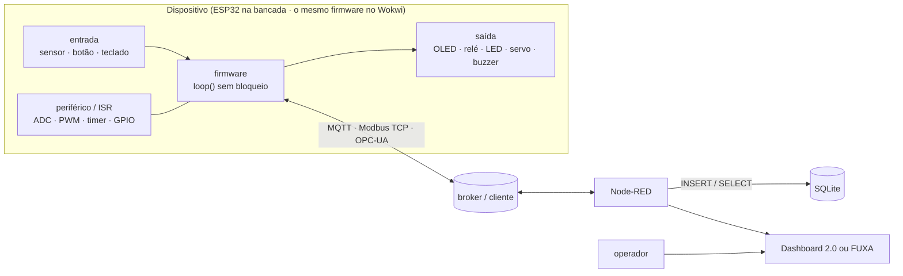
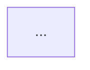

## Checklist — projeto final: do Wokwi à bancada {/* #checklist */}

- [ ] Proposta aprovada: issue com tema, diagrama de blocos, lista de material, mapa de pinos e plano dos nove critérios (P0)
- [ ] Firmware no Wokwi com dispositivo de entrada, de saída e um periférico dedicado ou interrupção, no ambiente `wokwi` (P1)
- [ ] Protocolo de comunicação nos dois sentidos, gravação e consultas no SQLite e dashboard no Node-RED ou no FUXA (P2)
- [ ] Protótipo em bancada no ambiente `lab`, aprovado no teste de aceitação ao vivo (P3)
- [ ] `README.md` completo, decisões D1–D4 respondidas, vídeo de apresentação e tag `v1.0.0` (P4)
- [ ] Segredos fora do Git; nenhum `push --force`; cada marco num commit `Pn:`
- [ ] Cada integrante com commits e _pull requests_ revisados no histórico
- [ ] Logout do Git e do `gh` no computador do laboratório

:::info[Pontuação]
**C1…C9 = 100 %** da nota do projeto, avaliados no **estado final** do repositório e na
**demonstração** da Aula 3. Cada marco `Pn:` é a data em que os critérios dele têm de estar
prontos pela primeira vez: vale o commit `Pn:` mais recente.

| Critério                                | Peso | Marco |
| --------------------------------------- | ---- | ----- |
| C1 — Dispositivo de entrada e de saída  | 10 % | P1    |
| C2 — Periférico dedicado ou interrupção | 10 % | P1    |
| C3 — Protocolo de comunicação           | 10 % | P2    |
| C4 — SQL via SQLite                     | 5 %  | P2    |
| C5 — Simulação no Wokwi                 | 5 %  | P1    |
| C6 — Protótipo operacional em bancada   | 30 % | P3    |
| C7 — Dashboard no Node-RED ou no FUXA   | 15 % | P2    |
| C8 — Documentação no GitHub             | 5 %  | P4    |
| C9 — Vídeo de apresentação              | 10 % | P4    |

:::

<LabSetup />

### Configuração do ambiente de desenvolvimento {/* #setup */}

<DevTools />

---

Nos Labs 01 a 11, cada peça de um sistema IoT apareceu separada: o Git e o PlatformIO, os logs,
o Wi-Fi e o MQTT robustos, o DHT22 com temporizador, o OLED, o ADC e o PWM, o SQLite, o
dashboard, os protocolos industriais, o SCADA no FUXA e os testes automáticos. Quase tudo rodou
no **Wokwi**.

No projeto final, o grupo escolhe **um problema** e entrega **um sistema completo**, do sensor ao
operador, que funciona **na bancada**, com ESP32, sensores e atuadores reais. O mesmo firmware
continua simulando no Wokwi: é o ambiente de desenvolvimento, e a bancada é a prova.



## Objetivos

- Transformar um **problema** num **sistema IoT** com requisitos, arquitetura e critérios de
  aceitação definidos **antes** de programar.
- Integrar, num só projeto, o que os laboratórios trataram em separado: entrada e saída,
  periférico ou interrupção, protocolo, banco, dashboard, simulação e Git.
- Levar o firmware do **Wokwi à bancada** sem reescrever o código: mesmo commit, dois ambientes
  (Lab 04, T5).
- Provar que o protótipo **funciona e se recupera de falhas** num teste de aceitação ao vivo.
- Documentar e apresentar o sistema para alguém que não acompanhou o desenvolvimento.

## Duração e calendário {/* #calendario */}

O projeto vale o tempo de **três laboratórios**: três aulas na bancada e o trabalho extraclasse
entre elas. As datas de cada marco estão no Moodle.

| Quando            | Em sala                                                                 | Até o próximo encontro                                              | Marco  |
| ----------------- | ----------------------------------------------------------------------- | ------------------------------------------------------------------- | ------ |
| **Aula 1**        | proposta revisada na primeira hora; circuito no Wokwi; firmware base    | terminar o firmware no Wokwi; **separar os componentes** da bancada | P0, P1 |
| **Aula 2**        | montagem da bancada; protocolo; Node-RED com SQLite; primeiro dashboard | dashboard com comando e histórico; ambiente `lab` gravado na placa  | P2     |
| **Aula 3**        | integração na bancada; ensaio; **teste de aceitação** com o professor   | documentação, vídeo e release                                       | P3     |
| **Entrega final** | —                                                                       | —                                                                   | P4     |

:::warning[Componentes]
O que o grupo vai usar na bancada tem de estar **na mão na Aula 2**. A proposta (P0) separa o
que vem do kit da disciplina e o que o grupo traz. Um componente que não chegou não justifica
atraso: troque por um equivalente do kit e registre a troca na issue da proposta.
:::

## Material

- O ambiente dos Labs 01 a 11: VS Code no perfil `ESP32IO`, PlatformIO, Wokwi, Docker e o
  **LAB IoT** (mosquitto, Node-RED com SQLite e Dashboard 2.0, FUXA).
- **ESP32 DevKit** real, cabo USB de dados, protoboard e jumpers.
- Os sensores e atuadores do tema escolhido, com resistores, transistores, diodos e módulos de
  relé conforme o circuito. Cargas acima de 5 V exigem fonte própria (seção [Segurança](#seguranca)).
- Opcional: placa ou caixa para fixar a montagem, e multímetro.

## Clonar o repositório do grupo {/* #clonar */}

<LabTeamMembers labName="projeto" />

## Envie o link do repositório do seu grupo no Moodle: {/* #moodle-link */}

<LabSubmit labName="projeto" />

## Suba os containers {/* #docker */}

<LabIotAlunoSimples
  labName="projeto"
  completo="/infra/setup/gen_iot_aluno#projeto"
/>

---

<details>
<summary><strong>Mapa de marcos</strong> — 5 marcos · 9 critérios · 100 %</summary>

- [P0 — Proposta](#p0) · condição para começar
- [P1 — Simulação no Wokwi](#p1) · C1 + C2 + C5 = 25 %
- [P2 — Comunicação, SQLite e dashboard](#p2) · C3 + C4 + C7 = 30 %
- [P3 — Bancada e teste de aceitação](#p3) · C6 = 30 %
- [P4 — Documentação, vídeo e release](#p4) · C8 + C9 = 15 %

</details>

<FileTree
  details={true}
  defaultOpen={false}
  title="Estrutura de Arquivos do Projeto (na entrega final)"
  root="projeto-grupo-x"
  files={[
    ".gitignore u",
    ".vscode/settings.json r",
    "README.md u",
    "platformio.ini c",
    "wokwi.toml c",
    "diagram.json c",
    "include/config.h c",
    "include/segredos.exemplo.h c",
    "src/main.cpp c",
    "sql/schema.sql c",
    "sql/consultas.sql c",
    "nodered/flows-projeto.json c",
    "fuxa/projeto.json c",
    "docs/esquematico.png c",
    "docs/bancada.jpg c",
    "evidencias/p1-build.txt c",
    "evidencias/p1-lint.txt c",
    "evidencias/p1-serial.txt c",
    "evidencias/p1-wokwi.png c",
    "evidencias/p2-mqtt.txt c",
    "evidencias/p2-sqlite.txt c",
    "evidencias/p2-dashboard.png c",
    "evidencias/p3-build.txt c",
    "evidencias/p3-serial.txt c",
    "evidencias/p3-aceitacao.md c",
  ]}
/>

O `fuxa/projeto.json` só existe se o grupo usar o FUXA. O `nodered/flows-projeto.json` é
obrigatório: o SQLite fica no Node-RED mesmo quando o dashboard é o FUXA.

---

## Critérios de avaliação {/* #criterios */}

Cada critério recebe **100 %** (pleno), **50 %** (parcial) ou **0**. O professor pode dar valores
intermediários quando o trabalho fica entre dois níveis.

| Critério                      | Pleno (100 %)                                                                                                                                                                                             | Parcial (50 %)                                                                   |
| ----------------------------- | --------------------------------------------------------------------------------------------------------------------------------------------------------------------------------------------------------- | -------------------------------------------------------------------------------- |
| **C1** Entrada e saída · 10 % | pelo menos **um** dispositivo de entrada e **um** de saída, físicos, com leitura inválida tratada (`NaN`, _debounce_, valor fora da faixa)                                                                | só entrada ou só saída; ou funcionam, mas sem tratar leitura inválida            |
| **C2** Periférico/ISR · 10 %  | ADC, PWM (LEDC), _timer_ ou interrupção de GPIO com **parâmetros justificados** (D1) e no padrão da disciplina: o callback ou a ISR só marca uma flag `volatile`; nada de `Serial`, `delay()` ou rede ali | usado, mas com `delay()` no `loop()`, ISR pesada ou parâmetros sem justificativa |
| **C3** Protocolo · 10 %       | dados **saem** e comandos **entram**; payload ou mapa documentado; comandos **validados**; status com LWT (MQTT) ou mapa de registradores/NodeIds; reconecta sem travar o `loop()`                        | só um sentido; ou sem validação; ou o firmware trava sem rede                    |
| **C4** SQLite · 5 %           | `sql/schema.sql` versionado; `INSERT` **preparado** com validação; pelo menos **duas** consultas que respondem perguntas do projeto (uma com agregação ou função de janela), com o resultado na evidência | grava, mas monta o SQL concatenando texto, não valida, ou só tem `SELECT *`      |
| **C5** Wokwi · 5 %            | `diagram.json` equivalente à bancada; o ambiente `wokwi` compila e simula o sistema inteiro (com o broker público); `wokwi-cli lint` limpo                                                                | simula só uma parte; ou o circuito difere da bancada sem justificativa           |
| **C6** Bancada · 30 %         | aprovado no **teste de aceitação** (P3); a pontuação é a da [tabela da P3](#p3-pontos)                                                                                                                    | —                                                                                |
| **C7** Dashboard · 15 %       | valores ao vivo; status online/offline; pelo menos **um comando** que atua no hardware; gráfico com **histórico do SQLite**; indicação de alarme ou estado anormal; organizado para o operador            | só mostra valores; ou sem comando; ou sem histórico                              |
| **C8** Documentação · 5 %     | `README.md` no [modelo da P4](#p4), com esquema elétrico, mapas, decisões D1–D4 e instruções para reproduzir; PRs de todos os integrantes; nenhum segredo no histórico                                    | incompleto; ou não dá para reproduzir o sistema a partir dele                    |
| **C9** Vídeo · 10 %           | 3 a 5 min; **todos** os integrantes falam; mostra a **bancada** funcionando (não só a simulação), o dashboard comandando o hardware, uma consulta SQL e a arquitetura; imagem e áudio legíveis            | só a simulação; ou falta integrante; ou passa de 7 min; ou áudio ruim            |

---

## Temas sugeridos {/* #temas */}

O tema é livre, desde que atenda os nove critérios e seja aprovado na P0. Estes cobrem todos os
critérios com o kit da disciplina e com peças que o Wokwi simula:

| Tema                  | Entrada                                | Saída                                        | Periférico / ISR                                   | Protocolo sugerido                        | No Wokwi                                                 |
| --------------------- | -------------------------------------- | -------------------------------------------- | -------------------------------------------------- | ----------------------------------------- | -------------------------------------------------------- |
| Câmara climática real | DHT22, potenciômetro (setpoint)        | OLED, relé ou MOSFET do aquecedor, ventoinha | ADC com média, LEDC a 5 Hz e 25 kHz, `Ticker`      | MQTT (Labs 05–07) ou Modbus TCP (Lab 08)  | tudo; o relé é o `wokwi-relay-module`                    |
| Estufa / irrigação    | umidade do solo (ADC), LDR, DHT22      | bomba por relé, OLED                         | ADC com banda morta, `Ticker`                      | MQTT                                      | solo → potenciômetro; LDR → `wokwi-photoresistor-sensor` |
| Controle de acesso    | teclado matricial, botão de saída      | servo (trava), buzzer, OLED                  | PWM do servo (50 Hz), interrupção do botão         | MQTT                                      | `wokwi-membrane-keypad`, `wokwi-servo`, `wokwi-buzzer`   |
| Contador de produção  | sensor óptico ou botão com interrupção | motor DC por driver, LEDs de andon           | interrupção de GPIO, _timer_ da taxa, PWM do motor | Modbus TCP (ESP32 escravo) lido pelo FUXA | sensor → `wokwi-pushbutton`; motor → LED                 |
| Nível de reservatório | HC-SR04                                | bomba por relé, OLED, alarme                 | _timer_ ou interrupção para medir o eco            | MQTT                                      | `wokwi-hc-sr04`                                          |
| Tema livre            | —                                      | —                                            | —                                                  | —                                         | definido na P0                                           |

:::note[Componente sem equivalente no Wokwi]
Simule com um **equivalente elétrico** e registre a troca no `README.md`: um sensor analógico
vira um potenciômetro no mesmo pino de ADC; uma bomba ou um relé vira um LED no mesmo GPIO. O
firmware não muda, e a diferença entre a simulação e a bancada entra na decisão D4.
:::

---

## Arquitetura comum {/* #arquitetura */}

Qualquer que seja o tema, o projeto segue os padrões dos laboratórios. Eles não são estilo: são
o que faz o protótipo passar no teste de aceitação.

| Padrão                                                                                        | De onde vem       |
| --------------------------------------------------------------------------------------------- | ----------------- |
| `loop()` sem `delay()`: cada tarefa confere se já deu a hora (`millis()`) ou consome uma flag | Lab 02, T3        |
| logs `log_e` … `log_d`, com nível por ambiente e relatório de boot (motivo do reset)          | Lab 03            |
| Wi-Fi por **eventos** e MQTT com **_backoff_**; client ID com sufixo aleatório; LWT retido    | Lab 04            |
| callback de _timer_ ou ISR só marca uma flag `volatile`; quem trabalha é o `loop()`           | Labs 05 e 07      |
| comandos copiados para um buffer com `'\0'` e **validados** (`strtof` com ponteiro de fim)    | Labs 06 e 07      |
| tela redesenhada só quando muda (`telaSuja`)                                                  | Lab 06            |
| `INSERT` preparado, validação no Node-RED, consultas com `LAG()`/`LEAD()`                     | Labs 06 e 07      |
| a proteção de segurança fica no **equipamento**, não no SCADA                                 | Labs 09 (P4) e 10 |

### Um firmware, dois ambientes

O mesmo esquema do Lab 04 (T5): o ambiente `wokwi` usa a rede do simulador e o broker público; o
`lab` usa a rede e o broker da bancada, com as senhas num `segredos.h` fora do Git.

```ini title="platformio.ini"
[platformio]
default_envs = wokwi              ; o "pio run" (e o autograder) compila este

[env]
platform = espressif32
board = esp32dev
framework = arduino
monitor_speed = 115200
lib_deps =
    knolleary/PubSubClient
    ; + as bibliotecas do seu projeto (sem versão: a mais recente)

[env:wokwi]                       ; simulador: Wokwi-GUEST + broker.hivemq.com
build_flags =
    -DCORE_DEBUG_LEVEL=4
    -DREDE_WOKWI

[env:lab]                         ; bancada: rede e broker do LAB IoT
build_flags =
    -DCORE_DEBUG_LEVEL=3
    -DREDE_LAB
```

```toml title="wokwi.toml"
[wokwi]
version = 1
firmware = '.pio/build/wokwi/firmware.bin'
elf = '.pio/build/wokwi/firmware.elf'
```

O `include/config.h` e o `include/segredos.exemplo.h` são os do Lab 04 (T5), com o tópico base
do projeto:

```cpp title="include/config.h (trecho)"
#if defined(REDE_LAB)
  #include "segredos.h"                 // NAO vai para o Git (.gitignore)
  #define TOPICO_BASE MQTT_USUARIO      // ACL do broker da bancada: so <usuario>/#
#else
  #define TOPICO_BASE "elt85b/projeto/grupo-" GRUPO
  // ... Wokwi-GUEST, canal 6, broker.hivemq.com:1883, sem login
#endif
```

### Tópicos mínimos (MQTT)

| Tópico           | Sentido | Conteúdo                                                                          |
| ---------------- | ------- | --------------------------------------------------------------------------------- |
| `.../status`     | ESP32 → | `online` / `offline`, **retido**, com LWT                                         |
| `.../dados`      | ESP32 → | JSON com as medidas, `seq` e `uptime_ms`, a cada N s ou por mudança (banda morta) |
| `.../evento`     | ESP32 → | mudanças de atuador, de modo ou de alarme (como o `.../pwm` do Lab 07)            |
| `.../cmd/<nome>` | → ESP32 | comandos do dashboard, validados no firmware                                      |

Quem escolher **Modbus TCP** ou **OPC-UA** como protocolo principal documenta, no lugar desta
tabela, o **mapa de registradores** (Lab 08, 2.1) ou a árvore de **NodeIds** (Lab 08, 4.1).

:::warning[Modbus e OPC-UA no Wokwi]
O Wokwi só faz conexões de **saída** pela internet: o Node-RED do seu PC não consegue abrir uma
conexão com um ESP32 simulado. Um ESP32 **escravo Modbus TCP** (por exemplo, com a biblioteca
`emelianov/modbus-esp8266`, que também suporta o ESP32) só é lido na **bancada**. No ambiente
`wokwi`, mantenha o MQTT para o critério C5. Para OPC-UA, o caminho viável é o Node-RED como
_gateway_: o ESP32 fala MQTT ou Modbus, e um nó **OpcUa-Server** expõe as tags.
:::

### Pinos do ESP32

| Pinos                        | Cuidado                                                                                                      |
| ---------------------------- | ------------------------------------------------------------------------------------------------------------ |
| GPIO 6 a 11                  | ligados à flash: **nunca** use                                                                               |
| GPIO 34 a 39                 | **só entrada**, sem pull-up interno: bons para ADC e sensores com pull-up externo                            |
| ADC2 (0, 2, 4, 12–15, 25–27) | não lê com o Wi-Fi ligado: sinais analógicos vão no **ADC1** (32 a 39) (Lab 07, P1)                          |
| GPIO 0, 2, 5, 12, 15         | _strapping_: um pull-up ou pull-down externo pode impedir o boot (o 12 em nível alto muda a tensão da flash) |
| GPIO 21 / 22                 | I2C padrão (SDA / SCL): o OLED e outros módulos I2C dividem o barramento                                     |

---

## P0 — Proposta {/* #p0 */}

O grupo só começa a montar depois da proposta aprovada. Ela é uma **issue** do repositório,
revisada pelo professor na primeira hora da Aula 1. A aprovação é um comentário na issue; os
ajustes pedidos entram na própria issue.

### Requisitos

A issue `Proposta do projeto` tem:

1. **Tema e problema:** o que o sistema resolve, para quem, em duas ou três frases.
2. **Diagrama de blocos** em Mermaid: dispositivo, protocolo, Node-RED, SQLite, dashboard.
3. **Lista de material:** cada componente, de onde vem (kit da disciplina ou do grupo) e o
   equivalente no Wokwi.
4. **Mapa de pinos**, conferido com a tabela de [pinos do ESP32](#arquitetura).
5. **Plano dos critérios:** como C1 a C9 serão atendidos.
6. **Divisão de tarefas:** quem responde por firmware, bancada, Node-RED/SQL/dashboard e
   documentação/vídeo. Todo integrante abre PRs em pelo menos **duas** dessas frentes.

```markdown title="Corpo da issue (modelo)"
## Tema

Estufa automatizada: mantém a umidade do solo de um vaso entre dois limites e avisa quando o
reservatório está vazio.

## Diagrama de blocos

(bloco mermaid)

## Material

| Componente            | Origem | No Wokwi                |
| --------------------- | ------ | ----------------------- |
| ESP32 DevKit          | kit    | board-esp32-devkit-c-v4 |
| Sensor de solo capac. | grupo  | potenciômetro no GPIO34 |
| Módulo relé 5 V       | kit    | wokwi-relay-module      |
| Mini bomba 5 V        | grupo  | LED no GPIO do relé     |

## Pinos

| GPIO  | Função                |
| ----- | --------------------- |
| 34    | sensor de solo (ADC1) |
| 26    | relé da bomba         |
| 21/22 | OLED (I2C)            |

## Critérios

| Critério | Como                                                      |
| -------- | --------------------------------------------------------- |
| C1       | entrada: sensor de solo e botão; saída: relé e OLED       |
| C2       | ADC com média de 16 amostras; Ticker de 2 s; ISR do botão |
| ...      | ...                                                       |

## Divisão de tarefas

| Integrante | Frentes                |
| ---------- | ---------------------- |
| @usuario1  | firmware, documentação |
| ...        | ...                    |
```

```shell title="Terminal (cmd)"
gh issue create --title "Proposta do projeto" --body-file proposta.md
gh issue list
```

O `proposta.md` é só o texto da issue: não precisa ir para o repositório. Depois da aprovação,
copie o diagrama, a lista de material e o mapa de pinos para o `README.md`:

```shell title="Terminal (cmd)"
git add README.md
git commit -m "P0: proposta aprovada (closes #1)"
git push
```

---

## P1 — Simulação no Wokwi {/* #p1 */}

O sistema inteiro nasce no simulador: o circuito, a leitura das entradas, o acionamento das
saídas e o periférico ou a interrupção. A rede pode ficar para a P2, mas o `loop()` já é o
definitivo, sem `delay()`.

### Requisitos

1. **Circuito:** `diagram.json` com o ESP32 e os componentes da proposta (ou seus equivalentes),
   nos pinos do mapa.
2. **Firmware** no ambiente `wokwi`:
   - lê cada entrada, trata a leitura inválida e aciona cada saída (C1);
   - usa o periférico ou a interrupção da proposta, com a flag `volatile` quando houver
     callback (C2);
   - relatório de boot do Lab 03 (chip, heap, motivo do reset).
3. **Evidências:**

   ```shell title="Terminal do VS Code (cmd)"
   if not exist evidencias mkdir evidencias
   pio run -e wokwi > evidencias\p1-build.txt 2>&1
   wokwi-cli lint --warnings-as-errors . > evidencias\p1-lint.txt 2>&1
   type evidencias\p1-build.txt evidencias\p1-lint.txt
   ```

   - `evidencias/p1-serial.txt`: o monitor serial com o boot e as entradas mudando;
   - `evidencias/p1-wokwi.png`: o circuito simulando, com o serial à vista.

```shell title="Terminal do VS Code (cmd)"
git add platformio.ini wokwi.toml diagram.json include src evidencias/p1-build.txt evidencias/p1-lint.txt evidencias/p1-serial.txt evidencias/p1-wokwi.png
git commit -m "P1: simulacao no Wokwi"
git push
```

:::tip[Comece pelo mais arriscado]
O componente que o grupo nunca usou (o teclado, o HC-SR04, o servo) vai primeiro, sozinho, num
teste pequeno. Quando ele funcionar no Wokwi, junte com o resto.
:::

<FileTree
  root="projeto-grupo-x"
  files={[
    "platformio.ini c",
    "wokwi.toml c",
    "diagram.json c",
    "include/config.h c",
    "src/main.cpp c",
    "evidencias/p1-build.txt c",
    "evidencias/p1-lint.txt c",
    "evidencias/p1-serial.txt c",
    "evidencias/p1-wokwi.png c",
  ]}
/>

<CommitPoint
  id="p1"
  task="Simulação no Wokwi (C1 · C2 · C5)"
  pontos={25}
  files="platformio.ini wokwi.toml diagram.json src/main.cpp evidencias/p1-build.txt evidencias/p1-lint.txt evidencias/p1-serial.txt evidencias/p1-wokwi.png"
/>

---

## P2 — Comunicação, SQLite e dashboard {/* #p2 */}

O dispositivo passa a conversar com o resto do sistema, nos dois sentidos, e o operador ganha
uma tela.

### Requisitos

1. **Firmware (C3):** os [tópicos mínimos](#arquitetura) (ou o mapa Modbus/OPC-UA), com:
   - `status` retido e LWT;
   - pelo menos **um comando** que muda o comportamento do dispositivo, validado (faixa e
     formato), com resposta no log quando for recusado;
   - Wi-Fi por eventos e MQTT com _backoff_: sem rede, o `loop()` continua rodando e as
     funções **locais** continuam funcionando (tela, controle, alarme).
2. **SQLite (C4):** banco `/data/sqlite/projeto.sqlite` no Node-RED.
   - `sql/schema.sql`: o `CREATE TABLE` de cada tabela, o mesmo do inject "Criar tabela";
   - `INSERT` preparado, depois de uma function que valida o que chega do broker;
   - `sql/consultas.sql`: pelo menos **duas** consultas que respondem perguntas **do projeto**
     (por exemplo: mensagens perdidas pelo `seq` com `LAG()`, Lab 06; tempo em cada estado com
     `LEAD()`, Lab 07; média e máximo por minuto).
3. **Dashboard (C7):** página `/projeto` no Dashboard 2.0 (ou um sinótico no FUXA, Lab 10) com:
   - os valores ao vivo e o status online/offline;
   - pelo menos um **comando** (botão, slider, switch) que chega ao dispositivo;
   - um gráfico que **nasce com o histórico do SQLite** (Lab 06, 5.3);
   - uma indicação de alarme ou estado anormal (cor, texto, ou um alarme do FUXA).
4. **Evidências:**
   - `evidencias/p2-mqtt.txt`: o assinante do Lab 04 (3.3) com o `status`, três mensagens de
     dados e um comando, no Wokwi;
   - `evidencias/p2-sqlite.txt`: o resultado das consultas, copiado do debug;
   - `evidencias/p2-dashboard.png`: o dashboard com dados;
   - `nodered/flows-projeto.json` (e `fuxa/projeto.json`, se usar o FUXA).

```shell title="Terminal (cmd) — assinante do Wokwi"
docker run -d --name sub-projeto eclipse-mosquitto mosquitto_sub -h broker.hivemq.com -t "elt85b/projeto/grupo-x/#" -v
docker logs -f sub-projeto
```

```shell title="Terminal (cmd) — depois de um comando, gravar e encerrar"
docker logs sub-projeto > evidencias\p2-mqtt.txt 2>&1
docker rm -f sub-projeto
```

```shell title="Terminal do VS Code (cmd)"
git add src include sql nodered evidencias/p2-mqtt.txt evidencias/p2-sqlite.txt evidencias/p2-dashboard.png
git commit -m "P2: comunicacao, SQLite e dashboard"
git push
```

<FileTree
  root="projeto-grupo-x"
  files={[
    "src/main.cpp u",
    "sql/schema.sql c",
    "sql/consultas.sql c",
    "nodered/flows-projeto.json c",
    "evidencias/p2-mqtt.txt c",
    "evidencias/p2-sqlite.txt c",
    "evidencias/p2-dashboard.png c",
  ]}
/>

<CommitPoint
  id="p2"
  task="Comunicação, SQLite e dashboard (C3 · C4 · C7)"
  pontos={30}
  files="src/main.cpp sql/schema.sql sql/consultas.sql nodered/flows-projeto.json evidencias/p2-mqtt.txt evidencias/p2-sqlite.txt evidencias/p2-dashboard.png"
/>

---

## P3 — Bancada e teste de aceitação {/* #p3 */}

O mesmo commit vai para a placa real, pelo ambiente `lab`. Os tópicos ficam sob o usuário do
grupo no broker da bancada (`projeto-x/...`), por causa da ACL (Lab 04, P4).

```shell title="Terminal do VS Code (cmd)"
copy include\segredos.exemplo.h include\segredos.h
code include\segredos.h
git status
pio run -e wokwi -e lab > evidencias\p3-build.txt 2>&1
pio run -e lab -t upload
pio device monitor -e lab
```

O `git status` **não** pode mostrar o `segredos.h`. No `MQTT_HOST`, vai o IP do computador com o
LAB IoT do grupo (`ipconfig`, _Endereço IPv4_), ou o IP da página de acesso do laboratório.

### Segurança {/* #seguranca */}

:::danger[Bancada]

- **Nada de rede elétrica (127/220 V)** sem aprovação do professor na P0 e sem a montagem
  conferida por ele. Prefira cargas de 5 V ou 12 V.
- Motor, bomba, servo e relé **não** são alimentados pelo pino 3V3 do ESP32: use fonte própria,
  com o **GND comum** ao do ESP32.
- Carga indutiva (motor, bomba, bobina de relé) com transistor ou driver **e diodo de
  roda-livre**; módulos de relé já trazem o diodo.
- Os GPIOs do ESP32 são de **3,3 V**: um sensor de 5 V (como o eco do HC-SR04) precisa de
  divisor resistivo ou conversor de nível.
- Um `Reset inesperado: queda de tensao (BROWNOUT)` no relatório de boot (Lab 03) quando a carga
  liga é sinal de alimentação insuficiente, não de defeito no código.

:::

### Teste de aceitação

Na Aula 3, o professor roda este roteiro na bancada do grupo, com o dashboard aberto. O grupo
ensaia antes e registra o próprio resultado em `evidencias/p3-aceitacao.md`.

| #   | Teste               | Como                                                                              | Esperado                                                                                       |
| --- | ------------------- | --------------------------------------------------------------------------------- | ---------------------------------------------------------------------------------------------- |
| A1  | Partida a frio      | a placa sai da tomada e volta                                                     | `online` no dashboard em menos de 30 s, sem ninguém tocar no PC                                |
| A2  | Entrada → dashboard | o professor mexe no sensor ou aperta o botão                                      | o valor muda no dashboard no tempo previsto na proposta                                        |
| A3  | Dashboard → saída   | o professor usa o comando do dashboard                                            | o atuador **real** responde                                                                    |
| A4  | Comando inválido    | `mosquitto_pub` (ou MQTT Explorer) com um valor fora da faixa e com texto         | recusado no log; o dispositivo segue funcionando                                               |
| A5  | Queda de rede       | o broker do grupo para por ~30 s (`docker stop` do mosquitto) ou o AP é desligado | `offline` pelo LWT; as funções locais continuam; reconecta sozinho, sem reset                  |
| A6  | Falha da entrada    | o fio de dados do sensor é desconectado por ~10 s                                 | a falha é detectada e sinalizada (log, tela, dashboard); nenhuma saída fica em estado perigoso |
| A7  | Histórico           | uma consulta de `sql/consultas.sql` roda ao vivo                                  | os dados do teste aparecem, e a lacuna da A5 é visível                                         |
| A8  | Paridade            | o mesmo commit, no ambiente `wokwi`                                               | simula com o mesmo comportamento                                                               |

### Pontuação da bancada (C6 = 30 %) {/* #p3-pontos */}

| Parte                                                                                | Testes     | Peso |
| ------------------------------------------------------------------------------------ | ---------- | ---- |
| Funcionamento de ponta a ponta                                                       | A1, A2, A3 | 15 % |
| Robustez                                                                             | A4, A5, A6 | 7 %  |
| Montagem: fiação organizada e identificada, alimentação correta, regras de segurança | —          | 5 %  |
| Paridade com a simulação e esquema elétrico conferindo com a montagem                | A8         | 3 %  |

O A7 conta para o C4 (SQLite). Um teste que falha na hora pode ser repetido **uma** vez, depois
de o grupo explicar a causa.

**Evidências:**

- `evidencias/p3-build.txt`: os dois ambientes compilando;
- `evidencias/p3-serial.txt`: o monitor serial da placa, com o boot, a queda da A5 e a volta;
- `evidencias/p3-aceitacao.md`: a tabela A1–A8 preenchida pelo grupo no ensaio, com os tempos;
- `docs/bancada.jpg`: foto da montagem, com os componentes identificáveis;
- `docs/esquematico.png`: o esquema elétrico (KiCad, Fritzing ou desenho legível), com a
  alimentação e os valores dos componentes.

```shell title="Terminal do VS Code (cmd)"
git status
git add .gitignore include/segredos.exemplo.h docs evidencias/p3-build.txt evidencias/p3-serial.txt evidencias/p3-aceitacao.md
git commit -m "P3: prototipo em bancada"
git push
```

<FileTree
  root="projeto-grupo-x"
  files={[
    ".gitignore u",
    "include/segredos.exemplo.h c",
    "docs/esquematico.png c",
    "docs/bancada.jpg c",
    "evidencias/p3-build.txt c",
    "evidencias/p3-serial.txt c",
    "evidencias/p3-aceitacao.md c",
  ]}
/>

<CommitPoint
  id="p3"
  task="Protótipo em bancada (C6)"
  pontos={30}
  files="include/segredos.exemplo.h docs/esquematico.png docs/bancada.jpg evidencias/p3-build.txt evidencias/p3-serial.txt evidencias/p3-aceitacao.md"
/>

---

## P4 — Documentação, vídeo e release {/* #p4 */}

### 4.1 O `README.md`

Ele é a capa do projeto para quem nunca viu o sistema. Use os recursos de Markdown do Lab 01
(Parte 5):

````markdown title="README.md (modelo)"
# Estufa automatizada — Grupo X


Uma frase: o que o sistema faz.

## Integrantes

| Nome | GitHub | Frentes |

## Arquitetura



## Hardware

Lista de material, mapa de pinos, esquema (`docs/esquematico.png`) e foto (`docs/bancada.jpg`).
Componentes trocados no Wokwi e por quê.

## Firmware

Ambientes `wokwi` e `lab`, modos de operação, periférico/ISR e parâmetros, uma fórmula
(ex.: conversão do ADC para a grandeza física).

## Comunicação

Tabela de tópicos (ou mapa de registradores / NodeIds) com sentido e payload.

## Banco de dados e dashboard

Tabelas, consultas e o que cada uma responde; capturas do dashboard.

## Como reproduzir

Do clone ao sistema rodando: Wokwi, LAB IoT, importar o fluxo, `segredos.h`, gravar a placa.

## Resultados

O teste de aceitação (A1–A8), números medidos, limitações conhecidas.

## Decisões de projeto

D1 … D4.

## Vídeo

Link.
````

### 4.2 Decisões de projeto

No lugar das previsões dos laboratórios, o `README.md` responde quatro perguntas sobre o **seu**
sistema:

:::tip[Decisões de projeto]
**D1:** por que este periférico ou esta interrupção, e por que estes parâmetros (frequência e
resolução do PWM, atenuação e número de amostras do ADC, período do _timer_, _debounce_)? O que
aconteceria com um valor errado?

**D2:** o que acontece com o processo quando a rede cai, e quando o Node-RED cai? Quem leva o
sistema a um estado seguro: o firmware, o Node-RED ou o FUXA? Por quê (Lab 09, P4; Lab 10, P4)?

**D3:** quantas mensagens por hora o dispositivo publica, e quantas linhas por dia o SQLite
ganha? Como o intervalo, a banda morta ou a publicação por mudança foram escolhidos?

**D4:** que diferenças apareceram entre o Wokwi e a bancada (ruído do ADC, tempos, um componente
substituto, alimentação)? Como cada uma foi tratada?
:::

### 4.3 Vídeo de apresentação

De **3 a 5 minutos**, com **todos** os integrantes falando. Publique como _não listado_ no
YouTube (ou num link do Drive com acesso para a UTFPR) e ponha o link no `README.md` e no Moodle.

| Tempo     | Conteúdo                                                                          |
| --------- | --------------------------------------------------------------------------------- |
| 0:00–0:30 | o problema e o grupo                                                              |
| 0:30–1:30 | a arquitetura (o diagrama) e a bancada, com a câmera perto do circuito            |
| 1:30–3:00 | demonstração: entrada → dashboard, dashboard → saída, uma queda de rede e a volta |
| 3:00–4:00 | uma consulta SQL ao vivo e a mesma tela no Wokwi                                  |
| 4:00–5:00 | uma decisão de projeto (D1–D4) e o que o grupo faria diferente                    |

### 4.4 Release

A versão entregue fica marcada com uma tag e uma release, como no Lab 11:

```shell title="Terminal do VS Code (cmd)"
pio run -e wokwi
git tag -a v1.0.0 -m "Projeto final: versao apresentada"
git push origin v1.0.0
gh release create v1.0.0 .pio/build/wokwi/firmware.bin --title "v1.0.0" --notes "Versao apresentada no projeto final"
```

:::warning[Só o firmware do Wokwi vai para a release]
O `firmware.bin` do ambiente `lab` tem a senha do Wi-Fi e a do broker **dentro do binário**,
compiladas a partir do `segredos.h`. Publicá-lo vaza os segredos tanto quanto um commit.
:::

```shell title="Terminal do VS Code (cmd)"
git add README.md
git commit -m "P4: documentacao e video"
git push
```

<FileTree root="projeto-grupo-x" files={["README.md u"]} />

<CommitPoint
  id="p4"
  task="Documentação, vídeo e release (C8 · C9)"
  pontos={15}
  files="README.md"
/>

---

## Diferenciais {/* #diferenciais */}

Não somam além dos 100 %, mas contam como evidência de nível pleno nos critérios indicados:

| Diferencial                                                                             | Critério | De onde vem |
| --------------------------------------------------------------------------------------- | -------- | ----------- |
| lógica em `lib/` com testes Unity no `pio test -e native`                               | C2, C8   | Lab 11      |
| GitHub Actions com build, testes e simulação no `wokwi-cli`, com o badge no `README.md` | C5, C8   | Lab 11      |
| ambientes `debug` e `release` com níveis de log diferentes                              | C8       | Lab 03      |
| _watchdog_ no equipamento: estado seguro se o comando remoto parar de chegar            | C6       | Labs 09, 10 |
| dois protocolos (por exemplo, MQTT para telemetria e Modbus TCP para o SCADA)           | C3       | Labs 08–10  |
| FUXA com sinótico e alarmes junto com o Node-RED                                        | C7       | Lab 10      |

---

## Referência rápida {/* #referencia */}

| Para o critério    | Reaproveite                                                                              |
| ------------------ | ---------------------------------------------------------------------------------------- |
| C1 Entrada e saída | DHT22 e `NaN` (Lab 05), OLED (Lab 06), potenciômetro e LEDs (Lab 07)                     |
| C2 Periférico/ISR  | `Ticker` + flag (Lab 05), ADC com média e LEDC (Lab 07)                                  |
| C3 Protocolo       | Wi-Fi por eventos e _backoff_ (Lab 04), comandos validados (Labs 06–07), Modbus (Lab 08) |
| C4 SQLite          | `INSERT` preparado e `LAG()` (Lab 06), `LEAD()` e energia (Lab 07)                       |
| C5 Wokwi           | `diagram.json` e `wokwi.toml` (Lab 02), `wokwi-cli lint` (Lab 11)                        |
| C6 Bancada         | ambiente `lab` e `segredos.h` (Lab 04, T5), relatório de boot (Lab 03)                   |
| C7 Dashboard       | Dashboard 2.0 com histórico (Labs 06–07) ou FUXA (Lab 10)                                |
| C8 Documentação    | Markdown, Mermaid e badges (Lab 01, Parte 5)                                             |

| Problema                                             | O que fazer                                                                                          |
| ---------------------------------------------------- | ---------------------------------------------------------------------------------------------------- |
| A leitura analógica dá 0 ou trava com o Wi-Fi ligado | o pino é do ADC2: mude para o ADC1 (GPIO 32 a 39)                                                    |
| A placa não dá boot com o circuito ligado            | um pino de _strapping_ (0, 2, 5, 12, 15) está puxado: troque o pino ou desconecte para gravar        |
| Reset ao ligar o motor, a bomba ou o relé            | `BROWNOUT` no relatório de boot: fonte própria para a carga, GND comum, capacitor perto da carga     |
| O servo treme ou o ESP32 reinicia com ele            | alimente o servo pela fonte externa, não pelo 3V3 nem pelo USB                                       |
| Funciona no Wokwi e não publica na bancada           | ACL do broker: o `TOPICO_BASE` do `lab` tem de ser o usuário do grupo (Lab 04, P4); `rc=5` é a senha |
| O Node-RED não alcança o ESP32 simulado por Modbus   | o Wokwi não aceita conexões de entrada: Modbus/OPC-UA com o ESP32 só na bancada                      |
| O botão gera vários eventos num aperto               | _debounce_: ignore bordas a menos de ~50 ms da anterior, no `loop()`, e não com `delay()` na ISR     |
| `segredos.h` aparece no `git status`                 | falta a linha `include/segredos.h` no `.gitignore`; corrija antes de qualquer `git add`              |

---

## Logout do seu ambiente dev, git e gh {/* #logout */}

<LabLogout />
